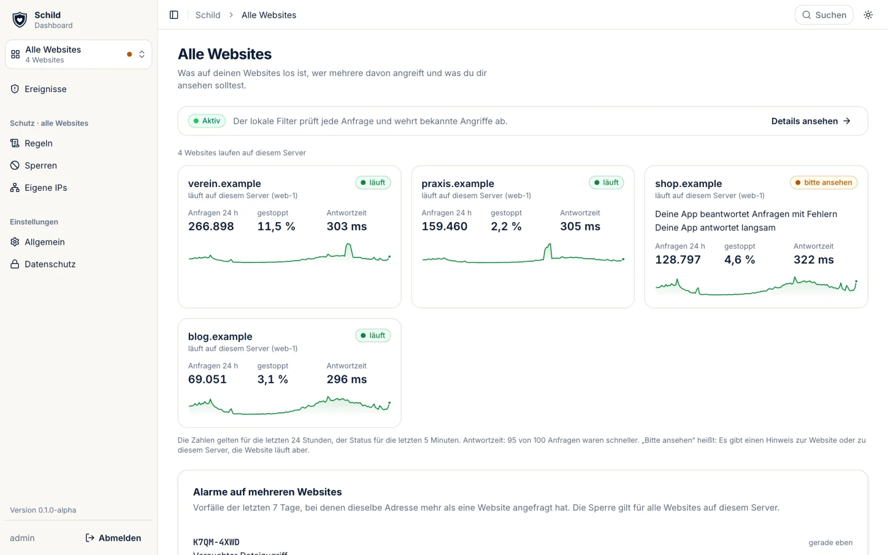

# Deutschland-Schild

[](https://github.com/deutschland-schild/schild/releases)
[](https://github.com/deutschland-schild/schild/actions/workflows/ci.yml)
[](https://scorecard.dev/viewer/?uri=github.com/deutschland-schild/schild)
[](LICENSE)

**Schild Gateway ist eine kostenlose, quelloffene Firewall für deine Website.** Es läuft auf deinem eigenen Server vor deiner Anwendung, prüft jede Anfrage und zeigt dir in einem Dashboard, was los ist. Anders als bei einem vorgeschalteten Cloud-Dienst läuft dein Traffic nicht über fremde Server: Deine Daten bleiben bei dir.

*In English: Schild Gateway is a free, open-source web application firewall with a dashboard. It runs on your own server in front of your application. The documentation is in German.*

[](https://deutschland-schild.de)

Website und Dokumentation: [deutschland-schild.de](https://deutschland-schild.de) · Image: [`ghcr.io/deutschland-schild/schild`](https://github.com/deutschland-schild/schild/pkgs/container/schild) · [Releases](https://github.com/deutschland-schild/schild/releases)

**Stand: Alpha.** Das Gateway mit Dashboard läuft für sich allein und ist im Live-Betrieb. Befehle, Konfiguration und Dashboard können sich noch ändern, Fehler sind möglich. Labs und Relays, aus denen später ein Netz werden soll, sind geplant und laufen bisher nur im Testlabor.

## Was es kann

- **Web Application Firewall:** Das OWASP Core Rule Set erkennt SQL-Injection-Versuche, Cross-Site-Scripting und andere typische Angriffsversuche.
- **Login-Schutz und Limits:** Schild erkennt massenhafte Login-Versuche bei WordPress, TYPO3, Joomla, Drupal, Nextcloud und Laravel und begrenzt Anfragen pro Pfad. Jede Sperre läuft von selbst wieder ab.
- **Dashboard:** Besucher:innen, Angriffsversuche, Vorfälle und Regeln an einem Ort, getrennt nach Mensch, Suchmaschine und KI-Crawler.
- **Monitoring:** Antwortzeit, Fehlerquote und Hinweise, etwa wenn die Festplatte vollzulaufen droht.
- **Zugriffsschutz und Wartungsmodus:** eine Website oder einzelne Pfade nur mit Passwort erreichbar machen.
- **Für KI-Agenten gebaut:** Über die Agent-API passt dein Agent die Firewall an deine Anwendung an. Sie hört nur lokal und antwortet nur mit einem Token, das du auf dem Server anlegst.
- **Deine Daten bleiben bei dir:** Nichts aus deinem Traffic verlässt den Server. Schild holt nur öffentliche Regeln und Listen ab.

Alle Funktionen im Detail: [docs/gateway/01-funktionen.md](docs/gateway/01-funktionen.md).

## Installieren

Der kürzeste Weg auf Debian 12 und 13 oder Ubuntu 22.04 und 24.04: das Paket `schild` aus dem eigenen apt-Repository, hinter deinem Webserver (nginx, Apache oder ein Load Balancer). Statt `3000` schreibst du den Port, auf dem deine Anwendung lauscht.

```bash
curl -fsSL https://pkg.deutschland-schild.de/install.sh | sudo sh -s -- alpha
sudo schild init -upstream http://127.0.0.1:3000
sudo systemctl enable --now schild
sudo schild dashboard setup-code
```

Das Skript richtet das Repository ein und installiert das Paket, sonst nichts. Dieselben Schritte von Hand stehen in der [Installationsanleitung](docs/gateway/00-installieren.md#als-paket-unter-debian-und-ubuntu). Updates kommen über apt, wenn du sie einspielst.

Die letzte Zeile zeigt den Einmal-Code für die erste Anmeldung. Das Dashboard hört nur auf dem Server selbst (`http://127.0.0.1:8788`), von außen kommst du per SSH-Tunnel hinein.

Schild läuft jetzt auf `127.0.0.1:8080`. Traffic fließt erst hindurch, wenn du deinen Webserver dorthin weiterleitest. Deine Zertifikate bleiben beim Webserver. Wieder raus: Den Webserver wieder direkt auf die Anwendung zeigen lassen, dann `sudo systemctl disable --now schild`.

Lieber als Container, oder ein anderes Linux? Dasselbe mit Docker Compose:

```bash
mkdir schild && cd schild
curl -fsSLO https://raw.githubusercontent.com/deutschland-schild/schild/v0.1.0-alpha.4/gateway/deploy/quickstart/compose.yaml
curl -fsSLO https://raw.githubusercontent.com/deutschland-schild/schild/v0.1.0-alpha.4/gateway/deploy/quickstart/schild.yaml
# In schild.yaml unter upstream.url die Adresse deiner Anwendung eintragen, dann:
docker compose up -d
docker compose exec schild schild dashboard setup-code
```

Die `compose.yaml` nennt eine feste Version des Images, nicht `latest`: Du entscheidest, wann du aktualisierst. Wieder raus: `docker compose down`.

Ab dem Start sperrt das Core Rule Set bekannte Angriffe, und die Limits für Login, Passwort vergessen und `xmlrpc.php` begrenzen. Vier der fünf Szenarien sperren nach 14 Tagen Lernzeit. Alles Weitere zählt erst nur mit, bis du es im Dashboard umstellst.

Die anderen Wege stehen in der [Installationsanleitung](docs/gateway/00-installieren.md):

- **Du nutzt Caddy:** Schild ist eine Caddy-Distribution, lädt dein Caddyfile und ersetzt Caddy als Webserver.
- **Andere Linux-Server ohne Docker:** ein statisches Linux-Binary (amd64, arm64) mit systemd-Unit.
- **Den Webserver weiterleiten:** die Zeilen für nginx und Apache.

Updates, Backup, Monitoring und Rückbau: [Betrieb](docs/gateway/02-betrieb.md).

## Entwickeln

Du brauchst Go (Version in `go.work`) und GNU make, für das Image Docker:

```bash
make gateway-test     # go vet und Tests des Gateways
make gateway-run      # lokal mit Testschlüsseln: Proxy 127.0.0.1:8080 vor einer App auf 127.0.0.1:8081
make gateway-image    # Image schild:dev mit Geo-Testdaten, ohne Download
```

Die Website startest du mit `cd site && npm install && npm run dev`. Alle Make-Ziele, das Testlabor und die Regeln für Agenten: [`DEVELOPMENT.md`](DEVELOPMENT.md). Technische Referenz des Gateways: [`gateway/README.md`](gateway/README.md).

## Was in diesem Repository liegt

Code, Dokumentation, Konzept, Marke und Website liegen hier zusammen und werden gemeinsam versioniert.

| Pfad | Inhalt |
| --- | --- |
| [`docs/gateway/`](docs/gateway/README.md) | Doku zum Schild Gateway: alle Funktionen und Betrieb (gerendert unter `/doku/gateway`) |
| [`docs/concept/`](docs/concept/README.md) | Konzept v1 – Grundsätze, Strategie, Spezifikation, Tests, Risiken (gerendert unter `/doku/konzept`) |
| [`docs/brand/`](docs/brand/README.md) | Marke, Sprache und Gestaltung in einem Dokument, Design Tokens (gerendert unter `/doku/marke`) |
| [`docs/stories/`](docs/stories/README.md) | Personas und User Stories (gerendert unter `/doku/personas`) |
| [`docs/AGENTS.md`](docs/AGENTS.md) | Regeln für Menschen und KI-Agenten, die hier arbeiten – inkl. Aufbau von `/doku` |
| [`site/`](site/) | Website (Nuxt, statisch generiert) – Landingpage und die Dokumentation unter `/doku` |
| [`gateway/`](gateway/README.md) | Schild Gateway: das Programm `schild` (Go) |
| [`lab/`](lab/README.md), [`relay/`](relay/README.md) | Schild Lab und Relay, geplant, bisher nur im Testlabor |
| [`dashboard/`](dashboard/README.md) | Dashboards von Gateway und Lab (Vue), werden ins Programm eingebaut |
| [`contracts/`](contracts/README.md), [`contract/`](contract/) | Verträge zwischen den Bausteinen: Schemas, Testvektoren, Entscheidungen; Go-Bibliothek dazu |
| [`tests/`](tests/README.md) | Systemtests: Testlabor, Angriffs-Suite, Specs, Messergebnisse. Unit-Tests liegen beim Code |
| [`DEVELOPMENT.md`](DEVELOPMENT.md) | Bauen und Testen, Aufbau, Regeln für Agenten |

Die Website rendert die Markdown-Dateien aus `docs/` unter `/doku`, ohne Kopien. Diskutiert wird per Issue oder Pull Request auf die jeweilige Datei.

## Lizenz

Code und Dokumentation in diesem Repository stehen unter der [MIT-Lizenz](LICENSE). Fremdbestandteile behalten ihre eigenen Lizenzen, etwa `skills/humanizer`, die Daten unter `contracts/vectors/crowdsec-hub`, die in [`gateway/NOTICE`](gateway/NOTICE) genannten Module und Daten des Gateways und [`CODE_OF_CONDUCT.md`](CODE_OF_CONDUCT.md) (CC BY-SA 4.0). Die Lizenz gibt keine Rechte an Namen und Logos von Deutschland-Schild.

Mitmachen: [`CONTRIBUTING.md`](CONTRIBUTING.md). Sicherheitslücken bitte nur vertraulich melden: [`SECURITY.md`](SECURITY.md).
