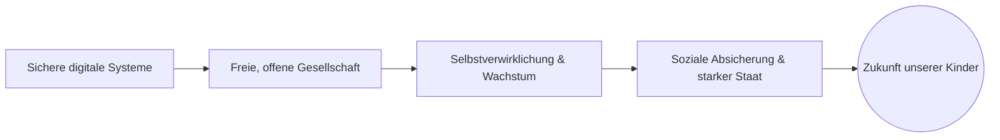

# Mission, Strategie und gesellschaftliche Wirkung

**Status:** Mission FIXIERT · Wirkungshypothesen ENTWURF

**Kurz:**

- Mission fest; Kurzform „Bedingungsloser Grundschutz für alle Websites.“ (Initiator, 25.10.2026).
- Kernthese: Die Lücke liegt zwischen Warnung und Wirkung: Bin ich betroffen, und was hilft bis zum Update?
- Wirkungshypothesen (Wirtschafts-, Demokratieschutz, Kräftegleichgewicht, digitale Souveränität) sind Entwurf; Zahlen brauchen noch Primärquellen mit Prüfdatum.
- Produktlinie 1 (Ziel): lokale WAF mit Lab-Regeln, Server-Check nur lesend, Abgleich von Sicherheitswarnungen; Eingriffe nur auf Wunsch.
- Kennzahlen (Entwurf): Systeme mit Schild, Zeit bis Regel, Fehlalarmrate, Kosten pro System; keine absolute Sicherheitsgarantie.

## Mission

Deutschland-Schild soll Menschen und Organisationen ohne eigene Security-Abteilung **kostenlosen, verständlichen, wirksamen und unabhängigen Cyberschutz** ermöglichen: Probleme erkennen, erklären und sicher beheben helfen. Der Dienst bleibt gemeinnützig und überparteilich.

**Kurzform:** „Bedingungsloser Grundschutz für alle Websites.“ (geändert am 25.10.2026 durch den Initiator)

## Warum jetzt?

- Angreifer können mit Automatisierung und KI Schwachstellen schneller finden und Angriffe skalieren.
- Kleine Betreiber bekommen oft Hinweise auf Risiken, aber ihnen fehlen Know-how, Zeit oder Prozesse für die Umsetzung.
- Scanner, Firewalls und Standards gibt es, für viele aber zu komplex oder zu wenig integriert.
- Die größte Lücke liegt zwischen **Warnung** und **Wirkung**: Viele erfahren von Lücken, wissen aber nicht, ob sie betroffen sind, und haben bis zum Update keinen einfachen Schutz.

Das sind strategische Hypothesen; Reichweiten- und Schadenszahlen für öffentliche Pitches brauchen Belege.

## Gesellschaftliche Wirkung: Wirtschafts- und Demokratieschutz (ENTWURF)

Cybersicherheit betrifft nicht nur einzelne Betreiber. Werden Angriffe durch KI billig und massenhaft, während Verteidigung teuer bleibt und Fachleute braucht, leidet die Widerstandsfähigkeit der ganzen Gesellschaft. Deshalb ist Grundschutz für uns ein **Gemeingut**, wie andere Infrastruktur, auf die sich alle verlassen.

**Wirkungskette:** Digitale Sicherheit ist Voraussetzung für eine offene, freiheitliche Gesellschaft. Die ermöglicht Wachstum, wirtschaftliche Stärke und soziale Absicherung und hält den demokratischen Staat verteidigungsfähig, damit es die nächste Generation gut hat.

| Ebene | Wirkungshypothese |
| --- | --- |
| **Wirtschaftsschutz** | Kleine Unternehmen, Selbstständige und Zulieferer sind oft das schwächste Glied digitaler Lieferketten. Ihr Schutz stärkt den Mittelstand und senkt Folgeschäden für ihre Partner. |
| **Demokratieschutz** | Vereine, Initiativen, Ehrenamt, lokale Medien und kommunale Akteure tragen die Zivilgesellschaft, haben aber selten Security-Kompetenz. Ihre digitale Widerstandsfähigkeit schützt öffentliche Debatte, Engagement und Vertrauen, unabhängig von politischer Ausrichtung. |
| **Kräftegleichgewicht** | KI senkt die Kosten von Angriffen. Kostenloser, offener Grundschutz verhindert, dass Sicherheit eine Frage des Budgets wird. Deshalb gemeinnützig. |
| **Digitale Souveränität** | Offene Werkzeuge, lokal betriebene Open-Weight-Modelle und föderierte Regelquellen vermeiden neue Abhängigkeiten von einzelnen Anbietern oder Staaten. |

**Überparteilichkeit:** „Demokratieschutz“ meint den Schutz demokratischer Infrastruktur und Teilhabe insgesamt, keine Parteinahme für oder gegen politische Akteure (vgl. [Grundsatz 2](00-grundsaetze.md)).

**ZU PRÜFEN:** Quantitative Aussagen (Schadenssummen, betroffene Organisationen, Angriffszahlen) nur mit aktuellen Primärquellen, z. B. BSI-Lagebericht oder Wirtschaftsschutz-Studien, inklusive Prüfdatum.

## Zielbild

Ein dauerhaft kostenloser Basisdienst, der:

1. autorisierte digitale Systeme auf relevante Risiken prüft,
2. diese priorisiert und verständlich erläutert,
3. sichere Maßnahmen anbietet und, soweit autorisiert, umsetzt,
4. die Wirkung anschließend überprüft,
5. Nutzer befähigt und bewährtes Sicherheitswissen offen teilt.

**Produktlinie 1 (ZIEL, wie auf der Website):** Schild wehrt Angriffe auf Websites lokal ab (WAF auf dem Webserver, Regeln aus einem Netz unabhängiger Labs), prüft den Server nur lesend und gleicht Sicherheitswarnungen ab. Dabei ändert Schild nichts; Eingriffe gibt es nur auf ausdrücklichen Wunsch (z. B. Admin-Zugänge „nur über VPN“). Punkt 3 und 4 gelten hier nur in diesem engen Rahmen, die Behebung bleibt bei den Betreiber:innen.

## Strategische Leitplanken

- Gemeinnützige Projektträgerschaft statt früher Unternehmensgründung.
- Kleines Kernteam (2–3 Personen), großes Netzwerk aus Communities, Hostern, Security-Forschung und Partnern.
- Schneller, **begrenzter** Pilot statt langer Vorlaufphase; Sicherheit und Einwilligung sind Startbedingungen.
- Schwerpunkt auf Integration, UX und geprüften Regeln, nicht auf Eigenentwicklung aller Komponenten.
- Dezentrale Schutzwirkung: Die Plattform hilft und herrscht nicht.

## Wirkung messen

**Kennzahlen (ENTWURF, wie auf der Website):** Systeme mit Schild, Zeit von neuer Lücke bis Regel, Fehlalarmrate, Kosten pro System.

Dazu: sicher abgeschlossene Onboardings, Anteil der Warnungen mit klarer Antwort (betroffen oder nicht), Nutzerverständnis und Zufriedenheit.

## Grenzen

Deutschland-Schild ersetzt keine eigene Verantwortung, Wartung, Backups, fachliche Incident Response oder einen vollständig abgesicherten Betrieb. Es gibt keine absolute Sicherheitsgarantie. Schild behebt nichts selbstständig. Eingriffe auf Wunsch (siehe Stufe 1) laufen mit Vorschau, Protokoll und automatischer Rücknahme.

## Als Nächstes

- [ ] Mission anhand einer einminütigen Live-Demo erklären können.
- [ ] Erste Zielgruppe und ihren messbaren Sicherheitsnutzen bestimmen.
- [ ] Öffentliche Aussagen zu Angriffsvolumen, Schadenshöhe und Zielmarkt mit Quellen belegen.
- [ ] Unterscheiden: sofort lieferbarer Pilot vs. langfristige Vision.
- [x] Kurzform an die Website angeglichen: „Bedingungsloser Grundschutz für alle Websites.“ (Initiator, 25.10.2026)
