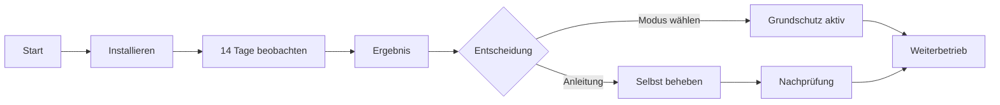

# Produkt, UX und Onboarding

**Status:** Prinzipien FIXIERT · Funktionsumfang ZIEL · konkretes UX-Design OFFEN

**Kurz:**

- Ablauf: abwehren, verstehen, einordnen, selbst entscheiden. WAF auf dem Webserver, Server-Check nur lesend, Behebung bleibt beim Betreiber.
- Entschieden (Oktober 2026): `autoblock` wird Standard erst in der Phase „Externe Labs“ (mit v1); davor `observe`/`review`, immer zuerst 14 Tage beobachten.
- Einführung in drei benannten Phasen: Alpha (eigene Projekte und Partner), Externe Labs (mit v1), Für alle.
- Entwurf: Schutzprofile, Dashboard mit Presets und Probelauf, Warnungsabgleich (betroffen · abgefedert · wahrscheinlich nicht betroffen · unklar), einheitlicher Entsperr-Weg.
- Noch offen: konkretes UX-Design; die Profile sind Produktkonzepte, nicht implementiert. Technik in [Technik kompakt](13-technik-kompakt.md).

## Kernversprechen

**Abwehren → Verstehen → Einordnen → selbst entscheiden.**

Schild ist ein Filter auf deinem Webserver (WAF) mit Regeln aus einem Netz unabhängiger Labs. Es wehrt bekannte Angriffe lokal ab, erklärt in Alltagssprache, was passiert ist, prüft den Server nur lesend und sagt dir bei neuen Sicherheitswarnungen, ob du betroffen bist. Updates und andere Behebungen machst du selbst, mit Anleitung; Eingriffe gibt es nur auf ausdrücklichen Wunsch, z. B. Admin-Zugänge „nur über VPN“.

Das Ziel ist Hilfe, die auch Nichttechniker:innen nutzen können, nach dem Vorbild angenehm nutzbarer Netzwerktools wie NetBird.

## Nutzerreise (ENTWURF)

1. **Start:** „Was möchtest du schützen?“ Installieren ohne Fachkonfiguration.
2. **Erkennen:** Schild erkennt Stack und Umgebung und schlägt Presets vor.
3. **Beobachten:** 14 Tage lang zeigt Schild nur, was es gesperrt hätte.
4. **Ergebnis:** wenige priorisierte Befunde (Ereignisse, Server-Check, Warnungen) statt Alarmflut.
5. **Entscheidung:** Modus wählen (beobachten, freigeben, automatisch sperren); Befunde mit Anleitung selbst beheben.
6. **Nachprüfung:** Der nächste Server-Check zeigt, ob der Befund erledigt ist.
7. **Weiterbetrieb:** lokal funktionsfähiger Schutz, nachvollziehbare Ereignisse, einfache Deaktivierung.

## UX-Prinzipien (FIXIERT)

- **Schnell zum ersten Nutzen:** wenige Schritte, sichere Defaults, minimaler Konfigurationsaufwand.
- **Verständlichkeit:** Alltagssprache; Details für Profis optional einblendbar.
- **Nutzerautonomie:** Empfehlungen statt Zwang; nachvollziehbare Freigaben.
- **Ruhige Oberfläche:** keine Panikkommunikation, keine unnötigen Pushs.
- **Freude an der Nutzung:** moderne, klare, respektvolle und barrierearme Gestaltung.
- **Reversibilität:** Änderungen leicht prüfen und zurücknehmen.
- **Vertrauenssignale:** Quellcode, Regelquellen, Datenverarbeitung und Grenzen erklärbar.
- **Lernen im Kontext:** kurze Erklärungen an der passenden Stelle statt Pflichtschulung.

## Schutzprofile (ENTWURF)

Im Gateway gibt es diese Modi nicht mehr (D89): Jede Regelquelle, jedes Szenario und jedes Limit hat einen eigenen Schalter, die Szenarien starten auf ihrer Empfehlung (D92). Die Modi unten beschreiben, wie Empfehlungen der Labs später ankommen könnten.

**Standardmodus (ENTSCHIEDEN, Oktober 2026):** Automatisch sperren (`autoblock`) wird Standard in der Phase „Externe Labs“, sobald mehrere unabhängige Labs Konsens bilden; bei automatisierten Angriffen ist „erst melden, dann entscheiden“ auf Dauer zu langsam (Time-to-Exploit). Ab Werk beobachtet Schild 14 Tage, in der Alpha gilt beobachten bzw. freigeben (siehe „Einführung“). Labs schicken nur Empfehlungen; was daraus wird, entscheidet der Betreiber über den Modus.

- **Automatisch sperren: Autoverify + Autoblock (Standard ab der Phase „Externe Labs“).** Im Grenzbereich beobachtet Schild nur. Ist die Prüfung im Browser eingeschaltet (ab Werk aus), zeigt es stattdessen eine Zwischenseite mit kleiner Rechenaufgabe (Proof-of-Work, kein Bilderrätsel); sie macht Massenanfragen teurer, beweist aber keinen Menschen ([Datenschutzkonzept](24-datenschutz.md), Abschnitt 10). Gesperrt wird nur bei klarer Lage und gefährlicher Aktion, nie allein wegen der IP oder einer fehlenden Prüfung. Sperren sind kurzlebig und lokal mit einem Klick rücknehmbar ([Technologie, KI und Sicherheitsarchitektur](04-technologie-und-security.md), „Autoverify vor Autoblock“).
- **Freigeben (`review`):** Empfehlungen landen als Vorschlag im Dashboard und werden erst nach Freigabe aktiv, einzeln oder gesammelt.
- **Beobachten (`observe`):** keine Sperren, nur Anzeige. Ab Werk die ersten 14 Tage, außerdem für empfindliche Systeme.
- **Under-Attack-Modus:** ein Schalter für den Ernstfall, ähnlich wie bei großen CDN-Anbietern. Alle Besucher:innen bekommen vorübergehend eine kurze Prüfseite (Rechenaufgabe ohne Gerätemerkmale und Dienste Dritter, mit Ausweg ohne JavaScript), für Login/Admin oder die ganze Seite. Technisch ist das der Modus „immer“ der Prüfung im Browser (`human.challenge.under_attack`), mit Endzeit von höchstens 24 Stunden ([Datenschutzkonzept](24-datenschutz.md), Abschnitt 10.2); optional automatisch bei sprunghafter Last.
- **Erweitert:** Quellen und Gewichte selbst wählen (siehe [Technik kompakt](13-technik-kompakt.md)), mit deutlichem Risikohinweis.

Diese Profile sind Produktkonzepte, keine implementierten Funktionen. Auch bei Automatik gelten Policy-Gates, Scope-Limits und lokale Rücknahme.

## Dashboard: Presets, jede Regel erklärt, Probelauf (ENTWURF)

Betreiber nutzen Schild nur, wenn es durchschaubar und angenehm ist. Das Dashboard (im Programm `schild`, bei dir oder gehostet) folgt diesen Regeln; technische Details stehen in [Technik kompakt](13-technik-kompakt.md).

- **Erkennen statt abfragen.** Schild erkennt den Stack (CMS, Plugins, PHP-Version) und schlägt **Presets** vor: WordPress, WooCommerce, TYPO3, Joomla, Drupal, Shopware, Laravel, Symfony, Nextcloud, Node/Express, Django, statische Seite. Ein Preset ist ein kleines, signiertes Regelpaket mit Standard-Aktionen.
- **Jede Regel in Alltagssprache:** was sie tut und warum, woher sie kommt (OWASP CRS, Preset, Lab), wer sie signiert hat (z. B. „3 von 4 Labs“), Link in die öffentlichen Logs, Treffer der letzten 24 h und betroffene echte Besucher.
- **Eine Aktion pro Regel:** Blocken · Prüfen (Zwischenseite mit Rechenaufgabe; ohne eingeschaltete Prüfung im Browser wie Beobachten) · Beobachten · Aus. Neue Regeln laufen erst sichtbar im **Probelauf**, der nur mitzählt.
- **Probelauf vor jeder Änderung** gegen den Traffic der letzten 24 Stunden: „Hätte 1.225 Angriffe gestoppt, 3 echte Besucher geprüft.“
- **Alles rücknehmbar,** mit lokalem Änderungsprotokoll und Ein-Klick-Rückgängig.
- **Oberfläche und Datei sind dasselbe:** Jede Einstellung steht auch in `schild.yaml` (`presets`, `overrides`), versionierbar und für Hoster ausrollbar; die Oberfläche zeigt das YAML live.
- **Weitere Bausteine:** täglicher Server-Check, nur lesend (zunächst Linux), jeder Befund mit Erklärung und Befehl; Formularschutz ohne Drittanbieter (das Skript-Tag bindet der Betreiber selbst ein) und Passwortschutz für Bereiche; Kompromittierungs-Index gegen den eigenen Normalzustand; lokale Logs und Fehler (ab Werk 100 MB oder 14 Tage); Admin-Zugang nie öffentlich, mit Passwort und Schalter „nur über VPN“; eigene IPs mit einem Klick freischalten (`schild allow --mine`); Länder- und Bot-Regeln per Klick (ab Werk: Länderregeln aus, unbestätigte Bots prüfen bzw. bei ausgeschalteter Prüfung im Browser beobachten).
- **Aus dem Quellcode:** Ein offener Agent-Skill (`skills/schild-rules/SKILL.md`) lässt den Coding-Agent der Entwickler:innen Presets, enge Ausnahmen und virtuelle Patches als Pull Request für `schild.yaml` vorschlagen. `schild validate` und Probelauf prüfen, ein Mensch merged.
- **Eigene Regeln** nur in einem geschützten Bereich, mit Validator (gleiche SecLang-Teilmenge wie Fernregeln) und Pflicht-Probelauf.

Ein klickbarer Entwurf dieses Dashboards mit Beispieldaten stand bis 05.11.2026 auf der Website; er ist entfernt, weil er Funktionen der Labs zeigte, die das Gateway noch nicht hat.

## Sicherheitswarnungen: betrifft es mich? (ENTWURF)

BSI, EU und Hersteller warnen fast täglich vor neuen Lücken. Ob eine davon die eigene Website trifft, müssen Betreiber:innen heute selbst herausfinden. Schild sagt es ihnen.

- **Abgleich lokal** mit der Umgebung: System, Webserver, Laufzeit (z. B. PHP als Modul oder FPM), Anwendungen, Plugins, Versionen, wichtige Einstellungen. Die Umgebung verlässt den Server nie (Ereignis `schild.advisory.assessed.v1`, [Architektur V1](21-architektur-v1.md) Abschnitt 2.1).
- **Ein Satz als Ergebnis:** **betroffen · abgefedert · wahrscheinlich nicht betroffen · unklar**, dazu, was zu tun ist (z. B. „Bitte auf 4.2 updaten“) oder wie man es prüft (z. B. `openssl version`). Nie „alles sicher“. **Abgefedert** heißt: Bis zum Update fängt eine Regel aus dem Netz die bekannten Angriffe ab; das Update spielt Schild nicht selbst ein.
- **Nicht der IT-Grundschutz des BSI:** Schild gleicht Warnungen des BSI und anderer Stellen nur ab. Kein Standard, keine Zertifizierung, keine Partnerschaft.

Quelle und Format der Warnungen im Netz (`schild.advisory.published.v1`, welche Feeds die Labs einlesen, siehe [Quellen](22-quellen-cve-ip-crowdsec.md)): ZU PRÜFEN.

## Entsperren beantragen: ein Weg für alle Schild-Websites (ENTWURF)

1. **Einheitliche Sperrseite:** „Dein Zugriff wurde zum Schutz dieser Website vorübergehend gesperrt.“ Mit Vorfall-Nummer, voraussichtlichem Ablauf der Sperre und dem Button **„Freigabe beantragen“**.
2. **Antrag stellen:** kurze Prüfung, dass ein Mensch fragt (Proof-of-Work), dann optional eine Nachricht und eine Kontaktadresse. Der Antrag geht direkt an den Betreiber dieser Domain, nicht an die Labs.
3. **Betreiber entscheidet:** Im Dashboard (und per Mail) erscheint der Antrag mit Vorfall, Grund und Regel. Ein Klick genügt: **freigeben** (befristete Ausnahme für diese Aktion bzw. diesen Absender) oder **ablehnen**.
4. **Rückmeldung:** Den Status sieht man über die Vorfall-Nummer. Jede Freigabe geht als pseudonymes Fehlalarm-Signal an die Labs; im Netz kann sie eine Regel nur enger machen, nie entfernen. Nachgewiesene Schutzregeln gegen echte Lücken lassen sich so gar nicht abwerten ([Technologie, KI und Sicherheitsarchitektur](04-technologie-und-security.md), „Autoverify vor Autoblock“).

Regeln:

- **Freigeben kann nur die Domain selbst.** Labs können keine Ausnahme erzwingen und keine Sperre verlängern. Eine Freigabe bei Website A gilt nicht automatisch bei B.
- **Datensparsam und begrenzt.** Die Vorfall-Nummer verweist nur auf das lokale Protokoll; Name oder Mail sind freiwillig und bleiben beim Betreiber. Anträge sind pro Absender und Zeit begrenzt.
- **Niemand bleibt hängen.** Sperren laufen ohnehin ab. Betreiber können bestandene Prüfung plus Antrag automatisch freigeben lassen oder die Bearbeitung an ihren Hoster delegieren.
- **Auch maschinenlesbar.** Für Programme und APIs liefert die Sperre HTTP 403 mit einer standardisierten Fehlerbeschreibung ([RFC 9457](https://www.rfc-editor.org/rfc/rfc9457)) inklusive Vorfall-Nummer und Antrags-Adresse, z. B. unter `/.well-known/schild/unblock`.

Kennzahl: Anteil der Freigaben an allen Sperren. Steigt er, sind Regeln zu scharf.

## Produktlinien (ENTWURF)

Produktlinien sind keine Phasen: Linie 1 trägt die Phasen Alpha und Externe Labs (nächster Abschnitt); Linien 2 und 3 gehören zum Ziel „Für alle“ („selbst installiert, beim Hoster eingeschaltet oder als gemeinnütziger Reverse-Proxy“). Jede Linie durchläuft **Discovery → Feedback → Partner & Finanzen → Prototyp → Going Live**; die nächste beginnt erst, wenn die vorige trägt.

| Linie | Für wen | Was | Stand |
| --- | --- | --- | --- |
| **1 – Prototyp** | Webserver-Betreiber, Admins, Agenturen | Schild am Webserver: Schild Gateway und Dashboard in einem Programm `schild` (Dashboard bei dir oder gehostet); eingehender Traffic wird gefiltert. Ausgehenden Traffic beobachten (Zustandsindex) gibt es ab v1, ausgehenden Traffic filtern später (ZU PRÜFEN). Architektur in [Technik kompakt](13-technik-kompakt.md) | Prototyp gebaut, Stufe 2 bestanden ([Prototyp-Verifikation](23-verifikation.md)) |
| **2 – Managed Reverse-Proxy** | Vereine und alle ohne eigenen Admin | Reverse-Proxy inkl. WAF, ähnlich großen CDN-Anbietern, aber gemeinnützig und offen. Referenz-Implementierung: Andere (z. B. große Hoster) können sie selbst betreiben | offen |
| **3 – Für alle** | Jede Website in Deutschland | Grundschutz einfach einschalten, unabhängig vom Hoster | offen |

## Einführung: klein anfangen (ENTSCHIEDEN, Oktober 2026)

Unabhängig von den Produktlinien kommt Schild schrittweise. Die Phasen haben Namen, keine Nummern; die nächste beginnt erst, wenn die vorige trägt. „Stufe 1–4“ meint dagegen nur die Stufen der [Prototyp-Verifikation](23-verifikation.md).

| Phase | Wer | Labs | Standardmodus |
| --- | --- | --- | --- |
| **Alpha** | Zuerst unsere eigenen Websites und Server, dann Alpha-Partner, die wir noch suchen: Hoster, Agenturen, Open-Source-Projekte; echte Produktionssysteme (Stufe 3 der Prototyp-Verifikation) | Nur unsere eigenen Labs | `observe` / `review` |
| **Externe Labs** | Erste externe Betreiber, mit v1 | Hoster, Hochschulen, Sicherheitsteams betreiben eigene Labs | `autoblock` (erst jetzt echter Konsens) |
| **Für alle** | Jede Website | Verbund | `autoblock` |

Solange nur unsere Labs laufen, gibt es keinen Konsens unabhängiger Betreiber; deshalb ist automatisch sperren erst ab der Phase „Externe Labs“ Standard. Die Landingpage zeigt die Phasen im Kapitel „Stand und Fahrplan“ (`index.vue`, `rollout`); den Fortschritt dort und hier gemeinsam pflegen.

## Prototyp-/Pilotumfang

Was gebaut und gemessen ist, führt allein die [Prototyp-Verifikation](23-verifikation.md). Nur versprechen, was der Prototyp nachweislich kann. Im Pilot zuerst den einen vollständigen Ablauf testen: Installation → 14 Tage beobachten → verständliche Einordnung (Ereignisse, Server-Check, Warnungen) → Modus wählen → Nachprüfung.

## Qualitäts- und Akzeptanzkriterien (erste Vorschläge)

- Testperson ohne Security-Vorkenntnisse kann erklären, welches System geprüft wird und warum.
- Die Anwendung zeigt vor Eingriffen Ziel, Folgen, Berechtigungen und Rücknahmeweg.
- Jede wichtige Meldung nennt mindestens Risiko, Relevanz und nächste sichere Handlung.
- Fehler- oder Offline-Situationen unterbrechen keine bestehenden Nutzerdienste.
- Notwendige Zustimmungen sind ausdrücklich und widerrufbar.

## Kennzahlen

Onboarding-Abschluss, Zeit zum ersten Schutz, Anteil erledigter Befunde aus dem Server-Check, Fehlklicks, Supportbedarf, langfristige Aktivierung, subjektives Vertrauen, Verständnisquote und dokumentierte negative Nebenwirkungen.

## Als Nächstes

- [ ] Eine primäre Nutzerreise skizzieren.
- [ ] Fünf moderierte Tests mit Nichttechnikern.
- [ ] „Schaden vermeiden“-UX für riskante Änderungen definieren.
- [ ] Website-Versprechen mit dem Prototyp abgleichen.
