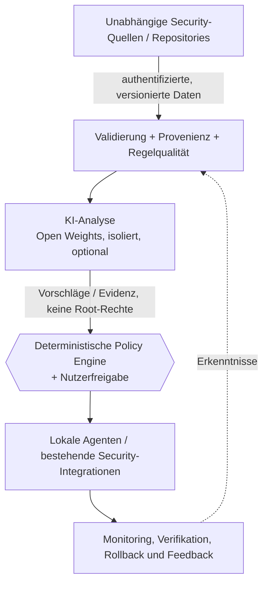
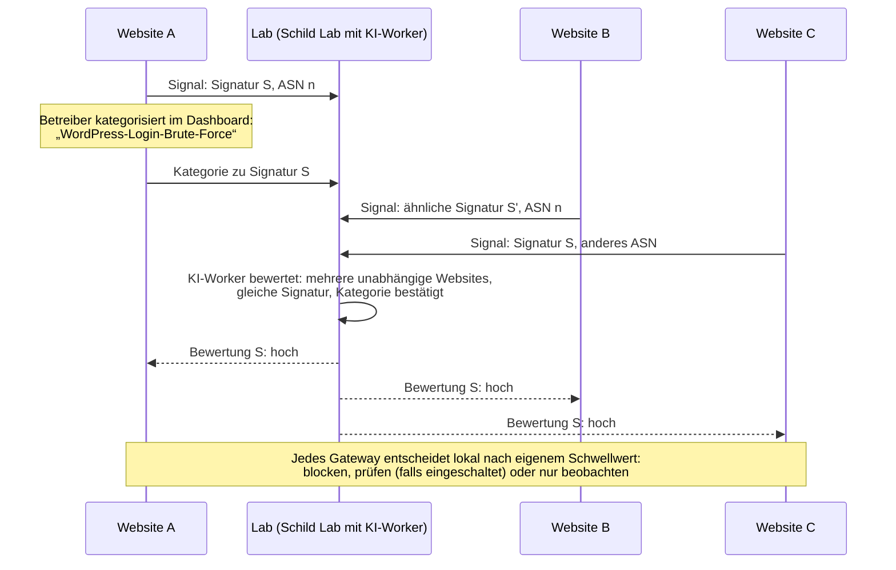

# Technologie, KI und Sicherheitsarchitektur

**Status:** Architekturgrundsätze FIXIERT · konkrete Komponenten ENTWURF

> **Labs, Relays und Verbund sind geplant.** Es gibt sie bisher nur im Testlabor, nicht im Betrieb. Benutzbar ist heute das Gateway, und es braucht keine Labs: [Funktionen des Gateways](../gateway/01-funktionen.md).

**Kurz:**

- Begründungen hinter [Technik kompakt](13-technik-kompakt.md): Härtung nach dem Red-Team-Review, Konsens der Labs (k von n), Signalbewertung, Reaktionsstufen, Neutralität.
- Fest: Local First, kein Single Point of Failure, keine globale Sperrliste, KI ohne Admin-Rechte hinter Policy-Gates (neun Nonnegotiables).
- Entschieden (E4, 26.10.2026): keine Besucher-IPs im Netz, weder gehasht noch als Pseudonym; bewertet werden Aktionen, nicht Absender.
- Reaktion gestuft: unter 40 durchlassen, 40–70 beobachten oder Prüfseite (falls eingeschaltet), ab 70 nur bei Konsens und gefährlicher Aktion kurz blocken.
- Noch offen: Aufnahmekriterien für Labs, Schlüsselverwaltung, Default-Schwellwerte, Rechtsgrundlagen vor dem Pilot.

## Architekturziel

Deutschland-Schild darf **nicht selbst zum Single Point of Failure** oder zu einer zentralen Sperrautorität werden. Lokale Schutzmechanismen funktionieren unabhängig von unserer Infrastruktur und den Labs.

## Bausteine und Schild Gateway

Die Bausteine sind Schild Gateway, Schild Dashboard, Schild Agent, Schild Lab und Relay ([Technik kompakt](13-technik-kompakt.md), „Bausteine“); Gateway und Dashboard sind ein Programm `schild`. Der Träger ist eine Organisationsebene, kein Baustein ([Governance](05-governance-und-traegerschaft.md)). Im Protokoll heißt das Gateway **Client**, in seiner Rolle gegenüber Labs und Relays.

**Schild Gateway: Reverse-Proxy mit WAF als Caddy-Distribution (geplant, Oktober 2026)**

- **Eigene WAF**, weil nur wer jeden Request sieht, lokal blocken, prüfen und Signale erzeugen kann; sonst müsste jede Website erst ModSecurity einrichten.
- **Basis:** [Caddy](https://caddyserver.com/) (Go, Apache 2.0) mit [Coraza](https://github.com/corazawaf/coraza) (OWASP) und OWASP Core Rule Set, dazu ein eigenes Schild-Modul für Presets, Signale, Quellen und die Prüfung im Browser (Zwischenseite mit Proof-of-Work, ab Werk aus).
- **Einbau:** Standard ist der **innere Modus** hinter dem vorhandenen Webserver (`127.0.0.1:8787`). Mit `error_page 502 503 = @schild_bypass` läuft die Website bei echtem Ausfall weiter (fail-open), nicht bei Timeout (siehe „Härtung“). Wahlweise **davor** (äußerer Modus, mit TLS).
- **Regeln:** SecLang, kompatibel mit ModSecurity.
- **Später:** performance-kritische Teile eventuell in Rust (z. B. Pingora), sobald Produktlinie 2 (Managed Reverse-Proxy) es verlangt; Protokoll und Formate bleiben sprachneutral.
- **Upstream stärken:** Coraza und CRS tragen wenige Freiwillige; wir steuern Fixes und Presets bei und planen Sponsoring ein.
- Entschieden (28.10.2026): keine Kopplung an CrowdSec und keine CrowdSec-IP-Daten; Labs nutzen Regeln aus dem CrowdSec Hub (MIT) als Kandidaten, das Gateway nutzt die öffentlichen Hub-Regeln mit automatischen Updates (30.10.2026, MVP-26; [Quellen](22-quellen-cve-ip-crowdsec.md), §4). Offen: Abgleich mit BunkerWeb (nginx + ModSecurity, AGPLv3); übernehmen statt doppeln, wo es passt.

**Föderierter Betrieb: wie Paket-Repositories (ENTWURF)**

Jede:r kann die Infrastruktur (Schild Lab, Presets, Signal-Austausch, gehostetes Dashboard) **parallel betreiben**: Hoster, Hochschulen, CERTs, Länder, Verbände. Deutschland-Schild betreibt die Referenz-Instanz, nicht die einzige. Das Gateway hat eine Liste signierter **Quellen** wie `sources.list` bei apt, Signale gehen an mehrere Betreiber, und das Dashboard zeigt die Herkunft jeder Bewertung. Offen: Austausch zwischen Betreibern, ohne zentrale Stelle ([Events und Geschwindigkeit](20-events-und-geschwindigkeit.md), [Architektur V1](21-architektur-v1.md)).

## Härtung nach dem Red-Team-Review (ENTWURF, 24.10.2026)

Laut [Red-Team-Review](15-red-team-review.md) hilft Konsens unter Labs gegen ein gehacktes Lab, aber nicht gegen gefälschte Clients, Grundregeln aus einer Quelle, einen geteilten Schlüssel oder zu mächtige Fernregeln.

| Problem | Festlegung |
| --- | --- |
| **Geteilter HMAC-Schlüssel ist faktisch öffentlich**: Jede Installation hat ihn, 2^32 IPv4-Adressen sind in Minuten durchgerechnet. | **Keine Besucher-IPs im Signal (ENTSCHIEDEN, 26.10.2026)**, weder gehasht noch als Pseudonym; ins Netz gehen nur Land und ASN als Merkmal eines Musters ([Prototyp-Verifikation](23-verifikation.md), E4). Damit gibt es keinen Schlüssel zum Zurückrechnen. Ab v1 Versand über OHTTP ([RFC 9458](https://www.rfc-editor.org/rfc/rfc9458)). **Keine IP-Daten im öffentlichen Log.** Wir sagen „pseudonym“, nie „anonym“. |
| **Fail-open per Request auslösbar**: `error_page … 504` lässt jede Anfrage durch, die die WAF in den Timeout schickt. | Fail-open **nur bei echtem Ausfall** (502/503), **nicht bei Timeout**. Harte Parse-Limits (Body, Header, Tiefe), darüber prüfen statt durchlassen. Ausfälle im Dashboard melden; WAF-Parser fuzzen ([Testkonzept](14-testkonzept.md)). |
| **Grundregeln laufen am Konsens vorbei**: Eine Einzelquelle wirkt direkt. | Grundregeln brauchen **ebenfalls k-von-n-Signaturen** verschiedener Betreiberarten oder laufen nur im Modus `review`. Behörden sind in der **Standardauswahl nicht stimmberechtigt**. Öffentliche Zusage: Bei einer Sperranordnung schalten wir eher ab, als sie umzusetzen; Warrant Canary. |
| **Gefälschte Clients füttern alle Labs gleichzeitig**, der Konsens ist dann korreliert. | Client-Berechtigung als knappe, nicht verkettbare Token (Privacy Pass, [RFC 9576–9578](https://www.rfc-editor.org/rfc/rfc9576)) über **Hoster, die bürgen**. Labs brauchen **eigene Belege** (Honeypots, Nachstellen); Client-Meldungen allein reichen nie. Nur unveränderte, öffentliche Erkennungsszenarien zählen. Mindestvielfalt nach ASN und Betreiberart. |
| **Bots steuern die Rückmeldung**: Ein Botnetz, das die Rechenaufgabe löst, erzeugt „Fehlalarme“. | Rückmeldungen zählen nur, wenn ein **Betreiber im Dashboard** entschieden hat, nie über bestandene Rechenaufgaben. Sie machen eine Regel enger, entfernen sie nie ([Manipulation und Poisoning](18-manipulation-und-poisoning.md), G4). |
| **Fernregeln können zu viel**: SecLang erlaubt `ctl:ruleEngine=Off` oder Cookies in `logdata`. | Fernregeln nur aus einer **festen Teilmenge** (Allowlist mit Validator): erkennen, punkten, prüfen, blocken. Eine Regel, die mehr als einen kleinen Anteil der Requests trifft, geht automatisch in den Probelauf. |
| **Lieferkette**: Jedes Repository dürfte Gateway-Updates veröffentlichen. | **Regeln und Programme strikt getrennt.** Programme nur aus einem Release-Kanal, Signierschlüssel bei verschiedenen Organisationen, reproduzierbare Builds mit unabhängigen Rebuildern, Sigstore, ab Werk kein Auto-Update. |
| **Rückzug aller Netzregeln** ([Offene Fragen](11-offene-fragen-und-risiken.md)) vs. „kein Ausschalter“ | Er nimmt **nur Netzregeln zurück** (der Grundschutz läuft weiter), braucht selbst k-von-n und ist ein gewöhnlicher signierter Regelstand mit null Netzregeln, kein zentraler Ausschalter ([Events und Geschwindigkeit](20-events-und-geschwindigkeit.md), ENTWURF). |
| **Transparenz-Log ohne Zeugen** zeigt, was der Betreiber zeigen will (Split View). | **Jedes Lab führt ein eigenes öffentliches Log, andere Labs zeichnen als Zeugen gegen** (C2SP-Witness-Protokoll). Ein Server übernimmt eine Regel nur, wenn sie in den Logs mehrerer Labs steht. |
| **Lab-Regel verrät selbst gefundene Lücke** vor dem Patch. | **Commit-then-Reveal:** zuerst nur ein Hash der Regel, Klartext nach dem Patch oder spätestens nach 90 Tagen. Disclosure nach ISO/IEC 29147. |
| **Rechenaufgabe stoppt keine Botnetze** und belastet alte Geräte. | Proof-of-Work nur als **Kostenbremse** kommunizieren. Adaptiv und gedeckelt; Ausweichweg ohne JavaScript; WCAG-2.2-Test; später Privacy-Pass-Token. |
| **„Ihr baut CrowdSec nach“** | Abgleich mit CrowdSec entschieden ([Quellen](22-quellen-cve-ip-crowdsec.md), §4): keine Kopplung, Hub-Regeln als Kandidaten, Parallelbetrieb dokumentiert. Wir unterscheiden uns in der Governance (mehrere Betreiber, offener Algorithmus, Log, Neutralität, keine Besucher-IPs im Netz), nicht im Agent. „Dezentral“ sagen wir erst ab drei unabhängigen Labs. |
| **Standard Autoblock** erzeugt Fehlalarme ab Tag 1. | Neue Installationen laufen **14 Tage im Modus „Beobachten“**, CRS-Paranoia-Level 1. Automatisch sperren ist erst ab der Phase „Externe Labs“ Standard ([Produkt, UX und Onboarding](03-produkt-und-ux.md)). Fehlalarmrate pro Regel öffentlich. |

## Labs: Peer-to-Peer-Verbund mit Mehrheitsprinzip (IDEE, Oktober 2026)

Ein **Lab** nimmt Signale an, wertet sie aus und verteilt Bewertungen, Regeln und Presets, z. B. die Referenz-Instanz, Hoster oder CERTs von Hochschulen und Behörden (Namen erst nach Zustimmung). Labs forschen auch selbst mit KI; Ablauf in [Technik kompakt](13-technik-kompakt.md), „Labs forschen mit KI“.

- **Auswahl bei der Installation:** mindestens drei Labs, sinnvoll vorausgewählt, änderbar wie Paketquellen. Es gibt kein Master-Lab; fällt eines aus, arbeiten die anderen weiter.
- **Mehrheit entscheidet:** Eine Bewertung, Regel oder ein Preset wirkt erst, wenn **k von n** der gewählten Labs sie unabhängig signiert haben (z. B. 2 von 3, 3 von 5). Ein kompromittiertes Lab kann so niemanden sperren lassen. Für bekannte Betreiber genügen **Schwellwert-Signaturen** (vgl. TUF); volle Byzantinische Fehlertoleranz bräuchte n ≥ 3f + 1.
- **Gewichteter Konsens, vom Betreiber bestimmt**, mit einer Leitplanke: immer mindestens zwei verschiedene Betreiber, sonst wirkt nichts automatisch.
- **Grundregeln und Bewertungen** sind getrennt wählbar. Labs senden **nur Empfehlungen**, der Modus im Gateway entscheidet.
- **Abgestimmt wird über Wissen, nicht über jeden Request**, das wäre zu langsam, datenschutzrechtlich heikel und gegen Local First. Für später denkbar: eine asynchrone „Zweitmeinung“ für Grenzfälle.
- **Uneinig heißt vorsichtig:** Widersprechen sich die Labs, blockt das Gateway nicht, sondern beobachtet oder zeigt (falls eingeschaltet) die Prüfseite.
- **Nachvollziehbar:** Jede signierte Bewertung steht in den gegengezeichneten öffentlichen Logs der Labs, wie bei Certificate Transparency.
- Offen: Aufnahmekriterien für Labs, Schlüsselverwaltung und Widerruf, Latenz bis zur Mehrheit, Labs außerhalb der EU. Ausbaustufe 1 startet mit einer Instanz und signierten Quellen; der Verbund folgt, sobald es mehrere Betreiber gibt.

## Signalbewertung: nachvollziehbar statt Blackbox (ENTWURF)

Ein Lab bewertet **Signaturen** (Request-, Client-, Aktions-Signatur), nicht Menschen. Algorithmus und Gewichte sind Open Source, jede Bewertung nennt ihre Belege, und andere Labs können sie nachrechnen.

| Faktor | Wirkung (Vorschlag) |
| --- | --- |
| **Unabhängige Quellen** | Erst ab mindestens 3 verschiedenen Clients bei mindestens 2 verschiedenen Betreibern bzw. Netzen; pro Client und Zeitfenster eine Meldung. Client-Meldungen allein reichen nie, das Lab braucht einen eigenen Beleg. |
| **Client-Vertrauen** | Neue Clients zählen wenig (z. B. 0,2), bewährte bis 1,0, je nach Treffern und Fehlalarmen. Gegen Sybil. |
| **Schwere** | Aus WAF-Regel (CRS-Schweregrad) und Aktion: Login-Serie < Upload mit Ausführung. |
| **Bestätigung** | Betreiber ordnen im Dashboard zu oder melden Fehlalarm. |
| **Zerfall** | Signaturen verfallen in Tagen; ohne neue Belege sinkt der Wert. |
| **KI (optional)** | Darf einordnen und Belege vorschlagen, den Wert aber nie allein über einen Schwellwert heben. |

Heraus kommt ein Wert von 0 bis 100 mit Belegen. Das Gateway handelt nach eigenem Profil und nur, wenn k von n seiner Labs übereinstimmen (Stufen unten).

## Autoverify vor Autoblock: Fehlalarme abfangen (ENTWURF)

Autoblocking allein sperrt im Zweifel echte Menschen aus, etwa das Vereinsmitglied hinter einem auffälligen Mobilfunknetz. Im Grenzbereich wird deshalb beobachtet oder geprüft, geblockt nur bei klarer Lage. Die Prüfung im Browser ist eine sichtbare Zwischenseite, je Website **ab Werk aus** (Leitplanken ENTSCHIEDEN 27.10.2026, [Datenschutzkonzept, Abschnitt 10](24-datenschutz.md)).

| Wert der Empfehlung | Reaktion |
| --- | --- |
| unter 40 | durchlassen, protokollieren |
| 40–70 | **Autoverify**, wenn die Prüfung eingeschaltet ist: Zwischenseite mit Rechenaufgabe (etwa eine Sekunde, ohne Bilderrätsel, Gerätemerkmale oder Dienste Dritter, Schaltfläche ohne JavaScript), danach Freigabe-Cookie ohne Kennung. Macht Massenanfragen teurer; Bots mit Rechenleistung kommen durch. Ist die Prüfung aus (ab Werk): nur protokollieren. |
| ab 70 **und** Konsens **und** gefährliche Aktion | **Autoblock:** kurz (Minuten), bei Wiederholung länger, jederzeit lokal rücknehmbar |

- **Nie allein wegen der IP sperren**, und nie allein, weil JavaScript, Freigabe oder Rechenaufgabe fehlen. IP-Bewertungen kommen nur aus lokalem Zustand und lokal abgeglichenen Listen und verstärken nur Aktionen, die schon verdächtig sind ([Manipulation und Poisoning](18-manipulation-und-poisoning.md), G1); sperren braucht eine gefährliche Aktion. Einzige Ausnahme ist Spamhaus DROP, ab Werk auf Netzwerkebene ([Manipulation und Poisoning](18-manipulation-und-poisoning.md), G1).
- **Gute Bots erkennen statt prüfen:** Suchmaschinen per Reverse-DNS bzw. veröffentlichten Bereichen, signierte Bots über [Web Bot Auth](https://datatracker.ietf.org/wg/webbotauth/about/) (IETF, in Arbeit), Zahlungsdienste und Monitoring über Presets. APIs, Webhooks und Feeds bekommen kein Proof-of-Work, sondern eine Begrenzung pro Absender.
- **Prüfergebnis als Rückmeldung (ZU PRÜFEN, nicht entschieden):** Ein „Fehlalarm?“-Signal nach bestandener Prüfung widerspricht der Leitplanke „nichts aus dem Browser an Labs“ und hängt an der anwaltlichen Frage 5 (§ 25 TDDDG). Bis dahin geht **nichts** über Prüfungen an Labs; Fehlalarme meldet der Betreiber im Dashboard. Kommt es doch, darf es eine Regel nur enger machen, nie abschalten.
- **Neue Regeln laufen erst im Probelauf**, dann als Canary, dann für alle. Ob eine steigende Bestehensquote eine Regel automatisch zurücknehmen darf, ist ZU PRÜFEN (Frage 5).
- **Freigabe beantragen:** Wer trotzdem gesperrt wird, beantragt über die einheitliche Sperrseite (HTTP 403 nach RFC 9457 mit Vorfall-Nummer) die Freigabe beim Betreiber der Domain. Jede Freigabe zählt als Fehlalarm-Signal ([Produkt, UX und Onboarding](03-produkt-und-ux.md), „Entsperren beantragen“).

## Neutralität: Schutz vor Überwachung und Missbrauch (ENTWURF)

Ein Netz, das Angriffssignale vieler Websites sieht, ist auch für Kriminelle, Unternehmen und Staaten zur Überwachung interessant. Missbrauch muss **technisch unmöglich oder sofort sichtbar** sein.

| Bedrohung | Gegenmittel |
| --- | --- |
| **Abhören** durch ein Lab oder wer es kontrolliert | Was den Server nicht verlässt, kann niemand abgreifen: keine Inhalte, Formulardaten, Cookies, vollständigen URLs oder IPs. Das Schema ist eine Positivliste, das Gateway verwirft alles andere selbst; jedes gesendete Signal steht im lokalen Protokoll. |
| **Wiedererkennen** über Hashes oder Client-Kennungen | Besucher-IPs verlassen den Server nicht, auch nicht als Pseudonym (E4). Client-Token unverkettbar (Privacy Pass), ohne Bezug zur Domain; ab v1 über [Oblivious HTTP](https://www.rfc-editor.org/rfc/rfc9458), damit das Lab nicht sieht, welche Website meldet. Forschung nur aggregiert ab k Quellen. Pseudonym, nicht anonym. |
| **Gezielte Regeln** gegen einzelne Websites oder Gruppen | Regeln aus Labs gelten **für alle gleich**; Regeln für einzelne Sites oder Clients nimmt das Gateway nur lokal an. Jede Regel steht in den Logs mehrerer Labs mit Zeugen, also kann niemand verschiedenen Servern verschiedene Wahrheiten zeigen. |
| **Hintertür** über Update oder Regel | Regeln können nur erkennen, prüfen, blocken, nichts senden und nichts ausführen. **Kein Fernsteuerungs-Kanal.** Updates Open Source, reproduzierbar gebaut, mehrfach signiert (Sigstore/TUF). |
| **Ein Akteur übernimmt den Verbund** (Druck, Gesetz, Hack) | Mehrheit über Betreiber **verschiedener Art** (Community, Hoster, Forschung, Behörde); die Standardauswahl mischt bewusst. Jedes Lab ist ersetzbar. |
| **Herausgabe-Anordnungen** an ein Lab | Datensparsamkeit: Es gibt kaum etwas herauszugeben. Jährliche **Transparenzberichte**; Standardauswahl nur mit Neutralitäts-Charta ([Governance](05-governance-und-traegerschaft.md)). |
| **Abhängigkeit von Geldgebern** | Förderung bezahlt Arbeit, kauft aber kein Lab, keine Regel, keinen Schlüssel und keinen Platz in der Voreinstellung. Fällt jede Förderung weg, schützt jedes Gateway lokal weiter. |

Offen: externe Prüfung des Threat Models, rechtliche Bewertung der Herausgabe-Szenarien, Neutralitäts-Charta.

## Signale und Signaturen: gemeinsam lernen, lokal entscheiden (ENTWURF)

Ereignisse bleiben auf dem Server; an die Labs gehen nur Signale ([Architektur V1, Abschnitt 2.1](21-architektur-v1.md)). Format: [`contracts/signal.md`](../../contracts/signal.md), Beispiel in [Technik kompakt](13-technik-kompakt.md).

**Aktionen vor Identität.** Jede legitime IP kann gekapert sein: Heimnetz, Firmen-Router, Residential-Proxy. Entscheidend ist, **was ein Request tut**. Geblockt wird zuerst die gefährliche Aktion, der Absender erst danach und nur kurz und lokal.

- **Request-Signatur:** Pfad-Muster, Payload-Hash, ausgelöste WAF-Regel.
- **Client-Signatur:** im Signal nur Browser-Familie, Hauptversion und Bot-Kennzeichen (E4). JA4 bleibt lokal und fließt nur in den human_score (ENTWURF, ZU PRÜFEN); die Header-Reihenfolge ist hinter Go `net/http` nicht verfügbar.
- **Aktions-Signatur:** Abfolgen wie Login-Serie, Admin-Pfade nach Plugin-Scan, Upload gefolgt von Ausführung.
- **Herkunft grob:** Land und ASN, lokal abgeleitet; die IP bleibt im Klartext auf dem Server.
- **Berechtigung:** ab v1 ein unverkettbares Token (Privacy Pass), im Prototyp und in der Alpha ein Schlüssel pro Website.

Labs verteilen Bewertungen, keine Sperrbefehle (Nonnegotiable 2). Eine Bewertung steigt erst bei mehreren unabhängigen Websites und läuft ohne neue Belege ab. Eine IP-Sperre ist nur die zweite, kurze, lokale Stufe. Die KI schätzt, gesperrt wird nach Regel und Schwellwert (Nonnegotiable 5).

**IPs ehrlich einordnen (DSGVO, ENTSCHIEDEN 26.10.2026):** Gehashte IPs sind pseudonym, nicht anonym, denn rund 4,3 Mrd. IPv4-Adressen sind in Minuten durchgerechnet. Verworfen sind IP-Hashes mit netzwerkweitem Schlüssel ([Red-Team-Review](15-red-team-review.md), K1) und jede andere Form von IP-Pseudonym im Netz: wenig Nutzen gegen rotierende Botnetze und Residential-Proxies, viel Aufwand. Auch Land, ASN und Browser-Familie sind zusammen pseudonym; die DSGVO gilt weiter ([Prototyp-Verifikation](23-verifikation.md), Abschnitt 4).

**Ingress filtern, Egress beobachten.** Ausgehenden Traffic beobachtet v1 nur über Metadaten (Kompromittierungs-Index, [Technik kompakt](13-technik-kompakt.md)), etwa eine Webshell, die nach außen telefoniert, Massen-Mails oder einen Kryptominer. Egress filtern kommt später (ZU PRÜFEN); offen ist, wie tief das Gateway dafür ins System muss.

## Presets: Schutz ab Tag 1 (ENTWURF)

Die meisten Angriffe sind Massenware. Presets wirken sofort, ohne KI und bevor das gemeinsame Lernen greift.

| Preset | Regel | Fängt |
| --- | --- | --- |
| **Deutscher Verein** (optional, ab Werk aus) | Login und Admin nur aus DE/EU, sonst prüfen (bei ausgeschalteter Prüfung beobachten); öffentliche Seiten weltweit. Länderregeln senken Lärm, sind aber kein Schutz | Brute-Force-Lärm aus dem Ausland |
| **WordPress-Basis** | `xmlrpc.php` blocken, Login-Versuche begrenzen, keine Nutzer-Liste über `?author=` | die häufigsten WP-Angriffe |
| **Scanner-Falle** | `.env`, `.git/`, `wp-config.php.bak`, `phpmyadmin` → blocken | Bots auf Lückensuche |
| **Falsches CMS** | WordPress-Pfade auf Seiten ohne WordPress → blocken | blindes Massenscannen |
| **PHP 7.4 (veraltet)** | bekannte Muster gegen PHP 7.x härter filtern, Uploads nie ausführen | Lücken ohne Update |
| **Formular-Schutz** | Begrenzung pro Absender; Rechenaufgabe per Skript-Tag des Betreibers ([Technik kompakt](13-technik-kompakt.md), „Formulare schützen“) | Spam, Mail-Missbrauch |

Eine **Geo-Sperre für die ganze Seite** ist bewusst kein Standard: Sie trifft Mitglieder im Ausland, Crawler, Zahlungsdienste und Monitoring, aber keine Angreifer mit deutschen Anschlüssen. Geo gilt für Aktionen (Login, Admin), nicht für Besucher.

**OFFEN – abzugleichen mit den Nonnegotiables:**

- **ENTSCHIEDEN: Automatisch sperren ist das Ziel ab der Phase „Externe Labs“** ([Produkt, UX und Onboarding](03-produkt-und-ux.md)); ab Werk 14 Tage beobachten, in der Alpha beobachten bzw. freigeben. Leitplanken: Sperren mit Ablauf, im Grenzbereich beobachten oder prüfen, Allowlist, Rücknahme mit einem Klick, Sperren nur lokal, Protokoll jeder Sperre. Offen: Default-Schwellwerte und Messung von Fehlsperren.
- Schwellwert und Sperrdauer legt der Betreiber fest, nicht wir und nicht die Labs.
- Die Prüfung im Browser läuft lokal, ohne Gerätemerkmale und Drittanbieter; Bildcaptchas löst KI längst. Schon die Rechenaufgabe ist sehr wahrscheinlich ein Zugriff nach § 25 TDDDG, einwilligungsfrei nur als „unbedingt erforderlich“, ZU PRÜFEN ([Datenschutzkonzept, Abschnitt 10](24-datenschutz.md)).
- Event-Schema: Mindestfelder, Speicherfristen, Versionierung.
- **DSGVO-konform by Design** (als Aussage nach außen erst nach der DSFA): lokal als Standard, datensparsame Events, Dashboard bei dir, gehostetes Dashboard und KI nur in DE/EU. Vor dem Pilot zu klären: Rechtsgrundlage (Art. 6 Abs. 1 lit. f, ErwG 49), AV-Vertrag für das gehostete Dashboard, Löschfristen, DSFA, externe Prüfung.

## Nonnegotiables

Sie setzen die [Grundsätze](00-grundsaetze.md) technisch um; bei Widerspruch gelten die Grundsätze.

1. **Local/Offline First:** Ein zentraler Ausfall darf lokale Schutzfunktion und Nutzerdienste nicht unterbrechen.
2. **Dezentral & föderiert:** Lokale Policies wählen unabhängige Security-Feeds; keine obligatorische globale Sperrliste.
3. **Open Source & Portabilität:** Sicherheitsrelevante Komponenten sind auditierbar, konfigurierbar und ersetzbar.
4. **Autorisierung:** Nur explizit erlaubte Targets prüfen; kein unautorisiertes Internet-Scanning.
5. **Berechtigungsgrenzen:** KI hat keine direkten Admin-Rechte, Tool-Zugriffe laufen durch Policy-Gates.
6. **Supervised & Gated:** Sicherheitskritische Vorschläge brauchen Evidenz, Tests und risikogerechte Freigaben.
7. **Rollback:** Vor Änderungen Nebenwirkungen, Gültigkeit, Wiederherstellung und Schutz vor Aussperrung prüfen.
8. **Ausfalltoleranz:** Modell-, Feed- und Betreiberwechsel möglich; keine zwingende Cloud-KI-Abhängigkeit.
9. **Neutralität:** Keine Inhalte und keine Klar-Identitäten nach außen, keine gezielten Regeln für einzelne Sites oder Nutzer, kein Fernsteuerungs-Kanal; alles signiert und öffentlich protokolliert.

## Open-Weight-KI

- **Reuse First:** keine eigenen Foundation Models; bestehende Open-Weight-Modelle evaluieren.
- **Souveräner Betrieb:** bevorzugt eigene oder kontrollierte GPUs; sensible Daten möglichst lokal.
- **Modellneutral:** austauschbare Endpunkte, dokumentierte Benchmarks.
- **Modelle sind keine Wahrheit:** Ergebnisse gegen Scans, Quellen, Regeln und reproduzierbare Tests prüfen.
- **Prompt-Injection-Schutz:** Eingaben aus Websites, Logs und Feeds sind nicht vertrauenswürdig; Tools strikt begrenzen.
- **GPU-Ausfall:** Bestehende Schutzmaßnahmen laufen ohne neue Inferenz weiter.
- **Lizenzprüfung:** Open Weights ist nicht automatisch Open Source.

## Signierte unabhängige Regelquellen

Quellen sind Open-Source-Projekte, CERTs, Sicherheitsforscher, Hoster und unabhängige Repositories. Metadaten: Urheber/Provenienz, Regeltyp, Zeitstempel, Evidenz, Konfidenz, Gültigkeit, Widerruf, Prüfsumme, Signatur.

- Signaturen belegen Herkunft und Integrität, **nicht Korrektheit**.
- Mehrfachsignatur, Rollback-Schutz und Metadaten-Sicherheit (TUF).
- Nie ungeprüft weitreichende Blocklisten global erzwingen; kurzlebige Sperren, Allowlisting, Fehlalarmbehandlung, lokale Rücknahme.

## Bestehende Werkzeuge evaluieren, nicht vorschnell festlegen

| Thema | Evaluationskandidaten | Anmerkung |
| --- | --- | --- |
| Collaborative Threat Intelligence / Blocking | CrowdSec | ähnliches Prinzip (Signale, Community-Blocklist, Bouncer); Unterschiede: gemeinnützig, keine Besucher-IPs im Netz, lokale Entscheidung; keine Kopplung, Hub-Regeln (MIT) als Kandidaten ([Quellen](22-quellen-cve-ip-crowdsec.md), §4) |
| Web-App-Schutz | Coraza, ModSecurity, CrowdSec AppSec | Integration abhängig vom Stack |
| Infrastruktur-/Vulnerability-Scan | Greenbone, Nmap | Nur autorisiert und begrenzt |
| Web-Security-Tests | OWASP ZAP | Vorsicht bei aktiven Tests |
| Linux-Hardening | Lynis, CIS, BSI IT-Grundschutz | Empfehlungen validieren |
| TLS-Sicherheit | testssl.sh / geeignete Tools | Nicht als Vollschutz verstehen |
| Policy / Paketintegrität | Policy-Engine, TUF-Evaluation | Konkrete Auswahl noch offen |

## Sicherheitsprüfungen vor Pilot

- Threat Model: Angriffe auf unsere Infrastruktur, Labs, Feeds, Agenten, Modell, Updates und Nutzerrechte.
- Minimalprivilegien, Secret-Management, Audit-Logs, Trennung der Vertrauensgrenzen.
- Kontrollierte Scans mit Rate Limits, Domänenverifikation und Abuse-Verfahren.
- CI-Tests: Update-Fälschung, Rollback-Angriff, ablaufende Sperren, Ausfall unserer Infrastruktur, kaputte KI-Ausgabe.
- Sichere Update- und Notfall-Wiederherstellungsprozesse.
- Datenschutzhinweise, Speicherfristen, Lösch- und Exportfunktionen.

## Als Nächstes

- [ ] Ist-Stand erfassen (Konzept v1, lokale Entwürfe): Was existiert wirklich?
- [ ] Kleinste sichere Pilotintegration auswählen.
- [ ] Threat Model, Datenschutzfluss und Policy-Gates dokumentieren.
- [ ] Feed-/Modell-Fallback sowie Rollback mit Tests nachweisen.
