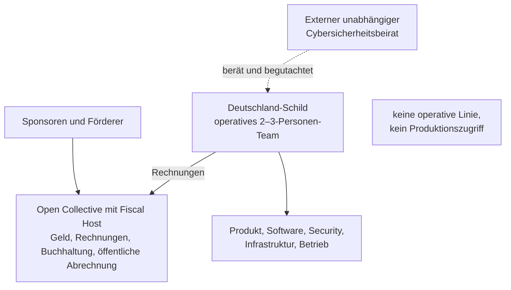

# Governance, Gemeinnützigkeit und Projektträgerschaft

**Status:** Grundsätze FIXIERT · Fiscal Host Open Collective ENTWURF (29.10.2026)

**Kurz:**

- Geplant: Open Collective als Fiscal Host (z. B. Open Collective Europe) statt eigener Gründung. Sponsoren zahlen an das Collective, alle Beteiligten stellen ihre Rechnungen dorthin, jede Einnahme und Ausgabe ist öffentlich. Noch nicht eingerichtet.
- Team aus 2–3 Personen, alle auf Rechnung, keine Anstellungen. Geld kommt als Firmensponsoring per Rechnung, Spendenquittungen gibt es nicht. AVVs schließt das Projekt nicht ab, weil jeder Betreiber Schild selbst betreibt. Labs betreiben Hoster und andere für sich selbst; Verträge und Haftung liegen bei ihnen, Lab-Betreiber vereinbaren untereinander, was sie brauchen.
- Externer Cybersicherheitsbeirat berät und prüft, ohne Weisung und ohne Produktionszugriff; BSI-Mitwirkung nur nach Klärung.
- Projektvereinbarung mit dem Fiscal Host, acht Pflichtpunkte; Lizenz des eigenen Codes: MIT (entschieden 25.10.2026), der Dokumentation im selben Repository ebenfalls (entschieden 01.11.2026).
- Deutschland-Schild ist Referenzbetreiber, andere können parallel betreiben; Neutralitäts-Charta für Labs ist eine Idee.

## Gewünschtes Betriebsmodell

Deutschland-Schild startet **nicht als klassisches Startup** mit Gesellschafterkreis und gründet auch keinen eigenen Verein. Das Geld läuft über Open Collective mit einem gemeinnützigen Fiscal Host (ENTWURF, 29.10.2026). Sponsoren zahlen an das Collective. Alle Beteiligten schreiben Rechnungen an das Collective, der Host prüft und bezahlt sie. Jede Einnahme und Ausgabe steht öffentlich im Collective.

Daneben geht auch Arbeit im Direktauftrag: Ein Hoster beauftragt eine Firma wie die PrioPad GmbH direkt, am Projekt zu arbeiten, ohne Umweg über das Collective. Dafür gelten dieselben Regeln wie fürs Sponsoring: Das Ergebnis kommt unter MIT-Lizenz ins Projekt und läuft durch das normale Review. Der Auftrag gibt keinen Einfluss auf Regeln, Zugang oder Daten. Direktaufträge stehen im Finanzbericht neben den Einnahmen des Collectives.

## Warum gemeinnützig – mit Startup-Tempo (ENTWURF)

Ein kleines Team ohne Vertriebszyklen und Abstimmungsschleifen reagiert schneller als Behörden, Konzerne oder Gremien. Ziel: Auf eine neue Angriffswelle folgt am selben Tag ein Preset oder eine Regel. Der Fiscal Host übernimmt Geld und Buchhaltung, damit das Team dieses Tempo halten kann.

**Warum gemeinnützig?**

- **Vertrauen:** Wer Angriffssignale vieler Websites sieht, darf kein Geschäftsinteresse an diesen Daten, an Lock-in oder Upsell haben.
- **Gemeingut:** Grundschutz soll nicht vom Budget abhängen ([Mission, Strategie und gesellschaftliche Wirkung](01-mission-und-wirkung.md)). Freemium ließe die Schwächsten in der Gratisstufe zurück.
- **Kein Exit:** kein Verkauf an einen Konzern oder ausländischen Investor, der den Dienst einstellt oder umbaut.
- **Förderfähigkeit:** Über einen gemeinnützigen Fiscal Host können Stiftungen später fördern. Für den Prototyp stellen wir keine Förderanträge; er wird über Sponsoren, Rechenleistung von Partnern und Eigenleistung finanziert.

**Kein Single Point of Failure, auch organisatorisch.** Deutschland-Schild ist der **Referenzbetreiber**, nicht der einzige. Wie bei Paket-Repositories (Debian-Mirrors, npm-Registries) kann jede:r die Schild-Infrastruktur parallel betreiben, etwa Hoster, Hochschulen, CERTs, Länder oder Verbände. Nutzer:innen wählen, welchem Dienst sie vertrauen, auch mehrere zugleich (siehe [Technologie, KI und Sicherheitsarchitektur](04-technologie-und-security.md), „Föderierter Betrieb“). Fällt ein Betreiber aus oder verliert Vertrauen, wechselt man, auch weg von uns.

## Aufgaben des Fiscal Hosts

- Das Projekt aufnehmen; der Zweck muss zu seiner Satzung passen.
- Geld von Sponsoren und Förderern annehmen und zweckgebunden halten.
- Rechnungen der Beteiligten prüfen und bezahlen. Niemand wird angestellt.
- Buchhaltung führen; die Abrechnung ist öffentlich.

Nicht nötig: Spendenquittungen (Unterstützung kommt als Firmensponsoring per Rechnung) und Auftragsverarbeitungsverträge (jeder Betreiber betreibt Schild selbst, das Projekt verarbeitet keine Daten im Auftrag). Ebenfalls nicht beim Projekt: Verträge und Haftung im Lab-Betrieb. Wer ein Lab betreibt, tut das für sich selbst und schließt nötige Vereinbarungen, etwa AVVs, direkt mit anderen Lab-Betreibern. Noch zu klären, aber kein Hindernis: die Gebühren des Hosts.

## Operatives Team

2–3 Personen für technische Leitung/Produkt, KI-/Backend-/Infrastrukturentwicklung und Security/Betrieb. Rollen lassen sich kombinieren. Alle arbeiten auf Rechnung an das Collective; Sätze sind offen.

## Unabhängiger externer Cybersicherheitsbeirat

Ein fachlicher Beirat, kein Ethikbeirat. Mitglieder können Security-Forscher, Admins, Fachleute von Hostern, Open-Source-Maintainer und, mit Genehmigung, Fachleute aus Behörden wie dem BSI sein.

- **Berät:** Architektur, Missbrauchsrisiken, robuste Schutzmechanismen, Ausfallresilienz.
- **Prüft kritisch:** Berichte, Audits, Schutzwirkung und signifikante Vorfälle.
- **Ist unabhängig:** dokumentierte Interessenkonflikte; Geldgeber haben keine Rolle im System ([Offene Fragen und Risiken](11-offene-fragen-und-risiken.md)).
- **Betreibt nicht:** keine Produktionsaufgaben, kein Zugriff auf Nutzersysteme, keine Weisungen im Betrieb.

BSI-Mitwirkung nur nach ausdrücklicher Klärung; **keine BSI-Partnerschaft oder Zertifizierung behaupten**.

## Zwingende Projektvereinbarung mit dem Fiscal Host

1. Gemeinnütziger Zweck und überparteiliche Ausrichtung.
2. Zweckbindung, Transparenz und Reporting von Fördermitteln.
3. Operative Entscheidungsbefugnisse, Verantwortlichkeiten und Eskalationen.
4. Haftung, Datenschutzrollen, Security-Vorfälle, Versicherungsschutz.
5. Rechte am bestehenden Code und Markenrechte. Lizenz des eigenen Codes: MIT (ENTSCHIEDEN, 25.10.2026, siehe `LICENSE`); die eigene Dokumentation steht ebenfalls unter MIT und liegt im selben Repository (ENTSCHIEDEN, 01.11.2026). MIT regelt keine Markenrechte.
6. Schutz vor Sponsoreneinfluss und Interessenkonflikte.
7. Exit/Trägerwechsel: Migration von Code, Daten, Domains, Schlüsseln, Nutzerbeziehungen.
8. Beirat: unabhängige fachliche Rolle ohne operative Weisungsbefugnis.

## Neutralitäts-Charta für Labs (IDEE)

Wer in die Standardauswahl des Schild Gateways will, unterschreibt eine Charta: keine Weitergabe von Signalen über gesetzliche Pflichten hinaus, keine gezielten Regeln, jährlicher Transparenzbericht (Anfragen von Behörden, Ausfälle, Fehlsperren), Austritt bei Verstoß. Die Technik erschwert Missbrauch ([Technologie, KI und Sicherheitsarchitektur](04-technologie-und-security.md), „Neutralität“), die Charta regelt die Verantwortung. Sie gilt für alle Betreiber gleich, auch für uns und für Behörden.

## Als Nächstes

- [ ] Open Collective Europe als Fiscal Host prüfen: Satzungszweck, Gebühren.
- [ ] Collective einrichten, sobald der Host zugesagt hat.
- [ ] Projektvereinbarung mit dem Host rechtlich prüfen lassen.
- [ ] Zuständigkeit für Datenschutz, Security-Freigaben und Incident Response festlegen.
