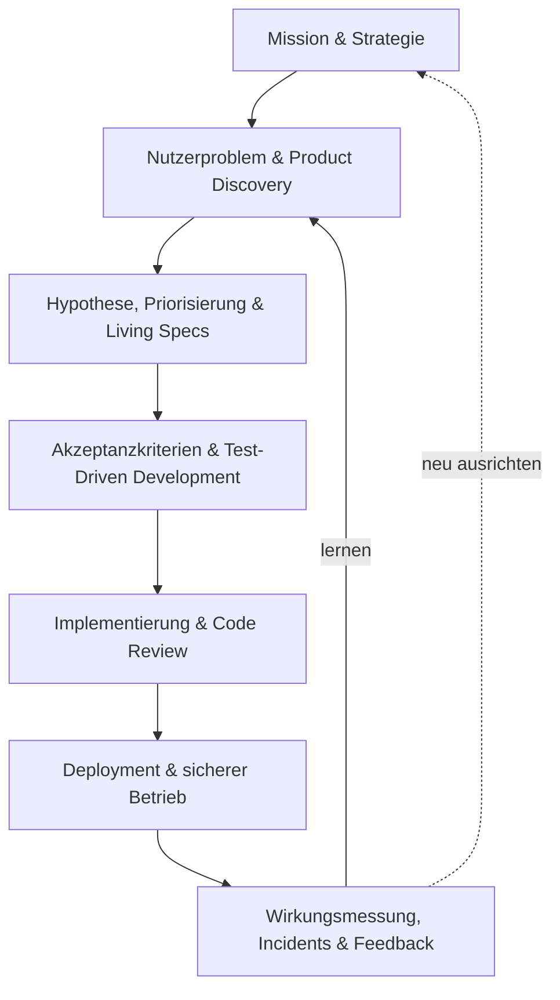

# Company as Code und KI-Agenten

**Status:** Organisationsprinzip FIXIERT · Tooling ENTWURF

**Kurz:**

- Company as Code ist als Organisationsprinzip fest: von Strategie bis Betrieb ein versionierter Kreislauf im Repository.
- Rückverfolgbar über `Ziel → Nutzerproblem → Spec → Test → PR → Metrik`; eine Datei pro Bereich, ADR-Dateien erst bei Bedarf.
- KI-Agenten bereiten vor, entscheiden nicht: keine pauschalen Admin-Rechte, Änderungen über Review, CI und Deploy-Gates.
- Definition of Done in sieben Punkten, inklusive Rollback und menschlicher Freigabe bei kritischen Änderungen.
- Tooling und Betriebsrhythmus sind Entwurf; Agent-Berechtigungen und Freigabegrenzen stehen noch nicht schriftlich fest.

## Leitidee

Deutschland-Schild arbeitet als **Company as Code**: Strategie, Werte, Product Discovery, Anforderungen, Tests, Code, Betrieb und Erkenntnisse sind nachvollziehbar verknüpft. Die Dokumentation wächst mit der Arbeit und wird nicht nachträglich als Handbuch geschrieben. Wie das Prinzip entstanden ist und was dahintersteckt: [Company as Code](https://brgmn.de/blog/2026-02-19-company-as-code/) im Blog von Martin Brüggemann.

Weil die Dokumentation mit der Arbeit wächst, gilt für alles darin: Veröffentlicht ist bisher das Gateway als Alpha. Was hier darüber hinaus steht, beschreibt, wie es werden soll. Befehle, Formate und Zahlen sind Entwürfe, bis ein Test oder eine Entscheidung sie bestätigt.

## End-to-End-Zyklus

Kurz: Werte → Strategie → Personas & Stories → Spezifikation → Tests → Umsetzung → Betrieb → Feedback, und wieder von vorn.

## Single Source of Truth

- Markdown, OpenAPI, Tests, ADRs und Konfigurationen liegen versioniert im Repository.
- Ein Anforderungskatalog, nicht mehrere, die sich widersprechen.
- Referenzen folgen der Kette `Ziel → Nutzerproblem → Spec → Test → PR → Metrik`.
- Personenbezogene Daten, Schlüssel, Sicherheitsvorfälle und vertrauliche Gesprächsnotizen gehören in getrennte, abgesicherte Systeme, **nicht** ins öffentliche Git.
- Die Doku bleibt vorerst klein: **eine Datei pro Bereich**.

## KI-Agenten unter Aufsicht

| Rolle | Typische Aufgaben |
| --- | --- |
| Strategy | Ziele, Wirkungshypothesen, Entscheidungsvorlagen |
| Discovery & Product | Interviews synthetisieren, Nutzerflows und Specs entwickeln |
| Architecture & Security | Optionen vergleichen, Threat Models, Policy-Gates, Tests |
| Engineering & Quality | TDD, Implementierung, CI, Reviews vorbereiten |
| Operations | Logs und Incidents auswerten, Verbesserungen vorschlagen |
| Community & Knowledge | Dokumentation pflegen, Best Practices integrieren |
| Funding & Partnerships | Antragsunterlagen, Due Diligence, Partnerlisten vorbereiten |

Agenten bereiten vor, entscheiden aber nicht. Kein Agent bekommt pauschal produktive Admin-Rechte. Änderungen an Code und Konfiguration laufen durch Review, CI, Freigaben nach Risiko und festgelegte Deploy-Gates.

## Entscheidungslogik

- **FIXIERT:** nur durch ausdrücklichen Beschluss/Initiator ändern.
- **ENTWURF:** ausprobierbar, mit Begründung und Erfolgsmaß.
- **ZU PRÜFEN:** vor Veröffentlichung verifizieren.
- **OFFEN:** Verantwortliche und Entscheidungstermin ergänzen.

Wichtige Architekturentscheidungen stehen zunächst als kurzer Abschnitt in der zuständigen Fachdatei. Eigene ADR-Dateien legen wir erst an, wenn sie wirklich helfen.

## Definition of Done

Eine Funktion ist fertig, wenn:

1. Nutzerproblem und gewünschte Wirkung beschrieben sind.
2. Akzeptanzkriterien vorliegen.
3. Tests bestehen, auch für relevante Fehlerfälle.
4. Sicherheits-, Datenschutz- und Autonomieanforderungen geprüft wurden.
5. Produkt, Doku und Schnittstellen konsistent sind.
6. Rollback, Monitoring und operativer Verantwortlicher geklärt sind.
7. Bei kritischen Änderungen die menschliche Freigabe erfolgt ist.

## Betriebs-/Lernrhythmus (ENTWURF)

- **Täglich:** technische Risiken, Bugs und Pilotfeedback priorisieren.
- **Wöchentlich:** Discovery-Erkenntnisse, Specs und Tests abgleichen.
- **Monatlich:** Wirkung, Kosten, Risiken und Partnerfeedback bewerten.
- **Bei Incidents:** Ursachen, Tests und Leitplanken nachziehen, ohne Schuldzuweisungen.

## Als Nächstes

- [ ] Repository mit minimaler CI/Markdown-Linkprüfung verbinden.
- [ ] Eine Funktion vollständig durch den Zyklus begleiten.
- [ ] Agent-Berechtigungen und Freigabegrenzen schriftlich festlegen.
- [ ] Live-Specs auf Basis des existierenden Prototyps ergänzen.
