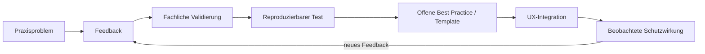

# Community, Bildung und Reuse First

**Status:** Grundsätze FIXIERT · Community-Formate ENTWURF

**Kurz:**

- Reuse First ist fest: vor Neubau gepflegte Lösungen prüfen, Upstream-Beiträge bevorzugen, Forks nur mit dokumentiertem Grund.
- Feedback-Kreislauf: Praxisproblem → fachliche Prüfung → reproduzierbarer Test → offene Best Practice; unbestätigte Community-Regeln übernehmen wir nicht.
- Lernen im Produkt: kurze Erklärungen am Befund in drei Tiefen, nutzbar ohne Kurs.
- Community-Formate sind Entwurf: Issues/Diskussionen mit Moderation, Responsible Disclosure, Quellen- und Lizenzhinweise.
- Community und externer Cybersicherheitsbeirat sind getrennt; keiner von beiden hat Produktionsberechtigungen.

## Leitgedanke

**Wir bündeln vorhandenes Expertenwissen und machen Best Practices so einfach, dass auch Nichttechniker sie nutzen können.**

## Wissensquellen

- Open-Source-Sicherheitsprojekte und ihre Maintainer
- Hoster, Rechenzentren und Infrastrukturbetreiber
- Admins, DevOps-, Platform- und Security-Teams
- CTO-Netzwerke
- Hochschulen, unabhängige Security-Forscher und gegebenenfalls CERTs
- Nutzer, Vereine und kleine Organisationen als Praxisquelle

## Reuse First

Bevor wir etwas neu bauen, prüfen wir: Gibt es eine aktiv gepflegte Lösung mit passender Lizenz, Wartbarkeit, Datenhoheit, APIs und Community? Integrationen und Beiträge upstream haben Vorrang; Forks und Eigenentwicklungen nur mit dokumentiertem Grund.

## Feedback zu nutzbaren Best Practices

Beispiel: Ein Hoster meldet eine wiederkehrende Fehlkonfiguration. Security-Fachleute prüfen den Befund, ein Test beschreibt den Sollzustand, dann veröffentlichen wir eine rücknehmbare Anleitung oder Ein-Klick-Maßnahme. Unbestätigte Community-Regeln übernehmen wir nicht ungeprüft.

## Lernen im Produkt

- Kurze Erklärungen genau dort, wo ein Risiko auftaucht.
- Drei Tiefen: Einsteiger / Fortgeschrittene / Experten.
- Lösungen funktionieren ohne vorherigen Kurs.
- Freiwillige Lernpfade, verlinkte Doku, Beispiele und Praxistipps.
- Ziel: mehrsprachige, barrierearme Inhalte.

## Community-Rahmen

- Öffentliche Issues und Diskussionen mit Moderations- und Verhaltensregeln.
- Klare Wege für Beiträge, Tests, Übersetzungen und Dokumentation.
- Responsible Disclosure für Schwachstellen.
- Quellen- und Lizenzhinweise bei Wissensübernahme.
- Vertrauliche Schwachstellendetails und Nutzerinformationen bleiben unveröffentlicht.
- Lernmaterialien und exportierbares Wissen sind öffentliches Gut.

## Externer Cybersicherheitsbeirat ≠ Community

Die Community bringt Impulse aus der Praxis. Der **unabhängige externe Cybersicherheitsbeirat** begutachtet kritische Fragen fachlich, getrennt vom operativen Team. Keiner von beiden bekommt dadurch Rechte im Produktionsbetrieb.

## Metriken

Validierte Best Practices, Upstream-Beiträge, Wiederverwendung statt Eigenbau, Time-to-Integration von Feedback, dokumentierte Behebungswirkung, Verständlichkeit der Lernangebote.

## Als Nächstes

- [ ] Erste fünf Experten für regelmäßiges Feedback gewinnen.
- [ ] Ein wiederkehrendes Problem aus Hosting-/Admin-Praxis auswählen.
- [ ] Bestehende Open-Source-Tools und Maintainer dafür identifizieren.
- [ ] Community-Feedbackkanal und Disclosure-Prozess vorbereiten.
