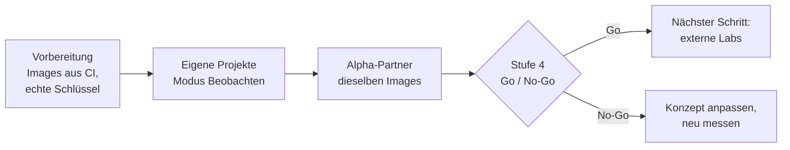

# Pilot, Betrieb und Erfolgskriterien

**Status:** Pilotziel FIXIERT, am 28.10.2026 vom Initiator an den Stand des Prototyps angepasst · Scope der Alpha OFFEN

**Kurz:**

- Der Prototyp hat Stufe 2 im Testlabor bestanden (26.10.2026). Das Gateway ist als Alpha 0.1.0-alpha.1 veröffentlicht und läuft vor eigenen Projekten.
- Der Pilot ist die **Alpha**: Stufe 3 der [Prototyp-Verifikation](23-verifikation.md), zuerst einige Wochen auf eigenen Projekten im Modus Beobachten, dann mit Alpha-Partnern, die wir noch suchen.
- Sieben Startbedingungen (u. a. Betreiber, Datenschutz, begrenzte Zahl von Websites, Threat Model, getesteter Rückzug); fehlt eine, bleibt es bei eigenen Projekten.
- Die Mechanik ist im Testlabor gemessen; ob Schild auf echtem Traffic taugt (Fehlalarme, Netzeffekt, Aufwand), zeigt erst die Alpha.
- Kennzahlen und Runbook-Mindestumfang sind benannt; Schutzwirkung behaupten wir erst mit Messwerten.

## Ausgangslage

Gateway, Labs, Relays und beide Dashboards sind gebaut, die Verträge zwischen ihnen eingefroren. Im Testlabor hat der Prototyp die Mechanik-Hypothesen M1–M7 ohne gerissenes Kill-Kriterium bestanden (Stufe 2, 26.10.2026, [Prototyp-Verifikation](23-verifikation.md)). Seitdem sind der Server-Check, Schutz über mehrere Anfragen, Ratenbegrenzung und die Erkennung verteilter Angriffe dazugekommen; deren Messungen im Testlabor stehen noch aus.

Ziel ist ein **begrenzter Pilot auf echten Systemen**: die Alpha. Sie folgt dem Stufenmodell der Prototyp-Verifikation:

- **Stufe 3:** dieselben Images wie im Testlabor (gleicher Digest), zuerst vor eigenen Websites, nur im Modus Beobachten, Laufzeit 4–6 Wochen (Vorschlag). Danach kommen Alpha-Partner dazu (Hoster, Agenturen, Open-Source-Projekte; bestätigt ist noch niemand), mit denselben Images und denselben Kill-Kriterien.
- **Stufe 4:** Bericht mit Zahlen, Grenzen und Entscheidungen; Go/No-Go für den nächsten Schritt.

## Nicht verhandelbare Startbedingungen

- Eindeutiger Betreiber mit verantwortlicher Kontaktstelle
- Nutzungsbedingungen, Datenschutz und ein Textbaustein für die Datenschutzerklärung der Pilot-Websites geklärt
- Schild läuft nur auf Servern, deren Betreiber es selbst installieren; Schild prüft keine fremden Systeme
- Begrenzte Zahl von Pilot-Websites, jede mit Ansprechperson
- Threat Model, Logging, Incident Response und Meldeprozess
- Getesteter Rückzug aller Netzregeln und sichere Deaktivierung; der Grundschutz läuft dabei weiter
- Transparente Pilotkennzeichnung; keine irreführenden Sicherheitsgarantien

Fehlt eine davon, bleibt es bei eigenen Projekten; kein öffentlicher Betrieb.

## Ablauf der Alpha (ENTWURF)

| Abschnitt | Ziel | Lieferobjekt |
| --- | --- | --- |
| Vorbereitung | amd64-Images aus der CI-Pipeline, Nachtest darauf; Hosts für Lab und Relay mit echtem TLS und Produktionsschlüsseln | Images mit Digest, Nachtest-Bericht, Schlüssel-Runbook |
| Eigene Projekte | Schild vor eigenen Websites, nur Beobachten; Fehlalarme, Netzeffekt und Aufwand messen (D1–D3) | Messreihen, Fehlalarm-Stichprobe, Betriebsprotokoll |
| Alpha-Partner | Partner mit denselben Images und Kill-Kriterien; UX-Feedback | Partner-Feedback, Findings, Fixes |
| Stufe 4 | Auswerten und entscheiden | Bericht, Checkliste, Go/No-Go |

Gespräche zu Träger und Finanzierung laufen parallel. Das rechtlich nötige Betriebsmodell muss stehen, bevor Websites Dritter dazukommen.

## Pilotfähigkeiten

| Fähigkeit | Stand | Nachweis |
| --- | --- | --- |
| WAF auf jeder Anfrage, Entscheidung lokal, kaum Verzögerung | gebaut, im Testlabor gemessen (M1) | Bericht Stufe 2 |
| Nichts Persönliches verlässt den Server | gebaut, gemessen (M2) | Bericht Stufe 2 |
| Regeln nur mit Mitzeichnung mehrerer Labs, Rückzug aller Netzregeln | gebaut, gemessen (M3–M5) | Bericht Stufe 2 |
| Lokaler Schutz bei Ausfall der Labs oder Relays | gebaut, gemessen (M7) | Bericht Stufe 2 |
| Server-Check, nur lesend | gebaut | Tests; Nachmessung im Testlabor |
| Schutz über mehrere Anfragen, Ratenbegrenzung, verteilte Angriffe | gebaut | Unit- und Integrationstests; Messung im Testlabor OFFEN |
| Verständliche Darstellung im Dashboard | gebaut | UX-Test mit Betreiber:innen OFFEN |
| Fehlalarme auf echtem Traffic beherrschbar | OFFEN | Alpha (D1) |
| Netzeffekt: dieselben Muster auf verschiedenen Websites | OFFEN | Alpha (D2) |
| Läuft im Alltag ohne viel Pflege | OFFEN | Alpha (D3) |
| Abgleich von Sicherheitswarnungen | nicht gebaut | – |
| KI in den Labs | nicht gebaut | – |

## Kennzahlen für den Pilot

- Anzahl Pilot-Websites und Zeit von der Installation bis zum ersten Nutzen
- Fehlalarmrate: was im Modus Automatisch gesperrt worden wäre, gegen eine Stichprobe von Hand
- Zeit von neuem Muster bis Regel
- Betriebsaufwand pro Woche und Projekt, Abstürze, Speicher
- Verhalten bei Ausfall unserer Infrastruktur oder der Labs
- Kosten pro System
- Nutzerverständnis, Supportanfragen und freiwillige Weiternutzung

Schutzwirkung oder Skalierung behaupten wir öffentlich erst mit geeigneten Messwerten.

## Runbook-Mindestumfang

- Rollen und Notfallkontakte
- Monitoring, Alerting und Incident-Klassifikation
- Schadensbegrenzung und sichere Deaktivierung
- Widerruf von Regel-, Modell- und Agentenberechtigungen
- Rollback und Wiederherstellung
- Responsible Disclosure, Kommunikation an Betroffene
- Dokumentierte Postmortems und Folge-Tests

## Als Nächstes

- [ ] Images aus der CI-Pipeline und Nachtest darauf (Voraussetzung für Stufe 3).
- [ ] Zahl und Auswahl der Pilot-Websites und Alpha-Partner festlegen.
- [ ] Go/No-Go-Kriterien von einem unabhängigen Security-Fachmann reviewen lassen.
- [ ] Textbaustein für die Datenschutzerklärung der Pilot-Websites fertigstellen.
