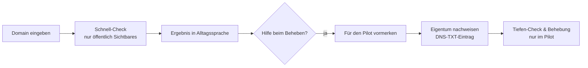

# Schnell-Check: Domain prüfen

**Status:** Konzept ENTWURF · Umsetzung v0 ENTWURF (lokal, nicht veröffentlicht) · Tiefen-Check ZIEL (Pilot)

**Kurz:**

- Domain eingeben, ohne Anmeldung sehen, was öffentlich sichtbar ist: HTTPS, TLS, Header, Mail-Einträge, bekannte offene Ports, Standort.
- Keine eigenen Port-Scans; Ports und Standort kommen aus Shodan InternetDB und RIPEstat. IPs als Eingabe abgelehnt.
- Umsetzung v0 ist Entwurf (Backend in der PrioPad API, kein Frontend auf der Website); nichts wird gespeichert.
- Noch offen: Nutzungsbedingungen von Shodan und RIPEstat; Tiefen-Check mit eigenem Scan erst nach Eigentumsnachweis im Pilot.

## Problem

Wer im Verein die Website betreut, weiß meist nicht, wie gut sie eingestellt ist, und hat keine Zeit für Fachartikel. Der erste Nutzen muss in Sekunden greifbar sein.

## Hypothese

Ein kostenloser Check ohne Anmeldung senkt die Einstiegshürde, zeigt konkret, was Deutschland-Schild tut, und führt Interessierte zum Pilot. Messbar am Anteil der Checks, nach denen sich jemand für den Pilot vormerkt (nur aggregiert, ohne personenbezogenes Tracking).

## Zwei Stufen mit klarer Grenze

| Stufe | Prüft | Voraussetzung | Status |
| --- | --- | --- | --- |
| **1 · Schnell-Check** | Was jeder Browser sieht, plus öffentliche Daten über den Server (Standort, bekannte offene Ports) | keine | ENTWURF |
| **2 · Tiefen-Check** | **Eigener** Port-Scan, Schwachstellen, Konfiguration, Behebung | **Nachweis der Berechtigung** (z. B. DNS-TXT) | ZIEL |

**Grundsatz ([00](00-grundsaetze.md), [04](04-technologie-und-security.md)):** Kein unautorisiertes Scannen. Der Schnell-Check macht eine normale Webseiten-Anfrage wie ein Besuch, je einen TLS-Verbindungsaufbau pro Protokollversion und öffentliche DNS-Abfragen. Offene Ports und Standort kommen aus öffentlichen Daten (Shodan InternetDB, RIPEstat).

Ein frei nutzbarer Scanner wäre ein Aufklärungswerkzeug, mit dem jede:r fremde Server unter unserem Namen und unserer IP abtasten könnte. Hoster werten Scans als Missbrauch, und rechtlich ist ungefragtes Scannen eine Grauzone. Einen eigenen Scan gibt es deshalb nur mit Eigentumsnachweis (Stufe 2). Aus demselben Grund lehnt der Check IP-Adressen als Eingabe ab.

## Prüfungen v0

| Prüfung | Was wir sehen | Warum es zählt |
| --- | --- | --- |
| HTTPS erreichbar | Antwortet die Seite verschlüsselt? | Ohne HTTPS lesen Dritte mit. |
| Zertifikat | Gültig, Aussteller, Ablaufdatum | Abgelaufene Zertifikate schrecken Besucher ab. |
| TLS-Versionen | Akzeptiert der Server noch TLS 1.0/1.1? (je ein Handshake, sonst nichts) | Alte Versionen sind geknackt und abgekündigt ([RFC 8996](https://www.rfc-editor.org/rfc/rfc8996)). |
| Weiterleitung auf HTTPS | Wird `http://` auf `https://` umgeleitet? | Sonst landen Besucher ungeschützt. |
| HSTS | Header `Strict-Transport-Security` | Browser bleiben dauerhaft verschlüsselt. |
| Sicherheits-Header | `Content-Security-Policy`, `X-Content-Type-Options`, Schutz vor Einbettung, `Referrer-Policy` | Erschweren typische Angriffe im Browser. |
| Software-Version sichtbar | `generator`-Angabe, `X-Powered-By`/`Server` mit Version | Angreifer finden passende Lücken schneller. |
| E-Mail-Absender (SPF) | TXT-Eintrag `v=spf1` | Erschwert gefälschte Mails in eurem Namen. |
| E-Mail-Richtlinie (DMARC) | TXT-Eintrag bei `_dmarc` | Sagt Empfängern, wie mit Fälschungen umzugehen ist. |
| CAA | Wer darf Zertifikate ausstellen? | Schutz vor falsch ausgestellten Zertifikaten. |
| Bekannte offene Ports | Öffentliche Daten aus [Shodan InternetDB](https://internetdb.shodan.io/) zur IP: offene Ports, Anzahl gelisteter Lücken | Offene Datenbanken, Fernzugriff (RDP/VNC) oder Docker gehören nicht ins Netz → **Problem**; FTP und Hosting-Admin-Panels → **Hinweis**. Bei Shared Hosting gehören die Ports zum Server, nicht nur zur Seite. |
| Standort & Betreiber | Öffentliche Registerdaten aus [RIPEstat](https://stat.ripe.net/): Netzbetreiber (AS), Land | Neutral (**Info**): DSGVO-relevant, aber kein Fehler. Bei CDNs oft nur der nächste Knoten. |

**OFFEN:**

- Nutzungsbedingungen vor dem Veröffentlichen klären: Shodan InternetDB ist frei für nicht-kommerzielle Nutzung (passt das, wenn PrioPad GmbH betreibt?); RIPEstat verlangt Fair Use (`sourceapp`-Kennung gesetzt).
- Kann OpenSSL auf dem Produktionsserver als Client noch TLS 1.0/1.1 aushandeln? Sonst meldet der Check alte Versionen fälschlich als abgeschaltet (Test gegen `tls-v1-0.badssl.com:1010`).
- Noch nicht geklärt: Blocklisten (Bedingungen der Listen prüfen), DNSSEC (braucht validierenden Resolver), bekannte verwundbare Versionen (Datenquelle und Pflege klären).

## Ergebnis

Jeder Befund hat Status (gut · Hinweis · Problem · nicht geprüft · Info), Titel, Erklärung in Alltagssprache und nächsten Schritt. Keine Gesamtnote und kein „100 % sicher“, denn der Check sieht nur Öffentliches. Am Ende: *„Hilfe beim Beheben? → Für den Pilot vormerken.“*

## Missbrauchsschutz & Sicherheit (Akzeptanzkriterien)

- Nur gültige öffentliche Domainnamen; **keine IPs, kein `localhost`, keine internen Endungen**.
- **SSRF-Schutz:** Der Check prüft alle aufgelösten Adressen, lehnt private, reservierte und Loopback-Netze ab und folgt keinen Weiterleitungen.
- Timeouts ≤ 6 s pro Anfrage, begrenzte Antwortgröße.
- Turnstile + Rate-Limit pro IP (Standard: 6 Checks pro Minute).
- Nur für freigeschaltete Projekte/Domains (CORS wie bei Formularen).

## Datenschutz

Domain und Ergebnis werden nicht gespeichert; verarbeitet werden nur die Domain und die IP für Rate-Limit und Turnstile. An RIPEstat und Shodan geht nur die IP des geprüften Servers, nie die der Nutzer:in. Hinweis in der Datenschutzerklärung.

## Tests (Definition of Done)

- Abgelehnt werden: ungültige Eingaben, IPs, `localhost`, interne Namen (422); Domains, die auf private Adressen auflösen; Anfragen ohne Turnstile-Prüfung.
- Mit gefälschten Netzwerk-/DNS-Antworten entstehen die richtigen Befunde für: kein HTTPS, fehlende Header, sichtbare Version, fehlendes SPF/DMARC, alte TLS-Versionen, riskante offene Ports.
- Öffentliche Datenquellen nicht erreichbar → „nicht geprüft“, kein Fehler. Das Rate-Limit greift.

## Umsetzung v0

- **Backend:** Modul „Checks“ in der PrioPad API (`POST /api/v1/{project}/checks/domain` mit `target` und `turnstile_token`), Hosting in Deutschland. Die API liefert nur Fakten (`id`, `status`, `data`); die Texte in Alltagssprache gehören ins Frontend (der erste Entwurf `site/app/utils/schnellcheck.ts` wurde am 28.10.2026 mit dem ungenutzten Frontend entfernt und liegt in der Git-Historie).
- **Frontend (ZIEL, derzeit nicht auf der Website):** Eingabefeld, z. B. im Hero der Startseite, Ergebnis direkt in der Karte. Der lokale Entwurf `DomainCheck.vue` ist entfernt (28.10.2026) und liegt in der Git-Historie.
- **Selbsttest:** Die eigene Seite muss grün sein; `netlify.toml` setzt dafür Sicherheits-Header (HSTS, CSP, `nosniff`, `Referrer-Policy`). SPF, DMARC und CAA für deutschland-schild.de sind **OFFEN** (DNS beim Domain-Anbieter). Die Seite liegt bei Netlify auf einer Amazon-IP, die als „USA“ geortet wird (CDN); so zeigt es der Check auch an.

## Als Nächstes

- [ ] Texte der Befunde mit Nichttechniker:innen testen (verstehen sie, was zu tun ist?).
- [ ] Blocklisten-/DNSSEC-Prüfung klären.
- [ ] Eigentumsnachweis (DNS-TXT) als Brücke zum Tiefen-Check spezifizieren, inkl. eigenem Scan wichtiger Ports.
- [ ] Hosting der eigenen Seite in Deutschland/EU prüfen (Glaubwürdigkeit).
