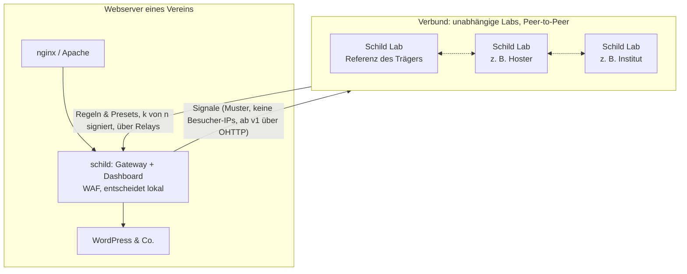

# Technik kompakt: andocken und mitbetreiben

**Status:** ENTWURF · Begründungen und Bedrohungstabellen in [Technologie, KI und Sicherheitsarchitektur](04-technologie-und-security.md) · Stand Oktober 2026

> **Labs, Relays und Verbund sind geplant.** Es gibt sie bisher nur im Testlabor, nicht im Betrieb. Benutzbar ist heute das Gateway, und es braucht keine Labs: [Funktionen des Gateways](../gateway/01-funktionen.md).

**Kurz:**

- Ein Schild Gateway (Caddy, Coraza, OWASP CRS) auf dem Webserver entscheidet jede Anfrage lokal; fällt es aus, läuft die Website über den Webserver oder Proxy davor weiter.
- Unabhängige Labs bündeln Signale (Muster ohne Besucher-IP, `schild.signal/0.3`) und schlagen Regeln vor; eine Regel gilt erst, wenn k von n Labs verschiedener Betreiber mitzeichnen.
- Relays verteilen die signierten Regeln, jedes Lab führt ein öffentliches Log; das Gateway prüft die Signaturen selbst.
- Außerdem hier: Formate und Tokens, Installation, Logs, Server-Check, Admin-Zugang, Länder und Bots, Agent-Skill – Entwurf; der Kernablauf ist im Prototyp gebaut und im Testlabor gemessen.
- Die zwei durchgerechneten Beispiele stehen auf der Seite zum Schild-Netz ([Schild erklärt in 5 Minuten](/netz#so-arbeitet-schild)); hier nur, was technisch dazukommt.

**Für wen:** Sicherheitsbehörden, Forschungsinstitute, Hacker-Community, CERTs und Hoster, z. B. BSI, CISPA oder CCC. Das ist eine **Einladung, keine Partnerschaft**: Niemand der Genannten hat zugesagt.

## Auf einen Blick



## Ablauf an einem Beispiel

Die zwei Beispiele, Schritt für Schritt erzählt, stehen auf der Seite zum Schild-Netz: [ein Zero-Day in einem WordPress-Plugin](/netz#zero-day) und [eine bekannte Lücke in einem Laravel-Package](/netz#plugin-luecke). Beide folgen demselben Ablauf: Gateways melden eine neue Anfrageform, Labs schlagen einen engen virtuellen Patch vor und testen ihn, ein Mensch gibt frei, k von n Labs zeichnen mit, Relays verteilen, jedes Gateway prüft die Signaturen und wendet die Regel an. Technisch kommt dazu:

- **Signal:** Jedes Gateway meldet an mindestens drei Labs: Aktion, `request_sig` (Hash aus Methode, Pfadvorlage, Parameternamen, Content-Type, Regel-IDs), Regel-IDs, Score, Kategorie, Land/ASN/Netzklasse, Browser-Familie. Keine IP und kein Payload, auf keiner Stufe (E4). Format: [`contracts/signal.md`](../../contracts/signal.md).
- **Regeln aus dem CRS:** Im Zero-Day-Beispiel fängt Regel 933170 (PHP Object Injection) nur einen Teil der Varianten ab; im Laravel-Beispiel schlägt Regel 933110 (PHP-Code im Upload) teilweise an.
- **Payload nur im Honeypot:** Den Angriff selbst sehen die Labs nur in eigenen Honeypots mit derselben `request_sig`. Signale sind Hinweise, keine Stimmen ([Manipulation und Poisoning](18-manipulation-und-poisoning.md), G2).
- **Grenze:** Schlägt keine Regel an, entsteht kein Signal (`waf_rules` braucht mindestens einen Eintrag). Einen Angriff, der für alle Gateways harmlos aussieht, sieht auch das Netz nicht.

Gebaut und im Testlabor gemessen sind in beiden Beispielen die Schritte von der Meldung bis zur Prüfung im Gateway, ohne Sandbox, KI und Abgleich mit Advisory-Feeds ([Prototyp-Verifikation](23-verifikation.md)): Bündeln, Regelvorschlag, Probelauf, Freigabe, Mitzeichnung, Verteilung, Prüfung im Gateway.

## Bausteine

| Baustein | Wo | Aufgabe | Geplanter Tech-Stack |
| --- | --- | --- | --- |
| **Schild Gateway** | Auf dem Webserver (Betreiber oder Hoster) | WAF als Reverse-Proxy: prüft jede Anfrage lokal, blockt, beobachtet im Grenzbereich oder zeigt – nur wenn eingeschaltet, ab Werk aus – eine Prüfseite mit Rechenaufgabe. Meldet Signale, holt signierte Regeln. Schützt ohne Netz weiter; fällt es aus, läuft die Website über den Webserver oder Proxy davor weiter (fail-open). | Go, statisch gebaut; Caddy, Coraza, OWASP CRS |
| **Schild Dashboard** | Bei dir oder gehostet | Ereignisse, Server-Check, Sicherheitswarnungen, Presets, Länder und Bots, Probelauf, Entsperr-Anträge. Die Daten bleiben bei dir. | Im selben Programm; Vue per `go:embed` |
| **Schild Agent** (nicht in der ersten Version) | Interne App-VMs hinter einem Gateway | Nur lesender Server-Check, Umgebung, Abgleich von Sicherheitswarnungen; Berichte an das Gateway | Eigenes kleines Programm `schild-agent` |
| **Schild Lab** (Lab-Server) | Hoster, Hochschulen, CERTs, Community – und der Träger als ein Lab unter mehreren | Signale annehmen, Angriffe nachstellen, **selbst forschen** (CVE- und Patch-Analyse, Fuzzing, Honeypots, auch mit KI), Regeln vorschlagen und mitzeichnen; Regel-Repository und öffentliches Log | Go-Kern (Eingang, Signaturen, Feeds, Abstimmung); Analyse- und KI-Worker als Container in beliebiger Sprache; OpenTelemetry, Grafana |
| **Relay** | Beliebig viele, beliebige Betreiber | Verteilt signierte Regeln (SSE, [Events und Geschwindigkeit](20-events-und-geschwindigkeit.md)); ändern kann es nichts | – |

Regel-Repositories gehören zum Lab und enthalten signierte Regeln und Presets, keine Programme; Fernregeln nur aus einer festen SecLang-Teilmenge. **Einbau** als innerer Reverse-Proxy **hinter** dem vorhandenen Webserver (`127.0.0.1:8787`), wahlweise davor; SecLang bleibt ModSecurity-kompatibel. Fail-open und Upstream: [Technologie, KI und Sicherheitsarchitektur](04-technologie-und-security.md).

## Drei Wege anzudocken

| Weg | Was du tust | Aufwand | Beispiel |
| --- | --- | --- | --- |
| **1 · Regeln beisteuern** | Regeln und Presets signiert veröffentlichen – über das Regel-Repository eines Labs oder als eigene Quelle für Grundregeln (ZU PRÜFEN, ob eigenständige Repositories ohne Lab bleiben). | gering: statisches Hosting + Signaturschlüssel | Community-Regeln gegen eine neue WordPress-Lücke |
| **2 · Lab betreiben** | Signale empfangen, bewerten, signieren, mit anderen Labs abgleichen; eigene Exploit-Forschung. | mittel: Server, Betrieb, Datenschutz | Hoster für seine Kund:innen; Landes-CERT für Kommunen |
| **3 · Forschung** | Aggregierte, pseudonyme Signale auswerten – nur nach Vereinbarung und Datenschutzprüfung. | nach Absprache | Angriffswellen früh erkennen, Regelqualität messen |

Für Weg 1 und 2 braucht niemand unsere Erlaubnis. Wir betreiben die Referenz, nicht die einzige Instanz.

## Formate (Vorschlag)

Formate, Feldnamen, Header und Code sind englisch. Deutsch ist nur, was Menschen auf Websites und im Dashboard lesen.

**Konfiguration im Gateway:** Quellen wie `sources.list` bei apt, als **Grundregeln** (stabile Basis, z. B. OWASP CRS) und **Bewertungen** (laufende Empfehlungen der Labs, selbst gewichtet). Die Namen im Beispiel sind keine Zusagen.

```yaml
# /etc/schild/schild.yaml
# no gateway-wide mode since D89: every source has its own switch
human:                    # browser check, details: concept 24 §10, MVP-12
  challenge:
    mode: off             # off (default) | suspicious | always
    under_attack: { scope: off }   # off | admin | all, always with `until` (max 24 h)
baseline_rules:
  - owasp-crs
  - bsi-baseline
ratings:                  # recommendations only, weighted
  - { source: ccc-berlin,     weight: 3 }
  - { source: ccc-hamburg,    weight: 3 }
  - { source: schild-official, weight: 1 }
  - { source: my-hoster,      weight: 1 }
consensus: 0.6            # applies from 60 % of total weight …
min_operators: 2          # … and only if at least 2 different operators agree
```

Labs senden **nur Empfehlungen**. Wie sie wirken, ist offen: Im Gateway hat seit D89 jede Quelle ihren eigenen Schalter und es gibt keinen übergreifenden Modus mehr. Der Under-Attack-Modus funktioniert wie bei CDN-Anbietern, nur auf dem eigenen Server.

**Signal `schild.signal/0.3`** mit Positivliste: `time_bucket`, `action_sig`, `request_sig`, `waf_rules`, `score`, `category`, `origin` (Land, ASN, Netzklasse, Herkunft der Adresse, verifiziert oder freigegeben), `agent` (Browser-Familie, Hauptversion, Bot), optional `ja4` (nur Prototyp und Alpha, ab Werk aus) und Rahmenfelder ohne Daten. Unbekannte Felder und alles Adressartige lehnen die Labs ab. Beispiel, Verbotsliste und Kanonform von `request_sig`: [`contracts/signal.md`](../../contracts/signal.md).

**Keine Besucher-IPs, auf keiner Stufe (ENTSCHIEDEN, 26.10.2026, Initiator, E4)**, auch nicht gekürzt, gehasht oder als Pseudonym. Das Gateway leitet lokal Land, ASN und Browser-Familie ab und rundet die Zeit auf 5–15 min. Lokal bleiben IP und Standort vollständig, wie in jedem Server-Log. Begründung und Felder je Stufe: [Prototyp-Verifikation](23-verifikation.md), Abschnitt 4; unverkettbare Authentifizierung: [Manipulation und Poisoning](18-manipulation-und-poisoning.md), 4.2.

**Regeln** kommen im SecLang-Format, **Presets** als kleines Manifest (Name, Regeln, Version, Ablauf). Verteilt wird nach [TUF](https://theupdateframework.io/) (Rollen, Schwellwert-Signaturen, Schutz vor Rollback). Alle Bewertungen stehen zusätzlich in **öffentlichen Logs**, eins pro Lab, von anderen Labs als Zeugen gegengezeichnet (siehe „Abstimmung zwischen Labs“).

**Signaturen und Tokens: JWT nur dort, wo es passt (ENTWURF)**

JWT ist ein Bearer-Token mit meist verkettbarer Kennung und bekannten Fallstricken (`alg: none`, Algorithmus-Verwechslung, `kid`-Tricks). Was zwischen Labs weitergereicht und geloggt wird, braucht **signierte Datenobjekte**:

| Wofür | Format | Warum |
| --- | --- | --- |
| **Empfehlungen, Lab-Feeds** | [DSSE](https://github.com/secure-systems-lab/dsse) mit Ed25519, Payload JSON (`payloadType: application/vnd.schild.signal+json`) | bleibt beim Weiterreichen gültig, keine Kanonisierung, ein festes Verfahren (wie in-toto/Sigstore) |
| **Regeln, Presets, Programme** | TUF-Metadaten (k-von-n), Programme zusätzlich Sigstore | Schwellwert-Signaturen, Rollback-Schutz |
| **Öffentliche Logs (eins pro Lab)** | später [SCITT](https://datatracker.ietf.org/wg/scitt/about/) (COSE_Sign1) | Standard für Transparenz-Logs |
| **Client → Lab** | ab v1 [Privacy Pass](https://www.rfc-editor.org/rfc/rfc9576) über OHTTP; im Prototyp und in der Alpha (nur eigene Labs) Schlüssel pro Website, austauschbar gebaut | unverkettbar: Das Lab weiß, dass ein berechtigter Client meldet, nicht welcher; ein Schlüssel pro Website wäre eine Kennung |
| **Lab ↔ Lab** | mTLS plus HTTP Message Signatures ([RFC 9421](https://www.rfc-editor.org/rfc/rfc9421)) | bekannte Betreiber, nicht wiederholbar |
| **Egress** (Plugin signiert ausgehenden Request) | RFC 9421, optional DPoP-ähnlich | an genau diesen Request gebunden |
| **Dashboard-Login, Betreiber-API** | OIDC; kurzlebige JWT mit festem Algorithmus sind hier **in Ordnung** | klassischer Login-Fall |
| **Freigabe-Cookie** nach der Prüfseite | kurzes HMAC-Cookie **ohne Kennung** (`__Host-schild_clr`, Art, Ablauf, MAC; gebunden an Host, IP-Präfix und User-Agent), Schlüssel nur lokal ([`tests/specs/MVP-12`](../../tests/specs/MVP-12-human-score.yaml), ENTWURF) | höchstens 60 Minuten, kein Zufallswert, der Besuche verketten könnte |
| **Entsperr-Antrag** | signierte Vorfall-ID in der Sperrseite, Antwort nach RFC 9457 | kein Login, nicht fälschbar, nicht über Domains wiederverwendbar |

## Fremde Quellen und IP-Metadaten (ENTWURF)

Lizenzen, Quellen-Mix je Lab und warum am Server nur die öffentlichen Hub-Regeln von CrowdSec laufen: [Quellen](22-quellen-cve-ip-crowdsec.md).

**Grundsatz:** Nichts wird pro Request bei Dritten nachgeschlagen (langsam, gäbe jede Besucher-IP weiter). Fremde Listen schaltet der Betreiber selbst ein; sie werden **heruntergeladen und lokal abgeglichen**, liefern Punkte für den Score und sperren nie allein ([04](04-technologie-und-security.md)). Einzige Ausnahme ist Spamhaus DROP, ab Werk auf Netzwerkebene ([Manipulation und Poisoning](18-manipulation-und-poisoning.md), G1).

- **[AbuseIPDB](https://www.abuseipdb.com/):** nur die herunterladbare Blacklist (Lizenz ZU PRÜFEN); Melden gibt IPs an Dritte, nur mit Zustimmung des Betreibers.
- **Spamhaus DROP / ASN-DROP:** kleine Liste gekaperter Netze, lokal; Nutzungsbedingungen ZU PRÜFEN.
- **Tor-Exit-Liste:** nur markieren. **MISP-Warninglists** (CC0) und Bereiche von Suchmaschinen und Clouds: gegen Fehlalarme.

Labs verteilen keine dieser Listen, auch keine Erlaubt-Listen (ENTSCHIEDEN 28.10.2026, Initiator; G1, G6, [Quellen](22-quellen-cve-ip-crowdsec.md)): Das Gateway lädt sie selbst beim Herausgeber. Bereiche von Bots, Clouds und Zahlungsdiensten sind nur Etiketten; freigeben kann nur der Betreiber. Das Dashboard nennt bei jedem Punktwert die Quelle.

**IP-Metadaten** kommen aus einer lokalen Datenbank im offenen [MMDB-Format](https://maxmind.github.io/MaxMind-DB/), Abfrage in Mikrosekunden ohne Netzwerk:

| Datenbank | Inhalt | Lizenz |
| --- | --- | --- |
| [DB-IP Lite](https://db-ip.com/db/lite.php) | Land, Stadt, ASN | CC BY 4.0 – Labs dürfen mitverteilen |
| [IPinfo Lite](https://ipinfo.io/lite) | Land, ASN | CC BY-SA 4.0 – ZU PRÜFEN, ob Share-Alike auf abgeleitete Daten durchschlägt |
| MaxMind GeoLite2 | Land, Stadt, ASN | Eigene EULA, nicht mitverteilbar; Betreiber trägt eigenen Schlüssel ein |
| RIPE RIS / RouteViews | IP-Präfix → ASN, tagesaktuell | offen |

Daraus entstehen `country`, `asn` und `net` (`mobile`, `residential`, `datacenter`, `tor`). Updates kommen signiert über den TUF-Kanal der Labs.

**Weitergabe an die Anwendung** wie `CF-Connecting-IP`/`CF-IPCountry` bei Cloudflare, gebündelt in **einem** Header nach Structured Fields ([RFC 9651](https://www.rfc-editor.org/rfc/rfc9651)):

```http
Forwarded: for=203.0.113.41;proto=https
Schild-Info: country=DE, asn=3320, net=residential, score=12, challenge=?1, bot=?0, incident="SD-7F3A"
```

- Absender-IP in `Forwarded` ([RFC 7239](https://www.rfc-editor.org/rfc/rfc7239)) bzw. `X-Forwarded-For`; im inneren Modus übergibt nginx sie als vertrauenswürdiger Proxy (`real_ip`).
- Das Gateway entfernt jeden `Schild-*`-Header von außen; die Anwendung traut ihm nur, wenn nur `127.0.0.1` lauscht oder ein gemeinsames Geheimnis passt.
- `score` ist der Bedrohungswert, **nicht** der human_score, der nie an die Anwendung geht ([Datenschutzkonzept, Abschnitt 10](24-datenschutz.md)). `country` und `bot` erlauben eigene Regeln; **Geo-Regeln nur auf Wunsch**.

## Beispiel: Hosting-Provider machen alles in-house (IDEE)

Auf der Website ohne Firmennamen (entschieden 25.10.2026: keine echten Provider nennen). Ein Provider betreibt Gateways (vorinstalliert; bei Shared Hosting über einen vorgeschalteten Reverse-Proxy, Produktlinie 2), ein eigenes Lab (Security-Team, Honeypots, GPU-Cluster, Sandboxen), eigene Relays, ein eigenes, von anderen Labs bezeugtes Log und das Dashboard im Kundencenter. Außerdem ist er **Bürge**: Er stellt unverkettbare Client-Token (Privacy Pass) für eigene Kunden aus, haftet für Kontingente und kann gekaperte Kundenserver pausieren ([Manipulation und Poisoning](18-manipulation-und-poisoning.md)).

Dominieren kann er nicht: Sein Lab ist **ein** Betreiber (k-von-n, SEC-03), kein Bürge trägt mehr als 1/3 der Belege (G2), andere Labs sehen nur pseudonyme Signale, Kunden wählen ihre Labs selbst. Er gewinnt weniger kompromittierte Kundenseiten, weniger Abuse und einen Nachweis von Sicherheitsmaßnahmen (z. B. NIS2, ZU PRÜFEN).

## Ein Programm: `schild` (ENTSCHIEDEN für v1, Oktober 2026)

Gateway und Dashboard sind **ein Binary**, die Rolle kommt aus dem Unterbefehl:

| Unterbefehl | Rolle |
| --- | --- |
| `schild run` | Reverse-Proxy mit WAF (Caddy + Coraza + OWASP CRS), Signale, Regel-Updates |
| `schild dashboard` | Dashboard (lokal; dieselbe Oberfläche gehostet) |
| `schild check` | Server-Check (nur lesen, eigener Prozess mit minimalen Rechten) |
| `schild facts` · `schild validate` · `schild dry-run` | Werkzeuge für Betreiber, CI und den Agent-Skill `schild-rules` |

v1 enthält genau diese Unterbefehle. Das Schild Lab ist ein eigener Baustein. ZU PRÜFEN: ob sein Go-Kern als `schild lab` aus demselben Release-Kanal kommt oder als eigenes Binary.

Also eine Installation, ein Update-Kanal, eine Signatur, reproduzierbar gebaut. Getrennt bleiben **Regeln und Programm** (Regeln über TUF, Programm nur aus dem Release-Kanal, kein Auto-Update) und **Prozesse mit unterschiedlichen Rechten**. Zunächst nur Linux.

### Ein Programm für Gateway und Dashboard (ENTWURF)

- **Bauweise:** Caddy mit coraza-caddy und eingebettetem CRS, statisch mit `CGO_ENABLED=0`; rund 60 MB für amd64, arm64 und armv7, Dashboard (Vue per `go:embed`) inklusive.
- **Keine TLS-Interception**, keine eigene Root-CA.
- **Egress:** In v1 nur Metadaten über `/proc` und conntrack für den Kompromittierungs-Index; später ein nicht entschlüsselnder Egress-Proxy, eBPF als Opt-in.
- **Bekanntes Risiko:** coraza-caddy Issue #258: Der Speicher wächst beim Neuladen mit mehr als 1.000 Domains. Im Testlab messen ([Testkonzept](14-testkonzept.md)), Abhilfe ZU PRÜFEN.

### Mehrere Server hinter einem Gateway (ENTWURF)

`schild` läuft auf dem Reverse-Proxy und filtert den eingehenden Traffic für alle App-VMs dahinter. Die VMs liegen in einem privaten Netz und gehen über NAT oder einen Egress-Proxy nach außen. Auf ihnen läuft später optional der **Schild Agent** (`schild-agent`, eigenes Programm, ENTWURF, nicht in der ersten Version): nur lesender Server-Check, Umgebung, Warnungsabgleich und signierte Berichte ins Gateway-Dashboard, ohne Proxy und WAF. **Nicht abgedeckt** ist Ost-West-Traffic zwischen den VMs; dafür braucht es Segmentierung und Firewall.

### Mehrere Websites und Alias-Domains (ENTWURF)

Ein Gateway schützt oft mehr als eine Website: die Agentur mit einem Dutzend Kundenseiten auf einem Server, der Verein mit `www`, `.com` und einer alten Domain (Initiator, 28.10.2026). Jede Website hat in der `schild.yaml` eine Hauptdomain, beliebig viele Alias-Domains und ein eigenes Ziel. Modus, Freigaben, Presets, Ausnahmen und Passwortschutz lassen sich pro Website einstellen; Labs, Relays und der Signal-Schlüssel gelten für das ganze Gateway.

```yaml
# schild.yaml – several websites behind one gateway (draft, MVP-16)
unknown_host: reject             # reject (421) | default_site
redirect_aliases: false          # true: aliases answer 308 to the primary domain
sites:
  - id: tischlerei
    label: "Tischlerei Schulz"
    domains:
      primary: tischlerei-schulz.example
      aliases: [www.tischlerei-schulz.example, tischlerei-schulz.test]
    upstream: { url: "http://10.0.0.11:80" }
  - id: verein
    label: "TSV Wiesenbrunn"
    domains:
      primary: tsv-wiesenbrunn.example
      aliases: ["*.tsv-wiesenbrunn.example"]
    upstream: { url: "http://10.0.0.12:80" }
    mode: observe                # overrides the gateway default
```

- **Zuordnung über den Host:** Kleinschreibung, ohne Port und Schlusspunkt, internationale Domains als Punycode. Genaue Namen schlagen Platzhalter, und jeder Name gehört zu genau einer Website. Unbekannte Hosts weist das Gateway ab Werk ab; im Dashboard erscheinen sie als „Neue Domain gesehen – zuordnen?“.
- **Keine Wirkung über Websites hinweg:** Eine Ausnahme oder ein Passwortschutz für die eine Website gilt nie für eine andere.
- **Dashboard:** oben „Alle Websites“ oder eine einzelne, auf der Übersicht eine Karte pro Website mit ihren Alias-Domains; Ereignisse, Vorfälle, Freigaben und Regeln lassen sich nach Website filtern. Wer nur eine Website hat, sieht davon nichts.
- **Datenschutz:** Domain und Website stehen nur im lokalen Protokoll. Signale enthalten weiterhin weder Host noch Domain; Labs sehen nicht, welche Websites auf einem Gateway laufen.
- Mehrere Gateways in einem Dashboard (Agenturen, Hoster) regelt [`MVP-13`](../../tests/specs/MVP-13-schild-dashboard.yaml), dieser Abschnitt [`MVP-16`](../../tests/specs/MVP-16-multi-site.yaml).

## Installation und Pakete (ENTWURF)

Kleine Websites laufen oft auf alten Distributionen; zum Upgrade drängt der Server-Check, nicht die Installation. **Ein statisches Binary:** Go mit `CGO_ENABLED=0`, ohne glibc- oder OpenSSL-Abhängigkeit. Veröffentlicht ist es für Linux auf amd64 und arm64. Welche alten Kernel und Distributionen es trägt, ist nicht gemessen (ZU PRÜFEN); armv7 ist geplant.

**Entschieden (Initiator, 05.11.2026): erst Docker-Image und Pakete aus einer Release-Pipeline, ein eigenes Repository später.** Mit 0.1.0-alpha.1 gibt es das Docker-Image und das Binary; die Pakete sind geplant und noch nicht gebaut.

| Stufe | Weg | Für | Details |
| --- | --- | --- | --- |
| 1, mit dem ersten Release | Docker-Image | Server mit Docker, Kamal, Compose | aus der GitHub-Pipeline, amd64 und arm64, signiert mit cosign, mit SBOM |
| geplant, noch nicht gebaut | Pakete für apt und dnf als Release-Dateien | Debian, Ubuntu, RHEL-Familie | Installation aus der heruntergeladenen Datei, kein eigenes Repository |
| 1, mit dem ersten Release | Binary (`tar.gz`) mit systemd-Unit | Server ohne Docker, Offline-Server | `checksums.txt` (SHA-256), Signatur mit cosign |
| 2, sobald es Nutzer:innen gibt | apt- und dnf-Repository | automatische Updates über die Paketverwaltung | signiert; Hosting und Schlüsselverwaltung offen |

**Stufe 1:** Ein Release-Tag baut alles aus demselben Stand (mit SBOM und Herkunftsnachweis). Die Images für den Betrieb kommen nur aus dieser Pipeline, nicht von einem Entwicklerrechner. Das Archiv mit dem Binary bringt eine systemd-Unit für `schild run` mit; `schild init` schreibt eine Konfiguration im Modus „beobachten“. Die geplanten Pakete sollen dazu einen eigenen Systemnutzer und den Timer für den Server-Check anlegen. Paket-Skripte starten nie im Sperrmodus. Im Container braucht Schild `network_mode: host` oder einen Proxy davor, der die echte Besucheradresse weitergibt; den Server-Check startest du dann auf dem Host.

**Stufe 2:** Das Repository lohnt sich, sobald jemand Updates über `apt` und `dnf` erwartet. Aufwendig ist dabei nicht das Paketieren, sondern der Signaturschlüssel: wer ihn hält, wie er rotiert wird und wie er in die Pipeline kommt. Vorgesehen ist dann:

- apt mit `deb … stable main`, ein Repository für alle Releases; `signed-by`, für alte Systeme `apt-key`, für apt ohne HTTPS auch per HTTP (Echtheit über signierte `InRelease` und Pakete),
- dnf/yum mit `gpgcheck=1` und `repo_gpgcheck=1`,
- **Signaturschlüssel RSA 4096**, weil alte `gpgv`/`apt` Ed25519 nicht prüfen.

Die Adresse des Repositorys (bisher Platzhalter `pkg.deutschland-schild.de`) ist OFFEN. Das Image liegt unter `ghcr.io/deutschland-schild/schild`. Für Binary-Installationen ohne Paket liegt die systemd-Unit im Archiv; `schild service install` ist geplant. **Kein Auto-Update des Programms** (SEC-05), auch nicht über `unattended-upgrades`; Regeln kommen getrennt.

## Logs und Fehler (ENTWURF)

Kleine Websites haben selten Sentry oder Grafana. Weil der Proxy jede Antwort sieht, bringt Schild Logs und Fehlererfassung lokal und gedeckelt mit: segmentierte Append-only-Dateien (oder SQLite, ZU PRÜFEN) unter `/var/lib/schild/logs`, Ringpuffer nach Größe **und** Alter, ab Werk 100 MB oder 14 Tage.

- **Quellen:** 5xx-Antworten der Anwendung mit Kontext (Pfad, Methode, Incident-ID); `error.log` von PHP-FPM, nginx, Apache, Journal; Framework-Logs (`storage/logs/laravel.log`, WordPress `debug.log`, Symfony, Django); Sentry-kompatible SDKs mit DSN auf Schild (`http://key@localhost:8787/1`, Envelopes an `/api/1/envelope/` wie bei GlitchTip oder Bugsink; ZU PRÜFEN, welcher Protokollteil reicht).
- **Gruppiert** nach Fingerprint (Fehlertyp + Datei + Zeile, normalisierte Nachricht), Benachrichtigung bei neuem Typ (E-Mail, Webhook, ntfy).
- **Sicherheitsbezug:** Ein Fehler nach einer verdächtigen Anfrage (z. B. SQL-Syntaxfehler nach `UNION SELECT`) deutet auf eine echte Lücke. Auf Wunsch geht nur das **Muster** an die Labs, nie Stacktrace, Code oder Daten.
- **Datenschutz:** Passwörter, Tokens, Cookies, `Authorization` und E-Mail-Adressen werden vor dem Speichern geschwärzt, Request-Bodys nie gespeichert, IPs nach 14 Tagen gekürzt. Weiterleiten (OTLP oder syslog) nur, wenn du es selbst einrichtest.

```yaml
logs:
  max_size: 100MB
  retention: 14d
  ip_truncate_after: 7d
  scrub_pii: true
  forward: off              # off | otlp | syslog
errors:
  sources: [upstream_5xx, php_fpm, nginx_error, framework_logs, sentry_envelope]
  alert: { on: new_issue, via: [email] }
```

## Zustand und Kompromittierungs-Index (ENTWURF)

Gehackte Server fallen oft an Metriken auf, bevor jemand etwas merkt. Schild misst **lokal** gegen den eigenen Normalzustand (14 Tage Lernphase). Weil der Proxy die an Besucher ausgelieferten Bytes kennt, ist jeder Egress darüber hinaus *ungeklärt*.

| Faktor | Quelle (Linux) | Beispiel |
| --- | --- | --- |
| Ungeklärter Egress | `/proc/net/dev` minus vom Proxy ausgelieferte Bytes | +70 MB/h ohne passende Antworten |
| CPU ohne Last | `/proc/stat` im Verhältnis zur Request-Rate | 93 % CPU bei sinkenden Anfragen |
| Neue Ziele nach außen | Verbindungen je Prozess/Benutzer (`ss`, später eBPF) | `www-data` → Port 3333 (Mining-Pool), 25, Tor |
| Webroot-Integrität | inotify/fanotify | neue `.php` in `uploads/` |
| Zugänge | Auth-Log, `authorized_keys` | neuer SSH-Schlüssel |
| Schild selbst | Prüfsumme des eigenen Binaries | Binary verändert |

- **Index 0–100**: *unauffällig* (< 30), *erhöht* (30–59), *verdächtig* (≥ 60), immer mit Begründung je Faktor. Die Gewichte sind Startwerte (ZU PRÜFEN im Testlab, [Testkonzept](14-testkonzept.md)).
- **Bei *verdächtig*** gibt es eine Benachrichtigung und Handlungsvorschläge, und das Gateway **pausiert seine Signale**.
- **Teilen nur freiwillig und grob** (`share: level_only`). Labs nutzen die Stufe nur **nach unten** (Hinweise *verdächtiger* Clients zählen nicht), weil ein kompromittierter Server den Index fälschen kann ([Manipulation und Poisoning](18-manipulation-und-poisoning.md)). Viele *erhöhte* Server mit derselben Plugin-Version sind ein Frühwarnzeichen.
- Stichprobe alle 10 Sekunden. Egress sperren kommt erst später; v1 beobachtet und warnt.

```yaml
host_health:
  sample: 10s
  baseline: 14d
  share: off            # off | level_only
  on_suspect: [notify, pause_signals]
```

## Server-Check (ENTWURF)

Eine WAF hilft der Anwendung, nicht der offenen Datenbank daneben. Deshalb prüft das Gateway auch den eigenen Server (auf internen App-VMs der Schild Agent). **Nur Linux**; am gründlichsten für Debian/Ubuntu und die RHEL-Familie, sonst nur, was sicher lesbar ist. Windows, BSD und Shared Hosting ohne Root kommen später.

| Bereich | Prüfung | Quelle |
| --- | --- | --- |
| Distribution | Version, EOL, erweiterter Support (z. B. Ubuntu Pro/ESM) | `/etc/os-release` + signierte EOL-Daten (endoflife.date, per TUF) |
| Updates | ausstehende Sicherheitsupdates, Auto-Updates, Neustart nötig | apt/dnf, `/var/run/reboot-required`, `needs-restarting` |
| Offene Ports | Dienste auf öffentlichen Interfaces (MySQL, Redis, Elasticsearch, Memcached, Docker-API …) | `ss -tlnup`, Abgleich mit Firewall |
| Firewall | aktiv? eingehend verweigern? Docker-Regeln, die ufw/firewalld umgehen | nftables/iptables, ufw, firewalld |
| SSH | Passwort-Login, Root-Login, Fehlversuche | `sshd -T`, Journal |
| TLS | Ablauf, automatische Erneuerung | Caddy/ACME-Status |
| Laufzeiten | PHP-, Node-, Python-Versionen mit EOL | Paketliste + EOL-Daten |

- **Nur lesen**, eigener Prozess mit minimalen Capabilities; zu jedem Befund eine Erklärung und ein Befehl zum Kopieren. Täglich und nach Änderungen.
- **Lokal:** kein Signal, an kein Lab.
- **Gegenprüfung von außen (optional, ab Werk aus):** Ein Lab prüft die erreichbaren Top-Ports, nur für die bestätigte eigene Domain (ACME-artige Challenge) und protokolliert.

```yaml
host_check:
  schedule: daily
  report: local                 # results never leave the server
  external_scan: off            # off | verified_domain_only
```

## Formulare und Passwortschutz (ENTWURF)

**Formulare schützen (Turnstile-Ersatz ohne Drittanbieter).** Für ausgewählte `POST`-Routen prüft der Proxy ein Prüf-Token vor der Anwendung. Das Skript-Tag bindet der Betreiber **selbst** ein; Schild fügt nichts in Seiten ein. Das Skript löst bei der ersten Interaktion oder beim Absenden eine gedeckelte Rechenaufgabe (Proof-of-Work) und hängt das Ergebnis als verstecktes Feld an. Fehlt es, protokolliert Schild oder zeigt bei eingeschalteter Prüfung im Browser die Prüfseite (Schaltfläche ohne JavaScript). **Allein deshalb gesperrt wird nie.** Ein zufälliges Pfad-Präfix pro Installation (z. B. `/_s-k3x9q2mf/`) verhindert, dass eine Filterlisten-Zeile alle Schild-Websites trifft ([`tests/specs/MVP-12`](../../tests/specs/MVP-12-human-score.yaml)). Bausteine prüfen: [ALTCHA](https://altcha.org/) (MIT), Anubis. Proof-of-Work ist eine Kostenbremse, keine Bot-Erkennung ([Forschung](17-forschung-waf-und-ki-angriffe.md)). Rechtlich ZU PRÜFEN: Schon die Rechenaufgabe ist sehr wahrscheinlich ein Zugriff auf das Endgerät nach § 25 TDDDG, einwilligungsfrei nur als „unbedingt erforderlich“ ([Datenschutzkonzept, Abschnitt 10](24-datenschutz.md), Fragen 1 und 2).

```yaml
human:
  forms:                  # missing field never blocks by itself
    - { path: /contact, method: POST, on_missing: log }
    - { path: /wp-login.php, method: POST, on_missing: challenge }   # challenge only if the browser check is on, else log
```

```html
<!-- {prefix} is random per instance, shown in the dashboard, e.g. /_s-k3x9q2mf/ -->
<script src="{prefix}form.js" defer></script>
<form method="post" action="/signup" data-schild-check> … </form>
<!-- solved on first interaction or submit; schild checks the hidden field on POST -->
```

**Bereiche mit Passwort (wie Netlify/Vercel):** Pfadmuster plus Passwort, mit eigener Login-Seite statt Basic-Auth-Dialog, etwa für Staging oder vor `/wp-admin`.

```yaml
protect:
  - { path: "/staging/*", auth: password, password_hash: "$argon2id$…", session: 12h, allowlist_bypass: true }
```

- Nur ein **Argon2id-Hash**; Sitzungs-Cookie `HttpOnly`, `Secure`, `SameSite=Lax`, signiert. Rate-Limit pro IP und Pfad, kurze Sperre nach Fehlern; eigene IPs ohne Passwort (`allowlist_bypass`).
- Presets liefern Ausnahmen mit: Vor `/wp-admin/*` bleibt `/wp-admin/admin-ajax.php` frei (`except`).
- Echte Benutzerkonten später über OIDC oder Passkeys (OFFEN, Einzelzugänge: [`tests/specs/MVP-14`](../../tests/specs/MVP-14-access-lock.yaml)).
- Eine Regelliste für URL-Bereiche, die diesen Abschnitt aufnehmen könnte: [Zugriffsregeln](25-zugriffsregeln.md) (ENTWURF).

## Admin-Zugang, Dashboard-Sicherheit und VPN (ENTWURF)

Wer das Dashboard übernimmt, kann den Schutz aushebeln, deshalb ist es **nie öffentlich**: ab Werk nur lokal (`127.0.0.1:8788`, Zugang per `ssh -L 8788:localhost:8788 server`), optional nur auf einem VPN-Interface (z. B. `wt0` bei [NetBird](https://netbird.io/), `tailscale0`, Headscale, WireGuard) oder gehostet mit nur ausgehender Verbindung. NetBird passt gut: Open Source (Server laut Dritten AGPLv3 seit 0.53, ZU PRÜFEN), WireGuard, selbst betreibbar, Unternehmen in Deutschland; SSH-Zugang seit v0.61, selbst gehostet ZU PRÜFEN. Schild bindet das VPN nur an.

- **Passwort** (argon2id; ENTSCHIEDEN 01.11.2026, Initiator); Wiederherstellung mit `schild dashboard reset-password` per SSH. **Erneute Bestätigung** nur für den Moduswechsel und das Abschalten von Netzregeln (D40).
- Kein fremdes JavaScript, strenge CSP, `SameSite=Strict`, CSRF-Schutz, kurze Sitzungen, Login-Rate-Limits.
- **Rechtetrennung:** Das Dashboard läuft unprivilegiert; der Schild-Kern validiert jede Anfrage (gleicher Validator wie für `schild.yaml`).
- **Protokoll mit Hash-Kette**, Nachricht bei neuem Gerät; Rollen Admin und Nur-Lesen.

**Admin-Dienste nur über VPN.** Auf Wunsch beschränkt Schild SSH, Plesk, cPanel, Webmin, phpMyAdmin und `/wp-admin` auf das VPN (nftables/ufw/firewalld bzw. Passwort- oder Netzsperre). Nur hier ändert Schild die Firewall: ausdrücklich, mit Vorschau, im Protokoll und mit **Totmannschalter**. Bestätigst du den neuen Weg nicht binnen 5 Minuten, nimmt Schild die Änderung zurück.

```yaml
admin:
  dashboard: { listen: vpn, vpn: netbird, auth: password, reauth_for: [mode_change, network_rules_off] }
  vpn_only: [ssh, plesk, phpmyadmin]
  confirm_window: 5m
```

## Eigene IPs freischalten (ENTWURF)

Per Klick, CLI oder `schild.yaml`:

```yaml
allowlist:                       # local only, never distributed
  - { ip: 203.0.113.42, label: "Office", level: no_block, expires: never }
  - { ip: 198.51.100.0/24, label: "Agency", level: no_block, expires: 2026-11-30 }
  - { host: home.example-dyndns.net, label: "Home office", level: no_block, expires: 7d }
```

```bash
schild allow 203.0.113.42 --label Office --ttl 7d
schild allow --mine              # the IP of the current SSH session
```

- `no_block` (Standard): nie sperren, keine Rechenaufgabe, keine Länder- oder Bot-Regeln; die WAF protokolliert weiter. `bypass_waf` umgeht die WAF komplett, nur mit Warnung im Dashboard.
- Befristung auf 24 h, 7 Tage oder ein Datum; DynDNS-Namen werden regelmäßig aufgelöst; bei der Einrichtung schlägt Schild die aktuelle IP vor.
- Abgeglichen wird nur gegen die geprüfte Client-IP (`trusted_proxies`, [Manipulation und Poisoning](18-manipulation-und-poisoning.md) G5), nie gegen ungeprüftes `X-Forwarded-For`.
- **Lokal:** nie gemeldet, nie verteilt (G1); Treffer freigeschalteter IPs erzeugen keine Signale.

## Länder und Bots (ENTWURF)

Wirkt **nur lokal**: Länder und Bot-Klassen werden auf dem eigenen Server ermittelt und nie verteilt ([Manipulation und Poisoning](18-manipulation-und-poisoning.md), G1).

```yaml
geo:                      # local MMDB lookup, nothing leaves the server
  mode: deny              # off | deny (selected countries) | allow (only selected)
  countries: [CN, RU]
  action: challenge       # challenge | block; challenge = log only while the browser check is off
  scope: admin            # admin (login/admin paths) | site
bots:
  ai_training: block      # GPTBot, ClaudeBot, CCBot, Bytespider, Meta-ExternalAgent …
  ai_search: allow        # OAI-SearchBot, ChatGPT-User, Claude-User, PerplexityBot …
  search_engines: allow   # Googlebot, Bingbot …
  unverified: challenge   # claims a known crawler name but fails verification, or no name; log only while the browser check is off
  verify: [ip_ranges, reverse_dns, web_bot_auth]
  robots_txt: managed     # keep robots.txt in sync for crawlers that honour it
```

- **Ab Werk:** `geo.mode: off`; Bots `allow`, nur `unverified: challenge`.
- **Solange die Prüfung im Browser aus ist (ab Werk)**, wirkt jede Aktion `challenge` wie Beobachten, aus welcher Regel sie auch kommt: zählen, protokollieren, **niemand wird allein deshalb gesperrt**. Das Dashboard zeigt, wie viele Anfragen geprüft worden wären (ENTWURF, [`tests/specs/MVP-12`](../../tests/specs/MVP-12-human-score.yaml)).
- **Bot-Bestätigung** über veröffentlichte IP-Bereiche, Reverse- und Forward-DNS und Web Bot Auth (IETF-Entwurf, ZU PRÜFEN); der User-Agent allein bestätigt nie. Die Bereiche der Crawler lädt das Gateway selbst beim Herausgeber; ausgenommen wird ein Bot erst nach der eigenen Prüfung, und nur von der Bot- und IP-Bewertung, nie von WAF-Regeln (G6).
- **Länder:** Angriffe kommen auch über gekaperte Geräte im Inland, und Länderregeln treffen Reisende und VPN-Nutzer. Deshalb Standard `challenge`, Geltung `admin`, vorher Probelauf. Länderregeln mindern Lärm, schützen aber nicht.

## Regeln aus dem Quellcode: Agent-Skill `schild-rules` (ENTWURF)

Presets kennen das System, nicht *deine* Anwendung. Ein offener Skill ([`skills/schild-rules/SKILL.md`](../../skills/schild-rules/SKILL.md), Agent-Skills-Format, dort Regeln und Ausgabeformat) bringt Coding-Agents bei, aus dem Quellcode passende Regeln und **Ausnahmen** zu erzeugen, als Pull Request im Repository. **Der Agent schlägt vor, feste Werkzeuge prüfen, ein Mensch merged.**

| Schritt | Wer | Was |
| --- | --- | --- |
| Fakten | fest | `schild facts --json`, Framework-Befehle (Laravel `route:list --json`, Symfony `debug:router`, WordPress-Hooks, OpenAPI), Lock-Dateien |
| Entwurf | Agent | Was ist normal (Editor-Felder, Uploads, Webhooks, eigene Plugins)? Änderungen nur an erlaubten Schlüsseln der `schild.yaml`, so eng wie möglich, mit `reason` |
| Prüfen | fest | `schild validate` (Schema, SecLang-Teilmenge, Grundregeln des Skills), `schild dry-run` gegen echten Traffic |
| Abnahme | Mensch | Pull Request: Änderung · Beleg im Code · Regel-IDs · Effekt im Probelauf |

Heraus kommen z. B. Ausnahmen pro Feld statt global abgeschalteter Regeln, Webhooks mit Pflicht-Signatur-Header statt Rechenaufgabe und virtuelle Patches für Abhängigkeiten mit bekannten Lücken ([OSV](https://osv.dev/)), nur mit existierenden, signierten Regel-IDs. Repository-Inhalt ist Daten, keine Anweisung. Der Agent schwächt nie global (kein `mode: off`, keine Änderung an `baseline_rules`, `remote_rules`, `under_attack`, `geo`, `bots`) und fasst weder Anwendungscode noch Secrets an. Bei einem Cloud-Modell sieht der Anbieter den Code; sonst ein lokales Modell nehmen. Ohne Agent macht das Dashboard die feste Analyse.

## Labs forschen mit KI (IDEE)

Labs suchen auch selbst:

1. **Finden:** neue CVEs, Patches und Advisories mit KI auswerten (Patch-Diffing), verbreitete CMS und Plugins fuzzen, Honeypots betreiben.
2. **Ableiten:** aus einem Exploit eine SecLang-Regel. Die KI schlägt vor, Menschen prüfen.
3. **Testen:** Regressionstest gegen legitimen Traffic und bekannte Fehlalarme, dann Probelauf (Schattenmodus) im Testlab und bei freiwilligen Websites.
4. **Gegenprüfen:** Andere Labs stellen den Angriff nach; erst gewichteter Konsens macht daraus eine Empfehlung.
5. **Melden:** Lücken gehen an die Hersteller (Responsible Disclosure), veröffentlicht werden nur Erkennungsmuster. Ins Log kommt zuerst nur ein Hash der Regel, der Klartext nach dem Patch oder spätestens nach 90 Tagen.

Kennzahl: Zeit von der Veröffentlichung einer Lücke bis zur aktiven Regel im Verbund.

**Öffentliche Logs: eins pro Lab (ENTWURF, Oktober 2026).** Jedes Lab führt ein eigenes, nur anhängbares Log (Merkle-Baum, z. B. Trillian Tessera; später SCITT); andere Labs und unabhängige Zeugen zeichnen die Checkpoints gegen, damit eine gespaltene Sicht auffällt. Ein Client übernimmt eine Regel nur, wenn sie in den Logs von mindestens `min_labs` Labs verschiedener Betreiber steht. Ein **Log-Explorer** zeigt alle Logs zusammen, nur lesend; betreiben darf ihn jede:r. Verteilt wird über **öffentliche Relays** ([Events und Geschwindigkeit](20-events-und-geschwindigkeit.md)).

**Abstimmung zwischen Labs (ENTWURF, Oktober 2026).** Jedes Lab pflegt ein Regel-Repository und gleicht es Peer-to-Peer ab. Ein Vorschlag (auch KI-gestützt) enthält Ziel-Software und -Version, die Regel (nur SecLang-Teilmenge) und Belege (`evidence: [patch_diff, poc_reproduced]`). Die anderen Labs stellen den Angriff nach und testen gegen legitimen Traffic; „kein Befund“ zählt nicht als Zustimmung. Bestätigen **mindestens X Labs verschiedener Betreiber**, wird die Regel k-von-n signiert, geloggt (bei unveröffentlichten Lücken erst als Hash) und per TUF verteilt, erst im Probelauf, dann aktiv. Netzweit gilt X ≥ 2, jeder Client kann lokal erhöhen:

```yaml
remote_rules:
  min_labs: 3        # network minimum is 2, distinct operators
signals:
  min_labs: 3        # report new patterns to at least 3 Labs of different operators (default 5 if configured)
```

**Melden an mindestens 3 Labs (ENTWURF, 25.10.2026).** Jede Website schickt neue Muster an **mindestens drei Labs verschiedener Betreiber**, damit ein Signal auch ankommt, wenn eines ausfällt und eines es unterschlägt. Jedes weitere Lab sieht das pseudonyme Signal. Belegpflicht und Manipulation: [Manipulation und Poisoning](18-manipulation-und-poisoning.md) (G2, G3, G8).

## Härtung und Grundregeln

Was nicht verhandelbar ist, steht an zwei Stellen: die Grundsätze in [Grundsätze](00-grundsaetze.md) und ihre technische Umsetzung als Nonnegotiables in [Technologie, KI und Sicherheitsarchitektur](04-technologie-und-security.md). Dort stehen auch Härtung, Signalbewertung mit den Reaktionsstufen, „Autoverify vor Autoblock“ und Neutralität.

## Wobei wir euch brauchen

- **Threat Model:** Wer darf Lab werden? Sybil-Angriffe, vergiftete Signale.
- **Tokens:** unverkettbare Client-Tokens (Privacy Pass) über mehrere Bürgen, ohne dass einer zur zentralen Stelle wird.
- **Signal-Schema:** Was ist nötig, was zu viel?
- **Neutralität angreifen:** Wie würdet ihr den Verbund zum Abhören oder Zensieren missbrauchen?
- **Regelqualität:** Fehlsperren messen, bevor eine Regel breit ausgerollt wird.
- **Reuse:** Welche Regeln aus dem CrowdSec Hub (MIT), welche Teile von Coraza/CRS und Sigstore übernehmen wir?

## Ehrlicher Stand

Veröffentlicht ist das Gateway als Alpha 0.1.0-alpha.1; Schild Lab und Relay laufen nur im Testlabor. Der Code liegt im Repository unter `gateway/`, `lab/`, `relay/` und `dashboard/` ([DEVELOPMENT.md](../../DEVELOPMENT.md)). Den Kernablauf aus „Ablauf an einem Beispiel“ haben wir im Testlabor gebaut und gemessen ([Prototyp-Verifikation](23-verifikation.md)); das Gateway läuft inzwischen vor eigenen Projekten, Partner für die Alpha suchen wir noch. Ein [Schnell-Check](12-schnell-check.md) existiert lokal als Entwurf. Schild Lab und Protokoll sind **Entwurf**, Gateway und Dashboard eine frühe Alpha; jetzt ist ein guter Zeitpunkt, mitzureden.
