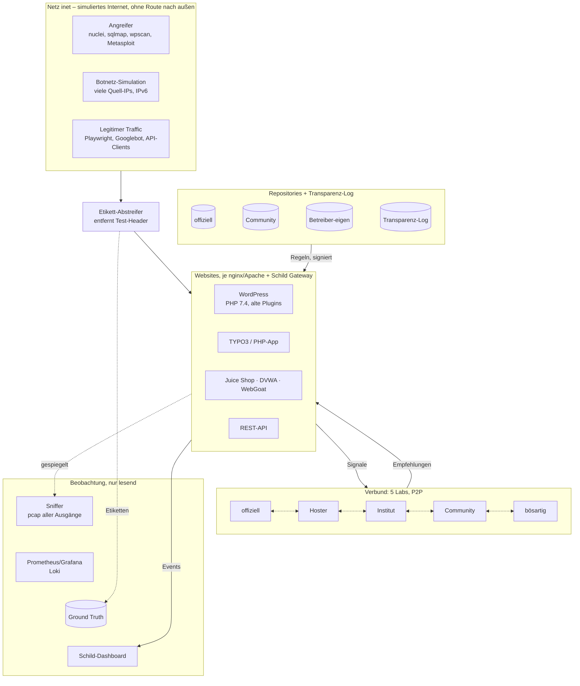
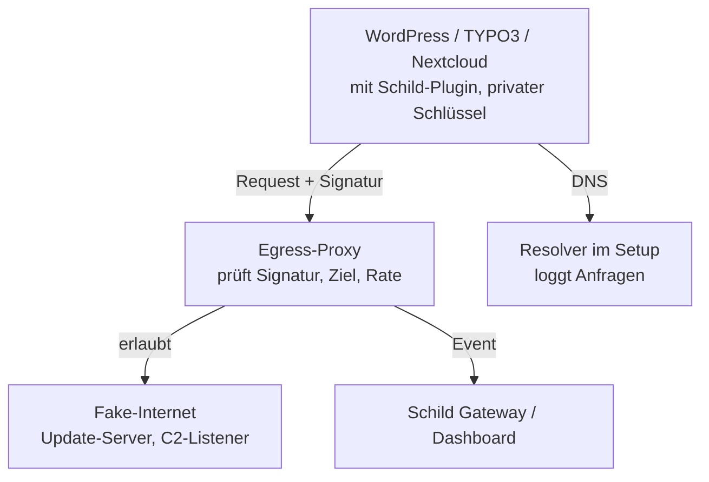

# Testkonzept: Schild-Testlab

**Status:** ENTWURF · Architektur in [Technologie, KI und Sicherheitsarchitektur](04-technologie-und-security.md) und [Technik kompakt](/docs/concept/13-technik-kompakt) · Stand Oktober 2026

> **Labs, Relays und Verbund sind geplant.** Es gibt sie bisher nur im Testlabor, nicht im Betrieb. Benutzbar ist heute das Gateway, und es braucht keine Labs: [Funktionen des Gateways](../gateway/01-funktionen.md).

**Kurz:**

- Schild-Testlab: verwundbare Websites, Schild Gateways, fünf Labs (eines bösartig), Repositories, Angreifer und legitimer Traffic abgeschottet in Docker, ohne Route nach außen.
- Prüffragen P1–P7: Erkennung, Konsens, Lieferkette, Datenschutz (Mitschnitt aller Ausgänge, T19), Fail-open/Latenz, Lab-Forschung, Entsperren, Egress.
- Szenarien T01–T26 und Leistungsmessungen B01–B13; Schwerpunkt sind Muster über viele IPs und Websites statt einzelner Requests.
- Ausbau in Stufen T0 (ein Host) bis T3 (Egress); CI mit Kurzlauf pro Pull Request und nächtlichem Volllauf.
- Alle Zielwerte sind Vorschläge bis zu den ersten T0-Läufen; Recht (§ 202c StGB, Datensatzlizenzen) noch zu prüfen. Reihenfolge: [Prototyp-Verifikation](23-verifikation.md).

Jede Behauptung aus [Produkt, UX und Onboarding](03-produkt-und-ux.md), [Technologie, KI und Sicherheitsarchitektur](04-technologie-und-security.md) und [Technik kompakt](13-technik-kompakt.md) soll im Schild-Testlab messbar geprüft werden. Die Umsetzung für den Prototyp steht auf Englisch in den Specs [`MVP-05`](../../tests/specs/MVP-05-testlab.yaml) (Testlab), [`MVP-06`](../../tests/specs/MVP-06-traffic.yaml) (Traffic) und [`MVP-07`](../../tests/specs/MVP-07-adversaries.yaml) (Gegenspieler) und in [`tests/testlab/`](../../tests/testlab/README.md); dieses Dokument beschreibt das Ziel dahinter.

**Begriffe:** Die **Labs** sammeln nicht nur Signale, sondern forschen selbst: Sie analysieren neue CVEs, Patches und Advisories, fuzzen verbreitete CMS und Plugins, betreiben Honeypots und leiten mit KI-Unterstützung Muster und Regeln ab. Betreiber eines Labs heißen **Lab-Betreiber**. Das **Schild-Testlab** ist die Testumgebung aus diesem Dokument.

## 1. Ziele und Prüffragen

| # | Prüffrage | Woran wir es messen |
| --- | --- | --- |
| P1 | **Erkennung:** Fängt das Gateway reale Angriffe, und wie oft trifft es Unschuldige? | Precision, Recall, Fehlalarmrate auf legitimem Traffic |
| P2 | **Konsens:** Wirkt eine Empfehlung erst bei gewichtetem Konsens, auch wenn ein Lab lügt? | keine Sperre durch ein einzelnes Lab; Time-to-Protect im Verbund |
| P3 | **Lieferkette:** Lassen sich manipulierte, veraltete oder eingefrorene Regeln einschleusen? | TUF-Prüfung schlägt an, Transparenz-Log zeigt die Abweichung |
| P4 | **Neutralität & Datenschutz:** Verlässt etwas Persönliches den Server? | Mitschnitt aller ausgehenden Pakete gegen die Positivliste des Signal-Schemas |
| P5 | **Fail-open, Latenz, Last:** Bleibt die Website erreichbar, und was kostet Schild? | Verfügbarkeit bei Gateway-Absturz, p50/p95/p99-Latenz, Durchsatz |
| P2b | **Lab-Forschung:** Durchläuft ein selbst gefundenes Muster denselben Weg wie jedes Signal, und fängt der Prozess fehlerhafte KI-Regeln ab? | Probelauf (Schattenmodus) + Reproduktion durch andere Labs; Zeit von CVE bis aktiver Regel |
| P6 | **Entsperren:** Kommt ein zu Unrecht Gesperrter zuverlässig wieder rein, und lernt der Verbund daraus? | Ablauf Sperrseite → Antrag → Freigabe → Fehlalarm-Signal |
| P7 | **Egress (später):** Fallen Webshell-Rückrufe und Datenabfluss auf, ohne legitime Updates zu stören? | Erkennungsrate C2/Exfiltration, Fehlalarme bei Plugin-Updates |

## 2. Topologie

Alles läuft auf einem Host (Stufe T0) bzw. wenigen Hosts (ab T1). Das „Internet“ ist ein internes Docker-Netz ohne Route nach außen.



Die lauffähigen Compose-Profile `t0` und `t1` liegen in [`tests/testlab/compose/`](../../tests/testlab/compose/); was sie leisten müssen, steht in [`MVP-05`](../../tests/specs/MVP-05-testlab.yaml). Die Bausteine im Zielbild:

- **Verwundbare Websites:** WordPress auf PHP 7.4 mit bekannten verwundbaren Plugin-Versionen (welche Images noch verfügbar sind: ZU PRÜFEN), TYPO3 oder eine kleine PHP-App mit bekannten Fehlern, OWASP Juice Shop, DVWA, WebGoat und eine REST-API (z. B. OWASP crAPI oder eigene, ZU PRÜFEN). Jede hinter nginx oder Apache mit Schild Gateway im inneren Modus.
- **Fünf Labs** mit unterschiedlichen Betreiberarten: offiziell, Hoster, Institut, Community, „bösartig“. Das bösartige Lab ist ein normales Lab mit Schalter für Fehlverhalten (vergiften, schweigen, einzelne Clients belügen). Jedes Lab hat eine eigene **Forschungs-Range**: ein abgeschottetes Netz mit Kopien der verwundbaren Container, Fuzzern und einem lokalen Open-Weight-Modell, ohne Verbindung zu `inet` oder zu den Clients.
- **Drei Repositories:** offiziell (CRS + Schild-Presets), Community, betreiber-eigen (nur für eine Website), alle TUF-artig mit Schwellwert-Signaturen; dazu ein **Transparenz-Log** (Kandidat: Trillian/Tessera oder Sigstore Rekor, ZU PRÜFEN).
- **Mock-DNS** (CoreDNS) für Reverse-DNS der Such-Bots und DNS-Exfiltration; optional **Mock-ACME** (Pebble) für TLS im äußeren Modus.
- **Beobachtung:** Prometheus/Grafana, Loki, pcap aller ausgehenden Verbindungen der Clients, Ground-Truth-Datenbank.

Jede Website bekommt eine eigene `schild.yaml`, damit alle Modi gleichzeitig laufen:

```yaml
# WordPress: default           # TYPO3: review           # Juice Shop: observe
mode: autoblock                mode: review              mode: observe
ratings:                       # REST API: autoblock + own repo, good bots, no PoW
  - { source: lab-official,   weight: 1 }
  - { source: lab-hoster,     weight: 1 }
  - { source: lab-institute,  weight: 2 }
  - { source: lab-community,  weight: 2 }
  - { source: lab-malicious,  weight: 2 }   # deliberately high weight
consensus: 0.6
min_operators: 2
```

## 3. Bedrohungsquellen und Replay

**Rechtlicher Rahmen (FIXIERT für das Testlab):** Angriffswerkzeuge laufen nur gegen eigene Container im Netz `inet` ohne Route nach außen; keine Ziele Dritter, keine Scans im Internet (Nonnegotiable 4). Werkzeuge im Sinne von § 202c StGB nur zum Prüfen eigener Systeme, Zweck und Umfang je Lauf dokumentiert. Datensätze nur mit geprüfter Lizenz. Rechtliche Einordnung durch Fachleute: ZU PRÜFEN.

Generatoren, Replayer und Botnetz-Simulation des Prototyps: [`MVP-06`](../../tests/specs/MVP-06-traffic.yaml).

**Aktive Angriffe**

| Werkzeug | Wofür | Hinweis |
| --- | --- | --- |
| nuclei | breite Template-Scans, CVE-Prüfungen | nur kuratierte Template-Auswahl, keine Templates mit Out-of-Band-Callbacks nach außen (interactsh deaktivieren oder lokal betreiben) |
| sqlmap | SQL-Injection gegen DVWA, Juice Shop, API | verschiedene `--tamper`-Skripte gegen WAF-Umgehung |
| wpscan | Plugin- und Nutzer-Enumeration | Vulnerability-Datenbank braucht API-Token, ZU PRÜFEN |
| nikto, ffuf | klassische Scanner, Pfad-Fuzzing | erzeugt die typischen „Scanner-Falle“-Treffer |
| Credential Stuffing | eigenes Skript mit Testlisten (z. B. aus SecLists) | Rotation von Quell-IPs und User-Agents |
| Metasploit | Exploit-Module gegen die verwundbaren Container | Payloads mit Rückruf nur zu einem Listener im Testnetz |

**Replay realer Daten**

| Quelle | Inhalt | Eignung |
| --- | --- | --- |
| Honeypot-Daten (z. B. T-Pot) | echte Angriffe aus dem Internet | Verfügbarkeit öffentlicher Rohdaten und Lizenz ZU PRÜFEN; eigener T-Pot im Pilot denkbar |
| CIC-IDS2017 / CSE-CIC-IDS2018 | PCAPs mit Web-Angriffen, Brute Force, Botnetz | Daten aus 2017/18; HTTP-Anteile klein, Eignung ZU PRÜFEN |
| CSIC 2010 HTTP Dataset | gelabelte normale und anomale HTTP-Requests | gut für Precision/Recall auf Einzelrequests; synthetisch, alt |
| ECML/PKDD 2007 Discovery Challenge | gelabelte HTTP-Requests (XML) | Format und heutige Relevanz ZU PRÜFEN |

PCAPs lassen sich nicht mit `tcpreplay` gegen einen echten Server abspielen, weil die TCP-Sitzungen nicht passen. Deshalb extrahieren tshark oder Zeek die HTTP-Requests, speichern sie als HAR oder JSONL, und ein eigener Replayer sendet sie neu (Zielhost, Zeitstempel und Quell-IP-Pool umgeschrieben, Original-Timing optional).

**Botnetz-Simulation:** Ein Generator-Container bekommt viele Adressen, IPv4 aus mehreren /24 im Netz `inet` und IPv6 aus einem /64 (Absender pro Request wählbar); macvlan nur mit physischem Testnetz dahinter. Profile: laut und schnell, **low-and-slow** (ein Login pro IP und Stunde über 500 IPs), Wellen über mehrere Websites zeitversetzt.

## 4. Schwerpunkt: Analyse über viele Requests

Einzelne Requests fängt die WAF. Die gefährlichen Muster entstehen erst über Zeit, Absender und Websites hinweg, deshalb liegt hier der Schwerpunkt.

**Gezielt erzeugte Muster**

- Login-Brute-Force verteilt über 200–2.000 IPs, jede IP unter jedem Ratenlimit
- Credential Stuffing mit rotierenden IPs, User-Agents und JA4-Fingerprints
- Scanner-Sequenzen: Fingerprinting → Plugin-Enumeration → Exploit-Versuch
- Enumeration (`?author=1..n`, REST-Nutzerliste, Objekt-IDs in der API)
- low-and-slow über Tage (im Zeitraffer: Uhr der Container beschleunigt, ZU PRÜFEN)

**Merkmale (Features)**

| Merkmal | Beispiel | Speicher |
| --- | --- | --- |
| Raten pro Pfad/Aktion | Logins/min auf `wp-login.php`, unabhängig von der IP | Zähler pro Aktion und Fenster |
| Sequenzen | Markov-Kette der Pfadfolge; seltene Übergänge (Scan → Upload → Aufruf) | Übergangsmatrix pro Preset |
| JA4 / JA4H | gleiche TLS-/HTTP-Signatur über viele IPs | Count-Min-Sketch |
| Header-Reihenfolge, Timing | Abstand zwischen Requests, zu gleichmäßig = Bot | Histogramm |
| Fehlerquote | Anteil 4xx/5xx pro Absender-Signatur | gleitende Quote |
| Parameter-Entropie | Zufallswerte, kodierte Payloads | Mittelwert/Varianz pro Parameter |
| Vielfalt | verschiedene IPs pro Signatur, verschiedene Nutzernamen pro Signatur | HyperLogLog |

**Baselines** lernt das Testlab pro Website und Preset (eine Woche legitimer Test-Traffic, danach eingefroren und versioniert), damit WordPress nicht am Verhalten einer REST-API gemessen wird.

**Fenster:** gleitend (1 min, 15 min, 24 h), mit Sketches (Count-Min, HyperLogLog) statt Rohdaten. Testziel: Speicher pro Website unter einer festen Grenze (Vorschlag: 64 MB, OFFEN), keine Rohdaten nach dem Fenster.

**Website-übergreifende Korrelation:** Dasselbe Muster trifft WordPress, TYPO3 und die API innerhalb von 10 Minuten → drei Clients bei zwei Betreibern senden Signale → Labs bewerten → gewichteter Konsens → Empfehlung an alle Clients, auch an eine vierte, noch nicht getroffene Website. Gemessen wird, ob Website 4 beim ersten Treffer schon geschützt ist.

**Ground Truth ohne Spuren im Gateway:** Jeder Generator setzt einen geheimen Header (`X-Testlab-Label: <HMAC(label, schlüssel)>`). Der **Etikett-Abstreifer** vor nginx entfernt ihn, setzt eine zufällige `X-Request-Id` und schreibt `request_id → label` in die Ground-Truth-Datenbank. Gateway und Labs sehen nur diese Zufalls-ID; die Auswertung verknüpft Events darüber.

**Kennzahlen**

| Kennzahl | Definition | Zielwert (Vorschlag, OFFEN) |
| --- | --- | --- |
| Precision / Recall | je Angriffsklasse, aus Ground Truth | Recall ≥ 0,9 für CRS-Klassen |
| Fehlalarmrate | gesperrte oder geprüfte legitime Requests / alle legitimen | Sperre < 0,01 %, Autoverify < 1 % |
| Time-to-Detect | erster Angriffs-Request → erstes Signal | < 1 min |
| Time-to-Protect | erstes Signal → Empfehlung wirkt auf allen Clients | < 5 min im Verbund |
| PoW-Bestehensquote | Anteil echter Browser, die Autoverify passieren | ≥ 99 % |
| Time-to-Rule | Veröffentlichung einer CVE → Regel im Verbund aktiv (nach Probelauf und Konsens) | < 24 h für kritische CVEs in verbreiteten Plugins |

## 5. Testszenarien

| ID | Szenario | Aufbau | Erwartung | Kennzahl |
| --- | --- | --- | --- | --- |
| T01 | Normalbetrieb | 24 h Playwright, Bots, API-Clients, keine Angriffe | keine Sperre, kaum Autoverify | Fehlalarmrate |
| T02 | SQL-Injection | sqlmap gegen DVWA und API | CRS blockt lokal, Signal geht raus | Recall, Latenz |
| T03 | Scanner | nikto, ffuf, nuclei gegen alle Sites | Scanner-Falle greift, Muster an Labs | Time-to-Detect |
| T04 | Brute Force über viele IPs | 1.000 IPs, je 2 Login-Versuche | Aktions-Signatur erkannt, nicht IP-basiert | Recall, Time-to-Protect |
| T05 | Neue Welle / Zero-Day | eigenes Muster, das keine CRS-Regel kennt, trifft 3 Sites | erst Konsens schützt Site 4 | Time-to-Protect |
| T06 | Konsens nicht erreicht | nur 1 Betreiber meldet | keine automatische Sperre, höchstens Autoverify; Dashboard zeigt Abweichung | Sperren = 0 |
| T07 | Vergiftung | bösartiges Lab empfiehlt Sperre legitimer Login-Signatur, Gewicht 2 | unter 60 % bzw. nur 1 Betreiber → wirkungslos; Transparenz-Log zeigt Ausreißer | Sperren = 0 |
| T08 | Sybil-Clients | 500 neue Fake-Clients melden harmlose Signatur | geringes Client-Vertrauen, Zählung pro Betreiber → keine Empfehlung | Bewertung < 40 |
| T09 | Lab fällt aus / Partition | 2 Labs abschalten, Netz teilen | Gateway schützt mit zuletzt bestätigten Regeln weiter; nach Heilung kein Doppel-Zustand | Schutz unverändert |
| T10 | Kompromittiertes Repo | Community-Repo signiert Regel mit nur 1 von 3 Schlüsseln bzw. gestohlenem Schlüssel | TUF lehnt ab bzw. Log-Abgleich der Clients deckt Split-View auf | Annahmen = 0 |
| T11 | Rollback-/Freeze-Angriff | altes signiertes Metadatum ausliefern; Updates einfrieren | Versionsprüfung lehnt Rollback ab; Ablaufdatum löst Warnung aus | Erkennung |
| T12 | Gateway-Absturz | `docker kill` des Gateways unter Last | nginx leitet direkt weiter (fail-open), Dashboard meldet Ausfall | Verfügbarkeit 100 % |
| T13 | Under-Attack mit echten Browsern | Modus „alles“, Playwright mit Chromium, Firefox, WebKit, langsamer Mobil-CPU, JS aus | PoW wird bestanden; ohne JS Ausweichweg | Bestehensquote, Zeit |
| T14 | Gute Bots | Googlebot-Simulation mit passendem rDNS (Mock-DNS) und Fälschung ohne rDNS | echter Bot ohne Prüfung, Fälschung wie normaler Absender | Fehlalarm Bots = 0 |
| T15 | Fehlalarm → Entsperren | legitimer Nutzer wird gesperrt | Sperrseite mit Vorfall-Nummer → Antrag beim Betreiber → Freigabe → Fehlalarm-Signal senkt Bewertung; API bekommt 403 nach RFC 9457 | Durchlaufzeit, Bewertung danach |
| T16 | Modus Prüfen | Empfehlung trifft TYPO3 | nur Vorschlag im Dashboard, wirkt nach Freigabe | Sperren vor Freigabe = 0 |
| T17 | Modus Beobachten | Angriff auf Juice Shop | nichts geblockt (außer Grundregeln, falls so konfiguriert, OFFEN), alles angezeigt | Events vollständig |
| T18 | Betreiber-eigenes Repo | eigenes Repo überschreibt CRS-Regel für die API, ergänzt eigene | Ausnahme wirkt nur lokal, nie bei anderen Sites; gezielte Fernregeln werden abgelehnt | Wirkung nur Site 4 |
| T19 | Datenschutz-Prüfung | Sniffer auf allen Ausgängen, Testdaten mit Markern (Kanarienwerte in Formularen, Cookies, Pfaden) | kein Marker, keine Klar-IP, nur Felder der Positivliste | Funde = 0 |
| T20 | Latenz und Last | k6 und vegeta, 50–2.000 Requests/s, mit und ohne Schild | Aufschlag messbar und begrenzt | p95-Aufschlag (Ziel OFFEN, z. B. < 5 ms) |
| T21 | Slow-and-low über Tage | 1 Versuch/IP/h, 3 Sites, Zeitraffer | Erkennung über Sketches, nicht über Rohdaten | Time-to-Detect, Speicher |
| T22 | Neue Regel im Probelauf | zu scharfe Regel per Canary ausrollen | Lokale Notbremse greift nach eigenem Traffic; automatischer Rückzug über steigende Bestehensquote ZU PRÜFEN ([Datenschutzkonzept, Abschnitt 10](24-datenschutz.md), Frage 5) | Zeit bis Rückzug |
| T23 | Lab findet neues Muster selbst | Institut-Lab leitet aus einer (nachgestellten) Plugin-CVE eine Regel ab, noch ohne Client-Signal | Probelauf/Canary gegen legitimen Traffic, dann reproduzieren die anderen Labs den Exploit in ihrer Range und stimmen ab; erst danach Empfehlung | Time-to-Rule, Fehlalarme im Probelauf |
| T24 | KI halluziniert eine Regel | Lab-KI erzeugt eine zu breite Regel (z. B. blockt jedes `?page=`) | Regressionstest und Probelauf zeigen Fehlalarme, andere Labs reproduzieren nicht → keine Empfehlung | Regel aktiv = 0 |
| T25 | Lab-Range für Exploit-Forschung | Lab fuzzt und exploitet die Dummy-Container in seiner Range | Funde werden zu Regelvorschlag mit Beleg (Request, Container-Version); kein Traffic verlässt die Range | Funde, Ausbrüche = 0 |
| T26 | CVE-Wettlauf | CVE wird „veröffentlicht“ (Zeitstempel), parallel startet ein Angriffs-Generator mit Exploit nach z. B. 6 h | Regel ist aktiv, bevor die Angriffswelle die Websites erreicht | Time-to-Rule vs. Time-to-Exploit |

**KI in den Labs** schlägt nur vor. Ob daraus eine Regel wird, entscheiden Regressionstests gegen gespeicherten legitimen Traffic, der Probelauf und der Konsens der anderen Labs, nie das Modell allein (Nonnegotiable 5). Jede Lab-Regel braucht einen reproduzierbaren Beleg (Exploit-Request gegen eine benannte Container-Version), den andere Labs in ihrer Range nachstellen können.

Für T19 wird jedes ausgehende Paket gegen das Signal-Schema geprüft. TLS zu den Labs bricht das Testlab dafür mit einer Test-CA auf; zusätzlich protokolliert das Gateway jedes gesendete Signal lokal, und beide Listen müssen übereinstimmen.

Die Gegenspieler-Szenarien (T07, T08, T10, T11, T24) setzt [`MVP-07`](../../tests/specs/MVP-07-adversaries.yaml) um, die Traffic-Szenarien (T01–T05, T13, T14, T20, T21) [`MVP-06`](../../tests/specs/MVP-06-traffic.yaml).

## 5a. Leistungsmessungen für Events und Verteilung (Vorschlag aus [Events und Geschwindigkeit](20-events-und-geschwindigkeit.md))

Alle Zielwerte sind Schätzungen und werden nach den ersten Läufen festgelegt.

| ID | Messung | Aufbau | Ziel (Vorschlag) |
| --- | --- | --- | --- |
| B01 | Request-Aufschlag mit vollem Regelsatz (CRS + 500 Netzregeln) | k6/vegeta wie T20 | p95 < 5 ms, p99 dokumentiert |
| B02 | Aufschlag mit Signalversand unter Last, Labs künstlich langsam (toxiproxy +500 ms) und ausgefallen | 30 % der Requests lokal verdächtig | Netzanteil an p99 = 0 ms; Website unverändert erreichbar |
| B03 | Signal über OHTTP-Relay mit Privacy-Pass-Token (ab v1) | 3–5 Labs | p95 < 150 ms (Schätzung); CPU je Signal im Lab |
| B04 | Signatur- und Token-Prüfkosten: Ed25519/DSSE, ARC-Präsentation, HPKE | `go test -bench` auf Lab-Hardware und alter Client-Hardware | Durchsatz je Kern dokumentiert |
| B05 | SSE-Fan-out: 100.000 simulierte Clients über 5/10/20 Relays, Regel inline 2 KB und 32 KB | Lastgeneratoren, Relays in Docker | 95 % < 10 s, 99 % < 60 s; RAM je Verbindung |
| B06 | Reconnect-Sturm: Relay-Neustart, Netzpartition, Wiederkehr | wie B05 | keine Überlast; Nachholen über `Last-Event-ID` ohne Lücken |
| B07 | Regel-Neuaufbau im Gateway: Prüfen, Kompilieren, atomarer Tausch | CRS + 50/500 Netzregeln | < 1 s, kein verlorener Request beim Tausch |
| B08 | Sandbox-Start warm (Snapshot) vs. kalt je Software-Version | Lab-Range | warm < 30 s |
| B09 | Konsensrunde Ende zu Ende (Vorschlag → Bündel → Log mit Zeugen → Probelauf bei Clients) | T1-Verbund, 5 Labs, X = 3 | Schnellpfad warm < 20 min; Phasenzeiten einzeln |
| B10 | Laufzeit des Rückzugs aller Netzregeln (Bündel mit null Netzregeln) nach k-von-n-Signatur, [Events und Geschwindigkeit, 4.5](20-events-und-geschwindigkeit.md) | wie B05 | 95 % < 10 s; Gateway zeigt danach „Regelstand <n> vom <Zeit>: 0 Netzregeln aktiv“ mit Grund, Grundschutz aktiv |
| B11 | Lab-Feed-Vollvermaschung: Ausfall direkter Verbindungen, Equivocation eines Labs | 5–30 Labs | Events kommen über Weiterleitung an; Doppelspiel erkannt und geloggt |
| B12 | Zurückhaltendes Relay (Freeze) | Relay liefert keine Checkpoints mehr | Client erkennt es am Herzschlag < 3 min und wechselt |
| B13 | Lab-Eingang unter Volllast: Signalwelle aller Clients, gleichzeitig KI-Warteschlange voll und ein Partner-Lab ausgefallen | 10.000 Clients simuliert, Burst ×20 | `EventAck` p99 < 50 ms; bei voller Warteschlange sofort `retry_after`, nie Timeouts ([Architektur V1](21-architektur-v1.md), 5.0) |

## 6. Egress (spätere Stufe)

Ein gekaperter Webserver soll nicht unbemerkt nach außen telefonieren. Geprüft werden nur Metadaten und Signaturen, keine Inhalte (Nonnegotiable 9).

**Aufbau:** Die Web-App hängt nur an einem internen Netz (`internal: true`); einziger Weg nach außen ist der **Egress-Proxy** (mitmproxy mit Python-Addons oder ein Forward-Proxy auf Caddy- bzw. Envoy-Basis, Auswahl OFFEN). DNS geht nur über den Resolver im Setup.



**Signieren:** Plugins für WordPress, TYPO3, Nextcloud, Shopware signieren beabsichtigte ausgehende Requests, mit einem Schlüsselpaar pro Installation; der öffentliche Schlüssel ist beim Proxy registriert. Signiert werden `iss` (App/Plugin), `aud` (Zielhost), Methode, Pfad, Body-Hash, `iat`/`exp`, `nonce`.

| Verfahren | Passt, weil | Offen |
| --- | --- | --- |
| HTTP Message Signatures (RFC 9421) | standardisiert, signiert ausgewählte Teile des Requests direkt | Bibliotheken für PHP: ZU PRÜFEN |
| JWS (RFC 7515) als Header | einfach, überall verfügbar | Body-Hash und Nonce selbst definieren |
| DPoP (RFC 9449) | Proof-of-Possession pro Request, ähnliche Claims | für OAuth gedacht; nur als Vorbild |
| SPIFFE/SVID | Workload-Identität mit kurzlebigen Zertifikaten | eher für Rechenzentren; für Webhosting zu schwer? |

**Prüfung im Proxy:** signiert und Ziel auf Allowlist → durch. Unsigniert → je nach Modus beobachten, prüfen (Dashboard) oder blocken. Signatur gültig, aber Ziel, Menge oder Uhrzeit ungewöhnlich → Anomalie-Event.

**Testfälle:** Webshell-Rückruf und C2-Beacon (periodisch, mit Jitter); Datenabfluss per HTTP-POST und DNS-Tunnel (z. B. iodine oder dnscat2 gegen den eigenen Resolver, ZU PRÜFEN); legitimer Update-Check eines Plugins (darf nicht stören); Plugin ohne Signatur-Unterstützung (Allowlist-Fallback); **Schlüsseldiebstahl** aus dem App-Container.

**Grenze:** Wer die App vollständig kontrolliert, kann auch signieren; die Signatur beweist nur die Herkunft aus dieser Installation, nicht die Absicht. Wir testen deshalb Ziel-Allowlists pro Plugin, Raten- und Mengenlimits und Schlüssel in einem Sidecar/Agent statt in der App, der nur bestimmte Ziele signiert. Das verschiebt den Angriff, verhindert ihn aber nicht.

**TLS-Interception:** Im Testlab ist eine lokale CA im Container in Ordnung. Im echten Betrieb braucht Aufbrechen von TLS Zustimmung, Datenschutzprüfung und klare Grenzen; bevorzugt nur Metadaten (SNI, Ziel, Menge) und die Signatur im Header, ohne Inhalte zu lesen (OFFEN).

## 7. Stufen und CI

| Stufe | Umfang | Voraussetzung |
| --- | --- | --- |
| **T0 – Ein Host** | `docker compose up`: 4 Websites, 1 Lab, 1 Repo, Angreifer, legitimer Traffic, Sniffer. Szenarien T01–T04, T12, T19, T20 | Gateway-Prototyp |
| **T1 – Verbund** | 5 Labs mit Forschungs-Ranges, 3 Repos, Transparenz-Log. T05–T11, T15–T18, T23–T26 | Lab und Protokoll im Entwurf |
| **T2 – Chaos & Red Team** | Netzausfälle (z. B. toxiproxy, Pumba, ZU PRÜFEN), interne Red-Team-Tage, Replay realer Datensätze, T21–T22 | stabile T1 |
| **T3 – Egress** | Egress-Proxy, signierende Plugins, C2- und Exfiltrationstests | Egress-Gateway-Version |
| **Später: öffentliches Schild-Testlab** | Institute und Community (z. B. CISPA, CCC; Einladung, keine Zusage) greifen mit eigenen Werkzeugen an, insbesondere Neutralität und Konsens | Regeln für Teilnahme, isolierte Umgebung |

**CI-Integration (ENTWURF):**

- **Pro Pull Request:** T0-Kurzlauf (10 min) mit festem Seed, Abbruch bei Fehlalarm oder fehlender Erkennung.
- **Nächtlich:** voller Lauf T01–T22 mit Bericht (Precision, Recall, Fehlalarme, Latenz) als Artefakt, verglichen mit dem Vortag.
- **Bei jedem CRS- oder Regel-Update:** Regressionslauf gegen gespeicherte Replays und legitimen Traffic, bevor die Regel in den Probelauf geht.
- Images, Seeds, Datensätze und Konfigurationen sind versioniert, jeder Lauf ist exakt wiederholbar.

## 8. Offene Fragen und ehrliche Grenzen

- **Synthetischer Traffic ist nicht echt.** Playwright-Nutzer verhalten sich ordentlicher als Menschen; Fehlalarmraten aus dem Labor sind eine Untergrenze. Den Pilot mit echten Websites ersetzt das nicht ([Pilot, Betrieb und Erfolgskriterien](09-pilot-und-betrieb.md)).
- **Datensätze altern.** CSIC 2010, ECML/PKDD 2007 und CIC-IDS zeigen Angriffe von damals, KI-gestützte fehlen. Eigene Honeypots im Pilot liefern frischere Daten (Datenschutz ZU PRÜFEN).
- **Angreifer kennen das Testlab.** Offene Tests zeigen auch, was nicht erkannt wird. Das ist gewollt, muss aber beim Veröffentlichen von Ergebnissen bedacht werden.
- **Recht:** § 202c StGB, Lizenzen der Datensätze und Exploits, Haftung beim öffentlichen Testlab: ZU PRÜFEN.
- **Aufwand:** Verwundbare Images veralten oder verschwinden; Lab- und Repo-Simulation ist eigene Software. Schätzung für T0: OFFEN.
- **Zielwerte:** Alle Schwellen hier sind Vorschläge bis zu den ersten T0-Läufen.

## Als Nächstes

Reihenfolge, Kill-Kriterien und Specs für den Prototyp: [Prototyp-Verifikation](23-verifikation.md).

- [ ] T0 als `docker-compose.yml` mit WordPress, DVWA, einem Gateway und Sniffer aufsetzen.
- [ ] Etikett-Abstreifer und Ground-Truth-Auswertung bauen.
- [ ] Datensätze sichten: Verfügbarkeit, Lizenz, Format.
- [ ] Erste Zielwerte für Fehlalarmrate und Latenzaufschlag nach T0-Läufen festlegen.
