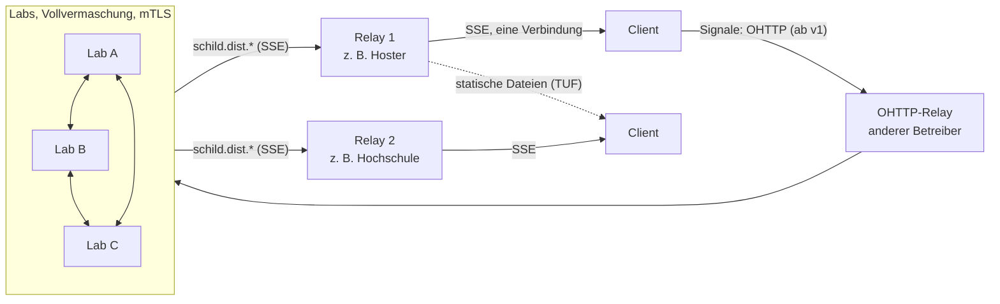

# Events und Geschwindigkeit: Abfragen, Abstimmung, Verteilung

**Status:** ENTWURF · ergänzt [Technik kompakt](13-technik-kompakt.md) („Abstimmung zwischen Labs“, Formate), [04](04-technologie-und-security.md) (Härtung), [18](18-manipulation-und-poisoning.md) (G1–G8, Signal 0.3) und [14](14-testkonzept.md) (Messungen) · Stand 25.10.2026, ergänzt 27.10.2026 (4.5 Rückzug aller Netzregeln, 4.6 Relay-Verzeichnis)

**Kurz:**

- Im Request-Pfad wartet nichts auf das Netz: Entscheidung lokal, Netzanteil am p99-Aufschlag 0 ms; keine IP-Abfragen bei Labs (E4).
- Zwei Kanäle: Signale Schild Gateway → Lab (Prototyp direkt HTTPS, ab v1 OHTTP), Regeln Lab → Gateway per SSE über Relays, Long-Polling als Fallback.
- Je Lab ein signierter, nur anhängbarer Feed (DSSE mit CloudEvents, `seq`/`prev`); Events benachrichtigen, TUF, k-von-n und Transparenz-Log entscheiden.
- Zielwerte sind Schätzungen, noch ungemessen (B01–B12): neue Regel bei 95 % der Clients in < 10 s, Schnellpfad bis Probelauf etwa 5–20 min.
- Neu seit 27.10.2026, noch Vorschlag: Rückzug aller Netzregeln als gewöhnliches Bündel mit null Netzregeln (4.5), signierte Relay-Listen je Lab (4.6).

**Frage des Initiators:** Wie lässt sich die Consent-Abfrage (Request und Antwort) maximal beschleunigen? Eventuell mit WebSockets? Am liebsten alles eventbasiert, aber extrem schnell.

Die Frage hat zwei Teile: den **heißen Pfad**, in dem ein Client (das Schild Gateway) zu einem Request entscheidet, während eine Besucherin wartet, und die **Konsensrunde**, in der Labs eine Regel prüfen, k-von-n signieren und an alle Clients verteilen.

**Kurzantwort:**

1. **Im Request-Pfad wartet nichts auf das Netz.** Das Gateway entscheidet lokal in Mikrosekunden bis wenigen Millisekunden. Netzwissen kommt vorher als Regeln per Push. IP-Wissen aus dem Netz gibt es nicht (E4; G1 in [Manipulation und Poisoning](18-manipulation-und-poisoning.md)).
2. **Push über Server-Sent Events (SSE) auf einer ausgehenden HTTPS-Verbindung, nicht über WebSocket.** Signale gehen getrennt (Prototyp direkt HTTPS, ab v1 OHTTP); ein bidirektionaler Socket würde die Unverkettbarkeit zerstören. SSE ist HTTP, geht durch Proxies und Mirrors und setzt mit `Last-Event-ID` wieder auf.
3. **Eventbasiert als signierte, nur anhängbare Feeds, ohne zentralen Broker.** Jedes Lab schreibt einen Feed, die Labs abonnieren sich gegenseitig. TUF und Transparenz-Log bleiben maßgeblich.
4. **Der Engpass ist nicht das Netzwerk.** Transport kostet Sekunden, die Sandbox Minuten, menschliche Freigabe für `block` (G2) Stunden. Am meisten bringen vorgewärmte Sandboxen, parallele Prüfjobs und ein Abschluss, sobald X Bestätigungen da sind.

## 1. Latenzbudget

### 1.1 Heißer Pfad (pro Request)

| Schritt | synchron? | Budget (Ziel, ENTWURF) | Bemerkung |
| --- | --- | --- | --- |
| Lokale Allowlist und Freigaben, Etiketten (G6), MMDB-Lookup | ja | < 50 µs | lokal, im Speicher |
| Coraza + CRS + Netzregeln | ja | dominiert; Ziel p95-Aufschlag < 5 ms gesamt (T20) | Netzregeln sind hier schon lokal kompiliert |
| Lokaler Zustand: Raten, Sketches, Sitzung | ja | < 100 µs | [Testkonzept](14-testkonzept.md), Abschnitt 4 |
| Lokale IP-Listen (eigene Sperren, lokal abgeglichene Fremdlisten) | ja | < 10 µs | Map/LRU, nur lokal, nie verteilt |
| Netzabfrage zu IPs | – | – | gibt es nicht: keine IPs ins Netz (E4, siehe 4.2) |
| Signal an Labs | **nein** | 0 ms im Request | Warteschlange, Versand mit Zufallsverzögerung |

**Zielwert: Netzanteil am p99-Aufschlag 0 ms**, auch wenn Netz oder Lab ausfallen (Local First, Nonnegotiable 6).

Auch „kurz warten, maximal 20 ms“ scheidet aus: Wer jeden Request verdächtig aussehen lässt, erzeugte so pro Request eine Netzabfrage und verlangsamte die Website gezielt. Und ein Timeout darf nie entscheiden, weder freigeben noch sperren (Härtung 04).

### 1.2 Konsensrunde (pro Regel)

Ziele für den **Schnellpfad** (kritische CVE, Höchstaktion `challenge`, [Forschung](17-forschung-waf-und-ki-angriffe.md)-4.1.5 und G8). Alle Zahlen sind **Schätzungen**, die das Testlab bestätigen muss.

| Phase | Ziel p95 | Was es bestimmt |
| --- | --- | --- |
| P1 Vorschlag erreicht alle Labs | < 2 s | Transport (Feed-Push) |
| P2 Prüfjob gestartet (warme Sandbox) | < 30 s | Vorgewärmter Pool je Software und Version |
| P2' Prüfjob gestartet (kalt: Image bauen, Plugin-Version installieren) | 2–10 min | Image-Cache, Registry |
| P3 Prüfung selbst (Exploit, Varianten, Negativkorpus, Minimalität G3) | 3–15 min | parallele Worker, Korpusgröße |
| P4 Stimme bei allen Labs, k-te Signatur da, Bündel zusammengesetzt | < 2 s nach der X-ten Stimme | Transport, Early-Exit |
| P5 Transparenz-Log + Zeugen | < 10 s | Checkpoint-Intervall + Witness-Antwort ([Tessera](https://github.com/transparency-dev/tessera): Checkpoint-Intervall je nach Speicher ab 100 ms–1,2 s; Witness-Timeout in einer Tessera-Integration standardmäßig 5 s, [Traefik-Doku](https://doc.traefik.io/traefik-hub/api-gateway/reference/install/observability/ref-transparency-logs)) |
| P6 Push an Clients: 95 % der online Clients | < 10 s | Fan-out über Relays |
| P6 99 % der online Clients | < 60 s | Nachzügler, Reconnects, Polling-Fallback |
| P7 Gateway prüft, kompiliert, tauscht Regelsatz atomar | < 1 s | Signaturprüfung < 1 ms; Coraza-Neuaufbau ZU PRÜFEN |
| **Summe Schnellpfad bis „Probelauf (Schattenmodus) an allen Clients“** | **≈ 5–20 min (warm)** | P2/P3 dominieren |
| **Rückzug aller Netzregeln** (nach k-von-n-Signatur, 4.5) | **< 10 s bei 95 %** | Gleicher Kanal, höchste Priorität |

Für `block` kommen die menschliche Freigabe in ≥ 2 Organisationen (G2) und die Staffelung Probelauf ≥ 24 h → Canary → `challenge` (G8) dazu, mit Absicht. Die Kennzahl „Time-to-Protect < 5 min im Verbund“ aus dem [Testkonzept](14-testkonzept.md) ist mit G8 nur für den **Probelauf** und den **Schnellpfad `challenge`** erreichbar; das sollte dort präzisiert werden.

Am meisten zählt Geschwindigkeit beim Rückzug (4.5); das ist der stärkste Grund für Push statt Polling.

## 2. Transport: Optionen im Vergleich

### 2.1 Randbedingungen

- **Clients** sind kleine, oft alte Webserver (Kernel ab 3.2, [Technik kompakt](13-technik-kompakt.md) „Installation und Pakete“) hinter NAT oder Firewalls: nur ausgehende Verbindungen, verlässlich nur TCP/443, UDP oft gefiltert.
- **Zehn- bis hunderttausende Clients**, aber wenige Dutzend Labs.
- **Privatheit:** Signale gehen ab v1 über OHTTP ([RFC 9458](https://www.rfc-editor.org/rfc/rfc9458)): ein neuer HPKE-Kontext je Anfrage (§6.1), keine Verkettung ohne Client-spezifische Schlüssel (§6), nur zustandslose Anwendungen und mindestens zwei HTTP-Anfragen je Anfrage (§2.1), Antwort erst nach vollständigem Empfang entschlüsselbar (§5.1). **OHTTP ist also Request/Response, kein Push und kein Strom.** Ein gestreamtes Format ist in Arbeit ([draft-ietf-ohai-chunked-ohttp](https://datatracker.ietf.org/doc/html/draft-ietf-ohai-chunked-ohttp), ZU PRÜFEN).
- **Dezentral:** kein Broker, der einem Betreiber gehört und den alle brauchen.
- **Betrieb:** Ein kleines Team betreibt ein Lab: Go-Kern als ein Binary, Analyse-Worker als Container ([Technik kompakt](13-technik-kompakt.md)).

### 2.2 Vergleich

| Option | Client ↔ Lab | Lab ↔ Lab | Lab → Client Push | Bewertung |
| --- | --- | --- | --- | --- |
| **SSE über HTTP/1.1 oder HTTP/2** | – | ✓ (Feed-Abo) | **✓ Empfehlung** | Eine Richtung, wie gebraucht; reines HTTP, Go-Standardbibliothek, über Proxies und CDNs verteilbar; Wiederaufsetzen mit `Last-Event-ID` ([WHATWG HTML §9.2](https://html.spec.whatwg.org/multipage/server-sent-events.html)). |
| **WebSocket** ([RFC 6455](https://www.rfc-editor.org/rfc/rfc6455); über HTTP/2 [RFC 8441](https://www.rfc-editor.org/rfc/rfc8441), HTTP/3 [RFC 9220](https://www.rfc-editor.org/rfc/rfc9220)) | ✗ für Signale | möglich | möglich | Der Rückkanal würde Signale mit der Client-IP verketten; nicht über Mirrors verteilbar. Als Fallback für denselben Strom möglich ([coder/websocket](https://github.com/coder/websocket)). |
| **gRPC-Streams** | – | möglich | möglich | HTTP/2-Trailer machen mit Proxies oft Ärger; kein Vorteil gegenüber SSE. |
| **QUIC / WebTransport** | – | später | später | UDP oft gefiltert; [webtransport-go](https://github.com/quic-go/webtransport-go) laut README seit 2024 ohne Finanzierung (ZU PRÜFEN). Erst, wenn Messungen Head-of-Line-Blocking zeigen. |
| **NATS / JetStream** | – | möglich | möglich | Schnell, Leaf Nodes verbinden ausgehend ([Doku](https://docs.nats.io/running-a-nats-service/configuration/leafnodes)), [WebSocket](https://docs.nats.io/running-a-nats-service/configuration/websocket), Dedup über `Nats-Msg-Id` (2 min). Aber ein Operator ist eine Vertrauensdomäne über die ganze Topologie ([JWT-Doku](https://docs.nats.io/running-a-nats-service/configuration/securing_nats/auth_intro/jwt)): ein Supercluster hieße ein Betreiber. **Gut innerhalb eines Labs.** |
| **libp2p GossipSub** | – | ✓ ab vielen Labs | ✗ | Für offene, feindliche Netze ([Vyzovitis et al. 2020](https://arxiv.org/abs/2007.02754), [Evaluationsbericht](https://research.protocol.ai/publications/gossipsub-v1.1-evaluation-report/), [go-libp2p-pubsub](https://github.com/libp2p/go-libp2p-pubsub)); für ≤ 30 Labs überdimensioniert, für Clients hinter NAT ungeeignet. |
| **MQTT** | – | ✗ | möglich | Broker-zentriert, kein Vorteil gegenüber NATS. |
| **Long-Polling** | – | – | **Fallback** | Geht überall; als Rückfallebene Pflicht. |
| **Kafka** | ✗ | ✗ | ✗ | Zu schwer für kleine Labs, keine Föderation über Organisationen. |
| **OHTTP** (RFC 9458) | **✓ Signale, Rückmeldungen** (ab v1) | ✗ | ✗ | Ab v1 Pflicht für alles, was der Client *sagt*; Verbindung zum Relay wiederverwendbar (§1). |

### 2.3 Entscheidungsvorschlag

**Zwei getrennte Kanäle, bewusst asymmetrisch:**

| Kanal | Richtung | Transport | Authentisierung | Inhalt |
| --- | --- | --- | --- | --- |
| **Sprechen** | Client → Lab | ab v1 OHTTP (Relay ≠ Lab-Betreiber), HTTP/2-Keep-Alive zum Relay; im Prototyp und in der Alpha direkt HTTPS ([Prototyp-Verifikation](23-verifikation.md)) | ab v1 Privacy Pass / ARC pro Nachricht | Signale (`tip`), Rückmeldungen – keine Besucher-IPs |
| **Hören** | Lab → Client | **SSE**, eine ausgehende Verbindung zu einem Relay; Long-Polling als Fallback | **keine** – der Strom ist öffentlich und für alle gleich | Benachrichtigungen mit eingebetteten TUF-Metadaten und kleinen Regeln |

„Hören“ ist öffentlicher Rundfunk: Alle bekommen dieselben Bytes ohne Anmeldung, das Abo verrät nur, dass diese IP Schild betreibt und online ist (5.2). Weil alles k-von-n signiert ist, kann jede:r ein Relay betreiben. Ein Relay kann zurückhalten, aber nicht fälschen; Zurückhalten erkennt der Client am Herzschlag (3.4).

**Lab ↔ Lab:** Vollvermaschung über mTLS. Jedes Lab bietet seinen Feed als SSE-Strom an (`GET /v1/feed?after=<seq>`), dazu einen Bereichsabruf für Lücken (`GET /v1/feed/range?from=&to=`). Labs leiten fremde Events signiert weiter, damit sie auch bei ausgefallener Direktverbindung ankommen. Bei 30 Labs sind das 435 Verbindungen, 29 je Lab; ab etwa 50 Labs käme GossipSub dazu (OFFEN). Weil jedes Event selbst signiert ist, braucht es kein RFC 9421; mTLS bleibt als Zugangskontrolle.

## 3. Event-Modell

### 3.1 Grundsätze

- **Ein Schreiber pro Feed.** Jedes Lab (und jeder Verteiler) hat genau einen Feed mit fortlaufender `seq` und `prev` (Hash des vorigen Events). Die Reihenfolge gilt pro Quelle, ein Konsens darüber ist nicht nötig. Zwei verschiedene Inhalte mit gleicher `seq` sind ein signierter Beweis für Doppelspiel (Equivocation) und gehen ins Transparenz-Log.
- **Inhaltsadressiert und idempotent.** `id` ist der Hash des Payloads: mindestens einmal zugestellt, genau einmal wirksam. Exactly-once über Organisationsgrenzen gibt es nicht.
- **Event-Sourcing im Lab:** Der Zustand eines Labs ist eine deterministische Faltung über alle Feeds, im Testlab exakt wiederholbar.
- **Events benachrichtigen, TUF und Log entscheiden.** Ein Client handelt nur auf verifizierte TUF-Metadaten und k-von-n-Signaturen. Events dürfen diese mitbringen, damit kein zweiter Abruf nötig ist.

### 3.2 Umschlag: DSSE außen, CloudEvents innen

DSSE ([Spezifikation](https://github.com/secure-systems-lab/dsse)) bleibt das Signaturformat ([Technik kompakt](13-technik-kompakt.md)). Der Payload ist ein CloudEvent 1.0 im strukturierten JSON-Modus ([Spezifikation](https://github.com/cloudevents/spec/blob/main/cloudevents/spec.md)); gleiches `source` + `id` heißt Duplikat. So sind alle Attribute signiert, nicht nur `data`.

```json
{
  "payloadType": "application/cloudevents+json",
  "payload": "<base64 of the CloudEvent below>",
  "signatures": [{ "keyid": "lab-uni-x/2026-10", "sig": "…" }]
}
```

```json
{
  "specversion": "1.0",
  "type": "schild.rule.vote.v1",
  "source": "lab:lab-uni-x",
  "id": "sha256:9f1c…",
  "time": "2026-10-25T09:12:03Z",
  "subject": "rule:schild-2026-0412",
  "datacontenttype": "application/json",
  "dataschema": "https://schema.deutschland-schild.de/rule-vote/1",
  "schildseq": 18231,
  "schildprev": "sha256:41ab…",
  "data": {
    "rule_digest": "sha256:77e0…",
    "verdict": "confirm",
    "evidence_digest": "sha256:c3d2…",
    "rule_signature": { "keyid": "lab-uni-x/rules-2026", "sig": "…" },
    "verification": { "sandbox": "wp-6.6.2+gallery-2.4.0", "variants": 120, "negative_corpus": "corpus-2026.10", "matches": 0, "minimality": "passed" }
  }
}
```

`schildseq` und `schildprev` folgen der CloudEvents-Namensregel. Transport-Header wie `ce-type` sind nur Routing-Hinweise und müssen zum signierten Inhalt passen. Später mit SCITT auch als COSE_Sign1/CBOR (OFFEN).

### 3.3 Event-Typen und Subjects

Subjects im NATS-Stil, damit ein Lab intern NATS nutzen kann; im SSE-Strom stehen sie im Feld `event:`.

| Subject | CloudEvents `type` | Von → an | Inhalt (Kern) |
| --- | --- | --- | --- |
| `schild.lab.<lab>.rule.proposed` | `schild.rule.proposed.v1` | Lab → Labs | Regel (SecLang-Teilmenge), Zielsoftware/-version, `evidence`, `verify_by` (Deadline), `rule_digest`; bei unveröffentlichter Lücke Regeltext und Exploit **HPKE-verschlüsselt pro Lab** (Commit-then-Reveal) |
| `schild.lab.<lab>.rule.verification.started` | `schild.rule.verification.started.v1` | Lab → Labs | Zusage mit erwarteter Dauer, zeigt, ob X erreichbar ist |
| `schild.lab.<lab>.rule.vote` | `schild.rule.vote.v1` | Lab → Labs | `confirm` · `reject` · `no_finding` (zählt nicht, [Technik kompakt](13-technik-kompakt.md)) · Signatur über `rule_digest` |
| `schild.lab.<lab>.rule.quorum` | `schild.rule.quorum.v1` | beliebiges Lab → Labs | zusammengesetztes Bündel: Regel + k Signaturen; deterministisch, also von jedem Lab gleich baubar |
| `schild.lab.<lab>.rule.logged` | `schild.rule.logged.v1` | Log-Betreiber → Labs | Log-Index, Checkpoint, Zeugen-Cosignaturen |
| `schild.lab.<lab>.rule.stage` | `schild.rule.stage.v1` | Lab → Labs | `shadow` → `canary` → `challenge` → `block` (G8), menschliche Freigaben als Signaturen |
| `schild.lab.<lab>.rule.withdrawn` | `schild.rule.withdrawn.v1` | Lab → Labs | Rückzug, k-von-n (SEC-02, 4.5) |
| `schild.lab.<lab>.rule.narrowing` | `schild.rule.narrowing.v1` | Lab → Labs | Verengungsvorschlag (G4) |
| `schild.lab.<lab>.tips.digest` | `schild.tips.digest.v1` | Lab → Labs | aggregierte Hinweise je `request_sig` und Epoche, gezählt nach Issuer (G2) – **keine IPs** |
| `schild.lab.<lab>.heartbeat` | `schild.lab.heartbeat.v1` | Lab → Labs | Lebenszeichen, freie Sandbox-Kapazität, vorgewärmte Software-Versionen (für Planung) |
| `schild.dist.checkpoint` | `schild.dist.checkpoint.v1` | Verteiler → **alle Clients** | neues TUF-`timestamp.json` (+ Snapshot-Delta, + kleine Regeln inline), Log-Checkpoint |
| `schild.dist.withdrawal` | `schild.dist.withdrawal.v1` | Verteiler → **alle Clients** | Rückzug mit k-von-n-Signaturen, höchste Priorität; ab v0.4 ein gewöhnliches Bündel mit null Netzregeln (4.5, ENTWURF) |
| – (Prototyp direkt HTTPS, ab v1 OHTTP; kein Bus) | `schild.signal/0.3`, `schild.feedback/0.2` ([`signal.md`](../../contracts/signal.md)) | Client → Lab | Request/Response, nie im öffentlichen Strom; ohne IP |

**Lab-Feeds sind nicht öffentlich**, weil sie Belege und verschlüsselte Exploits enthalten. Öffentlich sind nur der Verteiler-Strom (`schild.dist.*`) und das Transparenz-Log.

Was Schild auf dem Server selbst notiert, steht als lokaler Ereigniskatalog in [Architektur V1, Abschnitt 2.1](21-architektur-v1.md). Diese Ereignisse verlassen den Server nicht; hinaus gehen nur Signale und Feedback.

### 3.4 TUF und Log im Event-Strom

- **Die Autorität liegt an der Regel selbst.** Jede Regel trägt ihre k-von-n-Signaturen im DSSE-Umschlag. Die Stimmen signieren genau den `rule_digest` aus dem Vorschlag, also kann jedes Lab das Bündel ohne weitere Runde bauen, sobald die k-te Stimme da ist (Early Exit).
- **TUF sorgt für Frische und Rollback-Schutz.** Verteiler signieren `snapshot`/`timestamp` mit Online-Schlüsseln; `timestamp.json` ist die erste und oft einzige Datei, die ein Client lädt (§3.1.2), und wird häufig neu signiert (§4.6, [TUF-Spezifikation](https://theupdateframework.github.io/specification/latest/)). Der Client verlangt gültige TUF-Kette **und** k-von-n an der Regel.
- **Herzschlag = frisches `timestamp.json`**, alle 60 s (Vorschlag) als `schild.dist.checkpoint`, auch ohne neue Regeln. Fehlt es länger als etwa 3 min, wechselt der Client Relay oder pollt. So fällt ein Freeze-Angriff (T11) in Minuten statt Tagen auf.
- **Inline statt Nachladen:** Regeln unter 32 KB komprimiert (Vorschlag) stecken im Event, größere holt der Client von einem Mirror mit 0–30 s Zufallsverzögerung. Rückzüge sind immer inline.
- **Deltas:** Jede Regel ist ein eigenes TUF-Target. Wächst `snapshot.json`, helfen gehashte Bins (`path_hash_prefixes`, TUF §4.5).
- **Log vor „aktiv“, nicht vor „Probelauf“:** Der Probelauf beginnt mit k-von-n. Für `challenge`/`block` braucht der Client zusätzlich einen Inklusionsbeweis mit Zeugen-Cosignaturen ([C2SP tlog-cosignature](https://github.com/C2SP/C2SP/blob/tlog-cosignature/v1.0.0/tlog-cosignature.md); Go: [torchwood](https://pkg.go.dev/filippo.io/torchwood)); das kostet Sekunden und schützt vor Split View.
- **Kompression** (gzip, zstd) ist unbedenklich, weil der Strom öffentlich ist.

### 3.5 Lieferung, Lücken, Ordnung

| Thema | Regel |
| --- | --- |
| Zustellung | mindestens einmal; Verarbeitung idempotent über `id` |
| Lücken | `seq` springt → Bereichsabruf beim Absender oder einem anderen Lab |
| Reconnect | `Last-Event-ID` = letzte `seq`; Server liefert ab dort nach |
| Backpressure | Relay puffert pro Client begrenzt (Vorschlag 256 Events); läuft der Puffer über, wird die Verbindung beendet und der Client holt per Polling auf – nie unbegrenzt puffern |
| Prioritäten | `withdrawal` > `checkpoint` mit Regeln > Herzschlag |
| Uhrzeit | `time` nur informativ; Deadlines (`verify_by`) gelten nach Lab-Uhr (NTP), nie nach Client-Uhr |

## 4. Konkretes Design für Geschwindigkeit

### 4.1 Verteilung an Clients: ein Strom, viele Relays



- **Client:** eine ausgehende SSE-Verbindung zu einem zufällig gewählten Relay seiner Liste, dazu alle 15 min (mit Zufall) `timestamp.json` von einer **anderen** Quelle als Gegenprobe.
- **Relays** sind einfach und öffentlich: Sie abonnieren `schild.dist.*` bei mehreren Labs, reichen weiter und liefern TUF-Dateien statisch aus. Jedes Lab ist auch Relay, Hoster und Hochschulen können weitere betreiben. Ein Go-Relay hält vermutlich zehntausende ruhende Verbindungen (Schätzung, B05).
- **Fan-out (Schätzung):** 100.000 Clients auf 20 Relays sind 5.000 Verbindungen je Relay. Eine 20-KB-Regel ergibt 100 MB je Relay, bei 1 Gbit/s unter 1 s. Die 10-s-Grenze hängt eher an TLS-Puffern und langsamen Empfängern.
- **Reconnect-Stürme:** Backoff mit vollem Zufall (1 s bis 5 min), `retry:` vom Server setzbar, Verbindungslimit je Quell-IP. Nach einem Relay-Neustart verteilen sich die Clients zufällig auf andere Relays.

### 4.2 „Consent“-Abfrage im heißen Pfad: entscheiden jetzt, verfeinern danach

Im heißen Pfad gibt es keine Abfrage. **Muster** kommen als Regeln per Push und liegen schon kompiliert im Speicher; ein neuer Regelstand wird atomar getauscht und wirkt ab dem nächsten Request. **IPs** fragt das Gateway nirgends ab ([Prototyp-Verifikation](23-verifikation.md), E4; [Manipulation und Poisoning](18-manipulation-und-poisoning.md), G1). IP-Zustände gibt es nur lokal: Ratenbegrenzung, eigene Sperren, lokal abgeglichene Listen wie Spamhaus DROP.

Auch IP-Filter werden nicht gepusht. Ein Bloom- oder Binary-Fuse-Filter wäre schnell (~9 Bit pro Eintrag bei ~0,4 % Fehlalarm, [FastFilter/xorfilter](https://github.com/FastFilter/xorfilter)), mit IP-Einträgen aber genau die verteilte IP-Liste, die G1 ausschließt. Filter nutzen wir nur für **Muster** wie Hashes bekannter Exploit-Payloads, und die laufen über den Regelstand.

### 4.3 Signale: schnell genug, unverkettbar

- Jedes Signal ist eine eigene OHTTP-Anfrage (eigener HPKE-Kontext, RFC 9458 §6.1) über eine **wiederverwendete** HTTP/2-Verbindung zum OHTTP-Relay (§1 erlaubt das).
- Zufallsverzögerung von 0–30 s und `time_bucket` (5–15 min, Signal 0.3) erschweren Zeitkorrelation; bei Hinweisen (`tip`, G2) kommt es auf Sekunden nicht an.
- Nie direkt nach einem Push-Event senden, sonst kann jemand, der Relay **und** Lab sieht, Abo und Signal verknüpfen. Vorschlag: `feedback` frühestens 5–30 min (zufällig) nach Regelempfang.
- OHTTP-Relay und Push-Relay gehören **verschiedenen Betreibern**.

### 4.4 Konsensrunde: parallel, mit Deadline, früher Abschluss

1. **Vorschlag** mit `verify_by` (Schnellpfad 30 min, normal 6 h) und reproduzierbarem Beleg: Image-Digest der Zielsoftware, Exploit-Requests, Seed des Varianten-Generators, Version des Negativkorpus.
2. **Sofortiger Start überall:** Jedes Lab prüft beim Empfang automatisch und meldet `verification.started`; Labs ohne passende Sandbox melden sofort `no_finding`.
3. **Vorgewärmte Sandboxen** für die häufigsten Kombinationen (CMS-Version × verbreitete Plugins × PHP-Version), bei neuen Releases automatisch nachgezogen; der `heartbeat` zeigt, wer was warm hat. Start aus Snapshot: Sekunden (Schätzung, B08).
4. **Parallel im Lab:** Exploit, Varianten und Korpus-Replay auf mehreren Workern (z. B. NATS-JetStream-Work-Queue). Der erste Fehlalarm im Korpus reicht für `reject`.
5. **Early Exit:** Bei X `confirm` von verschiedenen Betreibern setzt jedes Lab, das es bemerkt, das Bündel zusammen (`quorum`); Duplikate fallen über `id` weg, spätere Stimmen ändern nichts.
6. **Log und Verteilung** starten automatisch, der Probelauf bei allen Clients nach P5/P6.

Vorschläge sofort bei allen Clients im Probelauf mitlaufen zu lassen, wäre schneller, verletzt aber SEC-03 („keine Regel von nur einer Stelle“), verrät unveröffentlichte Lücken (Commit-then-Reveal) und ließe ein einzelnes Lab mit teuren Regeln (z. B. Backtracking-Regex) CPU bei allen verbrauchen. Vorzeitig laufen Vorschläge deshalb nur auf **Lab-eigenen Canary-Sites und Honeypots**.

### 4.5 Rückzug aller Netzregeln (ENTWURF, 27.10.2026)

**Die Richtung hat der Initiator am 27.10.2026 entschieden, Status ENTWURF; die Vertragsänderung folgt mit Vertragsversion v0.4** (D26 in [`DECISIONS.md`](../../contracts/DECISIONS.md)).

Eine fehlerhafte Netzregel, die in vielen Shops den Bezahlschritt bricht, muss in Sekunden überall weg sein, ohne dass ein eigener, missbrauchbarer Notfall-Kanal entsteht.

- **Kein Notfall-Kennzeichen.** „Alle Netzregeln zurückziehen“ ist ein gewöhnliches, k-von-n signiertes Bündel mit vollständigem Regelstand ([D04](../../contracts/DECISIONS.md)) und **null Netzregeln**, mit denselben Prüfungen wie jedes Bündel: k unabhängige Betreiber, steigende Version, Ablaufdatum, kein Rollback.
- **Wieder einschalten** heißt: ein neues Bündel mit höherer Version und den Regeln, die wieder gelten sollen. Einen Zustand „Netz aus“ gibt es nicht.
- **Der Grundschutz läuft weiter** (lokale Regeln, OWASP CRS, Presets, harte Limits).
- **Eine Zustandszeile im Gateway:** „Regelstand <n> vom <Zeit>: <k> Netzregeln aktiv“ plus Grund aus dem Bündel (z. B. „Regel 7700123 traf legitime Bestellungen; alle Netzregeln zurückgezogen, Prüfung läuft“). Ohne Alarmton und Warnfarbe.
- **Unverändert:** k-von-n, Verteilung in **< 10 s bei 95 %** (B10; klein, immer inline, höchste Priorität), die lokale Notbremse je Regel (G8) und das Aussetzen einzelner Netzregeln durch den Betreiber.
- **Bis v0.4** läuft der Rückzug im Vertrag v0 als `withdrawal`-Nachricht mit eigener `seq` (D04). Ob auch einzelne Regeln nur noch über einen neuen Regelstand zurückgezogen werden: OFFEN, klärt v0.4.

So braucht der Rückzug keine eigene Berechtigung, keinen eigenen Code-Pfad und keinen Schlüssel mit Sonderrechten, und SEC-02 („Ein Rückzug betrifft nur Netzregeln“) gilt technisch. **Reversibel** durch ein neues Bündel. **Risiko:** Wer k Betreiber kontrolliert, kann alle Netzregeln zurückziehen; das kann er heute schon, und der Grundschutz bleibt.

### 4.6 Relay-Verzeichnis: Labs bürgen für Relays (ENTWURF, 27.10.2026)

**Die Richtung hat der Initiator am 27.10.2026 entschieden, Status ENTWURF** (D27 in [`DECISIONS.md`](../../contracts/DECISIONS.md)). **Im Prototyp bleibt es bei der festen Relay-Liste** in `schild.yaml` (mindestens zwei Relays, D15).

Bei vielen Gateways kann niemand Relay-Listen von Hand pflegen, und eine offene Suche nach Relays wäre angreifbar. Deshalb: **Du wählst nur Labs. Die Labs sagen dir, welchen Relays sie trauen.**

- **Jedes Lab signiert eine Relay-Liste** mit Adresse, Betreiber und Rolle (Regel-Strom, ab v1 auch OHTTP), **Ablaufdatum** und steigender Version (wie TUF `timestamp`). Sie kommt über den Regel-Strom (Vorschlag: `schild.dist.relays`).
- **Das Gateway beachtet nur Listen der eigenen Labs** und verwirft abgelaufene oder ältere Versionen.
- **Labs überwachen ihre Relays** (Verzögerung, fehlende `seq`, alte Checkpoints) und streichen schlechte aus der nächsten Version.
- **Das Gateway überwacht sich selbst:** 180 s ohne frischen, lab-signierten Checkpoint → anderes Relay (wie D13); als letzter Ausweg holt es die statischen Dateien direkt bei den eigenen Labs.
- **Ein Relay kann nichts verändern**, nur zurückhalten, verzögern oder Metadaten sehen („dieser Server nutzt Schild und ist online“, 5.2).

| Leitplanke | Inhalt |
| --- | --- |
| Vielfalt | Relays aus den Listen von mindestens **zwei verschiedenen Labs bzw. Betreibern**; kein einzelnes Lab bestimmt allein, worüber das Gateway hört. Relays mit mehreren Bürgen haben Vorrang. |
| Betreiber offen | Jeder Eintrag nennt den Betreiber, weil v1 für OHTTP verschiedene Betreiber für Relay und Lab braucht ([Prototyp-Verifikation](23-verifikation.md), E1) und Regel-Strom- und OHTTP-Relay getrennt sind (4.3). |
| Eigene Relays | Fest eingetragene eigene Relays (z. B. beim Hoster) bleiben, auch wenn sich Lab-Listen ändern. |
| Keine P2P-Suche | Vorerst keine Relay-Suche im Peer-to-Peer-Netz (Eclipse-Angriff). GossipSub erst später (2.2, OFFEN). |
| Lokaler Vertrauensanker | Die Wahl der Labs und fest eingetragener Relays ändert sich nur lokal (Datei oder lokales Dashboard), **nie** über ein Schild Dashboard mit mehreren Gateways ([`tests/specs/MVP-13`](../../tests/specs/MVP-13-schild-dashboard.yaml)). |

```yaml
# schild.yaml – sketch for v1, not in contracts v0
labs: [...]                    # local trust root, never changed by any dashboard
relays:
  directory: labs              # use the signed relay lists of my labs
  min_operators: 2             # relays come from the lists of labs of >= 2 different operators
  pinned:                      # optional, always used in addition
    - { url: "https://relay.my-hoster.example" }
```

**Reversibel:** nur `pinned` ohne `directory`. **Risiko:** Ein empfohlenes schlechtes Relay kann nur zurückhalten oder Öffentliches mitlesen; die Vielfalt-Leitplanke begrenzt ein einzelnes Lab. **Test:** Relay hält zurück (B12); Liste abgelaufen, älter, von nicht gewähltem Lab, nur ein Betreiber.

## 5. Risiken und Zielkonflikte (ehrlich)

### 5.1 Größter Zielkonflikt: Geschwindigkeit gegen Gates

Die Konsensrunde lässt sich nicht auf Sekunden drücken: Reproduktion, Negativkorpus, Minimalitätstest und für `block` die Freigabe in zwei Organisationen kosten die Zeit, und genau sie schützen vor Poisoning ([Manipulation und Poisoning](18-manipulation-und-poisoning.md)). Der Schnellpfad (`challenge` in Minuten) ist der Kompromiss. Schnelles `block` ginge nur mit schwächeren Gates; das empfehlen wir nicht.

### 5.2 Weitere Risiken

| Risiko | Wirkung | Gegenmittel |
| --- | --- | --- |
| **DoS auf Relays** (öffentliche, nicht authentisierte Abos) | Verbindungen erschöpfen | Limit je Quell-IP, viele Relays verschiedener Betreiber, Long-Polling auf statische Dateien (CDN-fähig) als Rückfall |
| **DoS auf Labs über Signale** | Token-Prüfung und HPKE kosten CPU | ARC/Privacy-Pass-Kontingent pro Client, schneller Eingang mit `retry_after` ([Architektur V1](21-architektur-v1.md), 5.0) |
| **Amplification** | kleine Anfrage, große Antwort | Antworten auf Signale klein und von fester Größe; Push nur über bestehende Verbindungen, keine UDP-Antworten |
| **Thundering Herd** nach Veröffentlichung oder Relay-Neustart | Lastspitze, Ausfälle | Inline-Regeln, Abruf mit Zufallsverzögerung, Backoff mit vollem Zufall, `retry:` |
| **Relay hält zurück** (z. B. einen Rückzug) | Clients behalten fehlerhafte Regel | Herzschlag mit kurzlebigem `timestamp.json`, Gegenprobe bei zweiter Quelle, lokale Notbremse (G8) unabhängig vom Netz |
| **Metadaten durch dauerhafte Verbindung** | Relay sieht „IP X nutzt Schild, ist online, abonniert Labs-Set Y“ | Keine Parameter im Abo; Relay ≠ OHTTP-Relay; Verzögerung vor eigenen Signalen. **Restrisiko:** Relay-Betreiber sehen, dass die Website eine WAF hat; Alternative Polling über wechselnde Mirrors oder Tor (OFFEN) |
| **Verknüpfung Abo ↔ Signal** | hebt OHTTP-Unverkettbarkeit teilweise auf | getrennte Betreiber, Zufallsverzögerung, `time_bucket`; gegen einen globalen Beobachter nur Mischen über Zeit |
| **Equivocation** (Lab schickt verschiedenen Labs verschiedene Events) | gespaltene Sicht | Hash-Kette + Weiterleiten fremder Events; der Konflikt ist ein signierter Beweis und geht ins Log |
| **Kosten für Lab-Betreiber** | Sandboxen, Korpus-Replay, Relay-Bandbreite | Relay ist optional und billig; der Sandbox-Pool ist der echte Kostenblock (Schätzung OFFEN) |
| **Komplexität** | Fehler im eigenen Protokoll | Standards (SSE, DSSE, CloudEvents, TUF, C2SP); kein eigener Broker, keine eigene Konsens-Logik über Reihenfolge |

## 6. Empfehlung und erste Messungen

| Wofür | Nimm | Nicht |
| --- | --- | --- |
| Entscheidung im Request-Pfad | lokal: Regeln, Zustand, Verdikt-Cache | synchrone Netzabfragen |
| IP-Netzwissen | keins; ins Netz gehen nur Land und ASN als Merkmal eines Musters (ENTSCHIEDEN, 26.10.2026) | IP-Abfragen, IP-Listen, IP-Filter (G1) |
| Signale, Rückmeldungen | ab v1 OHTTP pro Nachricht, Zufallsverzögerung | Rückkanal auf der Push-Verbindung |
| Push an Clients | SSE zu öffentlichen Relays, Long-Polling als Fallback | NATS/MQTT im `schild` (zunächst), WebTransport |
| Lab ↔ Lab | ein signierter Feed pro Lab, Vollvermaschung, mTLS | gemeinsamer NATS-Supercluster |
| Innerhalb eines Labs | NATS JetStream (Work-Queue, KV) | – |
| Viele Labs (später) | GossipSub | Kafka |
| Umschlag | DSSE ⊃ CloudEvents 1.0, `seq` + `prev`, `id` = Inhalts-Hash | JWT |
| Wahrheit | TUF + k-von-n an der Regel + Log mit Zeugen | Event allein |

**Zuerst messen** (Benchmarks B01–B12 in [Testkonzept](14-testkonzept.md), Abschnitt 5a):

1. **B01/B02:** Aufschlag im Request-Pfad mit vollem Regelsatz und mit langsamen oder ausgefallenen Labs unter Last. Bleibt der Netzanteil an p99 bei 0?
2. **B05/B06:** SSE-Fan-out mit 100.000 simulierten Clients über 5–20 Relays: Zeit bis 95 %/99 %, RAM je Verbindung, Reconnect-Sturm nach Relay-Neustart.
3. **B08/B09:** Konsensrunde Ende zu Ende im T1-Verbund mit warmen und kalten Sandboxen. Zeigt, wo die Minuten liegen.
4. **B07:** Coraza-Neuaufbau und atomarer Tausch des Regelsatzes bei CRS + 500 Netzregeln.

## 7. Offene Punkte

- Push-Relays: Wer betreibt sie, wie viele mindestens? OFFEN. Gelistet werden sie in signierten Relay-Listen der Labs (4.6, ENTWURF).
- Chunked OHTTP als Weg für unverkettbares Long-Polling. Entwurf, ZU PRÜFEN.
- Coraza: Was kostet ein Regel-Neuaufbau, geht inkrementelles Hinzufügen? ZU PRÜFEN.
- Ab welcher Lab-Zahl lohnt GossipSub statt Vollvermaschung? OFFEN, Messung.
- Wer das `quorum`-Bündel baut, ist egal, weil es deterministisch ist. Die TUF-Versionierung bei gleichzeitigen Regeln (eigene Targets je Regel, gehashte Bins) muss der Prototyp aber prüfen.

## Quellen (geprüft 25.10.2026)

- [RFC 9458 Oblivious HTTP](https://www.rfc-editor.org/rfc/rfc9458) (§1, §2.1, §5.1, §6, §6.1); [draft-ietf-ohai-chunked-ohttp](https://datatracker.ietf.org/doc/html/draft-ietf-ohai-chunked-ohttp) (Entwurf)
- [TUF-Spezifikation](https://theupdateframework.github.io/specification/latest/) (§3.1.2, §4.5, §4.6, §5.4–5.7)
- [CloudEvents 1.0](https://github.com/cloudevents/spec/blob/main/cloudevents/spec.md); [DSSE](https://github.com/secure-systems-lab/dsse)
- [WHATWG Server-Sent Events](https://html.spec.whatwg.org/multipage/server-sent-events.html); [RFC 6455](https://www.rfc-editor.org/rfc/rfc6455), [RFC 8441](https://www.rfc-editor.org/rfc/rfc8441), [RFC 9220](https://www.rfc-editor.org/rfc/rfc9220); [coder/websocket](https://github.com/coder/websocket) ([Übernahme durch Coder](https://coder.com/blog/websocket))
- NATS: [Leaf Nodes](https://docs.nats.io/running-a-nats-service/configuration/leafnodes), [WebSocket](https://docs.nats.io/running-a-nats-service/configuration/websocket), [Dezentrale JWT-Auth](https://docs.nats.io/running-a-nats-service/configuration/securing_nats/auth_intro/jwt), [JetStream-Header/Dedup](https://docs.nats.io/nats-concepts/jetstream/headers)
- GossipSub: [Vyzovitis et al. 2020, arXiv:2007.02754](https://arxiv.org/abs/2007.02754), [Evaluationsbericht v1.1](https://research.protocol.ai/publications/gossipsub-v1.1-evaluation-report/), [go-libp2p-pubsub](https://github.com/libp2p/go-libp2p-pubsub)
- quic-go / [webtransport-go](https://github.com/quic-go/webtransport-go) (Pflegestatus ZU PRÜFEN)
- Transparenz: [Tessera](https://github.com/transparency-dev/tessera), [C2SP tlog-cosignature](https://github.com/C2SP/C2SP/blob/tlog-cosignature/v1.0.0/tlog-cosignature.md), [torchwood](https://pkg.go.dev/filippo.io/torchwood), Tessera-Parameter in [Traefik Hub](https://doc.traefik.io/traefik-hub/api-gateway/reference/install/observability/ref-transparency-logs)
- Filter: [FastFilter/xorfilter](https://github.com/FastFilter/xorfilter)

## Als Nächstes

- [ ] Entscheidung „zwei Kanäle: OHTTP sprechen, SSE hören“ nach Vorlage ([Offene Fragen, Annahmen und Risiken](11-offene-fragen-und-risiken.md)) aufnehmen.
- [ ] Event-Schema (`schild.rule.*`, `schild.dist.*`) als JSON-Schema im Repository; Testvektoren für DSSE ⊃ CloudEvents.
- [ ] Prototyp: Go-Kern des Lab-Servers mit Feed-Endpunkt und `schild run` mit SSE-Abo + Polling-Fallback; Messungen B01–B12.
- [ ] [Testkonzept](14-testkonzept.md): Time-to-Protect nach Stufen (Probelauf / Schnellpfad `challenge` / `block`) präzisieren.
