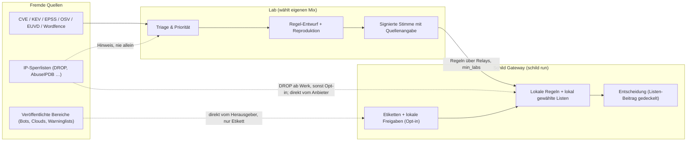

# Quellen: CVE-Datenbanken, IP-Listen und CrowdSec

**Status:** ENTWURF · Stand 28.10.2026 · erweitert [Technik kompakt](13-technik-kompakt.md) („Fremde Quellen und IP-Metadaten“), hält sich an [18](18-manipulation-und-poisoning.md) (G1, G2, G6) und [21](21-architektur-v1.md) (lokale Vertrauenslisten). Lizenz- und Preisangaben sind am 25.10.2026 recherchiert und ändern sich häufig. Was nicht aus Primärquellen bestätigt ist, ist als **ZU PRÜFEN** markiert.

**Kurz:**

- Schwachstellen-Quellen (CVE, KEV, EPSS, OSV, Wordfence, EUVD) nutzt nur das Lab; am Schild Gateway kommen fertige Regeln mit Kennung als Etikett an.
- Jedes Lab wählt seinen Quellen-Mix in `lab.yaml` mit Lizenz-Etikett und Zweck; erlaubt die Lizenz den Zweck nicht, startet das Lab nicht.
- Keine IP-Listen aus dem Netz (G1), auch keine Erlaubt-Listen (ENTSCHIEDEN 28.10.2026, Initiator): Labs verteilen Regeln gegen Angriffsmuster, keine IP-Daten. Veröffentlichte Bereiche von Suchmaschinen-Bots, Clouds oder Zahlungsdiensten lädt das Gateway selbst beim Herausgeber und nutzt sie nur als Etikett (Metainformation). Freigeben oder sperren entscheidet der Betreiber per Opt-in, beides wirkt nur auf seinem Server.
- Fremde Quellen allein erlauben höchstens `observe`; Stimmen, die nur auf derselben fremden Quelle beruhen, zählen wie eine.
- CrowdSec (ENTSCHIEDEN 28.10.2026, Initiator): keine CrowdSec-IP-Listen, weder am Server noch im Lab, kein Konto und keine Daten an CrowdSec. Labs nutzen die Regeln aus dem CrowdSec-Hub (MIT) als Quelle für Kandidaten. Das Gateway bringt die öffentlichen Hub-Regeln selbst mit und hält sie automatisch aktuell (ENTSCHIEDEN 30.10.2026, Initiator, [`MVP-26`](../../tests/specs/MVP-26-crowdsec-hub-rules.yaml)). Wer CrowdSec trotzdem will, betreibt es parallel; das ist dokumentiert (§4). Schild soll die offenen CrowdSec-Funktionen selbst abdecken.

**Frage des Initiators:** Welche Datenbanken könnten wir für CVEs und Abuse-IP-Listen nutzen, und wie integrieren wir CrowdSec, vermutlich in die Server? Jedes Lab soll seinen Mix selbst wählen.

## 1. Wo welche Quelle wirkt



| Ort | Darf | Darf nicht |
| --- | --- | --- |
| **Lab** | jede Quelle abrufen, deren Lizenz es erlaubt; Quellen gewichten; CVE-Daten in Regeln und Etiketten übernehmen; IP-Quellen als Hinweis für Triage und als *ergänzenden* Beleg nutzen | IP-Listen (eigene oder fremde, auch als Pseudonym, auch Erlaubt-Listen) an Clients verteilen (18, G1, G6); fremde Quellen allein als Grund für `challenge`/`block` nehmen; Daten entgegen der Lizenz weitergeben |
| **Server** | Spamhaus DROP ab Werk, weitere Sperrlisten per Opt-in direkt beim Anbieter laden und **lokal** anwenden; veröffentlichte Bereiche von Bots, Clouds und Zahlungsdiensten direkt beim Herausgeber laden und als Etikett anzeigen; einzelne Bereiche per Opt-in lokal freigeben | lokal geladene Listen an Labs melden oder weitergeben; Etiketten automatisch als Freigabe anwenden; lokal freigegebene Absender sperren; Pro-Request-Abfragen bei Dritten (13: „Nichts wird pro Request bei Dritten nachgeschlagen“) |

**Keine Listen über die Labs (ENTSCHIEDEN 28.10.2026, Initiator):** Labs spiegeln weder Sperr- noch Erlaubt-Listen. Sperrlisten widersprechen G1 und vielen Lizenzen (AbuseIPDB verbietet die Weitergabe, CrowdSec regelt sie nicht frei). Erlaubt-Listen wären ein Angriffspunkt: Mehrere Labs könnten sich zusammentun und etwa die Server eines Werbenetzes eintragen, und überall fielen Prüfungen weg, ohne dass es jemand merkt. Metainformation ja, automatisch freischalten nein: Das Gateway lädt veröffentlichte Bereiche selbst beim Herausgeber und zeigt sie als Etikett; freigeben kann nur der Betreiber.

## 2. Schwachstellen-Quellen (CVE & Co.)

Ein Lab braucht sie, um (1) neue Lücken in verbreiteter Web-Software früh zu sehen, (2) zu priorisieren (wird sie ausgenutzt, wie wahrscheinlich?) und (3) betroffene Versionen und Endpunkte zu kennen, damit es einen *engen* virtuellen Patch schreiben und gegen eine verwundbare Version reproduzieren kann (18, G2/G3). Für (3) sind Ökosystem-Datenbanken (WordPress, Packagist) wichtiger als die großen CVE-Kataloge.

| Quelle | Inhalt | Zugriff | Lizenz/Weitergabe | Kosten | Eignung v1 |
| --- | --- | --- | --- | --- | --- |
| [CVE-Liste (cvelistV5)](https://github.com/CVEProject/cvelistV5) | Alle CVE-Datensätze im CVE-JSON-5-Format, inkl. ADP-Daten (z. B. CISA Vulnrichment) | Git-Repo, Aktualisierung etwa alle 7 Minuten; CVE Services API | [CVE Terms of Use](https://www.cve.org/Legal/TermsOfUse) (Nutzung und Weitergabe erlaubt, Wortlaut ZU PRÜFEN) | frei | **ja**, Grundlage für Kennungen. Risiko: Finanzierung über US-Behörde (CISA); Lage 2026 ZU PRÜFEN |
| [CISA Vulnrichment](https://github.com/cisagov/vulnrichment) | Ergänzung von CVEs um SSVC-Einschätzung („wird ausgenutzt?“), CWE, CVSS, CPE | Git-Repo (CC0), Daten zusätzlich als ADP im CVE-Datensatz | CC0 | frei | **ja**, ersetzt teilweise, was NVD nicht mehr anreichert |
| [CISA KEV](https://www.cisa.gov/known-exploited-vulnerabilities-catalog) | Katalog nachweislich ausgenutzter Lücken (am 25.10.2026: 1.756 Einträge) | JSON/CSV, Schema | [CC0](https://www.cisa.gov/sites/default/files/licenses/kev/license.txt) | frei | **ja**, stärkstes Prioritätssignal |
| [EPSS (FIRST)](https://www.first.org/epss/) | Täglich geschätzte Ausnutzungswahrscheinlichkeit je CVE | API `api.first.org/data/v1/epss`, tägliche CSV, ohne Anmeldung | frei nutzbar, Namensnennung erbeten ([FAQ](https://www.first.org/epss/faq)); formale Lizenz ZU PRÜFEN | frei | **ja**, zur Priorisierung, nicht als Beleg |
| [NVD (NIST)](https://nvd.nist.gov/developers/start-here) | Anreicherung: CVSS, CWE, CPE | API 2.0; 5 Anfragen / 30 s ohne, 50 mit Schlüssel | US-Behördendaten; Hinweispflicht „not endorsed“ ZU PRÜFEN | frei | **nur Zusatz.** Seit 15.04.2026 reichert NIST nur noch priorisierte CVEs an (KEV, Bundessoftware), ältere Rückstände sind „Not Scheduled“ ([Infosecurity](https://www.infosecurity-magazine.com/news/nvd-enrichment-premarch-2026/), [CSA](https://labs.cloudsecurityalliance.org/research/csa-research-note-nist-nvd-enrichment-changes-enterprise-vul/)). Wer sich auf CPE aus NVD verlässt, übersieht viele Lücken. |
| [OSV.dev](https://osv.dev/) | Aggregat aus Ökosystem-Datenbanken (GitHub, PyPI, Go, Packagist via GHSA, Distributionen …) im OSV-Schema, mit exakten Versionsbereichen | API ohne Limit laut [FAQ](https://google.github.io/osv.dev/faq/), Bulk-Download aus GCS-Bucket `osv-vulnerabilities` | Lizenz **je Ursprungsquelle** (siehe Feld/Quelle); Code Apache-2.0 | frei | **ja**, im Lab für Versionsbereiche. Nie die Software-Liste eines Servers an OSV schicken (verrät Inventar). |
| [GitHub Advisory Database](https://github.com/github/advisory-database) | Geprüfte Advisories für Paket-Ökosysteme (Composer, npm …) | Git-Repo im OSV-Format, GraphQL-API | [CC BY 4.0](https://github.com/github/advisory-database/blob/main/LICENSE.md): Namensnennung, Weitergabe erlaubt | frei | **ja** (ohnehin in OSV enthalten; zählt nicht doppelt, siehe §5) |
| [Wordfence Intelligence](https://www.wordfence.com/help/wordfence-intelligence/v3-accessing-and-consuming-the-vulnerability-data-feed/) | WordPress-Kern, Plugins, Themes: betroffene Versionen, Fix-Versionen, oft Endpunkt | Vulnerability Data Feed v3, JSON, **kostenloser API-Schlüssel nötig** (v1/v2 seit 09.03.2026 abgeschaltet) | laut Anbieter frei für private und kommerzielle Nutzung, Namensnennungspflicht ([Ankündigung](https://www.wordfence.com/blog/2022/12/wordfence-free-vulnerability-database/)); aktuelle Bedingungen ZU PRÜFEN | frei | **ja**, wichtigste Quelle für die Zielgruppe (WordPress). US-Firma (Defiant). |
| [Patchstack Database](https://patchstack.com/database/) | WordPress, Drupal u. a., teils früher als andere | Standard-API: Schlüssel nach Prüfung des Anwendungsfalls, 500 Anfragen / 24 h; vollständige Daten nur kommerziell ([Doku](https://docs.patchstack.com/database-api/standard-api)) | Weitergabe- und Lizenzbedingungen ZU PRÜFEN; vPatch-Regeln proprietär | frei (begrenzt) / kommerziell | **später**, nach Klärung der Bedingungen; EU-Firma (Estland) |
| [WPScan](https://wpscan.com/) | WordPress-Lücken | API, kostenlos 25 Anfragen/Tag | Gratisstufe laut Dritten nur nicht kommerziell (ZU PRÜFEN); [AGB](https://wpscan.com/terms) untersagen Speichern der Daten außerhalb des Dienstes | frei (sehr begrenzt) / Enterprise | **meiden**: Speicherverbot passt nicht zum Lab-Betrieb |
| [FriendsOfPHP security-advisories](https://github.com/FriendsOfPHP/security-advisories) | PHP-/Composer-Pakete (Symfony, Laravel, Drupal-Pakete …) | Git-Repo (YAML) | Unlicense (gemeinfrei) | frei | **ja** |
| [EUVD (ENISA)](https://euvd.enisa.europa.eu/) | Europäische Schwachstellen-Datenbank nach NIS2, eigene Kennungen (EUVD-…), Verweis auf CVE; ENISA ist seit Ende 2025 CVE-Root ([CSA](https://labs.cloudsecurityalliance.org/research/csa-research-note-enisa-cve-root-dual-governance-20260518-cs/)) | API `euvdservices.enisa.europa.eu` ohne Anmeldung (am 25.10.2026 erreichbar), offizielle Doku und Limits nicht gefunden | Weiterverwendungsbedingungen ZU PRÜFEN | frei | **ja, als Gegenquelle und Etikett**; laut [VulnCheck](https://www.vulncheck.com/blog/enisa-euvd) deutliche Lücken (CWE/CPE fehlen), nicht als alleinige Quelle |
| [BSI CERT-Bund WID (CSAF)](https://wid.cert-bund.de/.well-known/csaf/provider-metadata.json) | Sicherheitshinweise des BSI im CSAF-2.0-Format, signiert (OpenPGP) | ROLIE-Feeds TLP:WHITE (öffentlich) und TLP:GREEN | Nutzungsbedingungen ZU PRÜFEN; TLP:GREEN nicht öffentlich weitergeben | frei | **ja (WHITE)**, deutsche Quelle, gut für Kommunikation („BSI-Hinweis …“) |
| CSAF-Feeds der Hersteller und Distributionen ([Red Hat](https://security.access.redhat.com/data/csaf/v2/), Debian/Ubuntu-Tracker) | Betroffenheit von Server-Paketen (nginx, PHP, OpenSSL) | CSAF/OVAL/OSV | je Anbieter ZU PRÜFEN | frei | **später**, eher für Patch-Hinweise im Dashboard als für WAF-Regeln |

**Was ein Lab daraus macht:** CVE-Daten sind Arbeitsliste und Etikett, kein Beweis. Ein Regel-Vorschlag trägt die Kennungen (`CVE-…`, `GHSA-…`, `EUVD-…`, Wordfence-ID), die betroffene Software mit Versionsbereich und den Nachweis der eigenen Reproduktion. Damit kann das Dashboard „Schutz für Plugin X ≤ 2.3.1 (CVE-…)“ anzeigen. Ob die Software installiert ist, prüft der Server, wenn überhaupt, **lokal**; das Inventar verlässt ihn nicht.

## 3. IP-Quellen: Sperrlisten, Reputation, Etiketten

Es gelten die Grundsätze aus 04, 13 und 18: nie allein wegen der IP sperren; kein Abruf pro Request bei Dritten; Null-Beitrag für `mobile`, `cgnat`, `tor`, vom Gateway selbst verifizierte Bots und lokal freigegebene Absender; keine IP-Reputation aus dem Netz, auf keiner Stufe, denn Besucher-IPs verlassen den Server nie (E4). IP-Listen wirken nur beim Betreiber, der sie gewählt hat. Einzige Liste ab Werk ist Spamhaus DROP, auf Netzwerkebene ([Manipulation und Poisoning](18-manipulation-und-poisoning.md), G1).

| Quelle | Inhalt | Zugriff | Lizenz/Weitergabe | Kosten | Eignung v1 |
| --- | --- | --- | --- | --- | --- |
| **Etiketten (Metainformation, ohne Wirkung)** | | | | | |
| [Googlebot](https://developers.google.com/search/docs/crawling-indexing/verifying-googlebot) / [Bingbot](https://www.bing.com/toolbox/bingbot.json) | Veröffentlichte IP-Bereiche der Crawler | JSON; zusätzlich FCrDNS-Prüfung | frei zur Prüfung | frei | **ja, als Etikett;** das Gateway lädt selbst und prüft per FCrDNS (G6). Das Bingbot-JSON trug am 25.10.2026 das Datum 03.01.2024; Aktualität ZU PRÜFEN, FCrDNS bleibt Pflicht |
| Cloud-Bereiche ([AWS](https://ip-ranges.amazonaws.com/ip-ranges.json), [Google Cloud](https://www.gstatic.com/ipranges/cloud.json), [Azure](https://www.microsoft.com/en-us/download/details.aspx?id=56519), [Cloudflare](https://www.cloudflare.com/ips/)) | Rechenzentrums-Netze | JSON/Text | frei zur Prüfung | frei | **ja**, für `net=datacenter`, nicht zum Sperren (dort sitzen gekaperte Server und Zahlungsdienste) |
| [MISP-Warninglists](https://github.com/MISP/misp-warninglists) | Bekannte harmlose Bereiche: CDNs, Resolver, Suchmaschinen, Clouds | Git-Repo | CC0 (Teile MIT) | frei | **ja**, als Etikett; das Gateway lädt selbst |
| [GreyNoise](https://docs.greynoise.io/docs/using-the-greynoise-community-api) (RIOT, „benign“) | Erkennt harmlose Massen-Scanner und bekannte Dienste (gegen Fehlalarme) | Community-API: laut Doku 50 Suchen/Woche, ohne Kontext | [EULA](https://www.greynoise.io/terms): Gratisstufen für nicht-kommerzielle Zwecke; Forschungsprogramm auf Antrag | frei (sehr begrenzt) | **später**, nur im Lab für Einzelfälle; Forschungszugang anfragen. US-Firma |
| **Markieren, nicht sperren** | | | | | |
| [Tor-Exit-Liste](https://check.torproject.org/torbulkexitlist) | Aktuelle Exit-Relays (am 25.10.2026: 1.212) | Text | frei | frei | **ja**, nur `net=tor`, Null-Beitrag |
| **Sperrlisten / Reputation** | | | | | |
| [Spamhaus DROP](https://www.spamhaus.org/blocklists/do-not-route-or-peer/) (inkl. ehem. EDROP) und ASN-DROP | Gekaperte und kriminell genutzte Netze, klein | JSON (`drop_v4.json`, `drop_v6.json`, `asndrop.json`), Abruf höchstens einmal täglich | kostenlos für alle, Namensnennung und Copyright-Hinweis beibehalten | frei | **ja**, am Server **ab Werk** auf Netzwerkebene, die ersten 7 Tage im Probelauf (D28, [MVP-15](../../tests/specs/MVP-15-network-blocking.yaml)); im Lab als Hinweis. Labs geben die Liste nicht weiter (§1) |
| [abuse.ch Feodo Tracker](https://feodotracker.abuse.ch/) | Botnetz-C2-Server | Text/JSON, Anmeldung (Auth-Key) | [CC0](https://abuse.ch/terms-of-use/) | frei | **ja, im Lab**; für eingehenden Web-Traffic wenig relevant |
| [abuse.ch URLhaus / ThreatFox](https://abuse.ch/terms-of-use/) | Malware-URLs, IOCs | API mit Auth-Key, Fair-Use-Limits | frei für nicht-kommerzielle Zwecke; kommerziell ggf. Abo über Spamhaus; **Verbot, Daten zum Training von KI-Modellen zu nutzen**; keine abgeleiteten Werke ohne Zustimmung | frei (nicht kommerziell) | **später**, nur Lab-Triage, nicht zum Feintuning eigener Modelle |
| [AbuseIPDB](https://www.abuseipdb.com/) | Nutzerberichte, „Confidence of Abuse“ 0–100 | Blacklist-Endpunkt, Gratisstufe wenige Abrufe/Tag, max. 10.000 Einträge (Zahlen von Dritten, ZU PRÜFEN) | [AGB](https://www.abuseipdb.com/legal): **Gratispläne nicht für kommerzielle Zwecke**; Weiterveröffentlichen und Weiterverkauf verboten | frei / ab Basic kostenpflichtig | **nur am Server per Opt-in mit eigenem Schlüssel**; Shops und Firmen brauchen einen bezahlten Plan; Labs verteilen nichts davon. US-Firma |
| [CrowdSec](https://docs.crowdsec.net/docs/next/central_api/community_blocklist) Community-Blocklist / CTI | Konsens-Liste aus Signalen der Nutzer; CTI-Auskunft je IP | nur mit Security Engine (Lite ~3.000 IPs ohne Beitrag, Community ~15.000 mit Beitrag); Raw-IP-Liste über Console (Gratisstufe 1×/24 h); CTI-API Gratisschlüssel mit kleinem Monatskontingent | Engine MIT; Bedingungen für Blocklist-Daten nicht als Lizenz veröffentlicht gefunden (ZU PRÜFEN); kommerzielle Weitergabe über Partnerprogramm | frei / Premium | **nein**, weder am Server noch im Lab (§4, ENTSCHIEDEN 28.10.2026) |
| [blocklist.de](https://www.blocklist.de/en/download.html) | Fail2ban-Meldungen (SSH, Mail, Web-Login …) | Text-Export, DNSBL | Bedingungen auf der Website nicht auffindbar, ZU PRÜFEN | frei | **später**, deutscher Betreiber, Lizenz klären |
| [Emerging Threats compromised-ips](https://rules.emergingthreats.net/blockrules/compromised-ips.txt) | Kompromittierte Hosts | Text | ET Open ist BSD; für diese Datei Lizenz unklar ([Forum](https://community.emergingthreats.net/t/licensing-is-the-compromised-ips-list-also-open/676)) | frei | **später**, ZU PRÜFEN |
| [DShield / SANS ISC](https://isc.sans.edu/block.txt) | Top-20-/24-Netze der letzten 3 Tage | Text, API | CC BY-NC-SA 2.5 (nicht kommerziell) | frei | **meiden** für Server-Wirkung; höchstens Lab-Triage |
| [FireHOL blocklist-ipsets](https://github.com/firehol/blocklist-ipsets) | Sammlung hunderter fremder Listen | Git-Repo | Lizenz **je Einzelliste**, viele unklar; Index teils nicht mehr gepflegt | frei | **meiden**: Lizenzmix, verdeckte Doppelzählung (enthält z. B. blocklist.de, DShield, DROP) |
| [Shadowserver](https://www.shadowserver.org/what-we-do/network-reporting/get-reports/) | Berichte über *eigene* Netze: kompromittierte, offene, verwundbare Systeme | E-Mail/API, nur für nachgewiesene Netzinhaber | frei, „we don't sell data“; Weitergabe ZU PRÜFEN | frei | **ja für Hoster-Labs**, zeigt gekaperte Kundenserver (passt zum Bürgen-Modell, 18, G7) |
| **IP-Metadaten** | | | | | |
| [DB-IP Lite](https://db-ip.com/db/lite.php) / [IPinfo Lite](https://ipinfo.io/lite) / RIPE RIS | Land, ASN | MMDB, siehe [Technik kompakt](13-technik-kompakt.md) | DB-IP CC BY 4.0; IPinfo Lite **CC BY-SA 4.0** (Namensnennung; ShareAlike für abgeleitete Datenbanken beachten) | frei | **ja** (13). Klärt den ZU-PRÜFEN-Punkt zu IPinfo aus [Technik kompakt](13-technik-kompakt.md) |

**Fehlalarm-Risiken:**

- **CGNAT und Mobilfunk:** Eine IP steht für Hunderte Menschen, und Listen wie AbuseIPDB führen sie, weil *ein* Gerät dahinter auffiel. Deshalb Null-Beitrag für `cgnat`/`mobile` (18, G1), auch bei lokal gewählten Listen.
- **Residential Proxies:** Angreifer mieten Privatanschlüsse, deren Adressen morgen jemand anderem gehören. Lokal geladene Listen deshalb oft aktualisieren und Treffer nur kurz wirken lassen (Dauer lokal einstellbar).
- **Cloud-Bereiche:** Zahlungsdienste, Webhooks und Monitoring sitzen in denselben Netzen wie gekaperte Server. Das Etikett zeigt das im Dashboard; was der Betreiber lokal freigibt, schlägt jede Sperrliste.
- **Listen-Vergiftung:** Wer bei AbuseIPDB oder einer anderen offenen Plattform IPs eines Konkurrenten meldet, vergiftet jede Quelle, die das übernimmt (Angriff A1 aus 18 über einen Umweg). Fremde Listen sind deshalb nie alleiniger Grund.

**Datenschutz:** Listen herunterladen und lokal abgleichen verarbeitet personenbezogene Daten (IP-Adressen der Gelisteten und der Besucher:innen), voraussichtlich auf Grundlage von Art. 6 Abs. 1 lit. f DSGVO mit Erwägungsgrund 49 (Netz- und Informationssicherheit); ZU PRÜFEN in der DSFA. Kritischer ist das **Melden** (AbuseIPDB-Report, CrowdSec-Signal): Es schickt Besucher-IPs im Klartext an Dritte, bei AbuseIPDB in die USA. Das darf nur der Betreiber selbst einschalten, mit Hinweis in seiner Datenschutzerklärung; Schild tut es nie per Standard und nie über die Labs.

## 4. CrowdSec

### Wie CrowdSec funktioniert (Stand Oktober 2026)

- **Security Engine** (Agent, [MIT](https://github.com/crowdsecurity/crowdsec), aktuell v1.8.1 vom 03.09.2026) liest Logs, erkennt Muster per **Szenario** und schreibt Entscheidungen in die **Local API (LAPI)**.
- **Bouncer / Remediation Components** fragen die LAPI ab (Streaming-Modus: periodischer Abgleich, Standard 60 s; Live-Modus: pro Request) und setzen Entscheidungen um. Für Caddy gibt es den [caddy-crowdsec-bouncer](https://github.com/hslatman/caddy-crowdsec-bouncer) (Apache-2.0, v0.14.1 vom 03.08.2026), der auch die **AppSec-Komponente** ansprechen kann.
- **AppSec-Komponente** ist die WAF von CrowdSec, intern [Coraza](https://docs.crowdsec.net/docs/appsec/installation) mit eigenen „Virtual Patching“-Regeln und optional OWASP CRS; technisch fast dasselbe wie unser Gateway (16).
- **Central API (CAPI):** Die Engine schickt Signal-Metadaten (Szenario, Hash/Version, Zeit, Maschinen-ID, **angreifende IP im Klartext** mit Geo) an CrowdSec ([Doku](https://docs.crowdsec.net/docs/central_api/intro)). Nur unveränderte Hub-Szenarien zählen für den Konsens. Zurück kommt die **Community-Blocklist**: Lite (~3.000 IPs) ohne regelmäßigen Beitrag, Community (~15.000) mit Beitrag, Premium (bis ~60.000) gegen Geld ([Doku](https://docs.crowdsec.net/docs/next/central_api/community_blocklist)).
- **CTI-API:** Auskunft je IP; Gratisschlüssel mit kleinem Monatskontingent (Doku nennt 120/Monat für Community, ältere Fassungen 40, ZU PRÜFEN), bezahlt ab etwa 49 $/Monat für 5.000 Anfragen ([Preise](https://www.crowdsec.net/pricing), ZU PRÜFEN).
- **Firma:** CrowdSec SAS, Frankreich; EU-Recht, als Firma kein CLOUD-Act-Bezug (Hosting-Standorte ZU PRÜFEN). Konsensformel nicht öffentlich.

### Optionen

| Option | Was | Passt zu unseren Regeln? | Bewertung |
| --- | --- | --- | --- |
| **(a) Lokale Bridge am Server** | `schild` bindet das Caddy-Bouncer-Modul ein (Option beim Bau oder optionales Modul). Der Betreiber betreibt *seine eigene* CrowdSec-Engine; `schild` liest deren Entscheidungen im Streaming-Modus und wertet sie als **lokale Punkte** (Standard) oder, ausdrücklich gewünscht, als lokale Aktion. | Ja: lokale Liste, lokale Haftung (18, G1 „lokal abgeglichene Fremdlisten bleiben“). Schutzliste gewinnt. Nichts davon geht an Labs. | **Verworfen (ENTSCHIEDEN 28.10.2026, Initiator).** Schild soll die offenen CrowdSec-Funktionen selbst abdecken; eine Brücke bräuchte zusätzliche Software und ein Konto bei einer Firma. |
| **(a′) Schild als Signalquelle für die lokale CrowdSec** | `schild` schreibt Coraza-Treffer in ein Log-Format, das ein CrowdSec-Szenario liest. | Ja, solange es lokal bleibt. Eigene Szenarien zählen bei CrowdSec nicht für den Konsens. | Verworfen (28.10.2026), wie (a). |
| **(b) Lab nutzt CrowdSec als Quelle** | Ein Lab fragt die CTI-API für Einzelfälle ab oder betreibt selbst eine Engine mit Honeypots und nutzt deren Blocklist intern. | Ja, als **eine** Quelle mit Herkunftsangabe (§5). Jede CTI-Abfrage schickt eine Angreifer-IP an CrowdSec; das gehört ins Lab-Datenschutzkonzept. | **Für IP-Daten verworfen (ENTSCHIEDEN 28.10.2026).** Keine Blocklist und keine CTI im Lab: IP-Daten, Lizenz nur für interne Zwecke, Abfragen schicken Angreifer-IPs an CrowdSec. **Hub-Regeln ja**, siehe „Hub-Regeln in den Labs“. |
| **(c) Zurückgeben: Regeln statt IPs** | Labs veröffentlichen geprüfte virtuelle Patches zusätzlich als CrowdSec-AppSec-Regeln oder Szenarien im [Hub](https://app.crowdsec.net/hub) (MIT). | Ja, Regeln enthalten keine IPs (G1). Passt zu „kooperieren statt doppeln“ (16). | **Empfohlen, ab der Alpha.** Formatwandler ZU PRÜFEN (CrowdSec-DSL wird zu SecRules kompiliert). |
| **(c′) LAPI-kompatible Schnittstelle der Labs** | Labs bieten eine Decision-API an, damit fremde CrowdSec-Bouncer Schild-Bewertungen beziehen (in 13 und 16 als Idee genannt). | **Nein**, das wäre eine verteilte IP-Liste (G1). | **Verwerfen.** Allenfalls für Regeln (AppSec) denkbar, nicht für IP-Entscheidungen. |
| **(c″) Labs veröffentlichen eine Blocklist bei CrowdSec** | Lab stellt eigene IP-Erkenntnisse als „Third-Party Blocklist“ in die Console. | **Nein**: IP-Liste, zentraler Dritter, Datenschutz. | Verwerfen. |
| **(d) Gar nicht integrieren** | – | – | Am Server ja (ENTSCHIEDEN 28.10.2026). In den Labs keine CrowdSec-IP-Daten (b), Hub-Regeln nur als Kandidaten; Rückfluss über Regeln (c) ist OFFEN. |

### Empfehlung

1. **Keine Anbindung am Server** (ENTSCHIEDEN 28.10.2026, Initiator): weder Bridge (a) noch Signalquelle (a′) noch CrowdSec-Listen. Ausnahme seit 30.10.2026: die öffentlichen Hub-Regeln im Gateway, siehe unten. Wer Schild nutzt, soll CrowdSec nicht zusätzlich brauchen; die offenen CrowdSec-Funktionen deckt Schild selbst ab (Abgleich in Arbeit).
2. **Hub-Regeln als Quelle der Labs** (ENTSCHIEDEN 28.10.2026, Initiator): virtuelle Patches und Szenario-Logik aus dem CrowdSec-Hub (MIT) als Kandidaten, siehe unten. Keine CrowdSec-IP-Daten im Lab.
3. **(c)** Rückfluss über Regeln in den CrowdSec Hub. Das hilft auch CrowdSec-Nutzer:innen ohne Schild (OFFEN).
4. **Parallelbetrieb** ist möglich und dokumentiert, siehe unten.
5. **Nicht:** LAPI-Schnittstelle für IP-Entscheidungen, Blocklist-Spiegel, Pflichtabhängigkeit von CAPI, CTI-Abfragen.

**Begründung:** CrowdSec berechnet zentral eine IP-Liste für viele. Schild verteilt geprüfte Regeln nach Konsens unabhängiger Betreiber, ohne IP-Listen. Beides verträgt sich im Parallelbetrieb: Wer CrowdSecs IP-Listen will, schaltet sie in seiner eigenen CrowdSec ein, ohne Kopplung an Schild. Die Community-Blocklist verlangt für mehr Daten eigene Beiträge, also Klartext-IPs an eine Firma; das darf Schild niemandem als Standard unterschieben, auch wenn die Firma in der EU sitzt.

### Hub-Regeln in den Labs (ENTSCHIEDEN 28.10.2026)

Der [CrowdSec Hub](https://github.com/crowdsecurity/hub) steht unter MIT-Lizenz und enthält rund 230 AppSec-Regeln, davon über 200 virtuelle Patches zu CVEs, dazu Szenarien für Brute Force, Scans und Crawling. Regeln enthalten keine IP-Adressen und passen deshalb zu G1.

- **Abruf** nur aus dem Git-Repository, festgelegt auf einen Commit; nie über Console oder Central API, kein CrowdSec-Konto.
- **Umwandeln:** Die YAML-Regeln des Hubs nutzen nur einen kleinen Teil von SecLang (Zonen wie `ARGS`, `URI`, `HEADERS`, Vergleiche wie `contains`, `regex`, `libinjectionSQL`); CrowdSec kompiliert sie selbst zu SecLang. Ein Lab wandelt sie in unsere SecLang-Teilmenge um; Regeln mit eingebettetem rohem SecLang prüft es einzeln.
- **Nur Kandidaten:** Eine Hub-Regel zählt wie jede fremde Quelle nie allein. Sie wird nachgestellt, gegen harmlosen Traffic getestet und von mindestens zwei Lab-Betreibern mitgezeichnet (G2), bevor sie an Gateways geht.
- **Lizenz:** Lizenztext und Copyright-Zeile gehen mit jeder übernommenen Regel mit (NOTICE im Regelpaket; ein Feld für Herkunft und Lizenz im Regelpaket-Contract ist OFFEN). Datendateien, auf die manche Szenarien verweisen, haben keine Gesamtlizenz und werden einzeln geprüft.
- **Marke:** CrowdSec nur beschreibend nennen („Regel aus dem CrowdSec Hub, MIT“), kein Logo, nichts, was nach Partnerschaft aussieht.

### Hub-Regeln im Gateway (ENTSCHIEDEN 30.10.2026)

Die Mitzeichnung durch zwei Lab-Betreiber gilt nur im Lab. Das Gateway, auch im Standalone-Betrieb, arbeitet pragmatisch nach Best Practice: Es nutzt die öffentlichen virtuellen Patches aus dem Hub als eigene Regelquelle neben dem OWASP CRS, mit automatischen Updates ([`MVP-26`](../../tests/specs/MVP-26-crowdsec-hub-rules.yaml)).

- Abruf der öffentlichen Datei aus dem Git-Repository. Kein Konto, keine Central API, keine Console. CrowdSec bekommt keine Daten. Die CrowdSec-Engine läuft nicht mit, das Gateway wandelt die Regeln selbst um.
- Ein Stand liegt im Image, damit die Regeln auch ohne ausgehende Verbindung wirken.
- Der Hub signiert nichts. Deshalb prüft das Gateway jedes Update auf Grenzen und Kosten, tauscht es atomar und behält bei Fehlern den letzten guten Stand.
- Für den Anfang wirken die Regeln nur als „Erkannt“. Wann sie sperren, entscheidet der Initiator nach der Messung.

### Parallelbetrieb mit CrowdSec

Wer CrowdSec schon nutzt oder dessen IP-Listen will, betreibt es neben Schild, ohne Kopplung:

- CrowdSec mit eigener Engine und eigenem Bouncer, eigenes Konto, eigener Lizenzvertrag. Schild liest nichts von CrowdSec und schickt nichts dorthin.
- Was die eigene CrowdSec an CrowdSec meldet (ab Werk angreifende IPs im Klartext), entscheidet der Betreiber in *seiner* CrowdSec-Konfiguration; das gehört dann in seine Datenschutzerklärung.
- Schild erkennt laufende Bouncer und warnt vor doppelten Sperren ([`MVP-15`](../../tests/specs/MVP-15-network-blocking.yaml)). Empfohlene Reihenfolge: Netzwerk-Sperren an einer Stelle, also entweder der CrowdSec-Firewall-Bouncer oder der Netzwerkschutz von Schild.

## 5. Der Quellen-Mix je Lab

### 5.1 Konfiguration im Lab

Jedes Lab legt seine Quellen in der `lab.yaml` fest, neben `federation.peers` (21, §4.2). Aus **Lizenz-Etikett** und **Verwendungszweck** jeder Quelle folgt maschinell, wohin ihre Daten fließen dürfen. Es gibt keinen Pflicht-Mix und keine zentrale Quellenliste, nur eine empfohlene Startkonfiguration.

| `use` | Bedeutung | Darf in … |
| --- | --- | --- |
| `ip_label` | Etikett für IP-Bereiche (Bot, Cloud, Zahlungsdienst) als Kontext bei der Triage | nur lab-intern und als Kontext in Stimmen; nie an Clients (G1, G6) |
| `evidence` | zählt als ergänzender Beleg in einer Stimme | Stimmen (mit Quellenangabe), nie allein |
| `priority` | bestimmt Reihenfolge der Untersuchung (EPSS, KEV, Reputation) | nur lab-intern; erscheint als Etikett, nicht als Beleg |
| `triage` | nur für Analyst:innen und KI-Triage im Lab | nirgendwo hin; nicht in Stimmen, nicht in Modelltraining, wenn die Lizenz es verbietet |
| `label` | Kennung für Regeln und Dashboard (CVE, EUVD, BSI) | Regel-Metadaten |
| `candidate` | fremde Regel als Kandidat (z. B. CrowdSec Hub) | eigene Reproduktion und Mitzeichnung (G2); nie unverändert an Clients |

```yaml
# lab.yaml (lab) – which third-party sources this lab uses, and how
sources:
  # --- vulnerability data ---
  - id: cve-list
    upstream: cve.org            # upstream family, used for de-duplication
    kind: vuln
    url: https://github.com/CVEProject/cvelistV5
    use: [label, priority]
    license: cve-tou             # see license registry below
    refresh: 15m
  - id: cisa-kev
    upstream: cisa
    kind: vuln
    url: https://www.cisa.gov/sites/default/files/feeds/known_exploited_vulnerabilities.json
    use: [priority, label]
    license: cc0
    refresh: 6h
  - id: epss
    upstream: first-epss
    kind: vuln
    url: https://api.first.org/data/v1/epss
    use: [priority]
    license: attribution
    refresh: 24h
  - id: osv
    upstream: osv               # aggregates GHSA, PyPI, Go, distros ...
    kind: vuln
    url: gs://osv-vulnerabilities
    use: [label, evidence]      # version ranges help to reproduce
    license: per-record         # licence is taken from each record's origin
    refresh: 1h
  - id: wordfence
    upstream: wordfence
    kind: vuln
    url: https://www.wordfence.com/api/intelligence/v3/vulnerabilities/production
    credentials: env:WORDFENCE_API_KEY
    use: [label, evidence, priority]
    license: attribution
    refresh: 1h
  - id: euvd
    upstream: enisa
    kind: vuln
    url: https://euvdservices.enisa.europa.eu/api/
    use: [label]
    license: unknown            # TODO: check ENISA reuse terms
    refresh: 6h
  - id: bsi-csaf-white
    upstream: bsi
    kind: vuln
    url: https://wid.cert-bund.de/.well-known/csaf/provider-metadata.json
    tlp_max: WHITE              # never ingest GREEN into anything shared
    use: [label, priority]
    license: unknown
    refresh: 1h

  # --- IP data ---
  - id: search-bots
    upstream: search-engines
    kind: ip
    url: https://developers.google.com/static/search/apis/ipranges/googlebot.json
    use: [ip_label]
    verify: fcrdns             # range match alone is not enough
    license: open
    refresh: 24h
  - id: misp-warninglists
    upstream: misp
    kind: ip
    url: https://github.com/MISP/misp-warninglists
    use: [ip_label]
    license: cc0
    refresh: 24h
  - id: tor-exits
    upstream: torproject
    kind: ip
    url: https://check.torproject.org/torbulkexitlist
    use: [label]               # net=tor, never a penalty
    license: open
    refresh: 1h
  - id: spamhaus-drop
    upstream: spamhaus
    kind: ip
    url: https://www.spamhaus.org/drop/drop_v4.json
    use: [evidence]
    weight: 0.5
    license: attribution
    refresh: 24h               # Spamhaus: at most once per day
  - id: crowdsec-hub
    upstream: crowdsec
    kind: rules
    url: https://github.com/crowdsecurity/hub
    pin: <commit>              # never latest; updates are reviewed
    use: [candidate]
    license: mit               # licence text and copyright travel with every rule
    refresh: 24h
  - id: abuse-ch-threatfox
    upstream: abuse.ch
    kind: ioc
    credentials: env:ABUSECH_AUTH_KEY
    use: [triage]
    license: non-commercial
    restrictions: [no-ai-training, no-derivatives]

# Licence registry: what each tag allows. The lab refuses to start if a
# source's 'use' is not permitted by its licence tag.
licenses:
  cc0:                            { share: true,  attribution: false }
  attribution:                    { share: true,  attribution: true }
  cve-tou:                        { share: true,  attribution: true }
  open:                           { share: true,  attribution: false }
  per-record:                     { share: per-record }
  non-commercial:                 { share: false, allowed_use: [triage] }
  proprietary-no-redistribution:  { share: false, allowed_use: [triage, priority] }
  unknown:                        { share: false, allowed_use: [label, triage] }
```

Die Startprüfung („Lizenz erlaubt den Zweck nicht → Lab startet nicht“) ist absichtlich streng, damit eine Quelle mit unklarer Lizenz nicht unbemerkt in Stimmen und so zu den Clients gelangt.

### 5.2 Herkunft in Stimmen und Belegen

Jede signierte Lab-Bewertung (21, §7, mit Protobuf-Skizze) bekommt ein Feld für die Quellen. Skizze im JSON-Stil von [Manipulation und Poisoning](18-manipulation-und-poisoning.md):

```json
{
  "rule_id": "sr-2026-1042",
  "action_max": "challenge",
  "labels": ["CVE-2026-12345", "EUVD-2026-41210", "wordfence:7c1f..."],
  "evidence": {
    "own": [
      { "type": "reproduction", "target": "plugin-x@2.3.1", "lab_range": true },
      { "type": "honeypot_hits", "count": 37, "window": "6h" }
    ],
    "sources": [
      { "id": "wordfence", "upstream": "wordfence", "ref": "7c1f...", "fetched_at": "2026-10-25T08:10:00Z" },
      { "id": "osv", "upstream": "osv", "origin": "ghsa", "ref": "GHSA-xxxx-xxxx-xxxx" },
      { "id": "cisa-kev", "upstream": "cisa", "ref": "CVE-2026-12345" }
    ]
  },
  "sig": "ed25519:..."
}
```

Regeln für die Zählung (ENTWURF):

1. **Eigene Belege vor fremden.** `evidence.own` muss für `challenge` und `block` die Anforderungen aus 18, G2 erfüllen. `sources` allein erlaubt höchstens `observe`.
2. **Gleiche Herkunft zählt einmal.** Stützen sich mehrere Labs *nur* auf fremde Quellen derselben `upstream`-Familie (z. B. alle drei nur auf `crowdsec`), zählen ihre Stimmen dafür wie eine, so wie mehrere Labs eines Betreibers (SEC-03, [Architektur V1](21-architektur-v1.md) §7.1). Aggregatoren werden auf ihren Ursprung zurückgeführt (`osv` mit `origin: ghsa` = `ghsa`; FireHOL-Listen = jeweilige Einzelquelle).
3. **Quellen-Vielfalt sichtbar machen.** Das Gateway kann zusätzlich zu `min_labs` verlangen, dass die tragenden Stimmen nicht alle an derselben fremden Quelle hängen (`min_independent_upstreams`, Vorschlag 1 = aus). Standard bleibt Betreiber-Unabhängigkeit plus eigene Lab-Belege.
4. **Dashboard und Log** zeigen bei jeder Regel, auf welche Quellen sie sich stützt (13: „Im Dashboard steht bei jedem Punktwert, aus welcher Quelle er kommt“). Namensnennungen (Wordfence, GitHub, Spamhaus, IPinfo, DB-IP) erzeugt das Dashboard aus den Lizenz-Etiketten.

### 5.3 Opt-in am Server

Regeln und die Schutzliste für Endpunkte kommen über die Labs, IP-Daten nicht. Ab Werk lädt der Server nur Spamhaus DROP, direkt bei Spamhaus, und sperrt diese Netze auf Netzwerkebene (D28, [MVP-15](../../tests/specs/MVP-15-network-blocking.yaml)); die ersten 7 Tage nur im Probelauf, einzelne Adressen lassen sich im Dashboard erlauben. Alle weiteren IP-Quellen wählt nur der Betreiber per Opt-in, und sie wirken nur bei ihm. Sperrlisten holt sich der Server dann selbst beim Anbieter; der Betreiber ist Lizenznehmer und trägt die Entscheidung.

```yaml
# schild.yaml (website) – IP lists, always fetched by the gateway itself and applied locally (sketch)
network_blocking:
  spamhaus_drop:
    enabled: true              # default: on (D28), network level on all ports (MVP-15)
    dry_run: 7d                # observe for 7 days first
    url: https://www.spamhaus.org/drop/drop_v4.json
    refresh: 24h               # Spamhaus: at most once per day
local_sources:
  enabled: false               # default: off, no further list is fetched
  order: [protection_list, local_rules, local_sources, network]  # fixed, not configurable
  lists:
    - id: abuseipdb
      url: https://api.abuseipdb.com/api/v2/blacklist
      credentials: env:ABUSEIPDB_KEY   # operator's own account and licence
      refresh: 24h
      effect: score
      points: 8
      min_confidence: 100
  never_report: true           # fixed: hits from local lists are not sent to labs
```

Feste Regeln im Gateway, unabhängig von der Konfiguration:

- **Lokale Freigaben gewinnen** (18, G6): Kein lokaler Listen-Treffer wirkt auf Absender, die der Betreiber freigegeben hat, oder auf Webhook-Pfade. Freigaben gelten nie für WAF-Regeln und virtuelle Patches. Etiketten ändern keine Aktion.
- **Null-Beitrag** für `cgnat`, `mobile`, `tor` gilt auch für lokale Listen, außer der Betreiber schaltet ihn pro Liste bewusst ab (Dashboard warnt).
- **Lokale Listen-Treffer erzeugen keine Signale an Labs**, sonst würde eine fremde Liste über den Umweg Client→Lab doch zur Netzmeinung.
- **Kein Abruf pro Request** bei Dritten.
- Das **Dashboard** zeigt für jede Sperre und jeden Punktwert die Liste, ihre Lizenz und den Stand.

## 6. Empfehlung v1, später, meiden

| | Schwachstellen | IP |
| --- | --- | --- |
| **v1 (Lab)** | cvelistV5 + Vulnrichment, CISA KEV, EPSS, OSV.dev (inkl. GHSA), Wordfence Intelligence v3, FriendsOfPHP, EUVD und BSI-CSAF (TLP:WHITE) als Etikett/Gegenquelle | Google/Bing, Cloud-Bereiche und MISP-Warninglists als Etikett für die Triage; Tor-Exit (nur Etikett); Spamhaus DROP und Feodo als Hinweis; DB-IP/IPinfo Lite, RIPE RIS (13) |
| **v1 (Server, ab Werk)** | – (nur Regeln aus den Labs) | Spamhaus DROP auf Netzwerkebene (D28); Etiketten aus Google/Bing (mit FCrDNS), Cloud-Bereichen und MISP-Warninglists, direkt vom Herausgeber |
| **v1 (Server, Opt-in)** | – | AbuseIPDB mit eigenem Schlüssel und passendem Plan; weitere lokal gewählte Listen |
| **später** | Patchstack (Bedingungen klären), CSAF der Distributionen und Hersteller, NVD-Daten wo vorhanden | GreyNoise (Forschungszugang), blocklist.de und ET compromised (Lizenz klären), Shadowserver für Hoster-Labs, abuse.ch URLhaus/ThreatFox als Triage |
| **meiden** | WPScan (Speicherverbot, Gratis nur nicht kommerziell); NVD als alleinige Grundlage | FireHOL-Sammellisten (Lizenzmix, Doppelzählung); DShield-Blockliste als Wirkung (NC-Lizenz, nur Top-20-Netze); jede Weitergabe von AbuseIPDB- oder CrowdSec-Daten durch Labs; Live-Abfragen pro Request |

## 7. Risiken und offene Fragen

| Thema | Risiko | Status |
| --- | --- | --- |
| **„Nicht kommerziell“ bei gemeinnützigem Lab** | Ein gemeinnütziges Lab bewertet auch für Shops und Firmen. Ob das bei AbuseIPDB, abuse.ch, GreyNoise, DShield noch „non-commercial“ ist, ist offen; solche Quellen vorerst nur `triage`. | ZU PRÜFEN (juristisch, je Anbieter) |
| **KI-Klauseln** | abuse.ch verbietet ohne Zustimmung, KI-Modelle mit seinen Daten zu trainieren oder zu verbessern; andere Anbieter ziehen nach. Eigene Entscheidungsmodelle der Labs sind denkbar. | ZU PRÜFEN; Trainingsdaten nur aus Quellen mit `share: true` und ohne KI-Ausschluss |
| **US-Abhängigkeit der CVE-Infrastruktur** | CVE-Programm (CISA-finanziert), NVD (Anreicherung zurückgefahren), KEV, GHSA (Microsoft/GitHub), OSV (Google). Ein Ausfall träfe alle Labs gleich. | OFFEN; EUVD/BSI als zweite Säule beobachten, Rohdaten im Lab cachen |
| **EUVD-Reife** | Lücken, keine dokumentierte API, unklare Weiterverwendung | ZU PRÜFEN |
| **Spiegeln von Sperrlisten durch Labs** | G1 und Lizenzen sprechen dagegen | ENTSCHIEDEN 28.10.2026 (Initiator): Labs spiegeln keine IP-Listen, auch keine Erlaubt-Listen; IP-Daten nur als Etikett, das der Server selbst beim Herausgeber lädt |
| **Gleichförmigkeit** | Wenn alle Labs denselben Mix fahren, ist „unabhängige Labs“ nur formal unabhängig | ENTWURF; Herkunftsregel §5.2, Anzeige der Quellen-Vielfalt im Log-Explorer |
| **Datenschutz beim Melden** | CrowdSec-Signale und AbuseIPDB-Reports schicken Besucher-IPs im Klartext an Dritte (AbuseIPDB: USA) | ENTWURF; nur Betreiber-Opt-in, nie über Schild; Textbaustein für Datenschutzerklärung |
| **Datenschutz bei CTI-Abfragen aus dem Lab** | Jede Abfrage gibt eine IP an den Anbieter | CrowdSec CTI entfällt (28.10.2026); für andere Anbieter (z. B. GreyNoise) ZU PRÜFEN im Lab-Datenschutzkonzept |
| **Vergiftete Fremdquellen** | Offene Meldeplattformen sind über Falschmeldungen steuerbar (18, A1) | ENTWURF; Fremdquellen nie allein, Herkunftsregel, Kanarien aus G6 auch auf Fremdlisten anwenden |
| **Lizenz-Etiketten pflegen** | Bedingungen ändern sich (Wordfence v3, Spamhaus/abuse.ch); ein falsches Etikett lässt Daten falsch fließen | OFFEN; gemeinsame, öffentliche Lizenz-Registry der Labs mit Prüfdatum |
| **CrowdSec-Daten-Lizenz** | Blocklist- und CTI-Daten nur für interne Zwecke, keine Weitergabe (Lizenzvertrag V2.0.1, §6, §13) | ENTSCHIEDEN 28.10.2026: keine CrowdSec-IP-Daten; Hub-Regeln (MIT) mit Lizenzhinweis |

## Quellen (geprüft 25.10.2026)

**Schwachstellen**
- CVE: [cvelistV5](https://github.com/CVEProject/cvelistV5), [CVE Terms of Use](https://www.cve.org/Legal/TermsOfUse); Finanzierung: [The Record, 2025](https://therecord.media/cisa-extends-cve-program-contract-with-mitre), [GovInfoSecurity](https://www.govinfosecurity.com/blogs/seeking-post-mitre-management-whats-next-for-cve-program-p-3858)
- NVD: [Start Here / Rate Limits](https://nvd.nist.gov/developers/start-here); risikobasierte Anreicherung seit April 2026: [Infosecurity Magazine](https://www.infosecurity-magazine.com/news/nvd-enrichment-premarch-2026/), [Cloud Security Alliance](https://labs.cloudsecurityalliance.org/research/csa-research-note-nist-nvd-enrichment-changes-enterprise-vul/), [Help Net Security](https://www.helpnetsecurity.com/?p=366659)
- CISA: [KEV-Katalog](https://www.cisa.gov/known-exploited-vulnerabilities-catalog), [KEV-Lizenz CC0](https://www.cisa.gov/sites/default/files/licenses/kev/license.txt), [Vulnrichment](https://github.com/cisagov/vulnrichment)
- EPSS: [FIRST EPSS](https://www.first.org/epss/), [FAQ](https://www.first.org/epss/faq)
- OSV: [osv.dev](https://osv.dev/), [FAQ](https://google.github.io/osv.dev/faq/), [Quellen](https://github.com/google/osv.dev/blob/master/source.yaml)
- GitHub: [Advisory Database](https://github.com/github/advisory-database), [Lizenz CC BY 4.0](https://github.com/github/advisory-database/blob/main/LICENSE.md)
- WordPress: [Wordfence Feed v3](https://www.wordfence.com/help/wordfence-intelligence/v3-accessing-and-consuming-the-vulnerability-data-feed/), [Wordfence-Ankündigung 2022](https://www.wordfence.com/blog/2022/12/wordfence-free-vulnerability-database/), [Patchstack Standard API](https://docs.patchstack.com/database-api/standard-api), [WPScan Terms](https://wpscan.com/terms)
- PHP: [FriendsOfPHP security-advisories](https://github.com/FriendsOfPHP/security-advisories)
- EU/DE: [EUVD](https://euvd.enisa.europa.eu/), [VulnCheck zur EUVD](https://www.vulncheck.com/blog/enisa-euvd), [CSA zu ENISA als CVE-Root](https://labs.cloudsecurityalliance.org/research/csa-research-note-enisa-cve-root-dual-governance-20260518-cs/), [BSI CSAF provider-metadata](https://wid.cert-bund.de/.well-known/csaf/provider-metadata.json)

**IP**
- [Spamhaus DROP](https://www.spamhaus.org/blocklists/do-not-route-or-peer/), [Spamhaus Free Data Query Service](https://www.spamhaus.com/data-access/free-data-query-service/)
- [abuse.ch Terms of Use](https://abuse.ch/terms-of-use/), [Feodo Tracker](https://feodotracker.abuse.ch/)
- [AbuseIPDB Legal](https://www.abuseipdb.com/legal), [AbuseIPDB Plans](https://abuseipdb.com/blog/plans)
- [GreyNoise Community API](https://docs.greynoise.io/docs/using-the-greynoise-community-api), [GreyNoise EULA](https://www.greynoise.io/terms), [Research Community](https://docs.greynoise.io/docs/vip-program)
- [blocklist.de Downloads](https://www.blocklist.de/en/download.html), [Emerging Threats Forum zur Lizenz](https://community.emergingthreats.net/t/licensing-is-the-compromised-ips-list-also-open/676), [DShield block.txt](https://isc.sans.edu/block.txt), [FireHOL blocklist-ipsets](https://github.com/firehol/blocklist-ipsets)
- [Shadowserver Reports](https://www.shadowserver.org/what-we-do/network-reporting/get-reports/), [Tor-Exit-Liste](https://check.torproject.org/torbulkexitlist)
- Etiketten: [Googlebot verifizieren](https://developers.google.com/search/docs/crawling-indexing/verifying-googlebot), [Bingbot-Bereiche](https://www.bing.com/toolbox/bingbot.json), [AWS ip-ranges](https://ip-ranges.amazonaws.com/ip-ranges.json), [Cloudflare IPs](https://www.cloudflare.com/ips/), [MISP-Warninglists](https://github.com/MISP/misp-warninglists)
- Metadaten: [IPinfo Lite (CC BY-SA 4.0)](https://ipinfo.io/lite), [DB-IP Lite](https://db-ip.com/db/lite.php)

**CrowdSec**
- [Community-Blocklist (Lite/Community/Premium)](https://docs.crowdsec.net/docs/next/central_api/community_blocklist), [Central API: gesendete Daten](https://docs.crowdsec.net/docs/central_api/intro), [Datenschutzerklärung](https://www.crowdsec.net/privacy-policy), [Forum: DSGVO](https://discourse.crowdsec.net/t/is-crowdsec-acting-against-european-privacy-regulations/1363), [Forum: Datenlizenz](https://discourse.crowdsec.net/t/licence-for-the-data-collected-submitted-and-obtained/26)
- [AppSec-Komponente](https://docs.crowdsec.net/docs/appsec/installation), [CRS mit CrowdSec](https://crowdsec.net/blog/protecting-your-web-applications-with-owasp-crs-and-crowdsec), [caddy-crowdsec-bouncer](https://github.com/hslatman/caddy-crowdsec-bouncer), [Security Engine (MIT)](https://github.com/crowdsecurity/crowdsec)
- [CTI-API-Schlüssel](https://docs.crowdsec.net/u/console/ip_reputation/api_keys), [Preise](https://www.crowdsec.net/pricing), [Raw-IP-Liste](https://docs.crowdsec.net/u/integrations/rawiplist)

## Als Nächstes

- [ ] Lizenz-Registry als öffentliches Repository anlegen (Quelle, Etikett, Prüfdatum, Link auf Bedingungen), zusammen mit der Schutzliste aus 18.
- [ ] Schriftlich anfragen: AbuseIPDB und abuse.ch (Zählt ein gemeinnütziges Lab für kommerzielle Websites als „non-commercial“?), ENISA (EUVD-Weiterverwendung), BSI (CSAF-Nutzungsbedingungen).
- [ ] Feld `evidence.sources` in die Protobuf-Skizze von [Architektur V1](21-architektur-v1.md) übernehmen.
- [ ] Formatwandler Schild-Regel → CrowdSec-AppSec-Regel prüfen (Option c).
