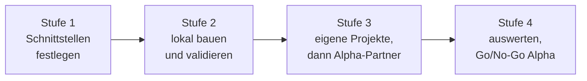

# Prototyp-Verifikation: Showstopper finden, bevor sie teuer werden

**Status:** ENTWURF · Stand 26.10.2026, ergänzt 28.10.2026 · Baut auf [Testkonzept](14-testkonzept.md), [Red-Team-Review](15-red-team-review.md), [Architektur V1](21-architektur-v1.md) und [Offene Fragen, Annahmen und Risiken](11-offene-fragen-und-risiken.md) auf. Die Specs für die Umsetzung liegen auf Englisch in [`tests/specs/`](../../tests/README.md).

> **Labs, Relays und Verbund sind geplant.** Es gibt sie bisher nur im Testlabor, nicht im Betrieb. Benutzbar ist heute das Gateway, und es braucht keine Labs: [Funktionen des Gateways](../gateway/01-funktionen.md).

**Kurz:**

- Vier Stufen: Schnittstellen festlegen, lokal bauen und unter Beschuss validieren, **dieselben Images** live auf eigenen Projekten im Modus Beobachten, auswerten.
- Kill-Kriterien seit 26.10.2026 eingefroren; Stufe 2 hat M1–M7 ohne gerissenes Kriterium bestanden. Das Gateway läuft seit November 2026 vor eigenen Projekten; die Messungen D1–D3 auf echtem Traffic stehen noch aus.
- E4: Signale ohne Besucher-IP, auch nicht gekürzt, gehasht oder als Pseudonym (Vertrag `schild.signal/0.3`); ob das optionale Feld `ja4` im Signal bleibt, ist noch zu prüfen.
- E1: Prototyp und Alpha direkt HTTPS mit Schlüssel pro Website, ab v1 OHTTP mit unverkettbaren Tokens; E7: lokal alle IPs im Klartext.
- Noch offen sind E3 (Regelverteilung) und E5 (unabhängige Betreiber im Live-Test); E2 und E6 sind noch zu bestätigen.

## 1. Reihenfolge

| Stufe | Inhalt | Ausgang (Gate) |
| --- | --- | --- |
| **1 – Schnittstellen** | Verträge für alles zwischen den Bausteinen: Signal, ACK, Regel-Bündel, Verteiler-Strom, lokale Events, Konfiguration, Ergebnisformat. Je Vertrag ein Schema und **goldene Testvektoren** (gültige und ungültige Beispiele, signiert mit festen Testschlüsseln). | Schemas und Testvektoren reviewt und eingefroren (Version `v0`); die Entscheidungen aus Abschnitt 4 sind getroffen. |
| **2 – Lokal bauen und validieren** | Gateway, Lab-Kern und Verteiler als Images; dazu das Schild-Testlab (Stufe T0/T1 aus dem [Testkonzept](14-testkonzept.md)) mit verwundbaren Websites, Angreifern, legitimem Traffic, Ground Truth, Mitschnitt und bösartigen Varianten. | Alle Mechanik-Hypothesen (M1–M7) bestanden oder mit Konsequenz entschieden; ein Befehl reproduziert jeden Lauf. |
| **3 – Live auf eigenen Projekten** | Dieselben Images (gleicher Digest) vor eigenen Websites, **zuerst nur im Modus Beobachten**: Schild bewertet alles, sperrt aber nichts außer den Grundregeln, die vorher schon liefen (OFFEN: auch die nicht). Laufzeit 4–6 Wochen (Vorschlag). Danach kommen Alpha-Partner dazu (CTOs, Hoster, Open-Source-Projekte), mit denselben Images und denselben Kill-Kriterien. | Datenhypothesen (D1–D3) gemessen; kein Vorfall durch Schild. |
| **4 – Auswerten** | Bericht mit Zahlen, Grenzen und Entscheidungen; Konzeptdokumente anpassen. | Go/No-Go für die Alpha mit CTOs ([Pilot und Betrieb](09-pilot-und-betrieb.md)). |

**Warum diese Reihenfolge:** Live-Daten sagen nur etwas, wenn die Mechanik stimmt; sonst messen wir Fehler im Prototyp statt Verhalten im Netz. Und live einsetzen dürfen wir erst, wenn Fail-open, Datenschutz und der Rückzug aller Netzregeln lokal nachgewiesen sind.

## 2. Hypothesen und Kill-Kriterien

Jede Hypothese hat ein Kill-Kriterium: Reißt es, ändern wir das Konzept – nicht die Messung. Die Schwellen unten sind **eingefroren** (ENTSCHIEDEN 26.10.2026, Initiator) und gelten unverändert für Stufe 3; ändern nur mit neuer Version dieses Dokuments und Begründung, nie nach Blick auf die Live-Daten. Stufe 2 hat M1–M7 ohne gerissenes Kriterium bestanden ([Bericht](../../tests/results/REPORT.md)).

### Mechanik – lokal in Stufe 2

| ID | Hypothese | Bezug | Kill-Kriterium | Wenn es reißt |
| --- | --- | --- | --- | --- |
| M1 | Schild bremst die Website kaum und reicht nie ungeprüft durch | K3, T12, T20, B01 | p95-Aufschlag > 5 ms bei 500 Requests/s **oder** ein einziger Request erreicht bei Timeout/Überlast ungeprüft das Backend | Gateway-Architektur ändern, kein Live-Einsatz |
| M2 | Nichts Persönliches verlässt den Server | T19, H1, H7 | Ein Kanarienwert, eine Klar-IP oder ein Feld außerhalb der Positivliste im Mitschnitt | Blocker für Stufe 3 |
| M3 | Ein Betreiber allein, ein bösartiges Lab oder gefälschte Clients können keine Sperre auslösen | T06–T08, K5, K6 | Eine einzige Sperre legitimen Traffics durch Signale nur eines Betreibers oder durch Sybil-Clients | Trust-Modell überarbeiten |
| M4 | Fernregeln können nur schützen, nie abschalten oder ausleiten | SEC-01, K7 | Der Fuzzer findet eine Regel, die durch den Validator kommt und Schutz abschaltet, Daten ausleitet oder > 1 % legitimen Traffic trifft, ohne lokal ausgesetzt zu werden | Fernregeln nur als Vorschlag im Modus Prüfen |
| M5 | Lieferkette und Rückzug aller Netzregeln halten | T10, T11, B10, SEC-02 | Eine Regel mit zu wenigen Signaturen, ein Rollback oder ein eingefrorener Strom wird angenommen; der Rückzug braucht > 60 s | Verteilung überarbeiten |
| M6 | Der Lab-Eingang bleibt unter Last schnell | B13, 21 §5.0 | `EventAck` p99 > 50 ms beim Burst ×20, oder Timeouts statt `retry_after` | Lab-Architektur ändern |
| M7 | Ausfälle von Labs oder Verteiler ändern den Schutz nicht | T09, B02, B06, B12 | Website schlechter geschützt oder langsamer, während Labs oder Verteiler fehlen | Fallback-Policy überarbeiten |

### Echte Daten – live in Stufe 3

| ID | Hypothese | Messung | Kill-Kriterium | Wenn es reißt |
| --- | --- | --- | --- | --- |
| D1 | **Fehlalarme** auf echtem Traffic sind beherrschbar | Was hätte Schild im Modus Automatisch gesperrt? Abgleich mit dem, was tatsächlich legitim war (Stichprobe von Hand) | > 0,1 % legitimer Requests wären nach Tuning gesperrt worden | Standard wird Beobachten bzw. Prüfen statt Automatisch |
| D2 | Der **Netzeffekt** existiert: Dieselben Muster treffen verschiedene Websites zeitversetzt | Pro Muster (Aktions-Signatur, nicht IP): Zeit zwischen dem ersten und den folgenden Treffern über alle Projekte. Zusätzlich offline aus den lokalen Logs: Wie oft trifft dieselbe IP mehrere Projekte – und hätte IP-Wissen im Netz früher geschützt? (Nur Auswertung beim Initiator, keine IPs ins Netz.) | Medianer Vorsprung kürzer als die gemessene Time-to-Protect, oder fast alle Muster treffen nur eine Website | Kernversprechen „die anderen sind früher gewarnt“ fällt; Schwerpunkt auf Warnungen und Regeln zu CVEs statt Live-Signalen |
| D3 | Schild **läuft einfach** im Alltag | Betriebsaufwand pro Woche, Abstürze, Updates, Speicher | > 1 h Pflege pro Woche und Projekt, oder ein Ausfall der Website durch Schild | Vereinfachen, bevor Dritte es einsetzen |

**Grenze:** Eigene Projekte sind wenige und ähnlich. D2 ist dort eine Untergrenze. Ergänzend sind eigene Honeypots auf ein paar kleinen Servern möglich (OFFEN, Entscheidung des Initiators, Kosten und Datenschutz ZU PRÜFEN).

## 3. Bausteine

| Image | Rolle | Prototyp oder nur Test |
| --- | --- | --- |
| `schild` (`schild run`) | Schild Gateway: Reverse-Proxy mit Coraza und OWASP CRS, lokale Events, Signale, Regel-Updates, Fail-open; mit Gateway-Dashboard ([MVP-09](../../tests/specs/MVP-09-client-dashboard.yaml)) und Server-Check `schild check` ([MVP-11](../../tests/specs/MVP-11-server-check-agent.yaml)) | **Prototyp** |
| `schild-agent` | Server-Check für App-Server hinter dem Gateway: nur lesen, meldet signiert an das Gateway, nie an Labs (MVP-11, Verträge v0.3); nicht in der ersten Gateway-Version (D60b), nur im Testlabor | **Prototyp** |
| `schild-lab` | Lab-Kern: Eingang mit ACK, Warteschlange, Bewertung (zunächst Regeln und Statistik, keine KI), signierter Feed, öffentliches Log; mit Lab-Dashboard ([MVP-10](../../tests/specs/MVP-10-lab-dashboard.yaml)) | **Prototyp** |
| `schild-relay` | Verteiler: öffentlicher SSE-Strom mit Checkpoints, Regel-Bündeln und Rückzügen | **Prototyp** |
| `testlab-*` | Websites (WordPress, DVWA, Juice Shop, REST-API), Etikett-Abstreifer, Ground Truth, Auswertung, Mitschnitt | nur Test |
| `attack-*`, `traffic-*` | Angriffe (nuclei, sqlmap, GoTestWAF, CRS-Regressionstests), Botnetz-Simulation, legitimer Traffic, Replay | nur Test |
| `adversary-*` | bösartiges Lab, Sybil-Clients, vergiftete Regeln, SecLang-Fuzzer | nur Test |

**Nicht im Prototyp:** KI-Worker, OHTTP und Privacy Pass (ab v1), Scoring-Abo, Föderation zwischen Labs verschiedener Betreiber, Egress. Als Entwurf für danach: human_score und Prüfseite ([MVP-12](../../tests/specs/MVP-12-human-score.yaml)), Schild Dashboard für mehrere Gateways ([MVP-13](../../tests/specs/MVP-13-schild-dashboard.yaml)), Zugangsschutz ([MVP-14](../../tests/specs/MVP-14-access-lock.yaml)), Netzwerkschutz für alle Ports ([MVP-15](../../tests/specs/MVP-15-network-blocking.yaml)), mehrere Websites mit Alias-Domains pro Gateway ([MVP-16](../../tests/specs/MVP-16-multi-site.yaml)).

**Nachträglich gebaut (28.10.2026), im Image `schild`:** Verhalten über mehrere Anfragen und Ratenbegrenzung ([MVP-17](../../tests/specs/MVP-17-behaviour-and-rate-limits.yaml)) und verteilte Angriffe über Residential Proxies ([MVP-18](../../tests/specs/MVP-18-distributed-attacks.yaml)). Beide sind mit Unit- und Integrationstests abgedeckt; Messungen im Testlabor stehen noch aus.

## 4. Entscheidungen vor Stufe 1

| # | Frage | Festlegung | Status |
| --- | --- | --- | --- |
| E1 | Transport und Authentifizierung Client → Lab | Prototyp und Alpha (nur eigene Labs): direkt HTTPS, Schlüssel pro Website. Ab v1 (fremde Labs) **OHTTP Pflicht** über ein Relay eines anderen Betreibers als das Lab, dazu **unverkettbare Tokens** (Privacy Pass/ARC) statt Signatur pro Website. Transport und Authentifizierung sind deshalb von Anfang an austauschbar. | ENTSCHIEDEN (26.10.2026, Initiator) |
| E2 | Signatur-Umschlag | DSSE mit Ed25519, Domain Separation pro Nachrichtentyp, für Lab-Feeds, Regeln, Empfehlungen; für Signale nur bis v1 | ENTWURF |
| E3 | Regelverteilung | TUF-artige Metadaten (k von n, Version, Ablauf) über SSE; vorerst ohne Transparenz-Log-Zeugen | OFFEN |
| E4 | Inhalt eines Signals | **Keine Besucher-IP**, auch nicht gekürzt, gehasht oder als Pseudonym, auf keiner Stufe ([`signal.md`](../../contracts/signal.md)). Stattdessen lokal abgeleitet: Land, ASN, Netzklasse, Browser-Familie mit Hauptversion, Bot-Kennzeichen; dazu Aktions-Signatur, Regel-IDs, Score, Kategorie; Zeit auf 5–15 min gerundet. JA4 nur im Prototyp und in der Alpha, ab v1 höchstens grob. **JA4: ZU PRÜFEN** (Stand 27.10.2026): JA4 stammt aus dem TLS-Handshake, ist aber ein Merkmal des Clients und widerspricht damit der Leitplanke „keine Fingerprints und nichts aus dem Browser an Labs“ ([Datenschutzkonzept, Abschnitt 10](24-datenschutz.md); [`tests/specs/MVP-12`](../../tests/specs/MVP-12-human-score.yaml) zählt JA4 zu den verbotenen Feldern). Vorschlag: JA4 bleibt lokal und fließt nur in den human_score; das optionale Feld `ja4` fällt mit der nächsten Vertragsversion aus dem Signal, bis dahin ist `signals.include_ja4` ab Werk aus. | ENTSCHIEDEN (26.10.2026, Initiator) · JA4 ZU PRÜFEN |
| E5 | Unabhängige Betreiber im Live-Test | Alle Labs gehören zunächst einem Betreiber. Das Gateway hat deshalb ein Testprofil mit simulierten Betreibern, **nur** im Modus Beobachten und nie in Release-Builds | OFFEN |
| E6 | Sprache | Go für Gateway, Lab-Kern und Verteiler ([Technik kompakt](13-technik-kompakt.md)); Testwerkzeuge frei | ENTWURF |
| E7 | Was lokal bleibt | Im Gateway und im lokalen Dashboard **alle IPs und Standortangaben im Klartext**, wie in jedem Server-Log. Rohdaten standardmäßig 14 Tage (D51, Rechtsprüfung offen), danach gekürzt; Zusammenfassungen länger (einstellbar, OFFEN). Dashboard nur mit Login oder über localhost. Land und ASN aus einer mitgelieferten Datenbank (DB-IP Lite, CC BY 4.0, oder IPinfo Lite, CC BY-SA 4.0, ZU PRÜFEN), signiert mit den Regel-Updates verteilt; kein Nachschlagen bei Dritten. | FIXIERT (lokaler Klartext, Initiator) · Rest ENTWURF |

**Was je Stufe den Server verlässt** (Recherche 26.10.2026; Rechtliches ZU PRÜFEN):

| Stufe | Signal | Transport | Absender für das Lab | Rechtlicher Rahmen |
| --- | --- | --- | --- | --- |
| Prototyp (eigene Websites und Labs) | Felder aus E4; JA4 laut Vertrag v0 erlaubt, ab Werk aus (ZU PRÜFEN, siehe E4) | HTTPS | bekannt (eigene Websites) | eigene Verarbeitung, berechtigtes Interesse an IT-Sicherheit (Art. 6 Abs. 1 lit. f, ErwG 49 DSGVO) |
| Alpha (Websites von CTOs, eigene Labs) | wie Prototyp | HTTPS | bekannt | Vertrag je Website (Auftragsverarbeitung oder gemeinsame Verantwortung, ZU PRÜFEN), Hinweis in deren Datenschutzerklärung |
| v1 (fremde Labs) | wie Prototyp, JA4 höchstens grob oder gar nicht (ZU PRÜFEN, siehe E4), Versand verzögert oder gebündelt | OHTTP | **unbekannt** (Relay ≠ Lab, unverkettbares Token) | Lab ohne Mittel zur Re-Identifizierung – nach EuGH C-413/23 P (SRB) dort ggf. nicht personenbezogen (ZU PRÜFEN) |
| Für alle | wie v1; ein Lab macht erst ab einer Mindestzahl unabhängiger Websites eine Regel daraus | OHTTP + Privacy Pass | unbekannt | wie v1 |

**Warum keine IPs:** Gehashte oder gekürzte IPs bleiben personenbezogen und lassen sich zurückrechnen; verschlüsselt abgleichbare Verfahren wären aufwendig (Schlüssel über mehrere Labs, Epochen, Abfragen). Der Nutzen ist klein: Nach Herstellerzahlen standen 78 % der bösartigen Sitzungen aus Privatnetzen in keinem Reputations-Feed (GreyNoise), 60 % der Residential-Proxy-IPs wurden nur einmal gesehen (IPinfo). Lokal bleibt IP-Blocking erhalten. Ob IP-Wissen im Netz trotzdem fehlt, messen wir in Stufe 3 offline (D2).

## 5. Bauen mit Agenten

KI-Agenten bauen die Bausteine, jeder in einem eigenen Arbeitsbaum. Dafür gelten feste Regeln:

1. **Verträge zuerst.** Stufe 1 ist abgeschlossen und reviewt, bevor ein Agent Code schreibt. Verträge ändert nur der Initiator, mit neuer Version.
2. **Wer baut, misst nicht.** Auswertung, Ground Truth und Angriffe kommen von anderen Agenten. Kein Agent schreibt die Prüfung, an der er selbst gemessen wird.
3. **Red Team am Ende.** Ein eigener Agent bekommt nur die laufenden Container und die Verträge, nicht den Quellcode-Plan, und versucht M1–M7 zu brechen.
4. **Reproduzierbar.** Jede Messung läuft mit einem Befehl, festem Seed und versionierten Images; Ergebnisse als JSON im gemeinsamen Format.
5. **Menschen geben frei.** Ob ein Kill-Kriterium gerissen ist und was daraus folgt, entscheidet der Initiator, kein Agent ([AGENTS](../AGENTS.md)).

## 6. Live-Einsatz auf eigenen Projekten

- **Nur eigene Websites** mit Zustimmung des Betreibers. Keine Daten Dritter verlassen den jeweiligen Server; D1 wird lokal ausgewertet.
- **Beobachten zuerst.** Schild steht vor der Website, sperrt aber nicht. Erst wenn D1 im Ziel liegt, gehen einzelne Projekte auf Prüfen oder Automatisch (OFFEN).
- **Harte Limits auch im Beobachten.** Zu große Bodys (413), komprimierte Bodys (415), mehr als 1000 Parameter, kaputtes JSON, zu viele oder zu große Header und zu viele Cookies (400) sowie Prüfungen über 1 s (503) lehnt Schild auch beim Beobachten ab, damit nie ungeprüft durchgereicht wird (M1). Dasselbe gilt für die Grenzen, die den Ingress vor offenen Uploads schützen. Vor dem Einbau werden deshalb die Access-Logs jedes Projekts auf solche Anfragen geprüft und die Limits pro Website angepasst (ENTSCHIEDEN 26.10.2026, Initiator).
- **Was „geprüft" heißt.** Dateiinhalt in Uploads gilt als nicht von Regeln geprüft: Die Regeln sehen Namen und Header der Dateiteile, nicht ihren Inhalt. Die Schwelle von M1 bleibt gleich: Bei Timeout oder Überlast erreicht kein Request ungeprüft das Backend (ENTSCHIEDEN 30.10.2026, Initiator).
- **Rückweg in einer Minute:** Schild aus dem Pfad nehmen, ohne die Website anzufassen (Runbook vor dem Start, Test in Stufe 2).
- **Dieselben Images wie lokal**, kein Sonderbau für den Live-Einsatz.
- **Datenschutz:** Logs und Ereignisse bleiben auf dem Server; Datenschutzhinweise der Projekte vorher ergänzen ([Datenschutzkonzept](24-datenschutz.md), Abschnitt 7).

## 7. Was diese Verifikation nicht klärt

Recht (§ 202c StGB, Rollen nach DSGVO), Trägerschaft und Governance, das Bürgen-Verfahren für Client-Tokens, der Name und ob fremde Betreiber Schild einsetzen wollen. Diese Fragen stehen in [Offene Fragen, Annahmen und Risiken](11-offene-fragen-und-risiken.md).

## Als Nächstes

Stand 27.10.2026, Quelle: [`DEVELOPMENT.md`](../../DEVELOPMENT.md) und [`tests/results/`](../../tests/results/REPORT.md).

- [x] Stufe 1: Verträge eingefroren als `v0`, rückwärtskompatibel ergänzt durch `v0.1`–`v0.3` ([CHANGELOG](../../contracts/CHANGELOG.md)).
- [x] Stufe 2: `schild`, `schild-lab`, `schild-relay` und das Testlab gebaut; M1–M7 ohne gerissenes Kill-Kriterium, mit benannten Lücken ([Bericht](../../tests/results/REPORT.md)).
- [x] Dashboards gebaut: Gateway-Dashboard und Lab-Dashboard (MVP-09, MVP-10).
- [x] Server-Check und `schild-agent` gebaut (MVP-11) und unabhängig nachgemessen; ein Befund zum Agent-Listener wartet auf eine Entscheidung des Initiators.
- [x] M1 und M2 auf gepinnten Images unabhängig nachgemessen; das Runbook für Stufe 3 wurde am 6.11.2026 entfernt, das Gateway läuft live. Wie du es betreibst, steht unter [Betrieb](../gateway/02-betrieb.md).
- [ ] E3 und E5 bestätigen (in den Verträgen als D04 und D05 umgesetzt); E2 und E6 bestätigen.
- [ ] Vor Stufe 3: amd64-Images aus der CI-Pipeline und Nachtest darauf; Zugriffslogs je Website mindestens 14 Tage prüfen; Hosts für Lab und Relay mit echtem TLS und Produktionsschlüsseln; Datenschutzhinweise der eigenen Projekte.
- [ ] Vertragsversion `v0.4`: Rückzug aller Netzregeln als Regelstand mit null Netzregeln (D26); Entscheidung, ob `ja4` im Signal bleibt.
