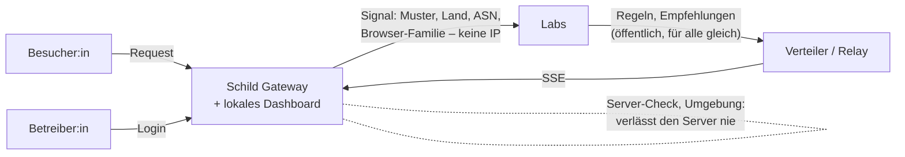

# Datenschutzkonzept

**Status:** ENTWURF · Stand 27.10.2026 · **Keine Rechtsberatung** – vor der Alpha durch Fachleute prüfen lassen (ZU PRÜFEN). Grundlage: [Prototyp-Verifikation](23-verifikation.md) (E1, E4, E7), [Technik kompakt](13-technik-kompakt.md), [Architektur V1](21-architektur-v1.md), [Manipulation und Poisoning](18-manipulation-und-poisoning.md).

> **Labs, Relays und Verbund sind geplant.** Es gibt sie bisher nur im Testlabor, nicht im Betrieb. Benutzbar ist heute das Gateway, und es braucht keine Labs: [Funktionen des Gateways](../gateway/01-funktionen.md).

**Kurz:**

- Alles Persönliche bleibt auf dem Server; Signale an Labs tragen keine Besucher-IP (E4), nur Muster, Land, ASN, Browser-Familie und gerundete Zeit.
- Diese Merkmale sind zusammen pseudonym, nicht anonym. Lokal liegen IPs 14 Tage im Klartext, danach gekürzt (E7, D51; Frist zu prüfen).
- Abschnitt 3 listet die Verarbeitungen V1–V12 mit Verantwortlichen, Rechtsgrundlage und Speicherdauer; die Rollen Website ↔ Lab je Stufe sind noch zu prüfen.
- human_score bleibt im Arbeitsspeicher und verlässt den Server nie; Prüfung im Browser nur als eigene Zwischenseite, ab Werk aus.
- Keine Rechtsberatung: Stufe 1 der Browser-Prüfung erst nach anwaltlicher Klärung der Fragen 1, 2, 5 und 6; DSFA vor der Alpha empfohlen.

**Geltungsbereich:** das Schild-System, also Schild Gateway mit lokalem Dashboard, Labs und Verteiler. Für die Website deutschland-schild.de gilt ihre Datenschutzerklärung; für den Schnell-Check, der noch nicht online ist, das Konzept [Schnell-Check](12-schnell-check.md). Ab v1 meldet das Gateway so, dass ein Lab nicht weiß, welche Website meldet.

## 1. Grundsätze

1. **Lokal zuerst.** Geprüft, protokolliert und entschieden wird auf dem Webserver. Das Netz liefert Regeln, keine Urteile über Personen.
2. **Was rausgeht, steht auf einer Positivliste.** Das Signal-Schema zählt die erlaubten Felder abschließend auf, alles andere verwirft das Gateway selbst ([`tests/specs/MVP-01`](../../tests/specs/MVP-01-contracts.yaml)).
3. **Keine Besucher-IPs im Netz**, weder gekürzt noch gehasht noch als Pseudonym (E4, ENTSCHIEDEN 26.10.2026).
4. **Ehrlich benennen.** Auch Land, ASN und Browser-Familie sind zusammen pseudonym. Wir schreiben „pseudonym“ oder „keine IP-Adressen“, nie „anonym“, und „DSGVO-konform“ nicht ohne Prüfung.
5. **Der Betreiber sieht, was gesendet wird.** Jedes ausgehende Signal steht im lokalen Protokoll und im Dashboard.
6. **Keine Übermittlung in Drittländer im Produktpfad.** Pro Request wird nichts bei Dritten abgefragt; Geo-Daten kommen aus einer mitgelieferten Datenbank.

## 2. Datenflüsse

Ab v1 läuft der Pfeil Gateway → Labs über ein OHTTP-Relay eines anderen Betreibers, mit unverkettbarem Token statt Schlüssel pro Website (E1).

## 3. Verarbeitungen

| # | Verarbeitung | Daten | Wo | Verantwortlich | Rechtsgrundlage (Vorschlag) | Speicherdauer (ab Werk) |
| --- | --- | --- | --- | --- | --- | --- |
| V1 | **Request-Prüfung und lokale Ereignisse** | IP, Land, Stadt, ASN (aus lokaler Geo-Datenbank), Zeit, Methode, Pfad, Status, User-Agent, ausgelöste Regeln, Score, Einstufung der Prüfung (wahrscheinlich Mensch / unklar / wahrscheinlich Bot, ohne Zahlenwert, Abschnitt 10). Geschwärzt vor dem Speichern: Passwörter, Tokens, Cookies, `Authorization`, E-Mail-Adressen; keine Request-Bodys | Webserver | Website-Betreiber | Art. 6 Abs. 1 lit. f DSGVO, Erwägungsgrund 49 (Netz- und Informationssicherheit) | IP im Klartext 14 Tage, danach gekürzt (D51, ZU PRÜFEN); einzelne Anfragen mit IP höchstens 48 Stunden, der Kontext eines Vorfalls bis zu 14 Tage, nur auf dem Server; Logs höchstens 100 MB oder 14 Tage; Zusammenfassungen ohne IP länger (OFFEN) |
| V2 | **Lokales Dashboard** | wie V1, im Klartext (E7, FIXIERT) | Webserver | Website-Betreiber | wie V1 | wie V1 |
| V3 | **Signal an Labs** | Aktions- und Request-Signatur, Regel-IDs, Score, Kategorie, Land, ASN, Netzklasse, Browser-Familie und Hauptversion, Bot-Kennzeichen, Zeit gerundet (5–15 min); optional der TLS-Fingerabdruck `ja4` (nur Prototyp und Alpha, ab Werk aus; ob er bleibt, ist ZU PRÜFEN, Abschnitt 9). Keine IP, keine URL mit Parametern, keine Header, keine Inhalte | Webserver → Labs | Website-Betreiber (Übermittlung); Lab je Stufe, siehe Abschnitt 4 | wie V1 | beim Lab: Signale höchstens 30 Tage (Vorschlag, OFFEN), nur Aggregate länger |
| V4 | **Sperrseite und Entsperr-Antrag** | Vorfall-Nummer; Name und E-Mail nur freiwillig | Webserver | Website-Betreiber | lit. f; bei freiwilligen Angaben lit. b bzw. f | bis zur Erledigung, dann mit V1 |
| V5 | **Fehlalarm-Rückmeldung** | wie V3, Typ `feedback`; nur nach Freigabe durch den Betreiber | Webserver → Labs | wie V3 | wie V1 | wie V3 |
| V6 | **Prüfung im Browser** (eigene Zwischenseite mit Rechenaufgabe, Stufe 1; ab Werk aus, nur bei Verdacht, Abschnitt 10) | Aufgabe mit Zufallswert und Lösung; Freigabe-Cookie ohne Besucherkennung, gebunden an IP-Präfix, User-Agent und Ablaufzeit; keine Gerätemerkmale | Webserver, Browser | Website-Betreiber (schaltet die Prüfung ein) | Schon die Rechenaufgabe ist sehr wahrscheinlich ein Zugriff auf das Endgerät (10.4): § 25 Abs. 2 Nr. 2 TDDDG (unbedingt erforderlich), danach lit. f mit ErwG 49 – ZU PRÜFEN | Aufgabe höchstens 5 Minuten; Cookie ab Werk 30, höchstens 60 Minuten |
| V12 | **human_score** (Stufe 0, ohne JavaScript, Abschnitt 10) | Header, die der Browser ohnehin sendet (User-Agent, Client Hints niedriger Entropie, `Sec-Fetch-*`, `Accept`, `Accept-Language`), Rhythmus der Anfragen, optional JA4 vom eigenen TLS-Terminator | Webserver (Arbeitsspeicher) | Website-Betreiber | lit. f mit ErwG 49; ob passive Header ein Zugriff nach § 25 sind – ZU PRÜFEN | nur die Einstufung mit V1; Rhythmus-Zähler Minuten im Arbeitsspeicher |
| V7 | **Regel-Abo** (SSE) | IP des Webservers beim Relay; keine Besucherdaten | Relay | Relay-Betreiber | lit. f | Verbindungslogs höchstens 7 Tage (Vorschlag) |
| V8 | **Lab-Logs, öffentliches Log** | Regeln, Presets, Schlüssel, Prüfsummen – **keine** personenbezogenen Daten | Lab | Lab-Betreiber | – | dauerhaft (Append-only, deshalb nichts Personenbezogenes) |
| V9 | **Forschung** | nur Aggregate über Signale, erst ab einer Mindestzahl Websites | Lab | Lab-Betreiber | lit. f bzw. Art. 89 – ZU PRÜFEN | nach Vereinbarung |
| V10 | **Server-Check, Umgebung** | Software, Versionen, Einstellungen des Servers | Webserver | Website-Betreiber | – (in der Regel keine Personendaten) | lokal; verlässt den Server **nie** |
| V11 | **Gehostetes Dashboard** (Option, nicht im Prototyp) | Ereignisse wie V1 | Dienstleister | Website-Betreiber, Dienstleister als Auftragsverarbeiter (Art. 28) | wie V1 | wie V1; ob IPs dort im Klartext liegen dürfen: OFFEN |

**Zu V7:** Betreibt eine Einzelperson die Website (etwa ein Hobby-Admin), kann schon die IP ihres Servers personenbezogen sein. Deshalb ist der Regel-Strom für alle gleich, ohne Anmeldung und Parameter; das Relay erfährt nur, dass dieser Server Schild nutzt.

## 4. Rollen je Stufe

| Stufe | Wer verarbeitet Signale | Rolle (Vorschlag) | Was zu tun ist |
| --- | --- | --- | --- |
| **Prototyp** | eigene Websites, eigene Labs | eine verantwortliche Stelle | Verzeichnis der Verarbeitungstätigkeiten, Hinweis in den Datenschutzerklärungen der eigenen Projekte |
| **Alpha** | Websites von CTOs, Labs des Initiators | Auftragsverarbeitung (Art. 28) oder gemeinsame Verantwortung (Art. 26) – ZU PRÜFEN | Vertrag je Website vor dem Start; Textbaustein für deren Datenschutzerklärung (Abschnitt 7) |
| **v1** | fremde Labs, OHTTP, unverkettbare Tokens | Das Lab weiß nicht, welche Website meldet, und sieht keine IPs. Nach EuGH C-413/23 P (SRB, 2025) können die Signale dann beim Lab nicht personenbezogen sein – ZU PRÜFEN. Für die Website bleibt die Übermittlung eine Verarbeitung nach lit. f. | Charta für Labs mit Pflichten (keine Re-Identifizierung, Speicherfristen, Transparenzbericht); Relay ≠ Lab-Betreiber |
| **Für alle** | wie v1 | wie v1 | dazu Mindestzahl unabhängiger Websites, bevor ein Lab Regeln ableitet |

## 5. Rechte der Betroffenen

- **Besucher:innen** wenden sich an den Betreiber der Website. Das Dashboard bietet dafür Suche, Export und Löschung nach IP; die Löschung erfasst auch Zusammenfassungen, die die IP noch enthalten.
- **Labs** können Signale keiner Person zuordnen (keine IP, ab v1 keine Website). Sie verweisen auf Art. 11 DSGVO und beschreiben das im Transparenzbericht.
- **Widerspruch** (Art. 21): Sicherheitsprotokolle lassen sich nicht pro Person abschalten. Das ist beim Schutz vor Angriffen üblich, im Einzelfall aber abzuwägen (ZU PRÜFEN).
- **Keine automatisierte Einzelentscheidung** mit rechtlicher Wirkung (Art. 22): Eine kurze Sperre oder Rechenaufgabe ist eine Schutzmaßnahme der Website, und jede Sperre lässt sich über die Vorfall-Nummer von einem Menschen aufheben ([Produkt, UX und Onboarding](03-produkt-und-ux.md)). Einordnung ZU PRÜFEN.

## 6. Technische und organisatorische Maßnahmen

| Bereich | Maßnahme | Nachweis |
| --- | --- | --- |
| Datenminimierung | Positivliste für Signale; Schwärzen vor dem Speichern; Bodys nur vorübergehend während der Anfrage, Reste löscht Schild beim Start | Test T19 / M2: Mitschnitt aller ausgehenden Verbindungen mit Kanarienwerten und -IPs |
| Speicherbegrenzung | Größe **und** Alter als Obergrenze; IP-Kürzung nach 14 Tagen automatisch | Test im Testlab mit Zeitraffer |
| Zugriff | Dashboard nur mit Login oder über localhost; Rollen Admin und Nur-Lesen; Zugriffsprotokoll | Stufe 2 |
| Transport | TLS 1.3; ab v1 OHTTP über Relay eines anderen Betreibers | B03 |
| Integrität | Signierte Regeln (k von n), signierte Lab-Feeds | M5 |
| Transparenz | Lokales Protokoll jedes gesendeten Signals; öffentliches Signal-Schema; Transparenzberichte der Labs | Review |
| Kein Fernzugriff | Regeln können nichts senden oder ausführen; SecLang-Teilmenge ohne `logdata` mit Headern oder Cookies | M4 |
| Drittanbieter | Keine Abfrage pro Request bei Dritten; Geo-Datenbank lokal (DB-IP Lite oder IPinfo Lite, Lizenz ZU PRÜFEN) | Code-Review |
| Prüfung im Browser | human_score nur im Arbeitsspeicher (10.1); Zwischenseite und Skript fest im Programm, vom Netz nicht änderbar | Egress- und Inhaltstest in MVP-12 (Kanarienwerte für Header, Lösungen, Cookies) |

## 7. Textbaustein für Website-Betreiber (Entwurf)

> **Schutz vor Angriffen (Schild).** Zum Schutz dieser Website vor Angriffen prüfen wir eingehende Anfragen mit der quelloffenen Web Application Firewall Schild. Dabei verarbeiten wir auf unserem Server Ihre IP-Adresse, daraus abgeleitet Land und Netzbetreiber, Zeitpunkt, aufgerufene Seite und Browserkennung. Rechtsgrundlage ist unser berechtigtes Interesse an der Sicherheit unserer Website (Art. 6 Abs. 1 lit. f DSGVO). IP-Adressen und Protokolle werden nach spätestens 14 Tagen gelöscht. Erkennt Schild ein Angriffsmuster, übermitteln wir einen kurzen Hinweis auf das Muster an unabhängige Schild-Labs – **ohne** Ihre IP-Adresse und ohne Inhalte, nur mit Land, Netzbetreiber und Browsertyp.

Ob der Baustein reicht, hängt von der Rolle der Labs ab (Abschnitt 4), ZU PRÜFEN vor der Alpha. Wer die Prüfung im Browser einschaltet, ergänzt den Baustein aus Abschnitt 10.6.

## 8. Datenschutz-Folgenabschätzung

Für die eigene Website ist eine WAF mit kurzer Speicherfrist üblich und vermutlich keine DSFA-Pflicht. Für das **Netz** spricht einiges dafür (neue Technologie, viele Websites, Verhaltensmerkmale). Deshalb: **DSFA vor der Alpha**, auch wenn sie am Ende nicht verpflichtend wäre, denn sie ist die beste Grundlage für die Charta der Labs (ZU PRÜFEN, Schwellwertprüfung nach Art. 35 und der Liste der DSK).

## 9. Offene Punkte

| Frage | Status |
| --- | --- |
| Rolle Website ↔ Lab in Alpha und v1 (Art. 26 oder 28, oder beim Lab gar nicht personenbezogen) | ZU PRÜFEN |
| Speicherdauer der Signale bei Labs (Vorschlag 30 Tage) und der Zusammenfassungen im Dashboard | OFFEN |
| Endfassung der EDPB-Leitlinien 01/2025 zur Pseudonymisierung | ZU PRÜFEN |
| Prüfung im Browser nach § 25 TDDDG: Rechenaufgabe **und** Cookie, Rollen, Bestehensquote an Labs (Abschnitt 10.7) | ZU PRÜFEN |
| Lizenz der Geo-Datenbank (Share-Alike bei IPinfo Lite) | ZU PRÜFEN |
| Gehostetes Dashboard: IPs im Klartext beim Auftragsverarbeiter? | OFFEN |
| Wer betreibt ab v1 ein unabhängiges OHTTP-Relay? | OFFEN |
| JA4 ab v1: grob oder gar nicht | OFFEN |

## 10. Prüfung im Browser und human_score

**Status:** Leitplanken ENTSCHIEDEN 27.10.2026 durch den Initiator; rechtliche Einordnung ZU PRÜFEN; Umsetzung ENTWURF in [`tests/specs/MVP-12`](../../tests/specs/MVP-12-human-score.yaml). **Keine Rechtsberatung.**

Schild schätzt bei jeder Anfrage, zunächst ohne JavaScript, ob eher ein Mensch mit Browser oder ein Programm fragt. Eine Prüfung im Browser gibt es nur als eigene Zwischenseite, die der Betreiber einschalten muss. Nichts davon verlässt den Server.

### 10.1 human_score (ENTSCHIEDEN 27.10.2026)

- **Ein Wert pro Anfrage von 0 bis 100.** Höher heißt eher ein Mensch mit gewöhnlichem Browser. Der Wert ist keine Wahrscheinlichkeit. **Leer heißt unbekannt, nie 0.**
- **Nur in Schild, nur für diese Anfrage.** Schild berechnet den Wert, entscheidet damit und vergisst ihn. Er wird **nicht pro Besucher gespeichert und nirgendwohin gesendet**, weder an Labs noch an den Verteiler, das zentrale Schild-Dashboard oder die Anwendung hinter Schild.
- **Im Protokoll steht nur die Einstufung** (wahrscheinlich Mensch, unklar, wahrscheinlich Bot; V1), kein Zahlenwert und keine Einzelbefunde.
- **Für Regeln** steht der Wert als Coraza-Variable bereit (`TX:human_score`, dazu `TX:human_stage`), nur für **lokale** Regeln des Betreibers. Fernregeln können ihn nicht lesen (SecLang-Teilmenge ohne `TX`). Bei unbekanntem Wert greift keine Regel auf „niedrigen Wert“.
- **Im Dashboard** erscheinen nur die drei Stufen und Summen, etwa im Probelauf: „Hätte 312 Anfragen mit niedrigem Score gesperrt.“ Das gilt auch für ein Schild Dashboard mit mehreren Gateways (MVP-13).
- **Kein Mensch-Nachweis.** Eine bestandene Rechenaufgabe macht Massenanfragen nur teurer ([Technologie](04-technologie-und-security.md), [Red-Team-Review](15-red-team-review.md), [Forschung](17-forschung-waf-und-ki-angriffe.md)). Sie ändert den Wert nicht und ist keine Ausnahme von WAF-Regeln.
- **Fehlender Nachweis heißt unbekannt.** Wer kein JavaScript hat, keine Freigabe besitzt oder die Prüfung nicht schafft, wird **allein deshalb nie gesperrt**.

### 10.2 Stufen

| Stufe | Was passiert | JavaScript | Status |
| --- | --- | --- | --- |
| **0 – ohne JavaScript, immer** | Passen User-Agent, Client Hints niedriger Entropie (die der Browser von sich aus sendet), `Sec-Fetch-*`, `Accept` und `Accept-Language` zusammen? Rhythmus und Reihenfolge der Anfragen (nur im Arbeitsspeicher, Minuten). Gute Bots über veröffentlichte Adressbereiche, Forward-Confirmed Reverse DNS und Web Bot Auth (RFC 9421). JA4 nur als Header vom eigenen TLS-Terminator, nur JA4 (BSD), kein JA4+ (FoxIO-Lizenz). **Kein** `Accept-CH` für Client Hints hoher Entropie | nein | ENTSCHIEDEN 27.10.2026 |
| **1 – Zwischenseite bei Verdacht** | Je Website, **ab Werk aus**; Modi aus / bei Verdacht / immer, Ausnahmen je Pfad, zuerst im Probelauf. Bei Stufe „unklar“, auf markierten Routen oder im Under-Attack-Modus liefert Schild statt der Seite eine Zwischenseite mit kleiner Rechenaufgabe nach ALTCHA-Art (MIT, lokal geprüft). Das Skript schickt die Lösung mit einem vom Server signierten Token zurück (HMAC, gebunden an IP-Präfix, User-Agent und wenige Minuten) und erhält ein kurzlebiges, signiertes Freigabe-Cookie **ohne Besucherkennung**. Ohne JavaScript führt ein Button weiter (kein Meta-Refresh, WCAG 2.2.1). Fällt Schild aus, entfällt die Prüfung und die Website läuft weiter. Für Formulare bindet der Betreiber ein Skript-Tag selbst ein ([Technik kompakt](13-technik-kompakt.md), „Formulare schützen“) | ja, nur die Rechenaufgabe | ENTSCHIEDEN 27.10.2026; Bau erst nach den Fragen 1, 2, 5, 6 aus 10.7 |
| **2 – wenige Automations-Merkmale** | Innerhalb der Zwischenseite aus Stufe 1, auf ein Bit reduziert, sofort verworfen. Nur wenn Stufe 1 nachweislich nicht reicht, und erst nach anwaltlicher Prüfung | ja | IDEE |
| **Skripte in alle Seiten einfügen** | – | – | nicht geplant (ENTSCHIEDEN 27.10.2026) |

### 10.3 Niemals (ENTSCHIEDEN 27.10.2026)

- Canvas-, WebGL-, Audio- oder Font-Fingerprinting
- Maus-, Scroll-, Tastatur- oder Touch-Biometrie
- RUM, Web Vitals oder „Site-Health“ per JavaScript
- dauerhafte oder websiteübergreifende Browser-Kennungen, auch Geräteschlüssel über WebCrypto
- Captchas oder Prüfdienste von Dritten
- **irgendetwas aus dem Browser an Labs oder Relays**, und auch an ein Schild Dashboard nur Summen – weder Rohwerte noch Hashes noch Werte pro Besucher
- Inhalt der Zwischenseite oder des Skripts, den das Netz oder ein Lab steuern kann

### 10.4 Rechtliche Einordnung (ZU PRÜFEN)

- **§ 25 TDDDG greift schon bei der Rechenaufgabe**, nicht erst beim Cookie: Code ausliefern und eine im Browser berechnete Lösung zurückbekommen ist sehr wahrscheinlich ein Zugriff auf das Endgerät (DSK, Orientierungshilfe Digitale Dienste, Rn. 24; EDPB Guidelines 2/2023, Rn. 32–33, 44–45, 52–53). Dass die Lösung nichts über das Gerät verrät, hilft bei der Ausnahme, nicht beim Anwendungsbereich.
- **Einwilligungsfrei nur über die Ausnahme „unbedingt erforderlich“** (§ 25 Abs. 2 Nr. 2). Sie trägt allenfalls nutzerorientierte Sicherheit, eng begrenzt und **ohne jeden Nebenzweck** (DSK-OH Rn. 74, 83, 86). Schon ein weiterer Zweck wie Auswertung oder Weitergabe kippt die Ausnahme für alles; daher die Liste in 10.3.
- **Danach die DSGVO:** Art. 6 Abs. 1 lit. f mit ErwG 49 (Netz- und Informationssicherheit). Ist der Zugriff unzulässig, rettet lit. f die Folgeverarbeitung nicht.
- **Stufe 0** wertet nur aus, was der Browser ohnehin sendet, und ist deutlich besser vertretbar. Ob passive Header zur Konsistenzprüfung trotzdem ein Zugriff sind, ist offen (EDPB Rn. 43).
- **Informationspflicht:** Art. 13 DSGVO gilt unabhängig von § 25; die Datenschutzerklärung der Website muss die Prüfung nennen (10.6).

### 10.5 Rollen

| Wer | Rolle | Status |
| --- | --- | --- |
| **Website-Betreiber** | Schaltet Stufe 1 ein, wählt Routen und Modus; damit Verantwortlicher und „Anbieter des digitalen Dienstes“ nach § 25 | ZU PRÜFEN |
| **Deutschland-Schild (Verein)** | Liefert nur quelloffene Software und hat keinen Zugriff auf Daten. Weil Prüf-Code und Zwecke fest vorgegeben sind, ist eine gemeinsame Verantwortung nicht ausgeschlossen (EuGH C-683/21) | ZU PRÜFEN |
| **Labs, Verteiler** | Bekommen nichts aus dem Browser und nichts über die Prüfung | ENTSCHIEDEN 27.10.2026 |
| **Schild Dashboard** (auch mit mehreren Gateways) | Nur Zählwerte je Stufe, kein Wert pro Anfrage | ENTSCHIEDEN 27.10.2026 |

### 10.6 Textbaustein für die Datenschutzerklärung (Entwurf, nur wenn die Prüfung eingeschaltet ist)

> **Prüfung im Browser (Schild).** Bei auffälligen Anfragen, auf besonders schutzbedürftigen Seiten wie Login oder Kontaktformular oder während eines Angriffs zeigen wir vor der eigentlichen Seite kurz eine Prüfseite. Ihr Browser löst dort eine kleine Rechenaufgabe und sendet das Ergebnis an unseren Server. Dabei lesen wir keine Merkmale Ihres Geräts aus und verwenden keine Dienste Dritter. Ist die Aufgabe gelöst, speichern wir für höchstens 60 Minuten ein Cookie, das keine Kennung enthält und nur für diese Website, Ihren Netzbereich und Ihren Browsertyp gilt. Ohne JavaScript gelangen Sie über eine Schaltfläche weiter. Zweck ist allein die Abwehr automatisierter Angriffe auf diese Website; die Daten verlassen unseren Server nicht. Rechtsgrundlage für den Zugriff auf Ihr Endgerät ist § 25 Abs. 2 Nr. 2 TDDDG, für die weitere Verarbeitung unser berechtigtes Interesse an der Sicherheit der Website (Art. 6 Abs. 1 lit. f DSGVO).

Wortlaut, Pflichtangaben und Rechtsgrundlage: ZU PRÜFEN (Frage 7).

### 10.7 Fragen für die anwaltliche Prüfung

**Vor dem Bau von Stufe 1 müssen die Fragen 1, 2, 5 und 6 beantwortet sein** (ENTSCHIEDEN 27.10.2026). Alle Fragen: ZU PRÜFEN.

1. Ist die Rechenaufgabe ein Zugriff nach § 25 Abs. 1? Trägt Abs. 2 Nr. 2 bei Prüfung nur bei Verdacht bzw. an Login und Formularen – und im Under-Attack-Modus für alle?
2. Ist Schutz vor Scraping und Überlast „nutzerorientierte“ Sicherheit (DSK-OH Rn. 74) oder vor allem Interesse des Betreibers?
3. Sind passive Header, Client Hints niedriger Entropie und JA4 zur Konsistenzprüfung ein Zugriff (EDPB Rn. 43)?
4. Stufe 2: Ist ein lokal ausgewertetes Ein-Bit-Ergebnis noch „unbedingt erforderlich“ gegenüber der Rechenaufgabe allein?
5. Darf eine aggregierte, regelbezogene Bestehensquote an Labs gehen, ohne die Ausnahme durch einen Nebenzweck zu verlieren?
6. Ist der Verein bei fest vorgegebenem Prüf-Code nur Software-Hersteller oder Mit-Verantwortlicher (EuGH C-683/21)? Was folgt daraus für Labs?
7. Welche Angaben braucht der Textbaustein (Art. 13)? Gibt es eine eigene Hinweispflicht nach TDDDG?
8. Art. 21 und 22 DSGVO bei automatischer Prüfung oder Sperre nach Score (siehe Abschnitt 5)
9. Ab wann ist eine DSFA nötig, falls Stufe 2 kommt?
10. Was ändert sich, wenn der Digital Omnibus mit einer Sicherheitsausnahme in Kraft tritt?
11. Lohnt eine Vorab-Anfrage bei der Landesdatenschutzbehörde zu Stufe 1?

## Als Nächstes

- [ ] Verzeichnis der Verarbeitungstätigkeiten für den Prototyp (eigene Projekte) aus Abschnitt 3 ableiten.
- [ ] Datenschutzerklärungen der eigenen Projekte vor Stufe 3 ergänzen (Abschnitt 7).
- [ ] Fachliche Prüfung von Abschnitt 4 und 8 vor der Alpha.
- [ ] M2/T19 im Testlab als harter Nachweis für Abschnitt 6.
- [ ] Fragen 1, 2, 5 und 6 aus Abschnitt 10.7 anwaltlich klären lassen, bevor Stufe 1 gebaut wird.
