# Schild Gateway: alle Funktionen

**Status:** Alpha · Stand 21.11.2026 · technische Quelle: [gateway/README.md](../../gateway/README.md)

**Kurz:**

- Das Schild Gateway ist ein Programm (`schild`), das auf deinem Server vor deiner Website läuft und jede Anfrage prüft, bevor sie deine Anwendung erreicht.
- Es arbeitet allein, ohne Konto und ohne Verbindung zu Labs oder Relays. Aus deinem Traffic verlässt nichts den Server.
- Diese Seite beschreibt nur, was gebaut ist.
- Installieren: [Installieren](00-installieren.md). Einbauen, Schalter, Ausfall und Rückbau: [Betrieb](02-betrieb.md).

## Was das Gateway ist

Schild Gateway ist ein Reverse-Proxy mit Web Application Firewall (WAF). Ein Reverse-Proxy nimmt Anfragen an und reicht sie an deine Anwendung weiter. Die WAF ist der Filter darin: Sie prüft jede Anfrage auf Angriffsversuche. Das Gateway ist ein einziges statisches Binary für Linux (amd64 und arm64), quelloffen und kostenlos. Darin stecken:

- **Caddy** als Webserver und Reverse-Proxy,
- **Coraza** als WAF mit dem **OWASP Core Rule Set** (CRS 4.30),
- eine lokale Datenbank (SQLite) für Ereignisse, Vorfälle und Einstellungen,
- das **Gateway-Dashboard** und der **Server-Check**.

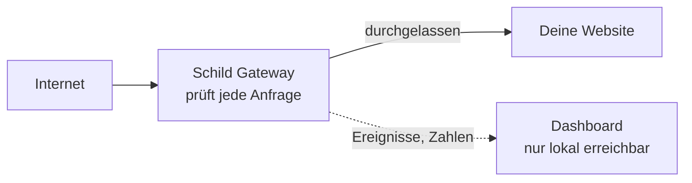

Jede Entscheidung fällt auf deinem Server. Schild holt nur öffentliche Regeln und Listen ab (siehe [Welche Daten wo bleiben](02-betrieb.md#welche-daten-wo-bleiben)).

## Wie sicher das Gateway selbst ist

Ein Programm, das vor deiner Website steht, muss selbst wenig Angriffsfläche bieten. Diese Punkte kannst du am Code und an einem laufenden Gateway nachprüfen:

- **Dashboard nur auf dem Server selbst.** Es hört ab Werk auf `127.0.0.1:8788`, die Metriken auf `127.0.0.1:9101`. Von außen kommst du per SSH-Tunnel oder VPN hinein.
- **Kein Standardpasswort.** Das erste Passwort setzt du mit einem Einmal-Code aus dem Log. Nach fünf falschen Versuchen ist eine Viertelstunde Pause.
- **Ohne Root.** Im Docker-Image läuft Schild als Benutzer ohne Root-Rechte. Die mitgelieferte Compose-Datei macht das Dateisystem schreibgeschützt und nimmt dem Container alle Sonderrechte. Die systemd-Unit lässt Schild als Benutzer `schild` laufen, der nur in `/var/lib/schild` schreiben darf.
- **Im Zweifel 503.** Dauert die Prüfung zu lange oder bricht sie ab, antwortet Schild mit 503 und lässt nichts ungeprüft durch.
- **Prüfbare Releases.** Du kannst nachprüfen, dass Image und Archive unverändert aus dem öffentlichen Quellcode gebaut wurden (Signatur mit cosign, Prüfsummen, Herkunftsnachweis). Eine Stückliste (SBOM) nennt alle enthaltenen Bibliotheken.
- **Agent-API nur mit Token.** Sie hört nur auf Loopback, und ohne ein Token, das du auf dem Server anlegst, lehnt sie jeden Aufruf ab. Im Dashboard schaltest du sie mit einem Klick aus, in `schild.yaml` sperrst du sie fest.

Eine Sicherheitslücke meldest du vertraulich. Der Weg steht in [SECURITY.md](https://github.com/deutschland-schild/schild/blob/main/SECURITY.md).

## Prüfung jeder Anfrage

Eine Anfrage durchläuft das Gateway in fester Reihenfolge: Absender bestimmen, eigene IPs, Zugriffsschutz, Crawler-Regeln, laufende Sperren und Limits, harte Grenzen, dann die Web Application Firewall mit ihren [Regeln](#regeln). Erst was alles passiert, geht an deine Anwendung.

Braucht die Prüfung zu lange, antwortet Schild mit 503 und lässt die Anfrage **nicht** ungeprüft durch. Die Antworten deiner Anwendung prüft Schild nicht.

### Harte Grenzen

Was sich nicht prüfen lässt, erreicht deine Anwendung nie, egal wie die Schalter stehen:

| Was | Antwort |
| --- | --- |
| Body größer als das Limit (Standard 12,5 MiB) | 413 |
| komprimierter Body | 415 |
| mehr als 1000 Parameter, JSON tiefer als 64 Ebenen oder kaputtes JSON | 400 |
| Query über 32 KiB, mehr als 100 Header oder 64 KiB Header, mehr als 150 Cookies | 400 |
| Pfad und Query zusammen über 40 KiB | 414 |
| Body ohne Text- oder Formularformat (z. B. ein Datei-Upload per `PUT`) über 128 KiB, `waf.raw_body_limit_bytes` | 413 |

## Regeln

Die Web Application Firewall (Coraza) prüft mit Regeln aus drei Regel-Repositories. Alle drei sind immer da und funktionieren gleich: ein Schalter je Repository mit denselben drei Stellungen, jede Regel einzeln abschaltbar. In `schild.yaml`, in der Agent-API und in den Ereignissen heißen sie `crs`, `crowdsec` und `local`.

| Repository | Was drin ist | Woher die Regeln kommen | Ab Werk |
| --- | --- | --- | --- |
| **OWASP Core Rule Set** (`crs`) | allgemeine Regeln gegen typische Angriffsversuche | im Programm eingebaut (CRS 4.30) | Sperren |
| **CrowdSec Hub** (`crowdsec`) | virtuelle Patches gegen bekannte Lücken | Stand im Programm, dazu Updates aus dem öffentlichen Hub | Erkennen |
| **Eigene Regeln** (`local`) | was du selbst schreibst | deine Dateien auf dem Server | Sperren |

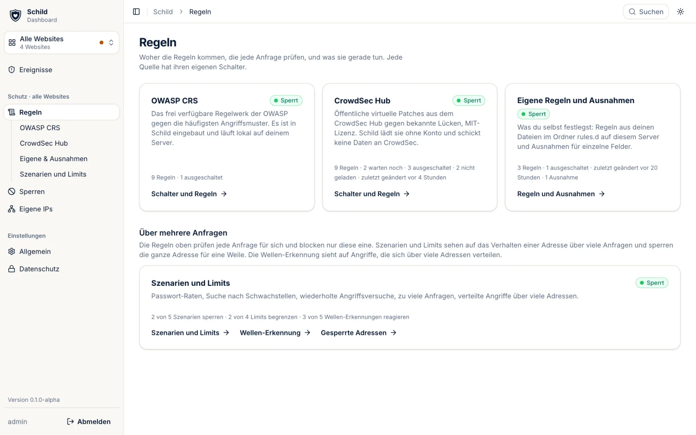

Die Bilder auf dieser Seite zeigen das Dashboard mit Testdaten. Dort stehen nur wenige Beispielregeln, auf einem echten Gateway sind es deutlich mehr.

### OWASP Core Rule Set

Das Core Rule Set erkennt typische Angriffsversuche: SQL-Injection, Cross-Site-Scripting, das Einschleusen von Befehlen oder PHP-Code, Zugriffe auf Dateien außerhalb der Website und Ähnliches. Jede Regel vergibt Punkte, ab einer Schwelle wird gesperrt. Strenge (Paranoia-Level) und Schwelle stellst du im Dashboard unter „Regeln › OWASP CRS“ ein oder in `schild.yaml` unter `rules.crs`. Was du im Dashboard einstellst, gilt vor der Datei und sofort, ohne Neustart. Ein kritischer Treffer zählt 5 Punkte: Mit einer Schwelle über 5 kommt eine Anfrage mit einem einzelnen kritischen Treffer durch. Ab Stufe 2 laufen zusätzliche Regeln, die öfter bei normalen Anfragen anschlagen; stell das Core Rule Set dafür erst ein paar Tage auf „Erkennen“. Steht das Core Rule Set auf „Aus“ oder „Erkennen“, ist der Grundschutz eingeschränkt, und das Dashboard sagt es dir.

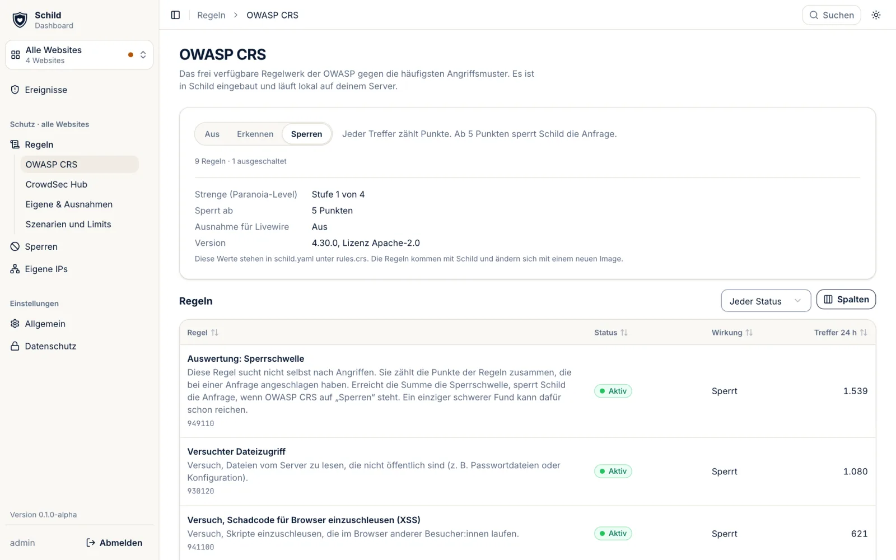

### Virtuelle Patches aus dem CrowdSec Hub

Die öffentlichen virtuellen Patches aus dem CrowdSec Hub sind rund 200 Regeln gegen bekannte Lücken in verbreiteter Software, jeweils nach CVE benannt. Dafür brauchst du kein CrowdSec-Konto und keine CrowdSec-Engine; Schild lädt nur den öffentlichen Index von GitHub und schickt nichts an CrowdSec.

- Ein Stand der Regeln steckt im Programm. Neue und geänderte Regeln holt Schild jede Stunde im Hintergrund. Ein fehlerhaftes Update ändert nichts an den laufenden Regeln.
- Regeln aus einem Update erkennen zuerst nur und sperren nach einer Wartezeit von selbst, siehe [Regeln aus Updates](#regeln-aus-updates).
- Der ganze Satz lässt sich auf einen Stand des Hubs festnageln (`rules.crowdsec.pin`) oder auf den Stand im Programm zurücksetzen (`schild rules reset crowdsec` oder ein Klick im Dashboard).

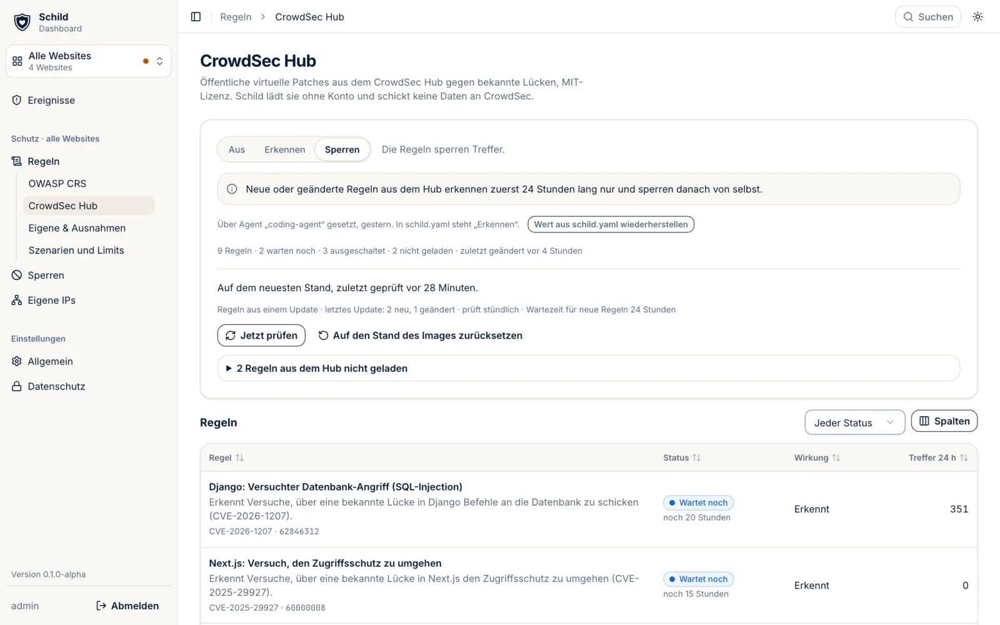

### Eigene Regeln

Eigene Regeln legst du als `*.conf` in das Verzeichnis `rules.local.dir` (Standard `/etc/schild/rules.d`), in SecLang, der Regelsprache von ModSecurity und Coraza. `schild rules sync local` lädt sie ohne Neustart, ein `SIGHUP` an den Prozess auch. Baut eine Datei nicht, laufen die bisherigen Regeln weiter und der Befehl nennt den Grund. Die Nummernbereiche der anderen Repositories sind für eigene Regeln gesperrt.

Zwei Dinge stellt Schild selbst ein, eigene Regeln können sie nicht ändern: ob die Regeln nur erkennen oder sperren (der Schalter je Repository), und wie viel vom Inhalt einer Anfrage gelesen wird (`limits` in `schild.yaml`). `SecRuleEngine`, `SecRequestBodyAccess`, die `SecRequestBodyLimit`-Direktiven und die Aktionen `ctl:ruleEngine`, `ctl:requestBodyAccess` und `ctl:requestBodyLimit` lehnt Schild deshalb ab. `Include` ebenfalls: Schild prüft jede Regel, die es lädt, und alle eigenen Regeln liegen im Regelverzeichnis. Soll ein Pfad vom Core Rule Set ausgenommen sein, etwa ein Webhook, geht das mit `ctl:ruleRemoveByTag=OWASP_CRS`:

```
SecRule REQUEST_URI "@beginsWith /webhook" "id:1001,phase:1,pass,nolog,ctl:ruleRemoveByTag=OWASP_CRS"
```

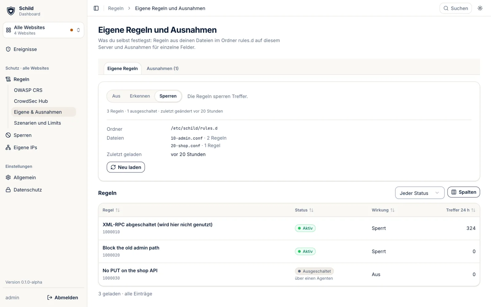

### Aus, Erkennen, Sperren

Jedes Repository hat einen Schalter mit drei Stellungen:

- **Aus:** Keine dieser Regeln läuft, Schild holt auch keine neuen.
- **Erkennen:** Die Regeln prüfen und zeigen Treffer in den Ereignissen als „Erkannt“, sperren aber nie.
- **Sperren:** Treffer werden gesperrt.

Willst du erst zusehen, stellst du ein Repository auf „Erkennen“. Nur im Testprofil (`profile: test`) sperrt Schild gar nichts.

Du stellst den Schalter im Dashboard unter „Regeln“, über die Agent-API oder in `schild.yaml` um. Er wirkt sofort, ohne Neustart. Ein Wert aus dem Dashboard oder von der Agent-API gilt vor dem Wert in `schild.yaml`, bis du ihn zurücksetzt.

### Einzelne Regeln ausschalten

Jede einzelne Regel lässt sich ausschalten, in jedem Repository: im Dashboard, über die Agent-API oder dauerhaft in `schild.yaml` unter `disabled_rules` (Nummern für Core Rule Set und eigene Regeln, Namen wie `crowdsecurity/vpatch-CVE-…` für den CrowdSec Hub). Eine Regel, die in `schild.yaml` aus ist, lässt sich weder im Dashboard noch über die Agent-API wieder einschalten.

Trifft eine Regel nur auf einem Feld echte Eingaben, ist eine [Ausnahme](#ausnahmen) meist besser: Dann prüft die Regel überall sonst weiter.

### Regeln aus Updates

Regeln, die ein Repository im laufenden Betrieb bekommt, wirken nicht sofort. Heute sind das nur neue oder geänderte Regeln aus dem CrowdSec Hub. Sie erkennen zuerst nur und sperren nach einer Wartezeit von selbst (Standard 24 Stunden, `rules.crowdsec.settling_s`), wenn das Repository auf „Sperren“ steht. Willst du eine Regel nicht, schaltest du sie [einzeln aus](#einzelne-regeln-ausschalten). Eine Freigabe für jede einzelne Regel gibt es nicht mehr: Wer vorsichtig sein will, lässt den CrowdSec Hub auf „Erkennen“.

### Ausnahmen

Sperrt eine Regel echte Eingaben, etwa in einem Code- oder Formelfeld, legst du eine Ausnahme an: so eng wie möglich, nämlich für einzelne Regeln und ein Feld auf einer Seite einer Website. Das geht für Regeln aus dem Core Rule Set und dem CrowdSec Hub, und zwar auf zwei Wegen:

- **Im Dashboard** unter „Eigene Regeln und Ausnahmen“ im Reiter „Ausnahmen“ mit „Ausnahme anlegen“. Du wählst Website, Pfad, Feld und die Regelnummern und schreibst dazu, wofür die Ausnahme da ist. Im selben Reiter stehen die möglichen Fehlalarme aller Websites: Regeln, die auf einer Seite fast nur normale Besucher:innen treffen. Den Knopf findest du auch dort, im Detail eines Ereignisses neben der Regel, die angeschlagen hat, und bei der Website unter „Ereignisse“ an einem möglichen Fehlalarm. An diesen Stellen ist das Formular schon ausgefüllt.
- **Über die [Agent-API](#agent-api-für-ki-agenten)**, wenn dein Agent die Firewall an deine Anwendung anpasst.

Eine Ausnahme nennt höchstens 16 Regeln. Braucht ein Feld mehr, legst du mehrere an; das Dashboard zeigt sie als einen Eintrag. Eine Ausnahme gilt sofort und übersteht einen Neustart. Jede wird mit Begründung protokolliert und lässt sich an derselben Stelle wieder entfernen, egal auf welchem Weg sie angelegt wurde. Einzelne Regeln nimmst du mit dem × neben ihrer Nummer heraus; die übrigen bleiben ausgenommen. Bearbeiten lässt sich eine Ausnahme sonst nicht: Für eine andere Seite oder ein anderes Feld entfernst du sie und legst eine neue an.

Was über eine solche Ausnahme hinausgeht, schreibst du als eigene Regel in eine Datei. Eigene Regeln änderst du direkt in deiner Datei.

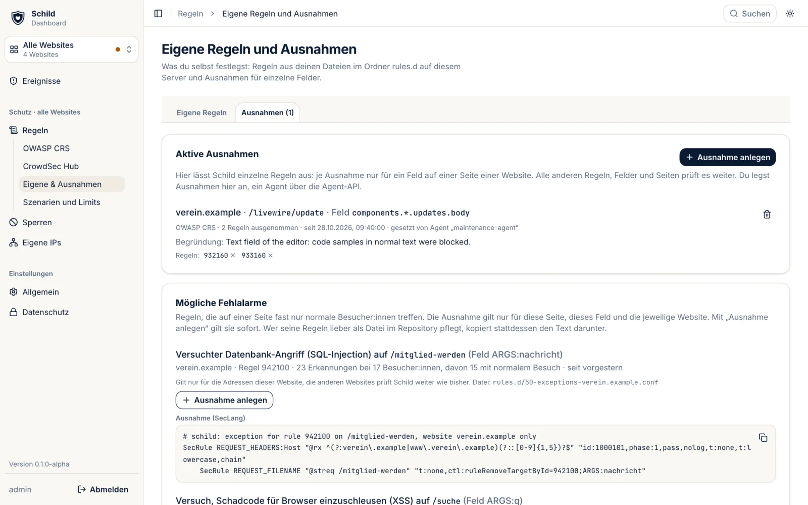

## Szenarien und Limits

Schild beobachtet, wie sich ein Absender über mehrere Anfragen verhält. Passwörter und Formularinhalte liest es dabei nie.

| Szenario | Wann es ab Werk anschlägt |
| --- | --- |
| Passwort-Raten | 5 Fehlversuche in 1 Minute oder 30 in 1 Stunde |
| Ausprobieren von Zugangsdaten | 10 verschiedene Benutzernamen in 10 Minuten von einem Absender |
| Suche nach Schwachstellen | 20 verschiedene Pfade mit 404/403 in 1 Minute; bekannte Scanner-Pfade wie `.env` oder `.git/` zählen fünffach |
| Aggressives Abrufen | 120 Seitenaufrufe pro Minute und das Zehnfache des Üblichen auf dieser Website |
| Wiederholte Angriffsversuche | 2 verschiedene WAF-Regeln in 1 Minute |

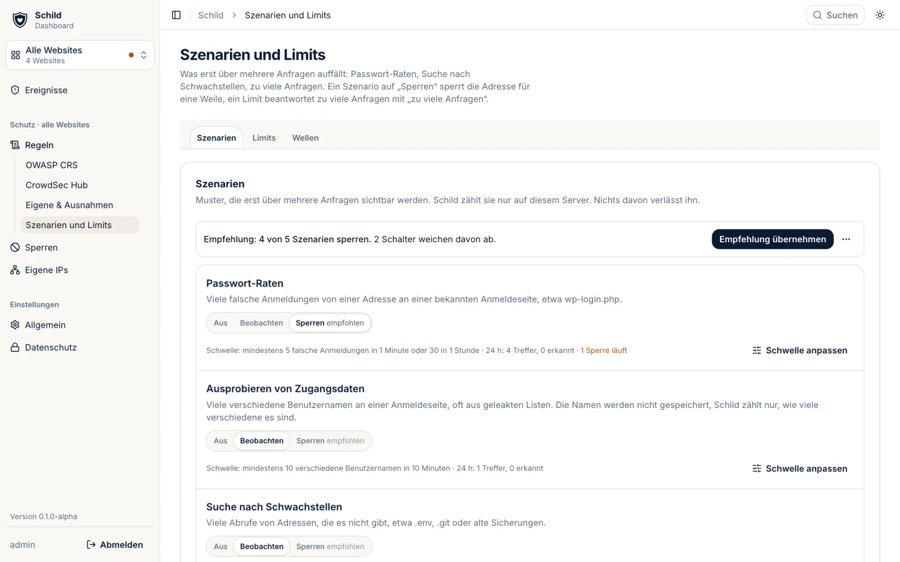

Die Schwellen änderst du unter „Regeln“ → „Szenarien und Limits“ mit „Schwelle anpassen“ an jedem Szenario oder in `schild.yaml` unter `behaviour.scenarios.<szenario>.thresholds`. Eine Schwelle gilt für alle Websites des Servers und wirkt sofort. Mit „Werkswert einsetzen“ stellst du die Tabelle oben wieder her. Bist du unsicher, stell das Szenario erst auf „Beobachten“: Dann siehst du, wen die neue Schwelle gesperrt hätte.

Login-Erkennung ist eingebaut für WordPress, TYPO3, Joomla, Drupal, Nextcloud, Laravel und übliche Login-Pfade (`/login`, `/signin`, `/api/login`). Ob ein Login fehlgeschlagen ist, erkennt Schild an der Antwort deiner Anwendung (Statuscode, Weiterleitung).

**Ab Werk gilt die Empfehlung.** Vier Szenarien stehen auf „Sperren“. „Aggressives Abrufen“ steht auf „Beobachten“, weil auch Suchmaschinen-Tools, Monitoring und Büros hinter einer Adresse schnell viele Seiten abrufen. Gesperrt wird erst nach einer Lernzeit von 14 Tagen ab dem ersten Start von Schild. Bis dahin zeigt das Dashboard „lernt noch“, sammelt, was normal ist, und zeigt, wen ein Szenario gesperrt hätte. Unter „Regeln“ → „Szenarien und Limits“ stellst du jedes Szenario einzeln um. Die empfohlene Stellung ist an jedem Schalter markiert, „Empfehlung übernehmen“ stellt alles auf einmal zurück. Welche Adressen gerade gesperrt sind, steht unter „Sperren“.

**Sperren laufen ab:** 15 Minuten, bei Wiederholung 1, 4, dann 24 Stunden. Adressen aus Rechenzentren: 15 Minuten, 1 Stunde, 24 Stunden, dann 7 Tage. Gesperrte sehen eine ruhige Seite „Kurze Pause“ mit Vorfallnummer und Uhrzeit, ab wann es weitergeht. Ist die [Firewall](02-betrieb.md) angebunden, kommen sie gar nicht mehr durch und sehen keine Seite.

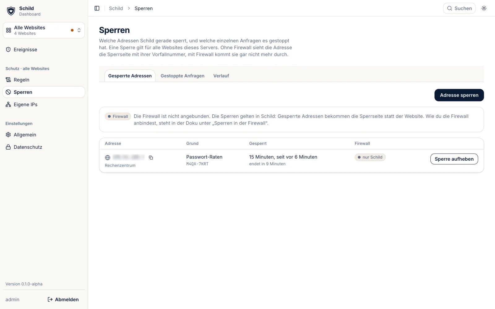

**Limits pro Pfad:** Vorlagen für Login (10 pro Minute), Passwort vergessen (3 in 10 Minuten), `xmlrpc.php`, Suche, Kontaktformulare und schreibende API-Aufrufe. Sie gelten für die üblichen Pfade von WordPress, Joomla, Drupal, Nextcloud, TYPO3 und Laravel; Schild prüft nicht, welches System bei dir läuft. Ab Werk begrenzen die Limits für Login, Passwort vergessen und `xmlrpc.php`. Die für Suche, Kontaktformulare und schreibende API-Aufrufe zählen nur mit, weil ein Shop oder eine App dort mit Absicht viele Anfragen schicken kann. Jedes dieser Limits hat unter „Regeln“ → „Szenarien und Limits“ → „Limits“ seinen eigenen Schalter, die Empfehlung ist dort markiert. Die Liste zeigt zuerst nur die Limits, deren Pfad in den letzten 24 Stunden Anfragen hatte oder die du umgestellt hast; „Alle zeigen“ blendet die übrigen ein. Limits wirken sofort, ohne Lernzeit. Eigene Limits legst du im Dashboard an, ein Probelauf über die letzten 24 Stunden zeigt vorher, wen sie getroffen hätten.

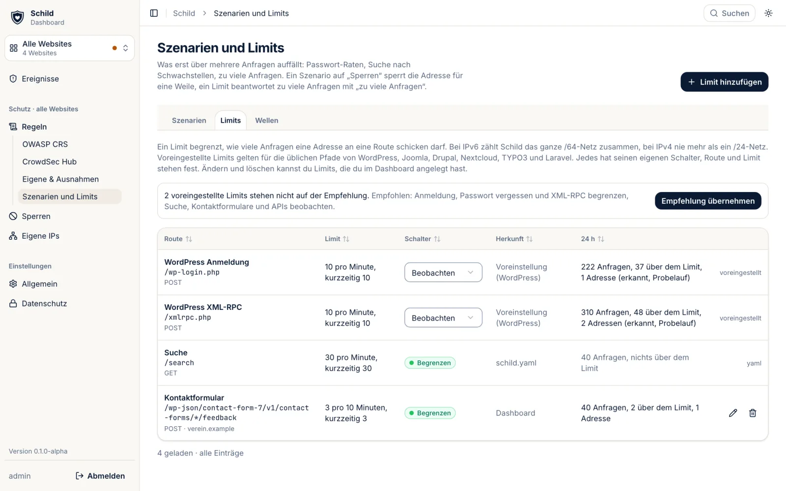

**Nie gesperrt** werden Adressen aus Mobilfunk, Carrier-NAT und Tor, weil sich dort viele Menschen eine Adresse teilen. Sie werden höchstens gezählt.

## Kurze Prüfung im Browser und Under Attack

Für jede Website kannst du eine kurze Prüfung vorschalten. Wer die Seite aufruft, sieht dann zuerst „Kurze Prüfung“: Der Browser löst eine kleine Rechenaufgabe und lädt nach ein bis zwei Sekunden die eigentliche Seite. Ohne JavaScript geht es über einen Knopf weiter. Die Prüfung läuft nur auf deinem Server, ohne Drittanbieter, ohne Tracking und ohne Wiedererkennung von Besucher:innen. Wer sie bestanden hat, wird 30 Minuten lang nicht erneut gefragt.

Geprüft werden nur Seitenaufrufe im Browser. APIs, Webhooks, abgeschickte Formulare, Bilder und andere Dateien kommen immer ohne Prüfung durch, ebenso bestätigte Suchmaschinen und deine [eigenen IPs](#eigene-ips). Fällt die Prüfung selbst aus, lässt Schild die Anfrage durch.

Du stellst sie im Dashboard bei der Website unter „Zugriffsschutz“ ein, in der Karte „Browser-Prüfung & Under Attack“. Ab Werk ist sie aus.

| Einstellung | Was sie tut |
| --- | --- |
| Bei Auffälligkeiten | Prüft Adressen aus Mobilfunk, Carrier-NAT und Tor, wenn dort ein Szenario anschlägt, und aggressives Abrufen. Diese Adressen sperrt Schild nie, hier ist die Prüfung der Ersatz. |
| Immer | Prüft jeden neuen Seitenaufruf, etwa gegen Crawler, die sich nicht an deine Vorgaben halten. |
| Under Attack | Für den akuten Fall: Die Prüfung gilt sofort, wahlweise nur für Admin- und Login-Seiten oder für die ganze Website. Du wählst 1, 4, 12 oder 24 Stunden, danach endet sie von selbst. „Jetzt beenden“ schaltet sie vorher ab. |

Under Attack läuft unabhängig von der Einstellung darüber und ist nie unbefristet.

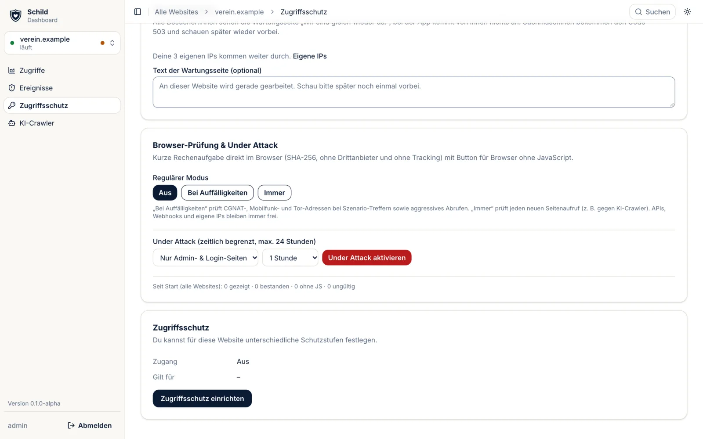

## Verteilte Angriffe

Manche Angriffe laufen über tausende private Anschlüsse und wechseln mit jeder Anfrage Adresse und Browserkennung. Schild erkennt solche Wellen am Ziel, nicht am Absender: viele Fehlversuche auf einen Login, viele Absender gegen ein Benutzerkonto, dieselbe Angriffsform von vielen Adressen oder viele Absender mit demselben technischen Fingerabdruck.

| Erkennung | Wann sie ab Werk anschlägt |
| --- | --- |
| Ansturm auf eine Route | 30 Fehlversuche in 1 Minute an einem Login und das Fünffache des dort Üblichen |
| Ein Konto, viele Adressen | 10 Fehlversuche für ein Konto in 10 Minuten von mindestens 3 Adressen |
| Gleiche Anfrage, viele Adressen | dieselbe auffällige Anfrage von 20 Adressen in 1 Minute |
| Gleicher Fingerabdruck | 20 Adressen mit demselben Fingerabdruck und wechselnden Browser-Angaben in 5 Minuten |
| Widersprüchliche Browser-Angaben | 20 Fehlversuche mit Angaben, die nicht zusammenpassen, in 5 Minuten |

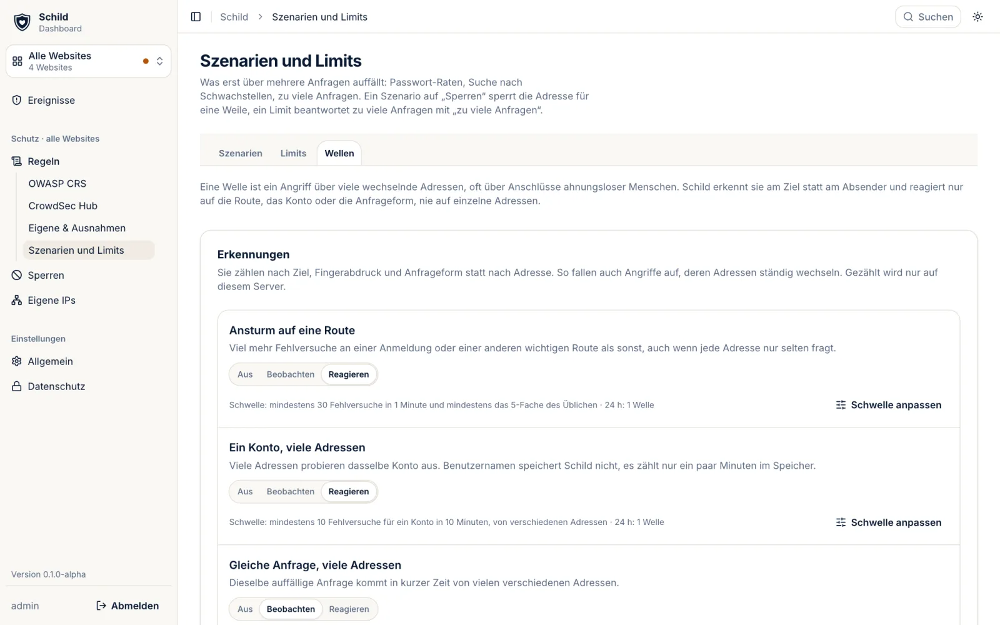

Beobachtet werden die eingebauten Login-Pfade und die Pfade, die du in `schild.yaml` unter `behaviour.distributed.routes` nennst.

Die Antwort richtet sich gegen die Welle, nie gegen einzelne Adressen. Jede Antwort ist zeitlich begrenzt, und wer schon angemeldet ist, merkt nichts:

- **Route einschränken:** Für 20 Minuten, höchstens 2 Stunden, teilen sich alle Anmeldeversuche ohne Sitzung auf der angegriffenen Route ein Limit von 10 pro Minute. Das Formular bleibt erreichbar.
- **Konto verlangsamen:** Versuche auf das angegriffene Konto warten erst 5 Sekunden, dann jeweils doppelt so lange, höchstens 60 Sekunden. Gesperrt wird das Konto nie.
- **Anfrageform sperren:** Genau diese eine Anfrage wird für alle Absender abgelehnt.

Ab Werk beobachten alle fünf Erkennungen nur. Unter „Regeln“ → „Szenarien und Limits“ → „Wellen“ stellst du jede einzeln auf „Reagieren“ und passt mit „Schwelle anpassen“ ihre Schwelle an. Reagiert wird erst nach 14 Tagen Lernzeit. Erkannte Wellen stehen im selben Reiter unter den Erkennungen, eine laufende Antwort beendest du dort vorzeitig.

Den Fingerabdruck bildet Schild aus Merkmalen der Kopfzeilen. Das ist grob: Ein TLS-Fingerabdruck (JA4) geht nur ein, wenn ein vertrauenswürdiger Proxy ihn in einer Kopfzeile mitschickt (`behaviour.distributed.fingerprint.ja4_header`).

## Bots und KI-Crawler

Im Dashboard legst du pro Website fest, welche Crawler deine Seiten abrufen dürfen: nach Zweck (zum Beispiel KI-Training, KI-Suche, Suchmaschinen) oder einzeln. Eine Vorlage blockt mit einem Klick alle KI-Trainings-Crawler und lässt den Rest durch.

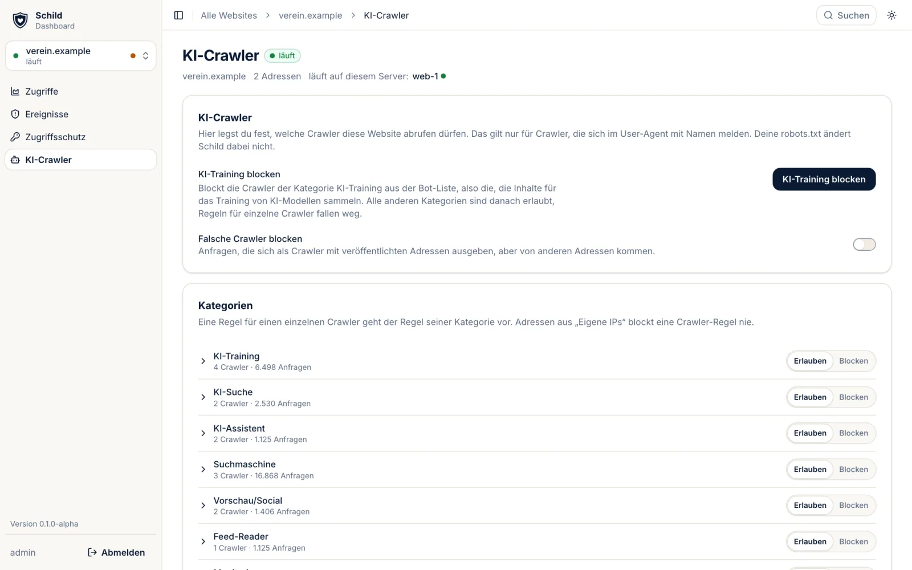

Gibt sich jemand als Googlebot oder GPTBot aus, kommt aber nicht aus den Adressbereichen, die der Betreiber veröffentlicht, kann Schild ihn als Fälschung blocken. Die Adresslisten holt Schild einmal am Tag direkt bei den Betreibern ab. Crawler, die sich nicht zu erkennen geben, erfasst diese Funktion nicht.

## Zugriffsschutz mit Passwort und eigenen IPs

Du kannst eine ganze Website oder einzelne Pfade schließen, etwa `/staging/*` oder `/wp-login.php`. Ein Pfad gilt immer auch für alles darunter:

- mit einem gemeinsamen Passwort (Besucher:innen sehen eine Login-Seite),
- nur für bestimmte Adressen und eigene Netze,
- oder beides. Dann muss beides zutreffen.

Gelten Passwort und Adressen zusammen, sehen nur diese Adressen das Anmeldeformular. Alle anderen bekommen die Seite „Kein Zugriff“ ohne Formular.

Die Anmeldung mit Passwort braucht HTTPS, weil der Browser das Cookie der Anmeldung nur über HTTPS zurückschickt. Vom Passwort speichert Schild nur einen Hash (Argon2id).

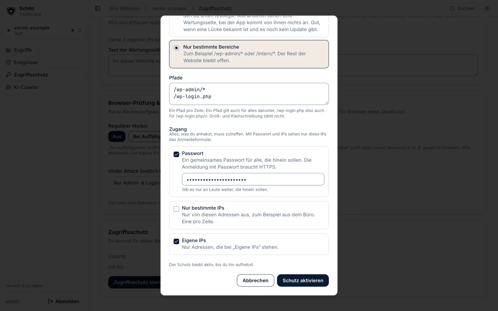

Bei einer ganz geschlossenen Website sehen alle anderen eine Wartungsseite. Der Schutz bleibt an, bis du ihn aufhebst, im Dashboard unter „Zugriffsschutz“ oder mit `schild lock`.

### Wartungsmodus

Für Wartungsarbeiten gibt es unter „Zugriffsschutz“ den Schalter „Wartungsmodus“: Auf der ganzen Website sehen alle die Wartungsseite mit dem Code 503, nur deine eigenen IPs kommen durch. Den Text der Seite kannst du dabei selbst schreiben. Der Wartungsmodus ist ein eigener Schalter neben dem Zugriffsschutz. Hast du etwa `/wp-admin` mit einem Passwort geschützt, bleibt das bestehen: Wer von einer eigenen IP kommt, braucht dort weiter das Passwort, und nach dem Ausschalten gilt der Schutz wie vorher. `schild lock` hebt vom Server aus beides auf, falls du dich ausgesperrt hast.

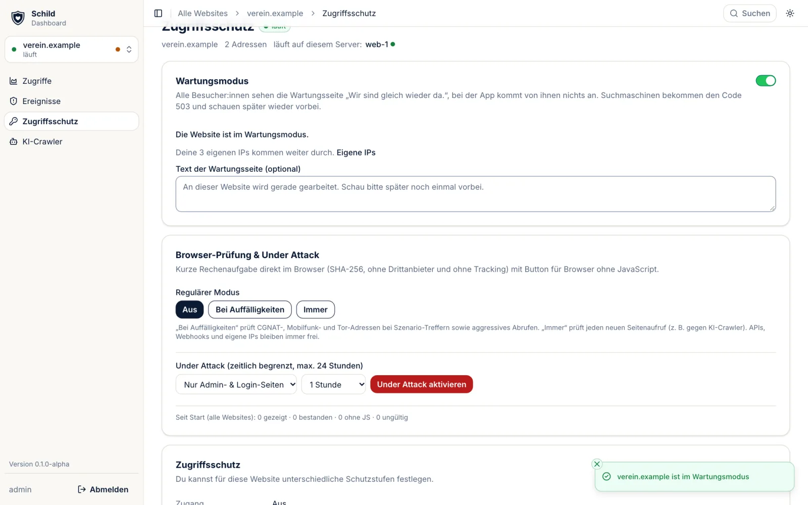

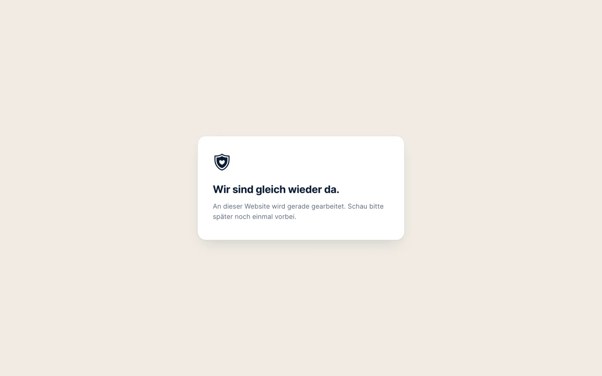

## Eigene IPs

Damit du dich nicht selbst aussperrst, schaltest du eigene Adressen frei: einzelne IPs, Bereiche oder DynDNS-Namen, dauerhaft oder befristet (24 Stunden, 7 Tage, 30 Tage). Zwei Stufen:

- **Nie sperren:** Schild prüft weiter und zeigt Treffer als „Erkannt“, sperrt aber nicht.
- **Filter überspringen:** keine Prüfung. Nur für Adressen, denen du voll vertraust, etwa dein Monitoring.

Auf der Kommandozeile schaltet `schild allow --mine` die Adresse deiner aktuellen SSH-Verbindung frei.

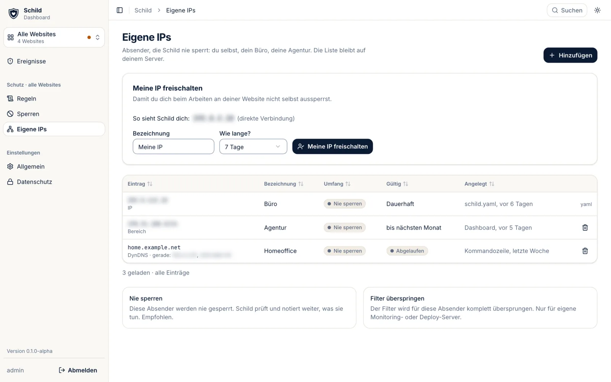

## Sperrseite und Warteseite

Eine gestoppte Anfrage bekommt eine ruhige Seite auf Deutsch mit Vorfallnummer (`XXXX-XXXX`), API-Clients eine maschinenlesbare Antwort (RFC 9457). Mit der Nummer findest du den Vorfall im Dashboard und lässt die Person mit „Durchlassen“ wieder durch, bei einer gesperrten Adresse mit „Sperre aufheben“.

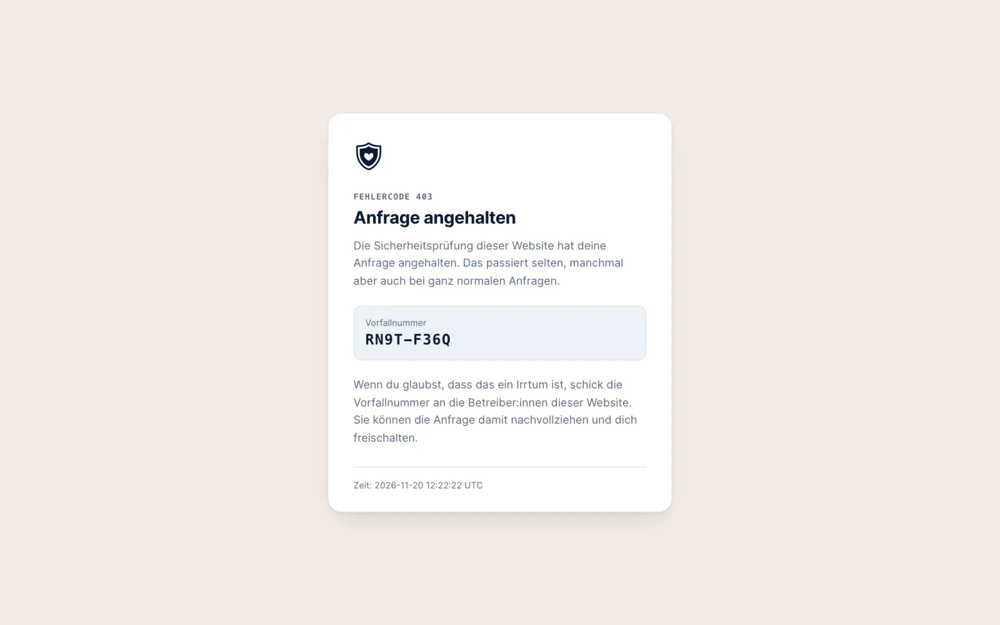

Ist Schild kurz voll ausgelastet, sehen Besucher:innen statt einer Fehlerseite eine Warteseite, die sich nach wenigen Sekunden selbst neu lädt.

## Dashboard

Das Dashboard ist im Programm eingebaut und nie öffentlich erreichbar: Es lauscht nur auf dem Server selbst (`127.0.0.1:8788`). Du kommst per SSH-Tunnel oder VPN hinein. Das erste Passwort setzt du mit einem Einmal-Code aus dem Log.

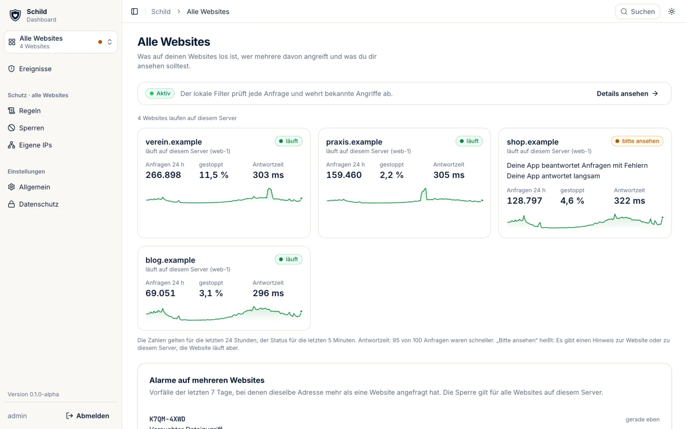

Links im Menü wählst du oben den Server, eine Website oder „Alle Websites“. Darunter stehen nur die Seiten, die dazu gehören.

| Bereich | Was du dort siehst und tust |
| --- | --- |
| Alle Websites | jede Website auf dem Server mit Zustand und Kennzahlen, Angriffsversuche auf mehrere Websites, darunter „Ereignisse“ aller Websites |
| Website › Zugriffe | die Startseite einer Website: Besucher:innen, Anfragen, gestoppte Angriffsversuche, Antwortzeit und Fehlerquote; Seiten, Länder, Browser, Mensch oder Bot und einzelne Anfragen, ab Werk bis zu 14 Tage zurück (siehe [Welche Daten wo bleiben](02-betrieb.md#welche-daten-wo-bleiben)) |
| Website › Ereignisse | jede gestoppte oder erkannte Anfrage mit Vorfallnummer, Kontext und Hinweisen auf mögliche Fehlalarme |
| Website › Zugriffsschutz, KI-Crawler | siehe oben |
| Server › Überblick, Auslastung, Server-Check | was der Server gerade tut: CPU, Arbeitsspeicher, Festplatte, Netzwerk, dazu die Befunde des Server-Checks |
| Regeln | die drei Regel-Repositories mit ihrem Schalter, jede Regel mit Zustand; darunter „Eigene & Ausnahmen“ (Ausnahmen anlegen und entfernen, Vorschläge für eng begrenzte Ausnahmen) und „Szenarien und Limits“ (mit Probelauf für Limits) |
| Sperren | jede gerade gesperrte Adresse mit Grund, Dauer und ob die Firewall sie hält; Adressen von Hand sperren (1 Stunde, 24 Stunden oder 7 Tage); die gestoppten Anfragen aller Websites mit Vorfallnummer; der Verlauf der Szenarien und Limits |
| Eigene IPs | Adressen, die Schild nie sperrt, anlegen und entfernen |
| Einstellungen › Allgemein | was Schild sperrt, die Zahlen der letzten 24 Stunden, häufigste Muster, Aufbewahrung, Passwort und die laufende Version |
| Einstellungen › Datenschutz | Daten zu einer IP-Adresse suchen, exportieren und löschen |

In jedem Ereignis, jedem Vorfall und in jeder Zeile der Listen „Ereignisse“ und „Zugriffe“ sperrst du die Adresse mit einem Klick: Adressen aus Rechenzentren für 7 Tage, alle anderen für 24 Stunden. Der Hinweis danach bietet „Rückgängig“ an. Eine andere Dauer und „Zu Eigene IPs hinzufügen“ stehen im Menü „…“ daneben.

## Traffic und Server im Blick

Schild zählt jede Anfrage, die es sieht: Besucher, Seitenaufrufe, Statuscodes, Antwortzeiten, die häufigsten Seiten, Verweise und Netzbetreiber, Länder, Browser, Geräte und Bots. Besucherzahlen sind Schätzungen mit etwa ±3 % Abweichung. Dazu misst Schild alle 10 Sekunden CPU, Arbeitsspeicher, Festplatten und Netzwerk des Servers.

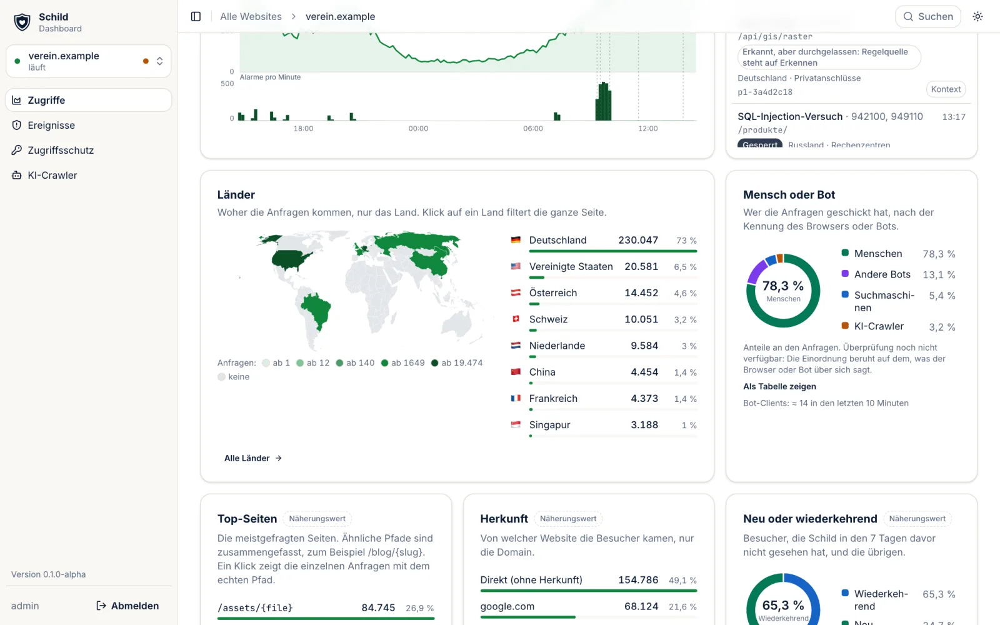

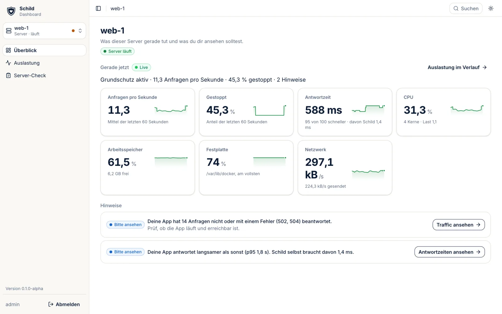

Hinweise bekommst du zum Beispiel, wenn die Festplatte in den nächsten 14 Tagen voll zu werden droht. Die Zahlen liegen in einer Datei mit fester Größenobergrenze und wachsen nicht mit dem Traffic. Es gibt kein Tracking-Skript und kein Cookie für Besucher:innen.

## Server-Check

Der Server-Check liest nur und ändert nichts. Du richtest ihn mit einem Befehl ein ([Server-Check einrichten](02-betrieb.md#server-check-einrichten)). Danach läuft er täglich oder auf Knopfdruck („Jetzt prüfen“) und prüft:

- **System:** Ende des Supports der Distribution, veralteter Kernel, ausstehende Sicherheitsupdates und andere Updates, automatische Updates, ob ein Neustart fällig ist.
- **Netz:** öffentlich erreichbare Dienste, offene Docker-API, Admin-Oberflächen, Firewall an und Standard für eingehende Verbindungen (für IPv4 und, wenn der Server eine öffentliche IPv6-Adresse hat, für IPv6), Ports, die Docker an der Firewall vorbei öffnet.
- **SSH:** Login mit Passwort, Login als root, Port, fehlgeschlagene Logins der letzten 24 Stunden.
- **Zertifikate:** Ablaufdatum.
- **Software:** PHP, Node.js, Python, Java, Webserver und Datenbanken ohne Support; Versionen von WordPress samt Plugins, TYPO3, Laravel und Nextcloud.
- **Logs:** wachsende Logdateien, fehlende oder alte Logrotation, Docker-Logs ohne Grenze.

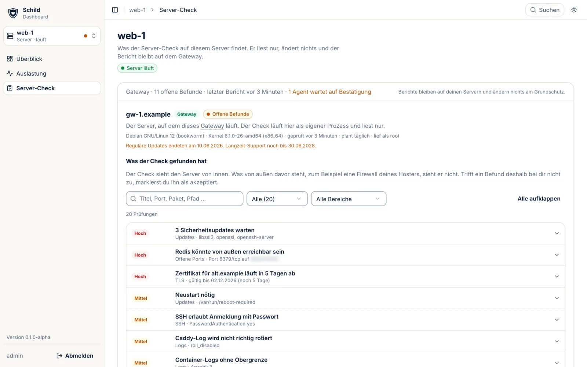

Zu jedem Befund gibt es eine Erklärung und den Befehl zum Beheben. Ausführen tust du ihn selbst.

Manche Befunde stimmen für den Server und sind für dich trotzdem in Ordnung. Ein Beispiel: Die Datenbank lauscht auf einer öffentlichen Adresse, aber die Firewall deines Hosters lässt den Port nicht durch. Die sieht der Check auf dem Server nicht. Solche Befunde markierst du im Dashboard als akzeptiert, auf Wunsch mit einer Notiz. Sie zählen dann nicht mehr als offen und bleiben unter „Akzeptiert“ sichtbar. Meldet der Check einen akzeptierten Befund später mit einer höheren Stufe, ist er wieder offen.

## Agent-API für KI-Agenten

Dein Coding-Agent kennt deine Anwendung: ihre Formulare, ihre API und was dort normale Eingaben sind. Über die Agent-API wendet er dieses Wissen auf die Firewall an. Du sagst ihm in normaler Sprache, was du brauchst, und er erledigt es mit ein paar Aufrufen. Schild bringt dafür keinen eigenen Agenten mit, du nimmst den, mit dem du ohnehin arbeitest.

So kann ein Auftrag klingen:

- „Unser neues Kontaktformular geht morgen live. Prüf, ob eine Regel es sperren würde.“
- „Beim Speichern im Editor sehen manche eine Sperrseite. Finde die Regel und schlag mir eine Ausnahme vor.“
- „Was hat die Adresse 203.0.113.7 heute gemacht?“

### Was dein Agent damit tut

- **Anfragen testen, bevor sie echt sind.** Er schickt eine Beispielanfrage, so wie dein Code sie sendet, durch die laufenden Regeln einer Website. Schild antwortet, welche Regel an welchem Feld anschlägt und ob sie sperren würde, und schlägt die passende Ausnahme gleich vor. Dabei wird nichts weitergeleitet, gezählt oder gespeichert.
- **Fehlalarme beheben.** Schild nennt die Regeln, an denen vor allem normale Besucher:innen hängen bleiben. Dein Agent sieht sich die Anfragen dazu an und legt eine [Ausnahme](#ausnahmen) an: einzelne Regeln, für ein Feld auf einer Seite einer Website. Alles andere bleibt geprüft.
- **Nachsehen, was los ist.** Status, Last, Ereignisse, Vorfälle, einzelne Anfragen und Bots, je Website. Ereignisse, Vorfälle und Anfragen nennen die IP-Adresse, solange Schild sie aufbewahrt. Dein Agent kann also sagen, was eine bestimmte Adresse gemacht hat.
- **Eine Adresse sperren.** Für eine begrenzte Zeit und mit Begründung: höchstens 24 Stunden, Adressen aus Rechenzentren höchstens 7 Tage. Aufheben kann er die Sperre auch.
- **Crawler steuern.** KI-Crawler und andere Bots je Website erlauben oder sperren, siehe [Bots und KI-Crawler](#bots-und-ki-crawler).
- **Regeln schalten.** Ein [Regel-Repository](#regeln) auf Aus, Erkennen oder Sperren stellen und einzelne Regeln ausschalten.

Lesen und testen darf jedes Token. Jede der vier schreibenden Aufgaben braucht eine eigene Berechtigung, die du beim Anlegen des Tokens vergibst. Ein Token hat genau eine davon.

### Wie sie abgesichert ist

- **Ohne Token passiert nichts.** Die Agent-API ist ab Werk an, lehnt aber jeden Aufruf ohne gültiges Token ab. Unter „Einstellungen“ im Dashboard schaltest du sie mit einem Klick aus. Steht sie in `schild.yaml` auf aus, lässt sie sich auch im Dashboard nicht einschalten.
- **Nur auf dem Server erreichbar.** Sie hört auf `127.0.0.1:8789`. Dein Agent läuft auf dem Server oder kommt per SSH-Tunnel. Eine Adresse aus deinem Netz nimmt sie nicht an.
- **Tokens entstehen nur auf dem Server** (`schild token add`). Schild zeigt ein Token einmal und speichert nur seinen Hash. Jedes läuft ab, ohne Angabe nach 90 Tagen, höchstens nach 365, und lässt sich sofort widerrufen.
- **Feste Grenzen je Token:** 120 Anfragen pro Minute, 2 gleichzeitig. Für Sperren gilt zusätzlich eine Grenze je Stunde und eine für alle laufenden Sperren zusammen. Private Adressen kann kein Agent sperren.
- **Alles ist nachvollziehbar.** Jeder Aufruf steht im Protokoll (`schild token log`). Jede Änderung braucht eine Begründung und erscheint als Ereignis mit dem Namen des Tokens im Dashboard. Ausnahmen und Sperren eines Agenten nimmst du dort wieder zurück.
- **Text von Besucher:innen ist markiert.** Pfade, User-Agents und Referrer stammen von Fremden und können Anweisungen an deinen Agenten enthalten. Die API kennzeichnet diese Felder als nicht vertrauenswürdig. Das senkt das Risiko, nimmt es aber nicht weg: Gib einem Agenten nur die Berechtigung, die er für seine Aufgabe braucht.

Was dein Agent liest, bleibt nur auf deinem Server, wenn auch sein Modell dort läuft. Nutzt er ein Modell in der Cloud, verlässt alles, was er liest, deinen Server, auch IP-Adressen.

### Einrichten

Zwei Schritte: auf dem Server ein Token anlegen und den Agenten verbinden. Die Befehle für Paket, Binary und Docker stehen unter [Agent-API einrichten](02-betrieb.md#agent-api-einrichten).

Die API beschreibt sich selbst: `/agent/v0/openapi.json` reicht deinem Agenten als Anleitung. Für Menschen steht dieselbe Beschreibung in der [API-Referenz](/api).

## Metriken und Geodaten

- **Metriken** für Prometheus unter `127.0.0.1:9101/metrics`, dazu `/healthz` und `/readyz`. Keine Besucherdaten in den Labels.
- **Geodaten:** Land und Netzbetreiber aus DB-IP Lite (CC BY 4.0) sind dabei. Wer genauere Daten will, bindet IPinfo oder MaxMind mit eigenem Zugang an. Nachgeschlagen wird immer lokal.
