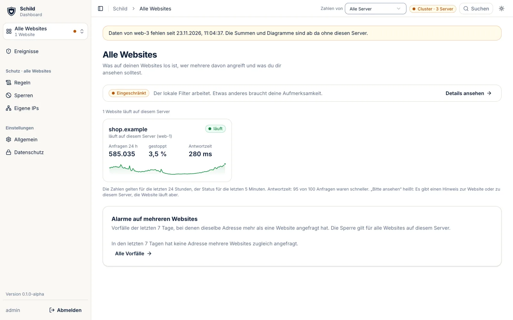

# Mehrere Gateways als Cluster betreiben

**Status:** Alpha · Stand 23.11.2026 · technische Quelle: [contracts/cluster.md](../../contracts/cluster.md)

**Gemessen** am 21. und 22.11.2026 von Mess-Agenten, die das Gateway nicht gebaut haben. Sie haben zwei bis sechzehn Gateways gemessen: mit Störungen im Netz, Abstürzen, Last, falschen Uhren, Zertifikaten hinter einem Balancer und einem Update Server für Server. Die Berichte: [Grundfunktionen](../../tests/results/MVP-27-group-measurement.md), [Härtetest](../../tests/results/MVP-27-hardening.md), Labor mit virtuellen Linux-Servern ([1](../../tests/results/MVP-27-lab.md), [2](../../tests/results/MVP-27-lab-run2.md), [3](../../tests/results/MVP-27-lab-run3.md), [4](../../tests/results/MVP-27-lab-run4.md)).

**Kurz:**

- Ein Cluster sind zwei bis sechzehn Gateways eines Betreibers, zum Beispiel hinter einem Loadbalancer. Sie teilen ihren Stand direkt untereinander. Du betreibst keine Datenbank, keinen Cache und keine Queue daneben.
- Zwei Server reichen. Fällt einer aus, arbeitet der andere mit allem weiter, was der Cluster wusste.
- Die Server teilen alles, was du im Dashboard oder über die Agent-API einstellst. Dazu kommen Sperren, Logins, Zertifikate, die Zähler von Limits und Szenarien sowie Ereignisse und Anfragen.
- Keine Anfrage wartet auf einen anderen Server. Erreicht ein Server den Cluster nicht, entscheidet er mit seinem letzten Stand.
- Ohne `cluster.enabled` ändert sich nichts. Ein einzelnes Gateway bleibt, wie es ist.

## Wofür ein Cluster gut ist

Mit einem Gateway hängt deine Website an einem Server. Mit zwei oder mehr Gateways kannst du einen Server aktualisieren oder verlieren, und die Website läuft weiter. Ein Hoster kann viele Websites hinter eine Reihe von Gateways stellen. Wächst der Traffic, nimmt er Server dazu.

Ohne Cluster arbeitet jedes Gateway für sich. Eine Sperre gilt dann nur auf einem Server, und ein Limit zählt pro Server. Besucher:innen müssen die Browser-Prüfung auf jedem Server neu bestehen.

## Was der Cluster teilt

| Was | Wie es sich verhält |
| --- | --- |
| Gesperrte Adressen | Eine Sperre aus einem Szenario, aus dem Dashboard oder von einem Agenten gilt nach etwa einer Sekunde auf jedem Server. „Freigeben“ hebt sie überall auf. Das gilt auch auf einem Server, den die Sperre beim Klick noch nicht erreicht hat. |
| Einstellungen | Alles, was du im Dashboard oder über die Agent-API einstellst, gilt auf jedem Server: Schalter der Regelquellen, Schwellen, Limits, Crawler-Regeln, Zugriffssperre, Browser-Prüfung, Ausnahmen. Das gilt auch für Einstellungen künftiger Funktionen. Diese Funktionen müssen dafür nichts tun. |
| Eigene Adressen und Freigaben | Die Liste eigener Adressen und freigegebene Absender gelten überall. Die eigene Liste eines Servers aus seiner `schild.yaml` gewinnt immer gegen eine Sperre aus dem Cluster. |
| Logins | Ein Passwort und eine Anmeldung gelten für das Dashboard jedes Servers. Agent-Tokens gelten auf allen Servern. |
| Besucher:innen | Wer die Browser-Prüfung bestanden oder sich an der Zugriffssperre angemeldet hat, bleibt das auf dem nächsten Server. |
| Zertifikate | Solange sich die Server erreichen, gibt es ein Zertifikat pro Name. Ein Server, der startet, bestellt erst, wenn er weiß, was der Cluster schon hat. Die Prüfung der Zertifizierungsstelle über HTTP landet auf einem beliebigen Server. Deshalb liegt ihr Prüfwert vorher auf jedem Server. |
| Regeln aus dem CrowdSec Hub | Lädt ein Server einen neuen Stand, übernehmen die anderen ihn von ihm. Sie prüfen ihn dabei wie einen eigenen Download. Neue Regeln sperren auf allen Servern ab demselben Zeitpunkt. Setzt du die Hub-Regeln auf einem Server zurück, folgen die anderen. Jeder verwirft dann seinen heruntergeladenen Stand und läuft mit dem Stand aus seinem Image, bis ein Server neu heruntergeladen hat. |
| Limits und Szenarien | Jeder Server meldet den anderen einmal pro Sekunde, was er gezählt hat. Ein Limit gilt damit für den Cluster und nicht pro Server. |
| Verteilte Angriffe (Wellen) | Auch die Erkennung verteilter Angriffe zählt für den Cluster. Eine Welle ist auf jedem Server dieselbe, und ihre Reaktion greift überall. „Beenden“ im Dashboard beendet sie auf allen Servern. |
| Ereignisse und Anfragen | Jeder Server hält auch die Ereignisse, Vorfälle und einzelnen Anfragen der anderen. Jedes Dashboard zeigt den ganzen Cluster. |
| Messwerte | Jeder Server hält auch die Messwerte der anderen. Zähler und Diagramme zeigen die Summe aller Server oder einen einzelnen Server (siehe [Zahlen und Diagramme im Cluster](#zahlen-und-diagramme-im-cluster)). |
| Löschung nach Art. 17 DSGVO | Schild löscht die Adresse auf jedem Server. Das gilt auch für einen Server, der gerade aus war und später zurückkommt. |

### Was bei einem Server bleibt

Ein paar Dinge beschreiben einen einzelnen Server. Deshalb teilt der Cluster sie nicht:

- `schild.yaml`, `rules.d` und dein Caddyfile bleiben Dateien deines Deployments. Du verteilst sie wie bisher auf jeden Server.
- Jeder Server prüft sich im Server-Check selbst und hat eigene Befunde. Nimmst du einen Befund hin, gilt das für diesen Server.
- Das Protokoll der Agent-Aufrufe zeigt nur die Aufrufe, die dieser Server bedient hat. Dasselbe gilt für die Angabe, wann ein Token zuletzt benutzt wurde. Was ein Agent geändert hat, steht als Ereignis auf jedem Server.
- Die Grenze für fehlgeschlagene Anmeldungen am Dashboard zählt pro Server.
- Was `schild firewall run` über die Firewall seines Hosts meldet, kennt nur das Gateway, das es gefragt hat. Deshalb steht der Zustand der Firewall in der Liste der Sperren nur auf diesem Server.
- Manche Anzeigen zeigen nur den Server, dessen Dashboard du geöffnet hast: die Werte von diesem Moment auf der Seite „Auslastung“ (Prozesse, Festplatten, Verbindungen), die Live-Ansicht im Sekundentakt und die Zähler unter „Schutzstatus“.

## So ist ein Cluster aufgebaut

**Zwei Server.** Vor den Servern steht der Loadbalancer deines Hosters oder eine Floating-IP, die zum jeweils aktiven Server zeigt. Beide Server halten den vollen Stand. Eine dritte Maschine brauchst du nicht.

**Viele Server.** Ein Loadbalancer verteilt die Verbindungen auf die Gateways. Das kann zum Beispiel HAProxy im TCP-Modus sein oder der Loadbalancer eines Cloud-Anbieters, der TLS durchreicht. TLS endet auf den Gateways. Ein Cluster nimmt höchstens 16 Gateways auf.

Schild verschiebt selbst keine IP-Adresse und ist kein Loadbalancer. Diese Aufgaben übernimmt dein Hoster, keepalived oder HAProxy.

Die Server sprechen über einen eigenen Port miteinander (`cluster.listen`). Die Verbindung ist mit TLS 1.3 verschlüsselt. Jeder Server hat einen eigenen Schlüssel, der den Server nie verlässt.

Lege diesen Port in ein privates Netz. Schild lehnt eine öffentliche Adresse dafür ab, solange du sie nicht ausdrücklich erlaubst (`cluster.allow_public_listen`). Adressen aus 100.64.0.0/10 gelten als privat. Solche Adressen vergeben Tailscale, NetBird und ähnliche Overlay-Netze.

`cluster.listen` darf auch alle Adressen binden (`0.0.0.0:8790` oder `[::]:8790`), wenn `cluster.advertise` die private Adresse nennt. Unter dieser Adresse erreichen die anderen Server diesen Server. Für `cluster.advertise` gilt dieselbe Regel wie für `cluster.listen`: eine öffentliche Adresse nur mit `cluster.allow_public_listen`.

**Uhren.** Gibt es zwei Änderungen am selben Eintrag, gilt im Cluster die spätere. Dafür brauchen die Server gleiche Uhren. Richte auf jedem Server eine Zeitsynchronisation ein, zum Beispiel chrony oder systemd-timesyncd.

## Einrichten mit einer Konfigurationsdatei

Ein Cluster entsteht allein aus der Konfiguration. Dein Deployment schreibt dieselben Dateien auf jeden Server. Einen Befehl zum Beitreten gibt es nicht.

1. Erzeuge einmal ein Cluster-Secret:

   ```bash
   schild cluster secret
   ```

   Lege es dort ab, wo dein Deployment Secrets hält.

2. Lege das Secret auf jedem Server in eine Datei. Nur der Dienst darf die Datei lesen, als Besitzer oder über seine Gruppe:

   ```bash
   sudo chown root:schild /etc/schild/cluster.secret
   sudo chmod 0640 /etc/schild/cluster.secret
   ```

   Ebenso geht `schild:schild` mit Modus 0600. Im Container läuft Schild als Benutzer 65532. Gib der Datei auf dem Host dann die Gruppe 65532 (`chown root:65532`, Modus 0640). Binde sie schreibgeschützt ein.

3. Ergänze `schild.yaml` auf jedem Server:

   ```yaml
   cluster:
     enabled: true
     listen: "10.0.0.2:8790"                  # die private Adresse dieses Servers
     secret_file: /etc/schild/cluster.secret
     peers: ["10.0.0.1:8790", "10.0.0.2:8790", "10.0.0.3:8790"]
     name_from_host: true                     # jeder Server heißt wie sein Host
   ```

   Nur `listen` unterscheidet sich von Server zu Server. Bindet `listen` alle Adressen (`0.0.0.0:8790`), unterscheidet sich stattdessen `advertise`. `peers` nennt alle Server und darf die eigene Adresse enthalten.

4. Starte Schild neu. Starte beim ersten Aufbau alle Server aus `cluster.peers`. Ein ganz neuer Cluster wird erst bereit, wenn jeder von ihnen einmal gestartet ist. Ein neuer Server, der den Cluster noch nie erreicht hat, nimmt keine Anfragen an.

Jeder Server nimmt sich beim Start selbst in den Cluster auf und findet die anderen. Die Reihenfolge ist egal.

**Namen der Server.** Mit `name_from_host: true` heißt jeder Server im Cluster nach seinem Hostnamen (der Teil vor dem ersten Punkt). So unterscheidest du die Server im Dashboard, auch wenn `node_name` in der Datei überall gleich ist. Ohne diese Zeile heißt ein Server wie sein `node_name`. Dann muss dein Deployment jedem Server einen eigenen `node_name` geben. Einen festen Namen setzt du mit `cluster.name`.

Änderst du `cluster.name`, `name_from_host` oder `node_name`, gilt der neue Name ab dem nächsten Start des Servers. Du musst den Server dafür nicht aus dem Cluster nehmen.

**Das Secret.** Das Secret lässt einen Server in den Cluster und kann sonst nichts. Wer es hat, kann einen Server aufnehmen. Behandle es deshalb wie ein Passwort.

**Kommt der Cluster nicht zustande, startet Schild nicht.** Mit `cluster.enabled: true` startet ein Server nur, wenn er sich in seinen Cluster aufnehmen kann. In diesen Fällen bricht der Start ab:

- Die Datei mit dem Secret fehlt.
- Das Secret ist zu kurz.
- Außer dem Dienst darf noch jemand die Datei lesen.
- Der Port aus `cluster.listen` ist belegt.
- Der Schlüssel des Servers ist beschädigt.
- Der Wechsel zu einem neuen Secret scheitert.

Das Log nennt den Grund. `cluster.enabled` ohne `cluster.secret_file` ist ein Fehler in der Konfiguration. So läuft kein Server allein mit eigenem Stand weiter, während du ihn im Cluster vermutest.

## Server mit unterschiedlichen Einstellungen zusammenführen

Kommt ein Server, der bisher allein lief, in einen Cluster, bringt er mit, was er hat. Seine eigenen Adressen, Freigaben, Limits und Einstellungen kommen zum Cluster dazu. Er selbst übernimmt, was der Cluster hat.

Nur wenn beide Seiten denselben Eintrag haben, gilt der Wert des Clusters. Ein Beispiel ist derselbe Schalter mit verschiedenen Werten. Den eigenen Wert des Servers bewahrt Schild auf dem Server auf. `schild cluster status` nennt ihn.

## Was der Loadbalancer braucht

**Prüfung, ob ein Server bereit ist.** Lass den Balancer `/.schild/readyz` auf den Web-Ports abfragen. Ein Server antwortet mit 503, solange er den Stand des Clusters noch nicht übernommen hat. Auch während er anhält, antwortet er mit 503.

Erreicht ein Server zehn Sekunden lang keinen anderen Server, bedient er mit dem Stand, den er hat. Das gilt nur für einen Server, der schon einmal im Cluster abgeglichen war. Ein neuer Server, der den Cluster noch nie erreicht hat, bleibt auf 503. Das ändert sich erst, wenn er einen Server erreicht, der den Stand des Clusters hat. Ein ganz neuer Cluster wird erst bereit, wenn jeder Server aus `cluster.peers` einmal gestartet ist. Starte beim ersten Mal also alle Server.

**Echte Adresse der Besucher:innen.** Hinter einem Balancer im TCP-Modus kommt die Adresse über das PROXY-Protokoll. In einem Cluster verlangt Schild dafür eine Liste erlaubter Absender im Caddyfile:

```caddyfile
{
	servers {
		listener_wrappers {
			proxy_protocol {
				allow 10.0.0.0/24
			}
			tls
		}
	}
}
```

Ohne diese Liste startet Schild in einem Cluster nicht. Sonst könnte jeder, der einen Server direkt erreicht, eine beliebige Adresse als seine ausgeben. Eine Sperre dieser Adresse gälte dann auf jedem Server.

**Die Prüfung muss sprechen wie der Traffic.** Schickt der Balancer den Traffic mit PROXY-Protokoll, muss auch seine Prüfung es senden. Sonst lehnt der Server die Prüfung ab und gilt als ausgefallen.

**Beispiel für HAProxy, Website ohne TLS auf den Gateways.** So lief der Balancer in der Messung mit zwei und mit sechzehn Servern:

```haproxy
defaults
  mode tcp
  timeout connect 2s
  timeout client 60s
  timeout server 60s

frontend web80
  bind :80
  default_backend gateways80

backend gateways80
  balance roundrobin
  option httpchk
  http-check send meth GET uri /.schild/readyz ver HTTP/1.1 hdr Host www.example.org
  http-check expect status 200
  default-server send-proxy-v2 check inter 2s fall 2 rise 2
  server web-1 10.0.0.1:80
  server web-2 10.0.0.2:80
```

Fällt ein Server hart aus, schickt HAProxy ihm noch Verbindungen, bis die Prüfung ihn herausnimmt. In der Messung dauerte das gut drei Sekunden. Mit `option redispatch` im Backend versucht HAProxy eine abgelehnte Verbindung auf einem anderen Server. Diese Zeile war in der Messung nicht gesetzt und ist deshalb nicht gemessen.

**Wenn TLS auf den Gateways endet.** Dann verhalten sich die beiden Ports verschieden:

- Port 80 leitet nur auf HTTPS um und beantwortet die Prüfung der Zertifizierungsstelle. Er nimmt kein PROXY-Protokoll an. `/.schild/readyz` beantwortet er mit einer Umleitung. Schick den Traffic dorthin ohne PROXY-Protokoll und prüfe nur, ob der Port offen ist. Ein Server, der gerade angehalten wird oder den Stand des Clusters noch nicht hat, bleibt deshalb für Port 80 im Pool. Das betrifft nur Umleitungen und die Prüfung der Zertifizierungsstelle.
- Port 443 nimmt das PROXY-Protokoll an. Die Bereitschaft gibt es nur hier, über TLS und mit dem Namen der Website. Ein neuer Server besteht diese Prüfung erst, wenn er sein Zertifikat hat. Im Cluster bekommt er es beim ersten Abgleich von den anderen.

```haproxy
backend gateways80
  balance roundrobin
  default-server check inter 1s fall 2 rise 1
  server web-1 10.0.0.1:80
  server web-2 10.0.0.2:80

backend gateways443
  balance roundrobin
  option httpchk
  http-check send meth GET uri /.schild/readyz ver HTTP/1.1 hdr Host www.example.org
  http-check expect status 200
  default-server send-proxy-v2 check check-ssl verify none check-sni www.example.org check-alpn http/1.1 inter 1s fall 2 rise 1
  server web-1 10.0.0.1:443
  server web-2 10.0.0.2:443
```

Die Zertifizierungsstelle kann einen Namen über Port 443 oder über Port 80 prüfen. Die Prüfung über Port 443 kommt hinter einem Balancer mit PROXY-Protokoll nicht an. In der Messung scheiterte sie, und der Server bestellte danach ein zweites Mal über Port 80. Schalte die Prüfung über Port 443 deshalb im Caddyfile der Website ab. Dann bleibt es bei einer Bestellung über Port 80. Mit dieser Einstellung gab es in der Messung in fünf von fünf Läufen genau eine Bestellung, auch wenn zwei Server gleichzeitig starteten:

```caddyfile
www.example.org {
	tls {
		issuer acme {
			disable_tlsalpn_challenge
		}
	}
	# ... der Rest der Website wie bisher
}
```

**Verteilung.** Verteilt der Balancer nach der Adresse der Besucher:innen, landet ein Client immer auf demselben Server. Dann zählen Limits genau. Verteilt er die Verbindungen reihum, zählen Limits mit etwa einer Sekunde Verzug.

## Den Stand prüfen

```bash
schild cluster status
```

Die Ausgabe nennt jedes Mitglied mit Rolle, Adresse, Zustand und letztem Kontakt. Dazu kommen die Zahl laufender Sperren und die Zahl geteilter Einstellungen. Die Ausgabe zeigt, was der laufende Server in den letzten fünf Sekunden festgehalten hat.

Dasselbe zeigt das Dashboard. Oben auf jeder Seite steht, ob der Server allein läuft („Einzelner Server“) oder Teil eines Clusters ist („Cluster · 3 Server“). Ein Klick darauf öffnet die Seite „Cluster“.

### Die Seite „Cluster“

Oben stehen die Summen: wie viele Server bereit sind, wie viele Anfragen der Cluster pro Sekunde bedient und wie viele Sperren laufen.

Darunter zeigt eine Karte das Internet und alle Gateways nebeneinander. Jedes Gateway ist mit dem Internet verbunden. Kein Gateway steht über einem anderen, weil der Cluster keinen Hauptserver hat. Ab neun Gateways sind die Kästen schmal und hochkant beschriftet. So passen auch 16 in eine Reihe.

Die Linie eines Gateways ist grün, wenn es Anfragen annimmt. Sie ist orange gestrichelt, wenn es gerade keine Anfragen annimmt oder von diesem Server aus nicht erreichbar ist. Ein Klick auf einen Server öffnet seine Details.


Mit sechzehn Gateways sieht die Seite so aus. web-7 ist nicht erreichbar, web-12 wird angehalten und web-15 ist noch nicht bereit:


Unter der Karte steht jedes Gateway als eigene Karte. Ab sieben Gateways steht jedes Gateway als Zeile in einer Tabelle. Die Details eines Servers nennen:

- ob er Anfragen annimmt, angehalten wird oder noch nicht bereit ist. Das ist die Antwort, die er dem Loadbalancer auf `/.schild/readyz` gibt.
- Anfragen pro Sekunde, den Anteil gestoppter Anfragen und die Antwortzeit der letzten Minute.
- CPU, Arbeitsspeicher und Festplatte. Ab 80 % wird der Balken orange, ab 95 % rot.
- Start, letzten Kontakt, Rückstand, Version, Uhr, Stand und Konfiguration.


Jeder Server meldet diese Zahlen alle fünf Sekunden an die anderen. Die Seite zeigt, was dieser Server zuletzt gehört hat, und fragt dafür keinen anderen. Erreicht er einen Server nicht, steht dort „Nicht erreichbar“ ohne Zahlen. Ob jener Server trotzdem Besucher:innen bedient, ist von hier aus nicht zu sehen. Die Zahlen dienen nur der Anzeige. Kein Server entscheidet danach.

| Anzeige | Bedeutung |
| --- | --- |
| Abgleich aktiv | Der Server erreicht alle anderen Gateways. |
| Abgleich eingeschränkt | Mindestens ein Gateway ist nicht erreichbar. Mit den übrigen läuft der Abgleich weiter. |
| Abgleich unterbrochen | Der Server erreicht kein anderes Gateway und arbeitet mit dem letzten Stand weiter. |
| Aus dem Cluster entfernt | Ein Mitglied hat dem Server gemeldet, dass er entfernt wurde. |

### Hinweise

In diesen Fällen zeigt das Dashboard jedes Servers einen Hinweis unter „Einstellungen“, mit einem Link zur Seite „Cluster“:

- Ein Server erreicht einen anderen nicht.
- Eine Konfiguration oder ein Stand weicht ab.
- Eine Uhr geht auseinander.

Die Startseite zeigt dann „Grundschutz aktiv“ mit dem Zusatz „Eingeschränkt“.


**Gleicher Stand.** Die Server prüfen gegenseitig, ob bei ihnen dasselbe gilt. Jedes Gateway bildet eine Prüfsumme über seine Sperren, Einstellungen, Freigaben und Logins. Diese Prüfsumme nennt es den anderen alle fünf Sekunden. Aus der Prüfsumme lässt sich nichts über den Inhalt lesen.

Zu jeder Prüfsumme nennt das Gateway den Stand der Einträge, auf dem es sie gebildet hat. Zwei Server vergleichen ihre Prüfsummen nur, wenn beide auf demselben Stand waren. Eine Änderung, die gerade unterwegs ist, gilt deshalb nie als Abweichung. Das gilt auch, wenn laufend Änderungen kommen, etwa viele Sperren während eines Angriffs.

Auf der Seite „Cluster“ steht bei jedem Server unter „Stand“, ob er gleich ist oder in welchem Bereich er abweicht. „Weicht ab“ heißt: Beide Server halten dieselben Einträge, und trotzdem gilt bei ihnen nicht dasselbe. Manchmal lassen sich zwei Server eine Minute lang nicht vergleichen, weil ohne Pause Änderungen kamen oder einer zurückliegt. Dann steht dort „unbekannt“.

Bleibt eine Abweichung 30 Sekunden stehen, erscheint ein Hinweis. Der Server gleicht dann von selbst neu ab: Er fragt den anderen Server noch einmal nach allem und wendet den Stand des Clusters erneut an. Das geschieht höchstens einmal pro Minute. Bleibt der Hinweis stehen, nennt das Server-Log den Grund. Ein Beispiel ist eine Einstellung, die nicht zur `schild.yaml` dieses Servers passt.

**Unterschiedliche Konfiguration.** Jedes Gateway nennt den anderen alle fünf Sekunden eine Prüfsumme seiner Konfiguration. Sie umfasst `schild.yaml` ohne `node_name`, `cluster.name`, `cluster.listen` und `cluster.advertise`, dazu `rules.d`. Das Caddyfile geht in die Prüfsumme noch nicht ein. Weicht ein Server ab, steht das in seiner Karte und als Hinweis. Schild verteilt keine Konfiguration. Das bleibt Aufgabe deines Deployments.

**Uhren.** Jedes Gateway nennt den anderen alle fünf Sekunden seine Uhrzeit. Auf der Seite „Cluster“ steht bei jedem Server, wie weit seine Uhr von der Uhr dieses Servers abweicht. Ab fünf Sekunden Abstand nennt `schild cluster status` den Server. Stellt ein Server einen Eintrag wegen der Uhr zurück, schreibt er das in sein Log. Ab zehn Sekunden erscheint ein Hinweis. Einen Eintrag, dessen Uhrzeit mehr als 60 Sekunden voraus liegt, nimmt kein Server an.

**Ein Server mit falscher Uhr nimmt keine Anfragen mehr an.** Ist sich die Mehrheit der Server über die Uhrzeit einig, mindestens zwei, und weicht die Uhr eines Servers um eine Minute oder mehr davon ab, meldet er sich als nicht bereit. In der Messung mit drei Servern dauerte das etwa vier Sekunden. Der Loadbalancer schickt ihm dann nichts mehr. Das steht als Hinweis in seinem Dashboard, in `schild cluster status` und im Log. Sobald die Uhr stimmt, nimmt er von selbst wieder Anfragen an.

Bei nur zwei Servern kann keiner wissen, wessen Uhr falsch geht. Dann bedienen beide weiter, und das Dashboard nennt den Abstand.

In der Liste gesperrter Adressen steht bei jeder Sperre, welcher Server sie entschieden hat. Löschst du unter „Datenschutz“ eine Adresse, nennt das Dashboard die Server, die die Löschung schon erreicht hat. Es nennt auch die Server, bei denen sie noch aussteht.

## Zahlen und Diagramme im Cluster

Jeder Server hält auch die Messwerte der anderen. Deshalb zeigen Zähler und Diagramme auf jedem Dashboard die Summe aller Server: Anfragen, gestoppte Anfragen, Antwortzeiten, die Ranglisten nach Pfad, Land oder Netz.

Oben auf jeder Seite steht der Filter „Zahlen von“. Die Vorgabe ist „Alle Server“. Wählst du einen Server, zeigen Zähler und Diagramme nur diesen Server. Das geht auch für einen Server, der gerade aus ist: Seine Werte bis zum Ausfall liegen auf den anderen Servern. Die Listen der Ereignisse und Anfragen zeigen immer alle Server.

Liegt von einem Server seit 30 Sekunden nichts vor, fehlen seine Werte ab diesem Zeitpunkt. Das Dashboard nennt den Server und die Uhrzeit: „Daten von web-3 fehlen seit …“. Die Summen sind ab da ohne diesen Server.



Die Messwerte der anderen Server liegen im Datenverzeichnis unter `metrics-nodes`, eine Datei je Server. Für sie gelten dieselben Fristen wie für die eigenen Messwerte (`monitoring.keep`). Jede dieser Dateien kann so groß werden wie die eigene `metrics.db`. In der Messung mit sechzehn Servern belegten die Messwerte der fünfzehn anderen nach zehn Minuten zusammen 28,5 MiB. Nimmst du einen Server aus dem Cluster, löschen die anderen seine Messwerte.

## Was ein Server beim Start übernimmt

Ein Server, der startet oder zurückkommt, holt zuerst Sperren, Einstellungen, eigene Adressen, Logins und Löschungen. Danach übernimmt er von einem anderen Server die laufenden Zähler:

- wie viel jeder Client von einem Limit verbraucht hat,
- was die Szenarien in ihren Zeitfenstern gezählt haben,
- was die Erkennung verteilter Angriffe gelernt hat.

Erst dann meldet er sich beim Balancer als bereit. Fehlt einem Client also noch ein Fehlversuch bis zur Sperre, gilt er auch auf dem frisch gestarteten Server als kurz vor der Sperre. In der Messung galt ein Limit von 60 Anfragen. Mit einem Neustart mittendrin griff das Limit hinter dem Balancer bei 57 bis 61 Anfragen, ohne Neustart bei 60 bis 62.

Gelingt die Übernahme der Zähler nach drei Versuchen nicht, bedient der Server trotzdem. Seine Zähler beginnen dann bei null, und sein Dashboard zeigt einen Hinweis. Sperren, Einstellungen und Logins hat er in jedem Fall.

Ereignisse und Vorfälle der anderen folgen in den Sekunden nach dem Start. Die einzelnen Anfragen, die die anderen inzwischen bedient haben, holt der Server im Hintergrund nach. Das geschieht von selbst, egal wie lange er weg war. Du musst nichts anstoßen.

**Nach mehr als 30 Tagen.** War ein Server länger als 30 Tage ohne Kontakt zum Cluster, übernimmt er beim nächsten Start den Stand des Clusters wie ein neuer Server. Was er vorher allein hielt, gibt er nicht noch einmal weiter. Logins, Sitzungen und Einträge, die der Cluster in dieser Zeit gelöscht hat, bleiben gelöscht.

## Wenn ein Server ausfällt

- Verbindungen, die auf dem ausgefallenen Server endeten, brechen ab. Anfragen, die dort gerade liefen, schlagen fehl. Kein Loadbalancer und kein Proxy kann eine laufende TLS-Verbindung auf einen anderen Server umziehen.
- Neue Verbindungen gehen an die anderen Server, sobald der Balancer den Ausfall bemerkt.
- Die anderen Server bemerken einen Ausfall sofort, einen hängenden Server nach etwa drei Sekunden.
- Sperren, Einstellungen, Logins und Zertifikate liegen auf jedem Server. Es geht nichts verloren.
- Die anderen Server zeigen weiter an, was der ausgefallene Server an Ereignissen und Vorfällen geschrieben hat, bis auf die letzte Sekunde vor dem Ausfall.

## Einen Server geplant anhalten

Für ein Update oder eine Wartung hältst du einen Server so an:

```bash
schild cluster drain
```

Der Server antwortet dem Balancer sofort mit 503. Noch 15 Sekunden lang bedient er, was ankommt. So schickt der Balancer neue Verbindungen woanders hin, bevor der Server eine einzige abweist.

Ein Balancer im TCP-Modus lässt offene Verbindungen aber auf ihrem Server. Deshalb bittet der Server in diesen 15 Sekunden mit jeder Antwort darum, die Verbindung zu schließen (`Connection: close`, bei HTTP/2 ein GOAWAY). Ein Client, der danach eine neue Verbindung öffnet, landet auf einem anderen Server. Ein Client, der die Bitte übergeht, verliert seine nächste Anfrage auf dieser Verbindung. Eine Verbindung, auf der in dieser Zeit keine Anfrage kommt, endet mit dem Server.

Dann hält Schild an und gibt laufenden Anfragen 30 Sekunden, um fertig zu werden. `systemctl stop schild` macht dasselbe. Nach der Wartung startest du den Server mit `systemctl start schild` wieder.

Beide Zeiten stellst du unter `cluster.drain` ein (`delay_s`, `grace_s`). `delay_s` sollte länger sein als das Prüfintervall deines Balancers mal die Zahl der Fehlversuche, nach denen er einen Server herausnimmt.

**Zeit zum Anhalten.** Ein Stopp dauert `delay_s` plus `grace_s`, in der Vorgabe also 15 plus 30 Sekunden. Dazu kommt das Herunterfahren. So lange muss systemd oder Docker warten, sonst beenden sie Schild mittendrin:

- Die mitgelieferte systemd-Unit wartet 90 Sekunden (`TimeoutStopSec=90s`).
- Docker wartet von sich aus nur 10 Sekunden. Setze in `compose.yaml` beim Dienst `schild` die Zeile `stop_grace_period: 90s`. Die Beispiele aus dieser Anleitung haben diese Zeile schon. Ohne Compose hältst du den Container mit `docker stop -t 90 schild` an.

Stellst du `delay_s` oder `grace_s` höher, gib systemd und Docker entsprechend mehr Zeit.

## Einen Server aus dem Cluster nehmen

1. Nimm den Server zuerst aus dem Loadbalancer, oder halte ihn mit `schild cluster drain` an.
2. Nimm ihn auf einem Server heraus, der im Cluster bleibt:

   ```bash
   schild cluster remove web-3
   ```

   Tragen zwei Server denselben Namen, nennst du statt des Namens die Kennung aus `schild cluster status`.

   Meldet der Befehl einen Fehler, ist der Server noch Mitglied. Das passiert, wenn der Server gerade selbst etwas geschrieben hat und seine Uhr vorgeht. Prüf dann die Uhren und ruf den Befehl noch einmal auf.

3. Setze bei ihm `cluster.enabled: false`, oder lass ihn aus.

Danach spricht kein Mitglied mehr mit diesem Server. Keines nimmt an, was er noch schickt, auch wenn er das Cluster-Secret hat. Seine Adresse aus `cluster.peers` fragen die anderen nicht mehr jede Sekunde. Streiche sie beim nächsten Deployment trotzdem aus `cluster.peers`.

Läuft der entfernte Server noch, erfährt er davon und schreibt es in sein Log. Er bedient mit seinem letzten Stand weiter und antwortet auf `/.schild/readyz` weiter mit 200. Ein Balancer, der ihn noch im Pool hat, schickt ihm also weiter Besucher:innen. Deshalb kommt Schritt 1 zuerst.

**Einen entfernten Server zurückholen.** Mit seinem alten Schlüssel kommt ein entfernter Server nicht wieder hinein. So holst du ihn zurück:

1. Halte ihn an.
2. Lösche sein Cluster-Verzeichnis. Das ist `cluster` im Datenverzeichnis, meist `/var/lib/schild/cluster`, im Container im Volume des Datenverzeichnisses.
3. Starte ihn mit `cluster.enabled: true` und dem Secret.

Er legt einen neuen Schlüssel an und kommt wie ein neuer Server in den Cluster.

**Eine Maschine unter derselben Adresse neu aufsetzen.** Nimm den alten Server zuerst mit `schild cluster remove` aus dem Cluster. Starte dann den neuen.

## Das Cluster-Secret wechseln

Ist das Cluster-Secret bekannt geworden, ersetzt du es. Wer das alte Secret hat, kommt danach nicht mehr in den Cluster.

1. Erzeuge ein neues Secret mit `schild cluster secret`.
2. Schreibe es auf jedem Server in die Datei aus `cluster.secret_file`.
3. Starte die Server nacheinander neu.

Mehr ist nicht zu tun. Du löschst kein Verzeichnis.

Ein Server, der mit dem neuen Secret startet, wechselt von selbst in den neuen Cluster. Er behält seinen Schlüssel und nimmt mit, was er im alten Cluster hielt: laufende Sperren und Freigaben, Einstellungen, eigene Adressen, Logins, Löschungen nach Art. 17, Zertifikate und den Stand der Aufgaben. Das alte Verzeichnis legt er daneben ab (`cluster.replaced-<Zeit>`). Die zwei neuesten bleiben liegen, ältere räumt er weg.

Während des Wechsels gibt es zwei Cluster nebeneinander. Die Server, die schon neu gestartet sind, bilden den neuen Cluster, die übrigen den alten. Die beiden Cluster tauschen nichts aus. Das hat vier Folgen:

- Setzt du in dieser Zeit eine Sperre oder Einstellung auf einem Server des alten Clusters, gilt sie im neuen erst, wenn dieser Server folgt. Er bringt sie dann mit.
- Ändern beide Seiten denselben Eintrag, gilt am Ende die spätere Änderung. Eine Freigabe schlägt die ältere Sperre, eine Löschung bleibt eine Löschung.
- Limits und Szenarien zählen in dieser Zeit je Cluster, nicht über alle Server.
- Der erste Server im neuen Cluster wartet bis zu zehn Sekunden auf die anderen, bevor er sich als bereit meldet. Die Dashboards zeigen die Server des jeweils anderen Clusters als nicht erreichbar.

Halte den Wechsel deshalb kurz, am besten wenige Minuten.

**Nach einem Leck.** Mit dem alten Secret konnte jemand einen eigenen Server in den Cluster bringen. Was ein solcher Server als Mitglied geschrieben hat, zieht beim Wechsel mit in den neuen Cluster, etwa ein Login, ein Agent-Token oder eine Freigabe. Prüfe deshalb nach dem Wechsel im Dashboard:

- die Logins,
- die Agent-Tokens,
- die Zugriffsregeln: Freigaben, eigene Adressen und die Zugriffssperre.

Was du nicht kennst, löschst du.

Wer im alten Cluster entfernt war und das neue Secret bekommt, ist im neuen Cluster wieder Mitglied. Er bringt aber nichts mit. Gib einem Server, der draußen bleiben soll, das neue Secret nicht.

Fehlt die Datei, ist das Secret zu kurz oder darf die Datei außer dem Dienst noch jemand lesen, startet der Server nicht. Das gilt auch, wenn der Wechsel in den neuen Cluster scheitert. Das Log nennt den Grund.

## Aufgaben, die nur einmal laufen dürfen

Manche Aufgaben sollen im Cluster einmal laufen und nicht einmal pro Server. Ein Beispiel ist das Erneuern der Schlüssel der Browser-Prüfung. Dafür gibt es keinen Hauptserver. Die Aufgabe übernimmt jeweils der erreichbare Server mit der kleinsten Kennung. Fällt er aus, übernimmt der nächste von selbst.

Jeder Server weiß, was eine Aufgabe schon erledigt hat: wann sie zuletzt gestartet ist, für welchen Zeitraum sie läuft, ob sie fertig wurde und welche einzelnen Schritte erledigt sind. Daraus folgt:

- Ein Server, der übernimmt oder neu startet, führt eine fertige Aufgabe nicht noch einmal aus.
- Bricht eine Aufgabe mittendrin ab, weil der Server ausfällt oder ein Schritt fehlschlägt, nimmt der zuständige Server sie nach einer Wartezeit wieder auf. Er erledigt dann nur die Schritte, die noch fehlen. Die Wartezeit beträgt zwei Minuten, wenn die Aufgabe nichts anderes festlegt.
- Eine Aufgabe mit fester Uhrzeit läuft in der Zeitzone, die du einstellst, auch über die Zeitumstellung hinweg. Eine Uhrzeit, die es an einem Tag nicht gibt, fällt auf die nächste Minute, die es gibt. Eine Uhrzeit, die es zweimal gibt, zählt einmal.
- War zur fälligen Zeit kein Server in Betrieb, läuft die Aufgabe einmal nach. Das geschieht, sobald wieder ein Server läuft und der Zeitraum noch der aktuelle ist. Ältere Zeiträume holt Schild nicht nach.
- Änderst du die Uhrzeit einer Aufgabe, läuft sie für einen Tag, an dem sie schon gelaufen ist, kein zweites Mal.

Nach einem Ausfall oder während einer Netztrennung kann sich ein Schritt wiederholen. Bisher gibt es nur eine Aufgabe, den Wechsel der Schlüssel der Browser-Prüfung. Für sie spielt das keine Rolle.

Die ersten Schlüssel der Browser-Prüfung in einem neuen Cluster sind ein Sonderfall. Jeder Server erzeugt beim ersten Start eigene Schlüssel und arbeitet zunächst damit. Für den Cluster gibt nur ein Server seine Schlüssel weiter: der erreichbare Server mit der kleinsten Kennung, nachdem er das drei Sekunden lang war. Die anderen übernehmen diese Schlüssel. Sieht ein Server zehn Sekunden lang keine Schlüssel des Clusters, gibt er seine eigenen weiter.

In einem neuen Cluster ist die Browser-Prüfung noch für keine Website eingeschaltet. Deshalb bemerkt in diesen Sekunden niemand etwas.

Ein einzelnes Gateway führt dieselben Aufgaben nach denselben Regeln aus. Deshalb erneuert es die Schlüssel der Browser-Prüfung jetzt auch im laufenden Betrieb und nicht mehr nur beim Start.

## Daten und Datenschutz

Ein Cluster ist ein Betreiber. In einem Cluster hält jeder Server auch die Ereignisse und Anfragen der anderen, mit den Adressen der Besucher:innen. Diese Daten reisen nur zwischen deinen eigenen Servern, über die verschlüsselte Verbindung des Clusters. Nenne in deiner Datenschutzerklärung jeden Server als Ort der Verarbeitung.

Jeder Server wendet seine eigenen Aufbewahrungsfristen und Größengrenzen auf alles an, was er hält. Eine Löschung nach Art. 17 gilt auf jedem Server.

Jeder Server speichert damit, was der ganze Cluster aufzeichnet. Das lässt sich nicht abschalten, weil alle Server denselben Stand haben sollen. Plane den Speicherplatz jedes Servers für die Daten des ganzen Clusters. Ein Beispiel: Eine Obergrenze reicht einem einzelnen Gateway für zwei Tage. Bei zehn Servern mit gleichem Traffic ist sie nach etwa fünf Stunden erreicht.

## Grenzen

- **Dieselbe Einstellung auf zwei Servern.** Änderst du denselben Schalter gleichzeitig auf zwei Servern, gilt überall die spätere Änderung. Verschiedene Einträge derselben Liste bleiben beide erhalten.
- **Limits über alle Server.** Bis die Server voneinander wissen, vergeht bis zu eine Sekunde. Ein Client, der seine Anfragen über alle Server verteilt, kommt in dieser Sekunde etwas über ein Limit hinaus.
- **Zahlen der anderen Server.** Diagramme zeigen die anderen Server mit etwa 10 bis 20 Sekunden Verzug. Besucherzahlen über mehrere Server sind eine Untergrenze, weil dieselbe Person mehrere Server erreicht haben kann.
- **Uhren.** Halte die Uhren mit NTP synchron. Geht die Uhr eines Servers eine Minute oder mehr falsch, nimmt er sich selbst aus dem Traffic, sobald es mindestens drei Server sind und die Mehrheit sich über die Uhrzeit einig ist.
- **Firewall hinter dem Loadbalancer.** Hinter einem Loadbalancer mit PROXY-Protokoll kommen alle Pakete von ihm. `schild firewall run` auf einem Gateway kann gesperrte Adressen dort nicht verwerfen. Die Gateways weisen gesperrte Adressen selbst ab. Den Aufbau der Verbindung tragen sie dabei noch, bei HTTPS auch den TLS-Handshake.
- **Höchstens 16 Gateways.** Einen 17. Server lehnt der Cluster ab.

## Befehle

| Befehl | Was er tut |
| --- | --- |
| `schild cluster secret` | Gibt ein neues Cluster-Secret aus. |
| `schild cluster status` | Zeigt Mitglieder, letzten Kontakt und den geteilten Stand. |
| `schild cluster drain` | Nimmt diesen Server aus dem Traffic und hält ihn an. |
| `schild cluster remove NODE` | Beendet die Mitgliedschaft eines Servers, genannt mit Name oder Kennung. |
